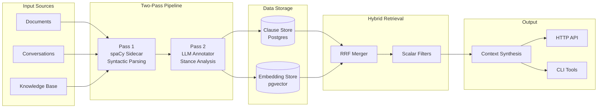

The SFL Engine is a sophisticated Ruby application designed to protect Retrieval-Augmented Generation (RAG) pipelines from context poisoning by separating what text says from how it says it. Think of it as a linguistic firewall for AI systems — it analyzes incoming text, extracts the actual facts from the persuasive language wrapping them, and filters out manipulative framing before that information reaches your language model.

Sources: [README.md](README.md#L1-L40)

## What Problem Does It Solve?

Standard RAG systems retrieve text by semantic similarity and feed it directly to language models. This creates a critical vulnerability: adversarial content can smuggle persuasive techniques, emotional manipulation, and false certainty into the context window alongside legitimate facts. The model has no structural way to distinguish "this migration is failing" (factual claim) from "every expert agrees" (social proof manipulation).

The SFL Engine solves this by applying Systemic Functional Linguistics (SFL) theory to separate two simultaneous layers of meaning that every clause carries:

- **Ideational Payload** — the actual content: what happened, who did what to whom, what processes occurred
- **Interpersonal Payload** — the rhetorical stance: how certain something sounds, what tone it uses, what persuasion tactics it employs

These payloads get stored independently, making it possible to retrieve facts while filtering out unwanted rhetorical characteristics.

Sources: [README.md](README.md#L12-L52)

## High-Level Architecture

The engine implements a two-pass annotation pipeline that processes raw text through deterministic parsing and LLM-based analysis before storing results in a hybrid database with vector search capabilities.



Sources: [docs/architecture-diagrams.md](docs/architecture-diagrams.md#L9-L21), [lib/sfl/core/pipeline.rb](lib/sfl/core/pipeline.rb#L18-L58)

## How It Works: The Two-Pass Pipeline

The core innovation is a deterministic two-stage annotation process that separates syntactic analysis (what the sentence structure is) from semantic interpretation (what the stance and meaning are).

### Pass 1: Syntactic Parsing (Deterministic)

A Python spaCy sidecar process receives raw text through a line-delimited JSON protocol and returns detailed syntactic information for each sentence. This pass is completely deterministic — no LLM involved, making it fast and predictable. It extracts:

- Token-level information (text, lemma, part-of-speech)
- Dependency relationships between words
- Sentence structure and clause boundaries
- Process types (material, mental, relational, verbal actions)
- Participant roles (who did what to whom)

The rule-based `IdeationalExtractor` maps dependency labels onto SFL categories, producing the **Ideational Payload** for each clause.

Sources: [sidecar/README.md](sidecar/README.md#L1-L20), [lib/sfl/core/pass_one/ideational_extractor.rb](lib/sfl/core/pass_one/ideational_extractor.rb#L1-L30)

### Pass 2: LLM Annotation (Semantic)

An LLM annotator takes the syntactic clause plus its Ideational payload and produces the **Interpersonal Payload**:

- **Mood** — declarative, interrogative, imperative, or exclamative
- **Modality Weight** — 0.0 to 1.0 scalar representing epistemic certainty
- **Tenor Value** — 0.0 to 1.0 scalar representing formality and social distance
- **Speaker Attitude** — classification of stance (social proof, authority appeal, emotional, neutral)
- **Reasoning Trace** — structured audit trail for high-stakes annotations

This pass leverages configurable LLM models through the DSPy framework, allowing customization per task without changing the pipeline structure.

Sources: [lib/sfl/core/types/interpersonal_payload.rb](lib/sfl/core/types/interpersonal_payload.rb#L1-L23), [Gemfile](Gemfile#L40-L48)

## Key Features at a Glance

| Feature | Description | Beginner Value |
|---------|-------------|----------------|
| **Multi-Source Support** | Analyzes conversations, documentation, and knowledge bases through unified pipeline | One tool for different text types |
| **CLI Interface** | `sfl-analyze` for local processing and experimentation | Easy to try without running a server |
| **HTTP API** | Roda-based REST API for integration into larger systems | Works with any programming language |
| **Hybrid Retrieval** | Combines vector similarity search with keyword search via Reciprocal Rank Fusion | Better relevance than either alone |
| **Scalar Stance Filters** | Filter results by mood, tenor, modality, and process type | Precise control over context composition |
| **Human Review Queues** | Built-in workflows for content and annotation review | Quality control for production use |
| **Golden Master Tests** | Deterministic integration tests comparing output against known-good baselines | Confidence in refactoring |

Sources: [README.md](README.md#L60-L90), [app/sfl.rb](app/sfl.rb#L1-L30), [exe/sfl-analyze](exe/sfl-analyze#L1-L18)

## Project Structure

The codebase follows a Ports and Adapters (Hexagonal) architecture pattern, keeping the domain logic pure and isolated from infrastructure concerns.

```
sfl-engine/
├── app/
│   ├── sfl.rb              # Roda application entry point
│   ├── routes/             # HTTP API endpoints
│   └── config/             # Configuration management
├── lib/sfl/
│   ├── analysis/           # Domain analysis engines (conversation, docs, KB)
│   ├── api/                # HTTP API implementation
│   ├── cli/                # Command-line interface
│   ├── core/               # Pure domain logic and types
│   │   ├── pass_one/       # Syntactic parsing (spaCy integration)
│   │   ├── ports/          # Interface definitions
│   │   ├── types/          # Domain data structures
│   │   └── pipeline.rb     # Two-pass orchestration
│   ├── ingest/             # Text ingestion and parsing
│   ├── llm/                # LLM integration and annotators
│   ├── retrieval/          # Hybrid search implementation
│   └── store/              # Database repositories
├── exe/
│   ├── sfl-analyze         # CLI entry point
│   ├── sfl-api             # HTTP API server
│   ├── sfl-review          # Review queue interface
│   └── sfl-tui             # Terminal UI interface
├── spec/                   # Comprehensive test suite
├── db/                     # Database migrations and seeds
└── sidecar/                # Python spaCy sidecar process
```

Sources: [lib/sfl.rb](lib/sfl.rb#L1-L49), [lib/sfl/core/](lib/sfl/core/), [docs/architecture-diagrams.md](docs/architecture-diagrams.md#L40-L70)

## Getting Started Options

The engine provides multiple ways to interact with it, depending on your needs:

| Interface | When to Use | Command |
|-----------|-------------|---------|
| **CLI** | Local development, experimentation, batch processing | `bundle exec sfl-analyze` |
| **HTTP API** | Integration into web applications, microservices | `bundle exec sfl-api` |
| **Review UI** | Quality control, annotation auditing | `bundle exec sfl-review` |
| **Terminal UI** | Interactive exploration and debugging | `bundle exec sfl-tui` |

All interfaces share the same underlying pipeline and data model — they're just different ways to access the same functionality.

Sources: [exe/sfl-analyze](exe/sfl-analyze#L1-L18), [exe/sfl-api](exe/sfl-api#L1-L24)

## What Makes This Different

Unlike standard RAG systems or NLP pipelines, the SFL Engine treats linguistic metadata as first-class data rather than annotation tags. This architectural decision enables capabilities that are difficult or impossible with conventional approaches:

- **Stance-Filtered Retrieval** — Retrieve facts while excluding manipulative framing patterns
- **Cognitive Distortion Detection** — Apply CBT-inspired filters to identify logical fallacies
- **Scalar Query Constraints** — Filter by continuous values like certainty and formality
- **Reproducible Annotations** — SHA-256 hashes over reasoning traces for audit trails
- **Multi-Source Aggregation** — Analyze conversations, docs, and knowledge bases with one system

These capabilities stem from the fundamental insight that fact and interpretation are separable at the data layer, not just at the prompt level.

Sources: [docs/introduction.md](docs/introduction.md#L54-L90), [README.md](README.md#L52-L80)

## Next Steps

Now that you understand the high-level purpose and architecture of the SFL Engine, here are recommended paths for deeper learning:

**If you want to try it quickly:**
- [Quick Start](2-quick-start) — Get the engine running with sample data in minutes

**If you're setting up a development environment:**
- [Docker Compose Setup](3-docker-compose-setup) — Run the full stack with containers
- [Environment Configuration](4-environment-configuration) — Configure providers and settings

**If you want to understand the theory:**
- [Systemic Functional Linguistics Concepts](6-systemic-functional-linguistics-concepts) — Learn the linguistic framework powering the engine

**If you're interested in architecture:**
- [Two-Pass Pipeline Architecture](7-two-pass-pipeline-architecture) — Deep dive into the core annotation pipeline
- [Hexagonal Architecture Pattern](8-hexagonal-architecture-pattern) — Understand the ports and adapters design

**If you're building on top of the engine:**
- [CLI Usage](23-cli-usage) — Learn command-line interface patterns
- [HTTP API Reference](24-http-api-reference) — Explore REST endpoints