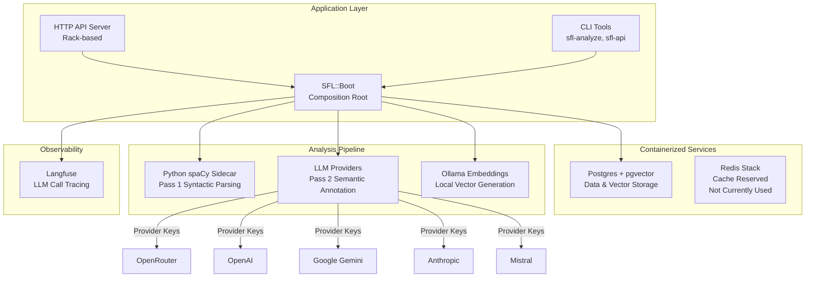

SFL Engine integrates multiple external services and subsystems to provide a complete linguistic analysis pipeline. The architecture follows a composition root pattern where all external dependencies are wired together through the `SFL::Boot` module, ensuring clear boundaries and testable interfaces.

## Service Architecture Overview

The ecosystem comprises containerized infrastructure services, language model providers, observability systems, and specialized NLP components:

Sources: [docker-compose.yml](docker-compose.yml#L1-L104), [lib/sfl/boot.rb](lib/sfl/boot.rb#L1-L261)

## Containerized Infrastructure

### Postgres with pgvector

Postgres serves as the primary data store for both relational data and vector embeddings. The container uses the `pgvector/pgvector:0.8.6-pg16` image and exposes port 5433 on localhost to avoid conflicts with system Postgres instances. The database handles three critical functions:

- **Clause storage**: Syntactic and semantic annotation results
- **Vector embeddings**: 768-dimensional vectors for semantic similarity search
- **Review queues**: Human annotation workflows and quality control

The `pgvector` extension enables cosine similarity searches within the database, allowing SFL Engine to perform hybrid retrieval combining keyword search and vector similarity without requiring a separate vector database service. Sources: [docker-compose.yml](docker-compose.yml#L4-L30), [lib/sfl/store/pg_embedding_store.rb](lib/sfl/store/pg_embedding_store.rb#L1-L80)

### Redis Stack

Redis Stack is provisioned in the Docker Compose configuration but currently serves as a reserved infrastructure component. The system currently uses file-based caching through `SFL::Core::Ports::FileCache` for Pass 2 annotation results, which provides persistence across process runs without requiring an external cache service. RedisInsight is available on port 8001 for future administrative needs. Sources: [docker-compose.yml](docker-compose.yml#L32-L45), [lib/sfl/core/ports/file_cache.rb](lib/sfl/core/ports/file_cache.rb#L1-L75)

### Docker Services Management

The `SFL::DockerServices` module provides best-effort auto-starting of infrastructure services. It executes `docker compose up -d --wait` when `SFL_AUTO_START_DOCKER=1` is set in the environment. The implementation includes multiple safety guards:

- Checks for Docker Compose plugin installation
- Verifies Docker daemon reachability
- Silent no-op behavior if Docker is unavailable
- Explicit opt-in to avoid automatic service management in production deployments

Sources: [lib/sfl/docker_services.rb](lib/sfl/docker_services.rb#L1-L52)

## Python spaCy Sidecar

Pass 1 syntactic parsing executes in a separate Python process to eliminate GIL/GVL deadlock risks that existed in the legacy in-process PyCall architecture. The sidecar communicates with the Ruby process over a line-delimited JSON protocol on stdin/stdout:

**Protocol Messages**:
- Startup: `{"type": "ready", "model": "<name>"}`
- Request: `{"id": "<uuid>", "text": "<str>", "document_id": "<str>"}`
- Response: `{"id": "<uuid>", "clauses": [...]}`
- Error: `{"error": "<message>"}`

The sidecar implementation fixes a critical head-index resolution bug from the legacy code. The previous implementation used text-based hash lookups (`local_idx[token.head.text]`), causing all duplicate words in a sentence to resolve to the first occurrence. The sidecar uses spaCy's native positional indexing (`token.head.i - sent.start`), making text-lookup failures structurally impossible. Sources: [sidecar/README.md](sidecar/README.md#L1-L62), [lib/sfl/core/pass_one/spacy_sidecar_parser.rb](lib/sfl/core/pass_one/spacy_sidecar_parser.rb#L1-L162), [sidecar/spacy_sidecar.py](sidecar/spacy_sidecar.py#L1-L50)

### Vendored Python Environment

The `bin/setup-python` script provisions a vendored Python interpreter in `.sfl-python/python/` to ensure consistent spaCy availability across development environments. The sidecar subprocess uses `PYTHONPATH` pointed to this directory. The spaCy model defaults to `en_core_web_sm` but is configurable via the `SPACY_MODEL` environment variable. Sources: [lib/sfl/boot.rb](lib/sfl/boot.rb#L246-L257), [sidecar/README.md](sidecar/README.md#L18-L25)

## LLM Provider Integration

### Multi-Provider Architecture

SFL Engine supports multiple LLM providers through a unified `LLM::Config` interface. Each pipeline task can independently specify its provider and model via environment variables following the pattern `SFL_TASK_<TASK_NAME>_{MODEL,PROVIDER,TEMPERATURE}`:

| Provider | API Key Environment Variable | Use Case |
|----------|------------------------------|----------|
| OpenRouter | `OPENROUTER_API_KEY` | Default Pass 2 annotation |
| OpenAI | `OPENAI_API_KEY` | GPT models |
| Google Gemini | `GOOGLE_API_KEY` | Gemini models |
| Anthropic | `ANTHROPIC_API_KEY` | Claude models |
| Mistral | `MISTRAL_API_KEY` | Mistral models |
| Ollama | None (local only) | Embeddings and local inference |

The composition root validates all required API keys at startup, raising `SFL::Boot::Error` if any configured provider's key is missing. Sources: [lib/sfl/boot.rb](lib/sfl/boot.rb#L18-L44), [lib/sfl/boot.rb](lib/sfl/boot.rb#L153-L163)

### Task-Specific Configuration

Different pipeline tasks use different default providers and models:

- **Pass 2 annotation**: Defaults to OpenRouter (`:openrouter`)
- **Pass 2 batch annotation**: Inherits from Pass 2 annotation
- **Context synthesis**: Inherits Pass 2 annotation defaults (trusted starting point)
- **Embedding**: Defaults to Ollama (`:ollama`) with `embeddinggemma:latest` model
- **Ingest classification**: Inherits embedding defaults (cheapest configured task)
- **Loader drafting**: Inherits Pass 2 annotation defaults (strongest general-purpose task)

This configuration flexibility allows operators to use expensive models for critical tasks while reserving cheaper local models for high-volume operations like embedding generation. Sources: [lib/sfl/boot.rb](lib/sfl/boot.rb#L70-L98), [.env.example](.env.example#L1-L9)

## Ollama Embedding Integration

The `LLM::Embedder` class provides a native Net::HTTP adapter for Ollama's embedding API, eliminating dependency on the RubyLLM gem. It calls the `/api/embed` endpoint directly, supporting both single-text and batch embedding operations:

**Configuration parameters**:
- `model`: Embedding model identifier (e.g., `embeddinggemma:latest`)
- `ollama_base_url`: Base URL (defaults to `http://tinybot:11434`)
- `breaker`: Circuit breaker instance for fault tolerance
- `timeout`: Timeout in seconds (configurable via `SFL_EMBEDDING_TIMEOUT_SECONDS`)

The embedder validates vector dimensions (768) before insertion to Postgres, ensuring alignment with the database schema. This prevents configuration mismatches where a user might select a 1024-dimension model like `mistral-embed` against a schema defined for 768-dimension vectors. Sources: [lib/sfl/llm/embedder.rb](lib/sfl/llm/embedder.rb#L1-L127), [lib/sfl/store/pg_embedding_store.rb](lib/sfl/store/pg_embedding_store.rb#L40-L55)

## Observability Integration

### Langfuse Tracing

LLM call tracing integrates through the `dspy-o11y-langfuse` gem, configured explicitly by `SFL::Boot` rather than through implicit require-time environment variable reads. This approach replaces the legacy pattern where tracing configuration happened at gem load time, causing race conditions and difficult-to-debug initialization errors.

**Tracing configuration process**:
1. Check for required environment variables (`LANGFUSE_HOST`, `LANGFUSE_PUBLIC_KEY`, `LANGFUSE_SECRET_KEY`)
2. Perform TCP reachability probe to the Langfuse endpoint
3. If unreachable and TTY is attached, prompt operator to continue without tracing
4. Only configure tracing if endpoint is reachable or operator explicitly opts out

The reachability check uses a 2-second TCP connection timeout and provides clear warning messages when the endpoint is unavailable. Sources: [lib/sfl/boot/langfuse_reachability.rb](lib/sfl/boot/langfuse_reachability.rb#L1-L72), [lib/sfl/llm/tracing.rb](lib/sfl/llm/tracing.rb#L1-L23), [lib/sfl/boot.rb](lib/sfl/boot.rb#L197-L219)

## Database Integration

### Connection Management

Database connections are established through `SFL::Store::Database.connect`, which uses Sequel to create a connection pool from the `DATABASE_URL` environment variable. The connection process includes:

- URL validation (raises `SFL::Boot::Error` if unset)
- Extension setup (`pgvector` and `uuid-ossp`)
- Connection pool configuration
- Transaction management for idempotent operations

The test suite uses a dedicated `sfl_engine_v2_test` database created automatically by the Docker init script, ensuring test isolation from development data. Sources: [lib/sfl/boot.rb](lib/sfl/boot.rb#L221-L237), [docker/init-test-db.sql](docker/init-test-db.sql#L1-L7)

### Vector Storage Integration

The `PgEmbeddingStore` implements the `Core::Ports::EmbeddingStore` interface, providing vector storage through pgvector. Key features include:

- **Idempotent document replacement**: Deletes and re-inserts vectors within a single transaction
- **Model versioning**: Stores model identifier alongside vectors for multi-model scenarios
- **Failed embedding tracking**: Updates `clauses.embedding_status` to track success/failure per clause
- **Dimension validation**: Ensures vectors match schema expectations before insertion

The store maintains a unique constraint on `(clause_id, model)`, preventing duplicate vectors for the same clause from the same embedding model. Sources: [lib/sfl/store/pg_embedding_store.rb](lib/sfl/store/pg_embedding_store.rb#L1-L80)

## HTTP API Deployment

The containerized API service provides a deployable HTTP interface for programmatic access to SFL Engine capabilities. The `sfl-api` container:

- Exposes port 3001 on localhost
- Depends on healthy Postgres and Redis services
- Includes spaCy pre-installed for Pass 1 parsing
- Configures service discovery via Docker DNS names (not host port remaps)
- Disables Docker auto-start within the container to prevent recursive execution

The API server provides endpoints for compilation, retrieval, synthesis, clause management, and review queues. CORS origins are configurable via `SFL_API_CORS_ORIGINS` environment variable. Sources: [docker-compose.yml](docker-compose.yml#L56-L94), [lib/sfl/api/server.rb](lib/sfl/api/server.rb#L1-L80), [lib/sfl/api/context.rb](lib/sfl/api/context.rb#L1-L84)

## Environment Configuration

All ecosystem integrations are configured through environment variables, following the twelve-factor app methodology. Key configuration categories include:

**Infrastructure**:
- `DATABASE_URL`: Postgres connection string
- `SFL_AUTO_START_DOCKER`: Enable automatic Docker Compose startup (1 or 0)

**LLM Providers**:
- `OPENROUTER_API_KEY`, `OPENAI_API_KEY`, `GOOGLE_API_KEY`, `ANTHROPIC_API_KEY`, `MISTRAL_API_KEY`
- `OLLAMA_BASE_URL`: Local Ollama endpoint (default: `http://tinybot:11434`)

**Task Configuration**:
- `SFL_TASK_PASS_TWO_ANNOTATION_{MODEL,PROVIDER,TEMPERATURE}`
- `SFL_TASK_EMBEDDING_MODEL`: Embedding model name
- `SFL_TASK_CONTEXT_SYNTHESIS_{MODEL,PROVIDER}`

**Observability**:
- `LANGFUSE_HOST`, `LANGFUSE_PUBLIC_KEY`, `LANGFUSE_SECRET_KEY`

**Python Sidecar**:
- `SPACY_MODEL`: spaCy model name (default: `en_core_web_sm`)

The `SFL::Boot` module loads `.env` files at startup if `RACK_ENV` is not set to production, allowing environment-specific overrides without committing secrets to version control. Sources: [lib/sfl/boot.rb](lib/sfl/boot.rb#L46-L68), [.env.example](.env.example#L1-L9), [lib/sfl/boot.rb](lib/sfl/boot.rb#L166-L177)

## Composition Root Pattern

All ecosystem integrations are wired together through `SFL::Boot`, which serves as the composition root for the entire application. This pattern ensures:

- **Single responsibility**: Boot is the only module that reads environment variables
- **Dependency injection**: All collaborators receive configuration via constructor parameters
- **Testability**: External dependencies can be replaced with doubles in test suites
- **Clear failure modes**: Configuration errors surface immediately at startup

The `Boot::Result` object contains fully-wired collaborators that both the CLI and HTTP API consume, guaranteeing consistent behavior across different execution contexts. Sources: [lib/sfl/boot.rb](lib/sfl/boot.rb#L1-L261), [lib/sfl/api/context.rb](lib/sfl/api/context.rb#L1-L84)