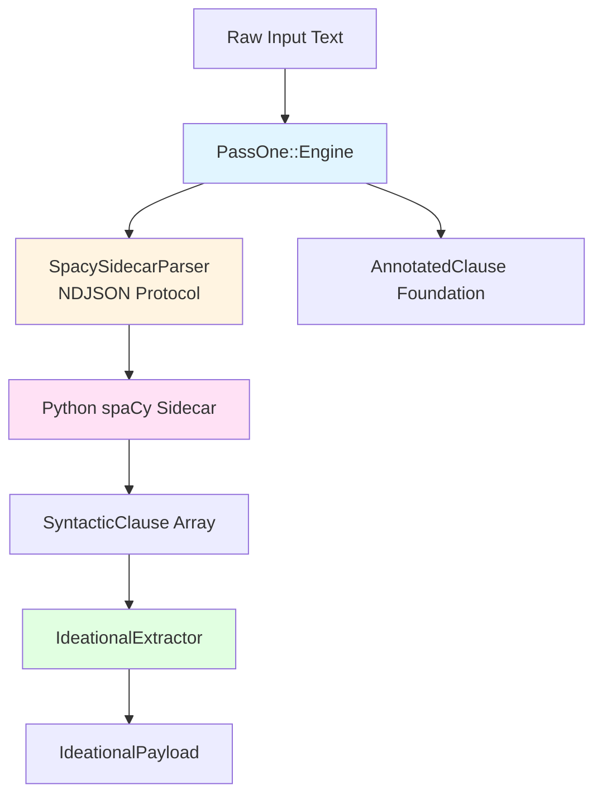

Pass 1: Syntactic Parsing is the foundational stage in the two-pass pipeline architecture, responsible for transforming raw text into structured syntactic clauses decorated with ideational metafunction information. This deterministic rule-based process extracts grammatical structure, identifies process types, maps participant roles, and builds complete dependency trees—providing the necessary foundation for Pass 2's LLM-powered interpersonal and textual analysis.

## Architecture Overview

Pass 1 operates as a clean separation of concerns between a Ruby orchestration layer and a Python spaCy sidecar process. The Ruby side manages instrumentation, error handling, and retry logic, while delegating the computationally intensive NLP work to a subprocess that never shares memory with the Ruby interpreter. This architecture eliminates the legacy PyCall-in-process hazards including the GC.start workaround, GIL/GVL deadlock risks, and Sidekiq concurrency ceilings.



The flow begins with raw text entering `PassOne::Engine`, which validates input and delegates parsing to an injected `SyntacticParser` port implementation. The production `SpacySidecarParser` communicates with a Python subprocess over NDJSON on stdin/stdout, receiving structured clause data in return. Each `SyntacticClause` is then processed by `IdeationalExtractor`, which maps dependency structures to Systemic Functional Linguistics (SFL) ideational metafunction categories without requiring LLM inference.

Sources: [lib/sfl/core/pass_one/engine.rb](lib/sfl/core/pass_one/engine.rb#L1-L63), [lib/sfl/core/pass_one/spacy_sidecar_parser.rb](lib/sfl/core/pass_one/spacy_sidecar_parser.rb#L1-L162)

## Core Components

### PassOne::Engine

The `PassOne::Engine` class serves as the primary use-case orchestrator for syntactic parsing, implementing a guard clause for empty input, wrapping operations in instrumentation spans, and translating exceptions into domain-specific errors. This class owns only the orchestration concerns—actual parsing logic lives entirely in the injected `SyntacticParser` port, allowing test doubles and alternative implementations without touching this file.

The engine's `#process` method accepts raw text and an optional document identifier, returning an array of `SyntacticClause` objects. Empty or whitespace-only inputs are handled gracefully with an empty array response. All operations are wrapped in instrumentation for observability, with timing metrics logged on completion. Exception handling ensures that both domain-specific `PassOne::Error` and unexpected errors are caught, logged, and re-raised with appropriate context.

Sources: [lib/sfl/core/pass_one/engine.rb](lib/sfl/core/pass_one/engine.rb#L1-L63)

### SpacySidecarParser

`SpacySidecarParser` implements the `SyntacticParser` port by communicating with a Python spaCy sidecar process via NDJSON on stdin/stdout. This adapter spawns a subprocess using a configurable command—defaulting to `python3 sidecar/spacy_sidecar.py --model <model>`—and maintains persistent stdin/stdout pipes for the lifetime of the parser instance.

The subprocess isolation provides critical benefits: the Ruby process never touches the Python interpreter directly, eliminating memory sharing, GIL/GVL deadlock risks, and the need for manual GC sweeps. The parser includes built-in resilience with a single crash-and-retry mechanism—if the sidecar process crashes, it restarts automatically and replays the request exactly once before surfacing permanent failures.

Communication follows a simple request-response protocol: the Ruby side writes a JSON object containing an `id`, `text`, and optional `document_id`; the Python side responds with a JSON object containing the same `id` and a `clauses` array, or an `error` field if parsing failed. This NDJSON protocol allows any process that speaks the same format to serve as a parser—not just the local Python sidecar.

Sources: [lib/sfl/core/pass_one/spacy_sidecar_parser.rb](lib/sfl/core/pass_one/spacy_sidecar_parser.rb#L1-L162), [sidecar/spacy_sidecar.py](sidecar/spacy_sidecar.py#L1-L114)

### IdeationalExtractor

`IdeationalExtractor` performs rule-based mapping from spaCy's dependency structures to SFL ideational metafunction categories, operating entirely on the syntactic output from the parser without LLM inference. This component transforms grammatical information into linguistic metafunction data by identifying process types, participant roles, and circumstantial adjuncts.

The extractor classifies processes into six SFL categories: material, mental, relational, verbal, behavioral, and existential. Classification uses a combination of POS tag indicators (e.g., VB-tagged verbs default to material), verb lemma lists for specific process types (e.g., "think", "believe" for mental processes), and special pattern detection for existential clauses beginning with "there" followed by existence verbs like "exist" or "be".

Participants are extracted by mapping spaCy dependency labels to semantic roles. For example, `nsubj` dependencies become "Actor" participants, `dobj` becomes "Goal", and `iobj` becomes "Recipient". Circumstances include adverbial modifiers, prepositional modifiers, and other adjuncts, stored as dependency-label:text pairs. The raw transitivity data preserves the complete dependency tree structure for potential downstream analysis.

Sources: [lib/sfl/core/pass_one/ideational_extractor.rb](lib/sfl/core/pass_one/ideational_extractor.rb#L1-L154), [spec/core/pass_one/ideational_extractor_spec.rb](spec/core/pass_one/ideational_extractor_spec.rb#L1-L122)

## Data Structures

### SyntacticClause

`SyntacticClause` represents a single clause with complete syntactic tree information from Pass 1. Each clause includes a unique identifier, the original text, an ordered array of tokens, optional syntactic groups, the index of the root token, the sentence position, and optional document and parent clause identifiers.

The clause structure supports hierarchical relationships through the `parent_clause_id` attribute, enabling nested or chunked clause representations where some clauses are children of others. A `readability` attribute is added later in the pipeline by the readability scorer, providing metrics for text complexity analysis.

Sources: [lib/sfl/core/types/syntactic_clause.rb](lib/sfl/core/types/syntactic_clause.rb#L1-L24)

### SyntacticToken

`SyntacticToken` encapsulates detailed grammatical annotations for each word in a clause, sourced directly from spaCy's linguistic analysis. Each token includes the original text, its lemma (base form), coarse-grained part-of-speech tag (e.g., "VERB", "NOUN"), fine-grained tag (e.g., "VBG", "NNP"), dependency relation to its head (e.g., "nsubj", "ROOT"), the index of the head token, morphological features as a hash, and the token's position index within the sentence.

The head_index uses sentence-local positioning—calculated as `token.head.i - sent.start` in the sidecar—which resolves a critical bug from the legacy implementation where repeated words would incorrectly resolve to the first occurrence rather than the correct head. This positional approach eliminates text-based lookup entirely.

Sources: [lib/sfl/core/types/syntactic_token.rb](lib/sfl/core/types/syntactic_token.rb#L1-L20), [sidecar/README.md](sidecar/README.md#L50-L62)

### IdeationalPayload

`IdeationalPayload` contains the SFL ideational metafunction information extracted from syntactic structures. This payload includes the clause identifier, classified process type, array of participant objects (each with role and text), array of circumstances (stored as "dependency:text" strings), and the raw transitivity hash preserving the complete dependency parse for reference.

The process type uses the `ProcessType` enum defined in the types system, ensuring only valid SFL process categories are represented. Participants and circumstances provide the semantic role information needed for understanding the transitivity structure of each clause.

Sources: [lib/sfl/core/types/ideational_payload.rb](lib/sfl/core/types/ideational_payload.rb#L1-L17)

## Process Type Classification

Process classification follows a deterministic hierarchy with specific priority rules. Mental verbs are checked first using a lemma list including "think", "know", "believe", "understand", "feel", and similar cognitive verbs. Relational verbs are checked second, including copular verbs like "be", "seem", "become", "appear", "remain", and sensory verbs like "look", "sound", "taste", "smell".

Verbal processes come third, covering speech acts with verbs like "say", "tell", "speak", "ask", "answer", "declare", "announce", "report", and similar communication verbs. Behavioral processes represent physiological or behavioral actions with verbs like "breathe", "smile", "sneeze", "cry", "laugh", "watch", "listen", "cough", and "sleep".

Existential processes require special pattern detection—the clause must begin with "there" (case-insensitive) and use an existential verb like "be" or "exist". Any verb not matching these specific lists defaults to material classification, which is the appropriate fallback for action verbs.

The implementation intentionally prioritizes specific verb lists over POS tag indicators, ensuring that "be" in a relational context (e.g., "She is happy") is classified as relational rather than existential, even though "be" appears in both verb lists. This decision preserves existing behavior from the legacy implementation.

Sources: [lib/sfl/core/pass_one/ideational_extractor.rb](lib/sfl/core/pass_one/ideational_extractor.rb#L30-L70), [spec/core/pass_one/ideational_extractor_spec.rb](spec/core/pass_one/ideational_extractor_spec.rb#L47-L90)

## Pipeline Integration

Pass 1 integrates into the broader pipeline as the first stage in a monadic composition chain. The `Core::Pipeline` class injects a `PassOne::Engine` instance during initialization and calls its `#process` method within the `#parse` private method, wrapping the result in a dry-monads `Success` object or converting exceptions into `Failure` objects tagged with `:pass_one_failed`.

This monadic structure ensures that Pass 1 failures short-circuit the entire pipeline—ideational extraction, Pass 2 annotation, persistence, and embedding are all skipped if syntactic parsing fails. The pipeline provides a `pass_one_only` option that skips Pass 2 entirely, useful for documentation golden master testing and scenarios where only syntactic and ideational information is needed.

After successful parsing, the pipeline pairs each `SyntacticClause` with its extracted `IdeationalPayload` before passing to subsequent stages. This pairing preserves the connection between syntactic structure and ideational meaning throughout the remainder of the analysis.

Sources: [lib/sfl/core/pipeline.rb](lib/sfl/core/pipeline.rb#L1-L200), [spec/core/pipeline_spec.rb](spec/core/pipeline_spec.rb#L1-L150)

## Python Sidecar Setup and Deployment

The Python sidecar can be run in two deployment modes: directly on the host system for development, or within a Docker container for production isolation. Both approaches use the identical NDJSON protocol—the Ruby parser has no awareness of which transport launched the subprocess.

### Local Development Setup

For local development, install spaCy globally and download a model:

```bash
pip install spacy
python3 -m spacy download en_core_web_sm
```

The parser then defaults to invoking `python3 sidecar/spacy_sidecar.py --model en_core_web_sm`. This approach requires manual environment management and is suitable for development scenarios where system Python packages are acceptable.

### Vendored Python Environment

The recommended production approach uses a self-contained Python environment provisioned under the application's own directory. Running `bin/setup-python` provisions Python 3.12 (by default), installs spaCy and dependencies into `.sfl-python/python`, and downloads the specified model using the `uv` package manager.

This vendored approach provides several advantages: exact version pinning avoids compatibility issues, self-containment prevents conflicts with host system packages, and the `PYTHONPATH` configuration ensures the sidecar uses only the vendored dependencies. The interpreter path is written to `.sfl-python/interpreter_path` and read by `Boot.resolve_pass1_command` at runtime to construct the appropriate invocation command.

Sources: [sidecar/README.md](sidecar/README.md#L1-L62), [bin/setup-python](bin/setup-python#L1-L133), [lib/sfl/boot.rb](lib/sfl/boot.rb#L238-L261)

### Docker Deployment

For containerized deployments, build the sidecar image and invoke it via Docker:

```bash
docker build -t sfl-spacy-sidecar sidecar/
```

Then configure the parser with an explicit command:

```ruby
SFL::Core::PassOne::SpacySidecarParser.new(
  model: "en_core_web_sm",
  command: ["docker", "run", "-i", "--rm", "sfl-spacy-sidecar", "--model", "en_core_web_sm"]
)
```

The API Dockerfile bakes spaCy directly into the container's system Python rather than running a separate sidecar container, avoiding the need for Docker-in-Docker access that would complicate the deployment topology.

Sources: [sidecar/README.md](sidecar/README.md#L19-L49), [docs/architecture-diagrams.md](docs/architecture-diagrams.md#L1-L115)

## Configuration Options

Pass 1 configuration is managed through the `Boot` composition root, which reads environment variables and constructs the appropriate parser instance. The spaCy model name defaults to "en_core_web_sm" but can be overridden via the `SPACY_MODEL` environment variable.

The Python interpreter and command are resolved by `Boot.resolve_pass1_command`, which checks for the vendored interpreter at `.sfl-python/interpreter_path`. If present, it constructs a command using that interpreter; otherwise, it returns `nil` and lets the parser fall back to the default `python3` command. The vendored environment's `PYTHONPATH` is set to `.sfl-python/python` to ensure the sidecar imports the vendored spaCy installation rather than any system installation.

For Docker deployments, the command can be explicitly provided to the parser constructor, overriding all default resolution logic. This flexibility allows the same parser class to work with local Python, vendored Python, or containerized Python without code changes.

Sources: [lib/sfl/boot.rb](lib/sfl/boot.rb#L30-L100), [lib/sfl/boot.rb](lib/sfl/boot.rb#L238-L261)

## Error Handling and Resilience

Pass 1 implements multiple layers of error handling to ensure robust operation. The `PassOne::Engine` catches both domain-specific `PassOne::Error` exceptions and unexpected errors, logging failure context with document identifiers before re-raising a standardized error message.

The `SpacySidecarParser` includes transport-level resilience with a single crash-and-retry mechanism. If the sidecar process crashes during a request (indicated by `Errno::EPIPE`, `IOError`, or `SidecarError`), the parser restarts the subprocess and replays the request exactly once. A second crash on the retry surfaces as a permanent error rather than looping indefinitely.

The Python sidecar itself is designed to never crash on malformed input—malformed JSON or parsing errors are returned as error responses rather than exceptions, ensuring that a single bad request cannot take down the entire sidecar process. This defensive programming creates a fault-isolated boundary where client errors don't affect service availability.

Sources: [lib/sfl/core/pass_one/engine.rb](lib/sfl/core/pass_one/engine.rb#L20-L35), [lib/sfl/core/pass_one/spacy_sidecar_parser.rb](lib/sfl/core/pass_one/spacy_sidecar_parser.rb#L87-L112), [sidecar/spacy_sidecar.py](sidecar/spacy_sidecar.py#L88-L104)

## Next Steps

After understanding Pass 1's syntactic parsing and ideational extraction, the natural next step is to explore [Pass 2: LLM Annotation](12-pass-2-llm-annotation), which builds upon the syntactic and ideational foundation to add interpersonal and textual metafunction annotations through LLM inference. For understanding how these two passes are orchestrated together, see [Core Pipeline Orchestration](13-core-pipeline-orchestration).

Those interested in the broader architectural context should review [Two-Pass Pipeline Architecture](7-two-pass-pipeline-architecture) for the complete pipeline design, and [Systemic Functional Linguistics Concepts](6-systemic-functional-linguistics-concepts) for the linguistic theory underlying the ideational, interpersonal, and textual metafunctions.