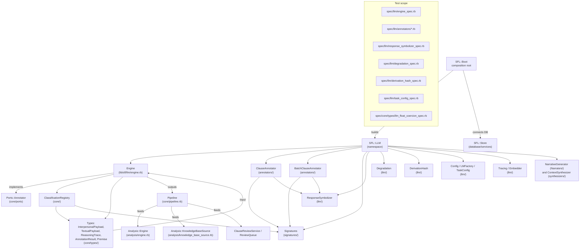

Pass 2 is the semantic-annotation stage of the two-pass SFL compiler. It takes the syntactic clauses produced by Pass 1 (via the spaCy sidecar) and the ideational payloads they carry, then sends each clause to a large language model constrained by a structured-output signature. The engine maps those structures onto the SFL interpersonal metafunction (mood, modality, tenor, speaker attitude, reasoning trace) and the textual metafunction (theme type, thematic elements, rheme), returning an `AnnotationResult` that is consumed by the pipeline, quality scoring, review queues, and downstream analysis.

This page documents the architecture, contracts, degradation path, and data model of Pass 2. Code references use the format `[filename](relative/path#L<start>-L<end>)`.

## Architectural Overview

Pass 2 is built around a single provider per `SFL::LLM::Engine` instance. It replaced the legacy DSPy-based `PassTwoEngine` (track decision 7) and the quarantined GEB sprint jobs (track decision 12). The engine has no provider-fallback chain and no rolling-synthesis machinery. Each annotation is protected by a circuit breaker; transient failures are retried with exponential backoff up to `MAX_ATTEMPTS = 3`; non-retryable failures (400/401/403/404, schema rejection, a bug in the codebase) fail fast and are never laundered into a fallback annotation.

**Pass 2 component roles and their implementation locations:**

| Component | Role | File |
|---|---|---|
| `SFL::LLM::Engine` | Bounded-retry orchestrator; contract rejection; Per-clause fallback provenance | `lib/sfl/llm/engine.rb` |
| `SFL::LLM::Annotators::ClauseAnnotator` | Single-clause LLM call (DSPy `Predict` + `ClauseAnnotationSignature`) | `lib/sfl/llm/annotators/clause_annotator.rb` |
| `SFL::LLM::Annotators::BatchClauseAnnotator` | One LLM call for many clauses (DSPy `Predict` + `BatchClauseAnnotationSignature`) | `lib/sfl/llm/annotators/batch_clause_annotator.rb` |
| `SFL::LLM::Signatures::ClauseAnnotationSignature` | Structured-output contract for single-clause annotation | `lib/sfl/llm/signatures/clause_annotation_signature.rb` |
| `SFL::LLM::Signatures::BatchClauseAnnotationSignature` | Structured-output contract for batched annotation | `lib/sfl/llm/signatures/batch_clause_annotation_signature.rb` |
| `SFL::LLM::ResponseSymbolizer` | Converts ruby_llm's string-keyed Hash to symbols end-to-end | `lib/sfl/llm/response_symbolizer.rb` |
| `SFL::LLM::Degradation` | Truthful default payloads (`annotation_source: "fallback"`) | `lib/sfl/llm/degradation.rb` |
| `SFL::LLM::DerivationHash` | SHA256 over premises/inference_rule/conclusion to verify reasoning provenance | `lib/sfl/llm/derivation_hash.rb` |
| `SFL::LLM::LMFactory` | Resolves provider/model/task config from `SFL_TASK_*` env vars | `lib/sfl/llm/lm_factory.rb` |
| `SFL::LLM::Config` / `TaskConfig` | Per-task provider, model, temperature | `lib/sfl/llm/config.rb` |
| `SFL::Core::Ports::Annotator` | Port contract; implementations never depend on ruby_llm directly | `lib/sfl/core/ports/annotator.rb` |
| `SFL::Core::ClassificationRegistry` | Canonical mood/theme_type + fuzzy alias resolution | `lib/sfl/core/classification_registry.rb` |

**Data flow through Pass 2:**

```mermaid
flowchart LR
  P1["Pass 1: Syntactic Parser\n(spaCy sidecar)"] -->|SyntacticClause + IdeationalPayload| E["SFL::LLM::Engine"]
  E -->|build_context| CA["ClauseAnnotator\n(DSPy Predict)"]
  E -->|build_context (batch)| BA["BatchClauseAnnotator\n(DSPy Predict)"]
  CA -->|raw Hash| RS["ResponseSymbolizer"]
  BA -->|raw Hash| RS
  RS -->|symbolized fields| E
  E -->|interpersonal| IP["InterpersonalPayload"]
  E -->|textual| TP["TextualPayload"]
  E -->|reasoning trace| RT["ReasoningTrace\n(derivation_hash)"]
  IP --> R["AnnotationResult"]
  TP --> R
  RT --> R
  R --> P2["Pipeline / Analysis / KB / Review"]
```

Sources: `lib/sfl/llm/engine.rb` `lib/sfl/llm/annotators/clause_annotator.rb` `lib/sfl/llm/annotators/batch_clause_annotator.rb` `lib/sfl/llm/signatures/clause_annotation_signature.rb` `lib/sfl/llm/signatures/batch_clause_annotation_signature.rb` `lib/sfl/core/ports/annotator.rb`

## The Engine: Contract Rejection and Bounded Retry

The heart of Pass 2 is `SFL::LLM::Engine` [lib/sfl/llm/engine.rb]. Its `#annotate` method never silently clamps out-of-range values. If an LLM returns a `modality_weight` of 5.0 or a `tenor` of 2.0, the Dry::Struct coercion fails in `interpersonal_from`, the engine logs a WARN warning that the value violates its contract, and substitutes a truthful fallback via `Degradation.default_interpersonal`. The clause's actual mood/tenor/modality are preserved; only the provenance label changes to `annotation_source: "fallback"`.

**Retry policy** [lib/sfl/llm/engine.rb]:

- `MAX_ATTEMPTS = 3`, `BASE_BACKOFF_SECONDS = 0.5` (exponential: 0.5s, 1.0s, 2.0s).
- Retryable HTTP statuses: `[408, 409, 425, 429, 500, 502, 503, 504]`.
- Retryable errors: `Timeout::Error`, `IOError`, `SystemCallError`.
- Non-retryable: all `PROGRAMMER_ERRORS` (`NameError`, `ArgumentError`, `TypeError`, `KeyError`), `Dry::Struct::Error`, and any error with an unrecognized status.

The batch path (`#annotate_batch`) is logically identical per clause but makes one LLM call for all clauses. If the batch call itself fails after all retries, every clause in the batch defaults to `fallback` with the cause named in each clause's `reasoning` field. Coverage is always logged: a total batch failure is an ERROR at log level, a partial failure is a WARN with the exact missing indices [lib/sfl/llm/engine.rb].

**Resilience patterns in the engine:**

| Pattern | Implementation |
|---|---|
| Bounded retry with exponential backoff | `with_retries` + `retryable?` + `sleeper` injection |
| Circuit breaking | `@breaker.call("pass_two.annotate")` wrapped around every provider call |
| Contract rejection (F6/D9) | Dry::Struct coercion on `modality_weight`, `tenor`, `Premise#value`; `nil` returned on violation, never a clamp |
| Truthful fallback provenance | `Degradation.default_interpersonal(clause_id, reason:)` labels `annotation_source: "fallback"` |
| Partial-coverage reporting | `log_batch_coverage` distinguishes 100% failure (ERROR) from partial (WARN) with `missing indices` |
| Programmer-error isolation | `rescue *PROGRAMMER_ERRORS` re-raises; a typo in `build_context` cannot become a fallback annotation |

Sources: `lib/sfl/llm/engine.rb` `lib/sfl/llm/degradation.rb` `lib/sfl/core/ports/annotator.rb` `spec/llm/engine_spec.rb`

## Pass 2 Contracts: Signatures and Ports

### `SFL::LLM::Signatures::ClauseAnnotationSignature`

This is the structured-output contract for a single-clause Pass 2 annotation. It replaces the legacy DSPy `SFLSignature` output block (track decision 7). Enums are sourced from `SFL::Core::ClassificationRegistry` so the schema and the normalization dimension can never drift apart. Numeric ranges (`modality_weight`, `tenor`) are declared as hard schema constraints (0.0–1.0) rather than guessed-at post hoc; an out-of-range value is a contract violation the engine rejects and degrades from, not a value to silently rescale.

The signature defines an `IndexedAnnotation` T::Struct with the following fields:

- **mood**: `T.any(String, Array)` — canonical values from `ClassificationRegistry` (`declarative`, `interrogative`, `imperative`, `exclamative`, `indicative`, `minor`, `fragment`)
- **modality_weight**: `Float` — certainty 0.0–1.0 (0 = weak/hedged, 1 = strong/certain)
- **tenor**: `Float` — formality 0.0–1.0 (0 = informal, 1 = formal)
- **speaker_attitude**: `T.any(String, Array)` — e.g., neutral, positive, negative, skeptical, assertive
- **topical_theme**: `T.any(String, Array)` — main starting point (Subject, fronted element, or Predicator)
- **textual_theme**: `T.nilable(T.any(String, Array))` — conjunctions/connectives at start (however, therefore, and)
- **interpersonal_theme**: `T.nilable(T.any(String, Array))` — modal adjuncts/discourse markers at start (surely, perhaps, well)
- **rheme**: `T.nilable(T.any(String, Array))` — everything after the Theme
- **theme_type**: `T.nilable(T.any(String, Array))` — Theme type classification
- **reasoning**: `T.any(String, Array)` — step-by-step reasoning for the classification
- **premises**: `T::Array[Premise]` — specific tokens/POS/deps that support the annotation
- **inference_rule**: `T.any(String, Array)` — named SFL rule mapping premises to the conclusion (e.g., `tenor_high_formal_register`)
- **confidence**: `Float` — confidence in the annotation, 0.0–1.0

Sources: `lib/sfl/llm/signatures/clause_annotation_signature.rb`

### `SFL::LLM::Signatures::BatchClauseAnnotationSignature`

The batched counterpart. Input is a single string field `clauses` containing numbered JSON lines (`"0: {...}", "1: {...}"`). Output is `annotations`, an array of `IndexedAnnotation` objects, each with an `index` field matching the input clause index. The engine uses this to index the batch response back to the original clauses in input order.

Sources: `lib/sfl/llm/signatures/batch_clause_annotation_signature.rb`

### `SFL::Core::Ports::Annotator`

The port contract. `annotate(clause, ideational, context:)` and `annotate_batch(pairs, context:)`. The port comment documents why `annotate_batch` is a distinct method rather than a loop: the batch schema is a genuinely different call shape/cost profile, not an implementation detail to hide.

Sources: `lib/sfl/core/ports/annotator.rb`

## The Format Pipeline: Context Building, DSPy, and Symbolizing

### Context building

Before each annotation call, `Engine#build_context` constructs a seven-attribute Hash directly from the `SyntacticClause` and `IdeationalPayload` [lib/sfl/llm/engine.rb]:

- `:text` — the clause text
- `:root_verb` — root token with lemma, pos, tag
- `:process_type` — from IdeationalPayload (material, mental, relational, verbal, etc.)
- `:participants` — `"Actor: It, ..." `formatted participant list
- `:pos_tags` — `"works/VERB ..." `joined token pos tags
- `:dependencies` — `"works<ROOT ..." `joined dependency arcs
- `:semantic_coherence_score` — optional extra context forwarded by the pipeline

The batch variant merges an `:index` field into each context so the batch response can be mapped back to clauses.

### DSPy `Predict` and `ResponseSymbolizer`

Both annotators construct a `DSPy::Predict` bound to their signature using an injected `lm` (a `DSPy::LM`). The LLM returns a string-keyed Hash (ruby_llm/external provider JSON). `ResponseSymbolizer.call` recursively walks the result and converts all Hash keys to symbols, so the rest of the codebase works in symbol-keyed Hashes end-to-end. This conversion is a single shared point for both annotators rather than duplicated in each.

Sources: `lib/sfl/llm/annotators/clause_annotator.rb` `lib/sfl/llm/annotators/batch_clause_annotator.rb` `lib/sfl/llm/response_symbolizer.rb`

## The Output Data Model

Pass 2 emits three types bundled in an `AnnotationResult` [lib/sfl/core/types/annotation_result.rb]:

1. **`InterpersonalPayload`** (interpersonal metafunction):
   - `clause_id`, `mood` (typed against `MoodType` from ClassificationRegistry), `modality_weight` (typed against `ModalityWeight` with 0.0–1.0 constraint), `tenor` (typed against `TenorValue` with 0.0–1.0 constraint), `speaker_attitude`, `reasoning`, `annotation_source`, `reasoning_trace`, `raw_classification`, `classification_status`, `untrusted`.
2. **`TextualPayload`** (textual metafunction):
   - `clause_id`, `topical_theme`, `textual_theme`, `interpersonal_theme`, `rheme`, `theme_type` (typed against `ClassificationRegistry.canonical_values(:theme_type)`), `raw_classification`, `classification_status`, `untrusted`.
3. **`ReasoningTrace`**:
   - `premises` (array of `Premise` structs), `inference_rule`, `conclusion` (hash of the key classification values), `confidence` (coercible Float 0.0–1.0), `derivation_hash` (SHA256), `generated_at`.

The `premise` comment in `lib/sfl/core/types/premise.rb` documents a deliberately open taxonomy: real LLM output uses a far richer vocabulary of evidence categories than any fixed enum can anticipate, so `Premise#type` is a free-form String. A 7-value enum would have discarded the entire clause's annotation whenever the model used a category outside the list — the live bug that motivated this change.

### Why `Coercible`, not `Strict`, Floats

The `ModalityWeight`, `TenorValue`, and `Premise#weight` attributes are `Types::Coercible::Float` with 0.0–1.0 constraints, not strict `Float`. The spec `spec/core/types/llm_float_coercion_spec.rb` documents the live regression this fixes: ruby_llm-schema sometimes serializes a boundary value (0 or 1) as a bare JSON integer (0/1) rather than 0.0/1.0. A strict `Float` would have discarded the entire clause's annotation (100% of clauses defaulted). With `Coercible`, an Integer boundary value becomes 0.0/1.0 and the annotation survives. The same class of bug applies to `ReasoningTrace#confidence` and `ClassificationResult#confidence`.

Sources: `lib/sfl/core/types/interpersonal_payload.rb` `lib/sfl/core/types/textual_payload.rb` `lib/sfl/core/types/reasoning_trace.rb` `lib/sfl/core/types/premise.rb` `lib/sfl/core/types/modality_weight.rb` `lib/sfl/core/types/tenor_value.rb` `spec/core/types/llm_float_coercion_spec.rb`

## Classification Registry and Fuzzy Alias Resolution

`SFL::Core::ClassificationRegistry` centralizes the mood and theme_type taxonomies, their aliases, and the normalization logic. It is the single source of truth that the LLM signatures, the Dry::Struct types, and the normalization pass all read from — so the schema and the fuzzy-normalization dimension can never drift apart.

**Normalization returns `[canonical_value, status]`** where status is one of:

- `:exact` — value matches a canonical value exactly
- `:aliased` — value matches an explicit alias in the table
- `:fuzzy` — value fell through to the Jaro-Winkler fallback and matched a canonical value above the threshold
- `:unknown` — value matched nothing; the engine substitutes the dimension's default and marks the clause as `untrusted`

The fuzzy threshold is `FUZZY_THRESHOLD = 0.92`, with `FUZZY_MIN_LENGTH = 4`. The Jaro-Winkler matcher is pre-seeded with canonical values plus alias keys, computed once at module load. The alias table contains entries for common LLM near-misses: `question` → `interrogative`, `questions` → `interrogative`, `query` → `interrogative`, `rhetorical_question` → `interrogative`, `exclamatory` → `exclamative`, `non-finite` → `fragment`, `vocative` → `minor`, `subjective` → `declarative`, `subjunctive` → `declarative`, and many more. The `THEME_TYPE` config also has a transform that normalizes `+` joins, `theme_` prefixes, and splits on `>`, `,`, `and`, `-plus-` to detect multiple themes (raises theme_type to `:multiple`).

The engine's `log_classification_gap` method warns on `:unknown` and `:fuzzy` results so the alias table can be extended forever without paying the fuzzy scan on every future run for already-canonical values.

Sources: `lib/sfl/core/classification_registry.rb` `lib/sfl/llm/engine.rb`

## Provisionality: Fallback, Stub, and Trusted Sources

Pass 2 annotations carry an `annotation_source` field that answers one question: did a real LLM call produce this value? The canonical set of trusted sources for downstream quality scoring and citation is `TRUSTED_ANNOTATION_SOURCES = %w[llm human]`. The following provenance labels are intentionally excluded:

- **`llm`** — a real Pass 2 annotation from a provider call; the only fully trusted source.
- **`human`** — a reviewer supplied/corrected the values via the HITL review flow; equally trusted for scoring and citation, but not from the compiler.
- **`fallback`** — Pass 2 failed (rejected response, breaker timeout, partial batch loss) and `Degradation.default_interpersonal`/`default_textual` substituted defaults. The `revision` field keeps the real reason; `annotation_source: "fallback"` makes it impossible for a downstream report to mistake a placeholder for model output.
- **`stub`** — Pass 1 only mode (`--pass1-only`); `Ports::Null::Annotator` returns `annotation_source: "stub"`, mood: `declarative`, modality_weight/tenor: 0.5. The pipeline is the only place that owns this label — legacy had a second copy in `ConversationAnalyzer` that silently didn't stub, which was the root cause of the golden-master bug.
- **`chunk_artifact`** — a clause flagged by `ChunkArtifactDetector` around a PDF chunk boundary; the clause is excluded from that turn's average tenors/computed from the model, but its annotation_source is marked `chunk_artifact` so aggregates ignore it.

Sources: `lib/sfl/core/types/annotation_source.rb` `lib/sfl/core/types/trusted_annotation_sources.rb` `lib/sfl/llm/degradation.rb` `lib/sfl/core/ports/null/annotator.rb` `lib/sfl/analysis/chunk_artifact_detector.rb`

## The Degradation Path

`SFL::LLM::Degradation` is intentionally a pure module with no state. It is used by `Engine` when a single clause's contract is violated, the annotator raises, or the batch call fails.

**`Degradation.default_interpersonal(clause_id, reason:)`** returns an `InterpersonalPayload` with `annotation_source: "fallback"`, mood: `"declarative"` (the most neutral mood), `modality_weight: 0.5`, `tenor: 0.5`, `speaker_attitude: nil`, `reasoning: reason`, and `untrusted: false`. The `annotation_source: "fallback"` label is what `SFL::Core::Types::TRUSTED_ANNOTATION_SOURCES` excludes — so a `fallback` clause is never counted as LLM-annotated by quality scorers, review queue producers, or citation targeting.

**`Degradation.default_textual(clause_id)`** returns a `TextualPayload` with `theme_type: "unmarked"` and `topical_theme: "unknown"`.

**Reasoning trace isolation**: when the LLM returns premises but a premise is malformed (missing `:value`), the engine's `safe_reasoning_trace_from` catches the Dry::Struct error and leaves `reasoning_trace: nil` **without defaulting the clause's actual mood/tenor/modality**. The provenance layer for the trace is separate from the annotation struct itself, so one bad premise cannot kill a good classification [lib/sfl/llm/engine.rb].

Sources: `lib/sfl/llm/degradation.rb` `lib/sfl/llm/engine.rb` `spec/llm/degradation_spec.rb` `spec/core/types/llm_float_coercion_spec.rb`

## Verification: Derivation Hash for Reasoning Provenance

`SFL::LLM::DerivationHash` computes a SHA256 digest over the three fields that define a reasoning trace: `premises`, `inference_rule`, and `conclusion`. The engine never trusts the `derivation_hash` field if the LLM emits one — it computes it itself from the actual returned values. This is why the hash is verifiable: an LLM-emitted hash would verify nothing because the model could emit any string it wanted.

The algorithm normalizes the input so that symbol-keyed and string-keyed conclusions and premises produce identical output, premises are sorted by `[type, source]` before hashing, and the conclusion is stringified and sorted as a hash before serialization. The result is a 64-character hex SHA256 digest.

Sources: `lib/sfl/llm/derivation_hash.rb` `spec/llm/derivation_hash_spec.rb`

## Integration with the Pipeline and Analysis

Pass 2 is wired into the compile loop through `SFL::Core::Pipeline` [lib/sfl/core/pipeline.rb]. The pipeline's five-stage bind chain is:

1. `parse` — Pass 1 (SyntacticParser + IdeationalExtractor), returns `Success(Array<SyntacticClause>)` or `Failure([:pass_one_failed, message])`
2. `pair_with_ideational` — each clause paired with its ideational extraction
3. `annotate` — either `Pass 1 Only` (stub all clauses via `Ports::Null::Annotator` with `annotation_source: "stub"`) or `annotate_all` (calls `pass_two.annotate_batch(pairs, context:)` with `semantic_coherence_score` forwarded)
4. `persist` — optional `PgClauseStore#replace_document`
5. `embed` — optional embedding of leaf clauses via `PgEmbeddingStore`

The pipeline supports `resume: true` with a cache port: on a second run with the same `document_id`, it partitions the cache by key (document_id + sentence_index + text), accepts only cache entries whose `annotation_source` is in `TRUSTED_ANNOTATION_SOURCES` (rejecting poisoned or fake-stub entries), and recomputes the rest. This prevents a stale or fake `llm` cache entry from being trusted retroactively.

The `Analysis::Engine` (ConversationSource, DocumentationSource) takes the compiled `AnnotatedClause` arrays and derives turn-level aggregates (avg_tenor, avg_modality, dominant_mood, tenor_shift, cohesion, etc.). A key design point: speaker profiles and turn aggregates are computed **only over turns/leaves with a trusted annotation source** — an all-fallback turn reports `nil` for tenor aggregates rather than a fabricated 0.5 [lib/sfl/analysis/speaker_profiler.rb]. The golden-master conversation fixture documents the expected stub-mode behavior: with `--pass1-only`, all 8 clauses get `annotation_source: "stub"` and the analysis reports 100% defaulted [spec/fixtures/golden_master/conversation/conversation_analysis.json].

Sources: `lib/sfl/core/pipeline.rb` `lib/sfl/analysis/engine.rb` `lib/sfl/analysis/speaker_profiler.rb` `spec/analysis/engine_spec.rb` `spec/analysis/engine_conversation_golden_master_spec.rb`

## End-to-End Code Map



Sources: `lib/sfl/llm/engine.rb` `lib/sfl/llm/annotators/clause_annotator.rb` `lib/sfl/llm/annotators/batch_clause_annotator.rb` `lib/sfl/llm/signatures/clause_annotation_signature.rb` `lib/sfl/llm/signatures/batch_clause_annotation_signature.rb` `lib/sfl/llm/response_symbolizer.rb` `lib/sfl/llm/degradation.rb` `lib/sfl/llm/derivation_hash.rb` `lib/sfl/llm/config.rb` `lib/sfl/llm/lm_factory.rb` `lib/sfl/core/ports/annotator.rb` `lib/sfl/core/types/annotation_result.rb` `spec/llm/engine_spec.rb` `spec/llm/annotators/batch_clause_annotator_spec.rb` `spec/llm/response_symbolizer_spec.rb` `spec/llm/degradation_spec.rb` `spec/llm/derivation_hash_spec.rb` `spec/llm/task_config_spec.rb`

## Related Page

Pass 2 is the second half of the two-pass SFL compiler. For the surrounding context, the first half, and the orchestration that feeds annotations into analysis, see [Two-Pass Pipeline Architecture](7-two-pass-pipeline-architecture), [Core Pipeline Orchestration](13-core-pipeline-orchestration), and [Analysis Engine](14-analysis-engine).