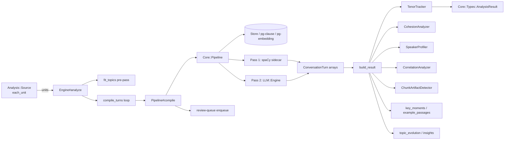

The **Analysis Engine** is the single compile loop shared by every `Analysis::Source` (ConversationSource, DocumentationSource, KnowledgeBaseSource) plus the cross-turn derivation stage that was once three independently drifting copies in legacy (D2). A Source only has to answer "what are my units" (`#each_unit` via `Core::Loaders::Source`), "how do I want a compiled turn reviewed" (`#review_entry`), and "what extra metadata do I carry" (`#extra_metadata`); everything else — clause compilation, topic pre-pass, speaker profiling, cohesion, correlations, key-moments detection, and `AnalysisResult` assembly — lives in one place: `SFL::Analysis::Engine`.

Sources: [engine.rb](lib/sfl/analysis/engine.rb#L1-L44) | [conversation_source.rb](lib/sfl/analysis/conversation_source.rb#L1-L15) | [documentation_source.rb](lib/sfl/analysis/documentation_source.rb#L1-L20)

## Architecture: The Single Compile Loop

`Engine#analyze` is the entry point. It delegates to `Core::Pipeline#compile` per unit, then runs a fixed post-compile pipeline (`build_result`) that turns the flat array of `ConversationTurn` structs into a fully populated `Core::Types::AnalysisResult`:

Sources: [engine.rb#L46-L120](lib/sfl/analysis/engine.rb#L46-L120)

### What `Engine#analyze` does, step by step

1. **Topic pre-pass** (`fit_topics`): if `topics:` is non-nil and the source has >= 3 units, it builds stub turns (neutral 0.5 tenor/modality, declarative mood) and fits a one-shot `TopicModeler` (LDA with a clamped k, or HDP when `topics: 0`). The resulting `topic_labels`, per-turn `topic_distribution`, and `detect_topic_shifts` are threaded through every turn and into the final result. [engine.rb#L136-L168](lib/sfl/analysis/engine.rb#L136-L168)
2. **Compile loop** (`compile_turns`): per unit it calls `Pipeline#compile(unit.text, document_id:, embed:, store:, resume:, pass_one_only:, semantic_coherence_score:)` and forwards every `store: true` result to `enqueue_review` (writing a `review_queue_repo` entry only when the Source's `#review_entry` returns a non-nil policy). [engine.rb#L177-L218](lib/sfl/analysis/engine.rb#L177-L218)
3. **Aggregation** (`build_result`): applies chunk-artifact detection, tracks tenor shifts, runs cohesion metrics, builds speaker profiles by speaker, correlates process types with tenor/modality (only trusted clauses contribute to averages), detects key moments, picks example passages, computes topic evolution and insights. [engine.rb#L102-L118](lib/sfl/analysis/engine.rb#L102-L118)

The compile loop is derived from legacy's `ConversationAnalyzer`/`DocumentationAnalyzer`/`KnowledgeBaseAnalyzer` — the engine comment explicitly reads "one use case (analyze) with its compile loop plus the cross-turn derivation methods it was created to stop duplicating."

Sources: [engine.rb#L1-L44](lib/sfl/analysis/engine.rb#L1-L44) | [engine.rb#L136-L218](lib/sfl/analysis/engine.rb#L136-L218)

### Entry points from the CLI

The CLI wires the engine differently by subcommand:

- `sfl-analyze conversation`: `build_conversation_engine` creates `Analysis::Engine.new(pipeline:, review_queue_repo:, on_progress: progress_bar.method(:advance), on_turn_start: progress_bar.method(:start), stop_requested: -> { stop_flag.stopped? })`. [cli.rb#L473-L510](lib/sfl/cli.rb#L473-L510)
- `sfl-analyze documentation`: `run_documentation` creates the same engine type with `Analysis::DocumentationSource`, then `finish_report` writes the ReportWriter output and prints the fallback-clause percentage. [cli.rb#L357-L361](lib/sfl/cli.rb#L357-L361)
- `sfl-analyze knowledge_base`: `build_kb_source` creates `Analysis::KnowledgeBaseSource.new(pipeline:, review_queue_repo:, on_progress:, stop_requested:, analyze_images:, chat:)`, which replaces the old `KnowledgeBaseAnalyzer`. [cli.rb#L548](lib/sfl/cli.rb#L548)

Sources: [cli.rb#L473-L510](lib/sfl/cli.rb#L473-L510) | [cli.rb#L357-L361](lib/sfl/cli.rb#L357-L361)

## The Three Source Hooks

The pattern that makes the engine generic is that the **Source answers policy questions; the Engine acts generically**. Each Source implements three optional hooks:

| Hook | ConversationSource | DocumentationSource | KnowledgeBaseSource |
|---|---|---|---|
| `#units` / `#each_unit` | JSONL / SRT/VTT/ASS via `SubtitleSource` | Markdown + PDF (via MarkdownSource/PdfSource), tracking `@unit_chunks` | Markdown/Canvas/PDF via loaders, flat-mapped per file |
| `#review_entry(unit:, clauses:)` | `nil` unless `audio_modality?` (ASR transcripts go to review) | Enqueues if any clause is a non-trusted annotation_source | Enqueues if fallback clause OR `quality_score < 0.40`, or `vault_image` |
| `#extra_metadata(turns)` | `{}` | `{ unit_label: "Section", clause_count:, low_confidence:, low_confidence_threshold: MIN_CLAUSE_THRESHOLD }` | Not implemented (KB uses its own report shape) |

`DocumentationSource` additionally implements the optional `#chunk_boundaries(turns)` hook — the third hook family — recording which flat clause-array indices sit at PDF chunk boundaries (contiguity of `@unit_chunks` with matching `file_id`). The Engine's `apply_chunk_artifacts` is the only caller of this hook.

Sources: [conversation_source.rb#L38-L65](lib/sfl/analysis/conversation_source.rb#L38-L65) | [documentation_source.rb#L38-L97](lib/sfl/analysis/documentation_source.rb#L38-L97) | [knowledge_base_source.rb#L41-L55](lib/sfl/analysis/knowledge_base_source.rb#L41-L55)

### The third hook: chunk-boundary detection

PDF chunking splits documents into arbitrary character-count chunks; a real sentence can straddle such a split and compile as two ambiguous 0.5-tenor fragments. The Engine handles this via `ChunkArtifactDetector` (terminal punctuation + continuation-start heuristic) and `DocumentationSource#chunk_boundaries`:

- `DocumentationSource` walks each unit's chunks, records `pdf_chunk` adjacency pairs, and returns flat clause-index boundaries.
- `Engine#apply_chunk_artifacts` only activates when the source responds to `#chunk_boundaries`. It maps boundaries through `ChunkArtifactDetector.detect(turns.flat_map(&:clauses), boundaries)`, flags the affected clauses with `annotation_source: "chunk_artifact"`, and recomputes that turn's `avg_tenor`/`avg_modality` from **reliable** (non-chunk-artifact) clauses only — the fallback 0.5 from an ambiguous fragment must not drag a real average toward the midpoint.
- Markdown-only sources never record a `pdf_chunk` pair, so `chunk_boundaries` returns `[]` by construction and the detector never runs on them.

Sources: [engine.rb#L226-L282](lib/sfl/analysis/engine.rb#L226-L282) | [documentation_source.rb#L50-L80](lib/sfl/analysis/documentation_source.rb#L50-L80)

## Cross-Turn Derivations

Every aggregation in `build_result` is a pure post-compile pass over the already-compiled turns. None mutates the turns in place (the F4/F5 fixes).

Sources: [engine.rb#L102-L118](lib/sfl/analysis/engine.rb#L102-L118)

### Tenor and modality

- **TenorTracker#calculate_shifts** is now a pure function: it returns a new array of turns with `tenor_shift` set per-turn (`curr.avg_tenor - prev.avg_tenor`), and looks up predecessors by array adjacency (`each_cons`) rather than by `turn_id` arithmetic — fixing a bug where filtered/reordered turns produced wrong shifts. [tenor_tracker.rb#L22-L37](lib/sfl/analysis/tenor_tracker.rb#L22-L37)
- `Engine#detect_key_moments` emits moments when threshold deltas are exceeded: **tenor_shift** (|Δ| > 0.15), **modality_shift** (|Δ| > 0.3), **semantic_anomaly** (coherence < 0.35 with a non-deflation profile), **deflation_anomaly** (coherence < 0.35 + interrogative/imperative mood or low modality/tenor). [engine.rb#L327-L390](lib/sfl/analysis/engine.rb#L327-L390)

### Speaker profiling

`SpeakerProfiler.build_profiles` groups turns by speaker and computes per-speaker `turn_count`, `avg_tenor`, `tenor_range`, `tenor_variance`, `avg_modality`, `mood_distribution`, and `dominant_processes`. The four tenor/modality aggregates are **nullable on purpose**: with no annotated turn to average there is no aggregate to report — `nil` is the only honest answer, not a fabricated 0.5 midpoint. [speaker_profiler.rb#L19-L48](lib/sfl/analysis/speaker_profiler.rb#L19-L48)

### Cohesion and correlation

- **CohesionAnalyzer** computes `repetition_score` (1 - unique_content_tokens/total_content_tokens), `conjunction_density`, and `pronoun_density` from the syntactic token stream, stored on each turn as `cohesion: CohesionMetrics`. [cohesion_analyzer.rb#L14-L39](lib/sfl/analysis/cohesion_analyzer.rb#L14-L39)
- **CorrelationAnalyzer#correlate_process_tenor** groups clauses by `ideational.process_type` and returns `{count:, annotated_count:, avg_tenor:, avg_modality:}` per group. Only clauses with a trusted annotation_source contribute to the averages; groups with zero annotated clauses report `nil`, not the 0.5 midpoint. [correlation_analyzer.rb#L14-L41](lib/sfl/analysis/correlation_analyzer.rb#L14-L41)

### Topic modeling

`TopicModeler` is a one-pass fitter around [tomoto](https://github.com/haltakov/tomoto) (LDA or HDP), wrapping [pragmatic_tokenizer](https://github.com/nebulab/pragmatic_tokenizer) with topic-modeling-specific preprocessing: lowercase, Porter stemming, stopword removal, punctuation/numbers stripped, and a Unicode-punctuation normalization map (LLM-generated prose uses U+2019 RIGHT SINGLE QUOTATION MARK, which would defeat the gem's ASCII-stoplist otherwise). [topic_modeler.rb#L33-L76](lib/sfl/analysis/topic_modeler.rb#L33-L76)

The k clamp is deliberate: `MIN_DOCS_PER_TOPIC = 3` and `MIN_TOPIC_K = 2`. A requested k that cannot be satisfied is clamped and logged via `@logger.warn` — "a silently-different k is precisely the class of bug that makes a degraded run indistinguishable from a good one." `topics: 0` maps to k `nil` (HDP auto-infers the topic count). [engine.rb#L487-L520](lib/sfl/analysis/engine.rb#L487-L520) | [topic_modeler.rb#L108-L123](lib/sfl/analysis/topic_modeler.rb#L108-L123)

### Insights and example passages

`Engine#generate_insights` returns a tenor-trend insight (if |trend| > 0.1), a speaker-share insight (if >1 speaker), and topic insights (topic count + dominant topic). `detect_example_passages` yields four `ExamplePassage` structs: Most Formal, Most Casual, Most Certain, Most Hedged — each mapping to a turn's `avg_tenor`/`avg_modality` extremum. [engine.rb#L393-L470](lib/sfl/analysis/engine.rb#L393-L470) | [engine.rb#L472-L490](lib/sfl/analysis/engine.rb#L472-L490)

### Aggregation helper

`Aggregations#mean` returns `0.5` for empty arrays (neutral default) and rounds to 3 decimal places. It is included by `Engine` and `SpeakerProfiler`. [aggregations.rb#L4-L10](lib/sfl/analysis/aggregations.rb#L4-L10)

## Types and Data Flow

The compile loop produces `Core::Types::ConversationTurn` structs; `build_result` produces a `Core::Types::AnalysisResult`. The full result shape:

| Field | Shape | Populated by |
|---|---|---|
| `metadata` | `{conversation_id, source_file, turn_count, speakers, analyzed_at, topics_enabled, interrupted, total}` + source `#extra_metadata` | `metadata_for` |
| `turns` | `Array<ConversationTurn>` | `compile_turns` → `build_turn` |
| `speaker_profiles` | `Hash<speaker, SpeakerProfile>` | `SpeakerProfiler.build_profiles` |
| `tenor_timeline` | `Array<{turn_id, timestamp, speaker, tenor, tenor_shift}>` | `tenor_timeline` |
| `field_evolution` | `Array<{turn_id, timestamp, dominant_process}>` | `field_evolution` |
| `correlations` | `Hash<process_type, {count, annotated_count, avg_tenor, avg_modality}>` | `CorrelationAnalyzer.correlate_process_tenor` |
| `insights` | `Array<String>` | `generate_insights` |
| `key_moments` | `Array<KeyMoment>` | `detect_key_moments` + `topic_shift_moments` |
| `example_passages` | `Array<ExamplePassage>` | `detect_example_passages` |
| `topic_labels` | `Hash<topic_id, [words]>` | TopicModeler |
| `topic_evolution` | `Array<{turn_id, timestamp, dominant_topic, topic_distribution}>` | `topic_evolution` |

`ConversationTurn` carries `turn_id, speaker, timestamp, message_text, clauses, avg_tenor, avg_modality, dominant_mood, process_types, participants, tenor_shift, cohesion, topic_distribution, dominant_topic, semantic_coherence_score`. [conversation_turn.rb](lib/sfl/core/types/conversation_turn.rb#L1-L25)

The KB path is structurally distinct: `KnowledgeBaseSource#analyze` produces `Core::Types::KnowledgeBaseReport` (artifacts, migration_manifest, content_type_distribution, quality_distribution, staleness_flags) rather than an `AnalysisResult`, so it deliberately does **not** go through `Engine#analyze`. Its `compile_artifact` shares the same `Pipeline#compile` + `review_queue_repo` + `#chunk_boundaries`-like delegation, but its report shape is KB-specific.

Sources: [engine.rb#L102-L118](lib/sfl/analysis/engine.rb#L102-L118) | [knowledge_base_source.rb#L41-L80](lib/sfl/analysis/knowledge_base_source.rb#L41-L80) | [analysis_result.rb](lib/sfl/core/types/analysis_result.rb#L1-L25)

## Narrative Generation and Citation Grounding

`NarrativeGenerator::Digest` snapshots the `AnalysisResult` (metadata, speaker profiles, correlations, insights, turns, key moments) into a text payload that an LLM narrator consumes. `CitationGroundingChecker` (the Crab role) runs **after** generation: it verifies each `[clause-id]` marker in the narrative resolves to a known clause and shares at least 2 content words with that clause's text. Ungrounded sentences are reported with a reason; the checker returns `{grounded:, ungrounded:, coverage:}` — a coverage float in [0,1]. [narrative_generator.rb#L16-L60](lib/sfl/analysis/narrative_generator.rb#L16-L60) | [citation_grounding_checker.rb#L14-L55](lib/sfl/analysis/citation_grounding_checker.rb#L14-L55)

Sources: [narrative_generator.rb#L16-L60](lib/sfl/analysis/narrative_generator.rb#L16-L60) | [citation_grounding_checker.rb#L14-L55](lib/sfl/analysis/citation_grounding_checker.rb#L14-L55)

## Testing

The engine has two golden-master specs plus one unit-spec:

- `engine_conversation_golden_master_spec.rb` is a **regression proof for the D2 compile-loop unification**: it runs `Engine + ConversationSource` against the same input legacy's CLI used to generate `spec/fixtures/golden_master/conversation/`, in pass1-only stub mode, and diffs the resulting `AnalysisResult` against the golden master's per-turn values (excluding `metadata.analyzed_at`). Pass 1 is stubbed with a plain double reproducing the golden master's per-turn clause counts (1,2,1,2,2 = 8 total). [engine_conversation_golden_master_spec.rb#L1-L40](spec/analysis/engine_conversation_golden_master_spec.rb#L1-L40)
- `engine_spec.rb` drives `#build_result` directly with hand-built turns (chunk artifacts, key moments, example passages, insights, enqueue_review, fit_topics, report_progress, stop_requested), and the topic-k clamping specs reproduce the 8-document/10-topic failure scenario with its warning. [engine_spec.rb#L1-L60](spec/analysis/engine_spec.rb#L1-L60)

Sources: [engine_conversation_golden_master_spec.rb#L1-L40](spec/analysis/engine_conversation_golden_master_spec.rb#L1-L40) | [engine_spec.rb#L1-L60](spec/analysis/engine_spec.rb#L1-L60)

## Design Principles

1. **Single compile loop**: A Source's job is "what are my units" + "how do I want a compiled turn reviewed" + "what extra metadata"; the Engine owns the compile loop and the cross-turn derivations.
2. **Pure post-compile aggregations**: Tenor tracking, cohesion, correlations, profiling, and insights are all pure functions over the compiled turns — no mutation of compiled data, no dependency on Source or Pipeline.
3. **Default-not-midpoint policy**: Fallback 0.5 values are never averaged into speaker or correlation aggregates; `nil` is the honest answer when there are no trusted clauses.
4. **Explicit degradation**: A reduced topic k, a fallback-annotation count, or a partial artifact failure is always surfaced (logger.warn, finished_report count, skipped artifacts) — never silently hidden.
5. **Duck-typed Source hooks**: `Engine` never knows whether it is driving ConversationSource, DocumentationSource, or KnowledgeBaseSource; it only depends on `#each_unit`, `#review_entry`, `#extra_metadata`, and (optionally) `#chunk_boundaries`.

Sources: [engine.rb#L1-L44](lib/sfl/analysis/engine.rb#L1-L44) | [speaker_profiler.rb#L19-L48](lib/sfl/analysis/speaker_profiler.rb#L19-L48) | [correlation_analyzer.rb#L14-L41](lib/sfl/analysis/correlation_analyzer.rb#L14-L41)

## Next Steps

- **Conversations** — follow up with `[Dialogue Turn Model](dialogue-turn-model)` for how clauses are structured inside each turn.
- **Documents** — `[Knowledge Base Source](knowledge-base-source)` and `[Standard Report Format](standard-report-format)` for the KB report shape and the report writer.
- **Data** — `[AnnotatedClause](annotatedclause-type)` and `[Ideational Payload](ideational-payload)` for the clause annotations that feed tenor/modality and correlation calculations.
- **Storage** — `[Postgres Integration](postgres-integration)` for how the engine persists clauses and review-queue entries.
- **Tests** — `[Golden Master Testing](golden-master-testing)` for the engine verification strategy.