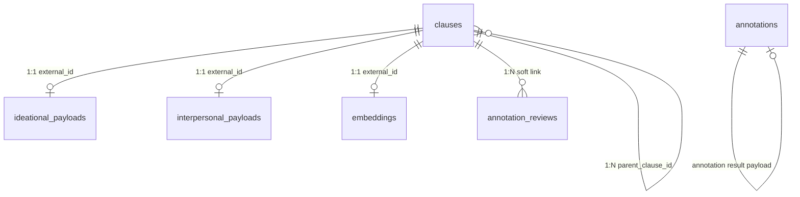
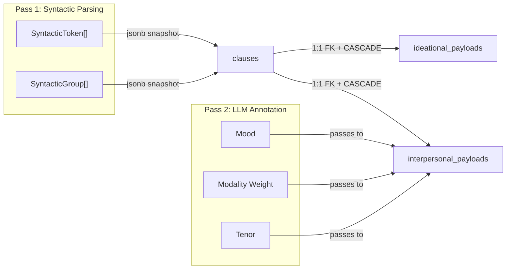
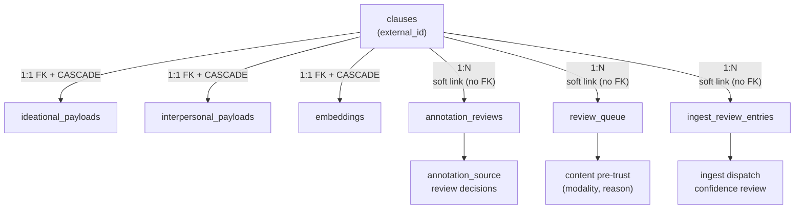
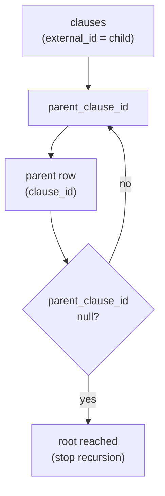
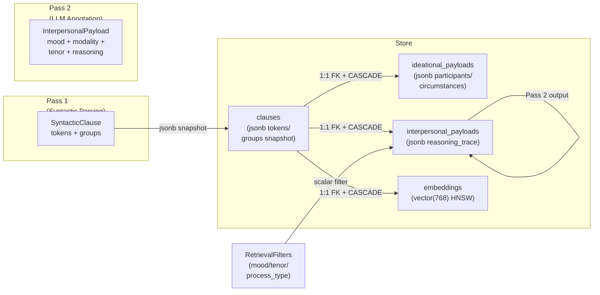
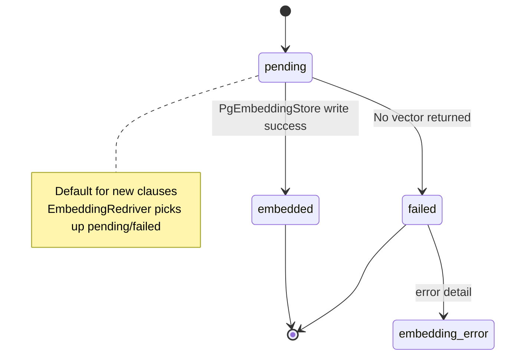

The `sfl-engine` database persists **clauses** (the core linguistic units after Pass 1 syntactic parsing), **payloads** (Pass 1 transitivity and Pass 2 LLM annotation results), **embeddings** (pgvector vectors for retrieval), and **human review** records. All persistence goes through Sequel against a Postgres database, with a deliberate split between real foreign keys (`ON DELETE CASCADE`) and soft-link convention tables.

The schema evolved through **11 numbered migrations** (see `db/migrations/`). The evolution narrative is visible in the migration comments themselves: **D5** (real FKs instead of legacy's plain `String` columns), **F7** (delete-then-insert idempotency contract), **F11** (embedding status tracking for re-drive), and **D8** (self-referential parent/child chunking with cycle prevention). Each migration's doc comment explains the *why*, not just the *what*.

## Core Data Model: The clauses + payload family

The central tables form a family around `clauses`:

**Mermaid - Clauses and payload relationships**

The `clauses` table is the **join key master**: `external_id` (a fresh UUID per compile) is the canonical identity, and every payload table references it.

**`clauses` table** (`db/migrations/001_create_clauses.rb`):

| Column | Type | Notes |
|--------|------|-------|
| `id` | primary key | Surrogate integer PK |
| `external_id` | String, unique | The `AnnotatedClause#id` — the true join key |
| `text` | String, not null | Raw clause text |
| `document_id` | String | Groups clauses into documents |
| `sentence_index` | Integer, not null | Parse position |
| `root_index` | Integer, not null | Parse position |
| `tokens` | jsonb, default `[]` | Full Pass 1 `SyntacticToken[]` snapshot |
| `groups` | jsonb, default `[]` | Full Pass 1 `SyntacticGroup[]` snapshot |
| `created_at` | DateTime | Default `CURRENT_TIMESTAMP` |

**Subtlety documented in migration 001**: `external_id` is stored (not `SyntacticClause#id`), because `PgClauseStore` collapses all three IDs to the outer `AnnotatedClause#id`. The `tokens`/`groups` jsonb columns exist so `find_by_document` can rebuild `SyntacticToken`/`SyntacticGroup` structs without re-running Pass 1.

**`ideational_payloads` table** (`db/migrations/002_create_ideational_payloads.rb`):

| Column | Type | Notes |
|--------|------|-------|
| `clause_id` | FK → `clauses.external_id` | `ON DELETE CASCADE`; real FK (D5) |
| `process_type` | String, not null | Transitivity: material, mental, relational, etc. |
| `participants` | jsonb, default `[]` | Structured passage entities |
| `circumstances` | jsonb, default `[]` | Circumstance roles |
| `raw_transitivity` | jsonb, default `{}` | Complete Pass 1 output |
| `created_at` | DateTime | |

**`interpersonal_payloads` table** (`db/migrations/003_create_interpersonal_payloads.rb`):

| Column | Type | Notes |
|--------|------|-------|
| `clause_id` | FK → `clauses.external_id` | `ON DELETE CASCADE`; real FK (D5) |
| `mood` | String, not null | Indicative, imperative, etc. |
| `modality_weight` | Float, default 0.5 | Scalar stance value |
| `tenor` | Float, default 0.5 | Scalar stance value |
| `speaker_attitude` | String | Free-form attitude label |
| `reasoning` | String | LLM reasoning text |
| `annotation_source` | String, default "llm" | e.g. "llm", "human" |
| `reasoning_trace` | jsonb | Rich structured trace (destination of `Core::Wire.dump`) |
| `raw_classification` | String | Added 010, nullable |
| `classification_status` | String | Added 010, nullable |
| `untrusted` | Boolean, default false | Added 010, nullable |
| `created_at` | DateTime | |

**Mermaid - Payload data flow**

The `interpersonal_payloads` table has a **composite index** `idx_interpersonal_scalar_filter` on `(mood, modality_weight, tenor)` `([db/migrations/003_create_interpersonal_payloads.rb#L25-L31](db/migrations/003_create_interpersonal_payloads.rb#L25-L31))`. This is the retrieval slice's scalar-filter + ranking query shape, computed by `SFL::Core::Types::RetrievalFilters` (`lib/sfl/core/types/retrieval_filters.rb`) and applied by `SFL::Store::ClauseFilters` (`lib/sfl/store/clause_filters.rb`).

## Storage: Embeddings and Search

**`embeddings` table** (`db/migrations/004_create_embeddings.rb`):

| Column | Type | Notes |
|--------|------|-------|
| `clause_id` | FK → `clauses.external_id` | Real FK, CASCADE |
| `embedding` | `vector(768)` | Fixed width, matching `PgEmbeddingStore::VECTOR_DIMENSIONS` |
| `model` | String, default "embeddinggemma:latest" | Distinguishes multiple models per clause |
| `created_at` | DateTime | |

Indexes: `UNIQUE (clause_id, model)` `([db/migrations/004_create_embeddings.rb#L16-L19](db/migrations/004_create_embeddings.rb#L16-L19))` and HNSW `index :embedding, type: :hnsw, opclass: :vector_cosine_ops` `([db/migrations/004_create_embeddings.rb#L20-L22](db/migrations/004_create_embeddings.rb#L20-L22))`.

**Critical design decision**: HNSW was chosen over IVFFlat `([db/migrations/004_create_embeddings.rb#L3-L16](db/migrations/004_create_embeddings.rb#L3-L16))`. IVFFlat requires a representative sample before building useful clusters and needs periodic `REINDEX`; HNSW builds incrementally with no training step and is pgvector's own recommended default since 0.5.0. The dimension is fixed at migration time (`vector(768)`), and a mismatch (e.g. a 1024-dim model) surfaces as a `PG::DataException` with a verbose error in `PgEmbeddingStore` `([lib/sfl/store/pg_embedding_store.rb#L14-L31](lib/sfl/store/pg_embedding_store.rb#L14-L31))`.

**`clauses` extended columns** (added across migrations 005, 008, 010, 011):

| Column | Added by | Notes |
|--------|--------|-------|
| `source_type` | 005 | Provenance tag: "unspecified" default, indexed |
| `embedding_status` | 008 | "pending" | "embedded" | "failed" | "not_applicable" (leaf-only) |
| `embedding_error` | 008 | Text, nullable; carries failure reason |
| `raw_classification` | 010 | Pass 2 raw classification output |
| `classification_status` | 010 | Pass 2 normalization status |
| `untrusted` | 010 | Boolean flag for quarantine |
| `parent_clause_id` | 011 | Self-referential FK for structural chunking |
| `readability_flesch` | 011 | Fluency score |
| `readability_kincaid` | 011 | Fluency score |
| `readability_fog` | 011 | Fluency score |
| `word_count` | 011 | Word count |

`embedding_status` values carry important contracts:

- **"pending"** → default for new clauses; `EmbeddingRedriver` picks these up as gaps to re-drive.
- **"embedded"** → set when `PgEmbeddingStore` successfully writes a vector.
- **"failed"** → set when an embed attempt returned no vector; `embedding_error` holds the reason.
- **"not_applicable"** → **not** for leaf clauses. Instead, **non-leaf (parent) clauses** are marked `not_applicable` at insert time `([lib/sfl/store/pg_clause_store.rb#L103-L107](lib/sfl/store/pg_clause_store.rb#L103-L107))` because parents never carry their own vector — only their leaf descendants do. This prevents `EmbeddingRedriver` from chasing parents forever.

## Review and Audit Tables

Three review-adjacent tables serve distinct audiences:

**`annotation_reviews`** (`db/migrations/006_create_annotation_reviews.rb`):

Append-only audit trail for **Pass 2 annotation-confidence** decisions (`accept`/`reject`/`re_annotated`). Deliberately **no foreign key** to `clauses` `([db/migrations/006_create_annotation_reviews.rb#L25-L31](db/migrations/006_create_annotation_reviews.rb#L25-L31))`.

The migration comment is explicit: this is an audit log, not a 1:1 payload row. `ON DELETE CASCADE` would be wrong — deleting a clause must not silently erase the historical record that a human once reviewed it. This is the same "soft link" convention settled on by legacy's `ClauseRepository`.

**`review_queue`** (`db/migrations/007_create_review_queue.rb`):

Content-review queue for **untrusted generated text before permanent storage** — e.g., a vision model's description of an image, a fallback text extraction, a transcript segment. Columns: `modality` ("image" | "text" | "audio"), `document_id`, `source_file`, `generated_text`, `reason`, `status` (default "pending"), `reviewer`, `reviewed_at`. Like `annotation_reviews`, **no FK** — pre-trust content, sound as-is `([db/migrations/007_create_review_queue.rb#L25-L31](db/migrations/007_create_review_queue.rb#L25-L31))`.

**`ingest_review_entries`** (`db/migrations/009_create_ingest_review_entries.rb`):

Ingest-time review queue written when `Ingest::Orchestrator` cannot confidently dispatch a file. **Mirrors the exact shape of `review_queue`** — same UUID PK, same `pending` default, same `status` index — so a future CLI review subcommand is a pure read/query layer `([db/migrations/009_create_ingest_review_entries.rb#L25-L29](db/migrations/009_create_ingest_review_entries.rb#L25-L29))`.

**Mermaid - Review table separation**

## Structural Chunking: Self-Referential `parent_clause_id`

Migration 011 adds **parent/child contextual chunking** without a parallel `chunks` table `([db/migrations/011_add_parent_clause_id_to_clauses.rb#L25-L30](db/migrations/011_add_parent_clause_id_to_clauses.rb#L25-L30))`. A "child chunk" is simply a `clauses` row whose `parent_clause_id` points at another `clauses` row's `external_id`. This reuses `PgClauseStore`, `ClauseFilters`, and `AnnotatedClause` as-is.

**Critical safety mechanisms:**

1. **CHECK constraint** `chk_clauses_parent_not_self`: `parent_clause_id IS NULL OR parent_clause_id <> external_id` — prevents a row from pointing at itself `([db/migrations/011_add_parent_clause_id_to_clauses.rb#L31-L34](db/migrations/011_add_parent_clause_id_to_clauses.rb#L31-L34))`.
2. **BEFORE INSERT OR UPDATE trigger** `clauses_prevent_cycle`: walks the ancestor chain and raises an exception before a cycle (A → B → A) can be inserted `([db/migrations/011_add_parent_clause_id_to_clauses.rb#L36-L66](db/migrations/011_add_parent_clause_id_to_clauses.rb#L36-L66))`.

**Readability scores** (from `Analysis::ReadabilityScorer`) are added as nullable columns on the same row: `readability_flesch`, `readability_kincaid`, `readability_fog`, `word_count` `([db/migrations/011_add_parent_clause_id_to_clauses.rb#L26-L29](db/migrations/011_add_parent_clause_id_to_clauses.rb#L26-L29))`. Every clause gets scored, not just chunks with children.

**Mermaid - Parent/child recursive query**

`PgClauseStore#ancestor_chain` uses a `WITH RECURSIVE` SQL query to walk up from a clause to its root `([lib/sfl/store/pg_clause_store.rb#L63-L83](lib/sfl/store/pg_clause_store.rb#L63-L83))`.

## Schema-to-Code Mapping: How the Store Reads It

The schema is not just a static artifact; it is directly consumed by the store layer. The following table traces key schema decisions to their implementations.

| Schema decision | Implementation | File |
|----------------|----------------|------|
| `external_id` as join key | `PgClauseStore.replace_document` deletes by `document_id`, inserts `multi_insert` with `external_id` as the `clause_id` for all payloads | `lib/sfl/store/pg_clause_store.rb` |
| `ON DELETE CASCADE` on payloads | `PgClauseStore#replace_document` deletes only `clauses`, trusting cascade for payloads | `lib/sfl/store/pg_clause_store.rb` |
| `tokens`/`groups` jsonb | `reconstruct(token_hash)` and `reconstruct_group(group_hash)` rebuild `SyntacticToken`/`SyntacticGroup` from string-keyed JSON | `lib/sfl/store/pg_clause_store.rb` |
| `embedding_status` column | `PgEmbeddingStore#replace_document` sets "embedded"/"failed" per clause; `EmbeddingRedriver` queries `WHERE embedding_status IN ('pending', 'failed')` | `lib/sfl/store/pg_embedding_store.rb`, `lib/sfl/store/embedding_redriver.rb` |
| `reason` column on `review_queue` | `PgReviewQueueRepository#enqueue` writes status "pending" with `reason` from caller | `lib/sfl/store/pg_review_queue_repository.rb` |
| `annotation_source` filter | `ClauseFilters#source_type` processes `Sequel[:clauses][:source_type]` | `lib/sfl/store/clause_filters.rb` |
| `reasoning_trace` jsonb | `reconstruct_reasoning_trace` maps to `Core::Types::ReasoningTrace` | `lib/sfl/store/pg_clause_store.rb` |
| `parent_clause_id` self FK | `PgGraphRepository#parent_child_edges` selects `:external_id, :parent_clause_id` pairs | `lib/sfl/store/pg_graph_repository.rb` |
| `vector(768)` dimension | `PgEmbeddingStore::VECTOR_DIMENSIONS = 768`; `check_dimensions!` raises if model output width mismatches | `lib/sfl/store/pg_embedding_store.rb` |

**Mermaid - Database architecture overview**

**Mermaid - Data flow through the database**

## Key Design Patterns and Contracts

### 1. Real FKs (D5) vs Soft Links

| Table | FK Convention | Rationale |
|-------|--------------|-----------|
| `ideational_payloads` | **Real FK**, CASCADE | 1:1 payload — delete clause, delete payload |
| `interpersonal_payloads` | **Real FK**, CASCADE | 1:1 payload — delete clause, delete payload |
| `embeddings` | **Real FK**, CASCADE | 1:1 vector — delete clause, delete vector |
| `annotation_reviews` | **No FK** (soft link) | Append-only audit log — history must survive clause deletion |
| `review_queue` | **No FK** (soft link) | Pre-trust content — same convention |
| `ingest_review_entries` | **No FK** (soft link) | Same as `review_queue` |
| `clauses.parent_clause_id` | **Real FK**, CASCADE | Self-reference — child deletes when parent deleted |

### 2. `embedding_status` Lifecycle

### 3. Migration Timeline

| Migration | Purpose |
|-----------|---------|
| `001_create_clauses.rb` | Base table with `external_id`, jsonb tokens/groups, `root_index` (no legacy `root_token` recompute) |
| `002_create_ideational_payloads.rb` | Pass 1 transitivity with real FK (`ON DELETE CASCADE`) |
| `003_create_interpersonal_payloads.rb` | Pass 2 annotation output with scalar-filter composite index |
| `004_create_embeddings.rb` | pgvector HNSW index, `vector(768)`, `(clause_id, model)` unique index |
| `005_add_source_type_to_clauses.rb` | Provenance tag (`source_type`), default "unspecified" |
| `006_create_annotation_reviews.rb` | Append-only audit trail, no FK (preserves history) |
| `007_create_review_queue.rb` | Content pre-trust queue (image/text/audio) |
| `008_add_embedding_status_to_clauses.rb` | `embedding_status`, `embedding_error` columns for F11 |
| `009_create_ingest_review_entries.rb` | Ingest dispatch confidence review queue |
| `010_add_classification_metadata.rb` | Raw Pass 2 classification + `untrusted` flag |
| `011_add_parent_clause_id_to_clauses.rb` | Parent/child chunking (self FK + CHECK + trigger), readability scores |

## Migration Primitives: SQL and Ruby

The schema uses several Sequel migration primitives worth understanding:

- **`create_table` with `column :jsonb`**: Sequel's jsonb type, default `[]` or `{}`.
- **`foreign_key ... key: :external_id`**: A foreign key that references a **non-PK column** — the `external_id` UUID, not the surrogate `id`.
- **`index %i[mood modality_weight tenor]`**: A **composite index** spanning three columns for the scalar filter + ranking query `([db/migrations/003_create_interpersonal_payloads.rb#L25-L31](db/migrations/003_create_interpersonal_payloads.rb#L25-L31))`.
- **`index :embedding, type: :hnsw, opclass: :vector_cosine_ops`**: A **pgvector HNSW index** using cosine distance `([db/migrations/004_create_embeddings.rb#L20-L22](db/migrations/004_create_embeddings.rb#L20-L22))`.
- **`add_constraint`**: A CHECK constraint for the self-reference guard `([db/migrations/011_add_parent_clause_id_to_clauses.rb#L31-L34](db/migrations/011_add_parent_clause_id_to_clauses.rb#L31-L34))`.
- **`run <<~SQL`**: Raw SQL execution for the PL/pgSQL cycle-prevention function and trigger `([db/migrations/011_add_parent_clause_id_to_clauses.rb#L36-L76](db/migrations/011_add_parent_clause_id_to_clauses.rb#L36-L76))`.

## Database Connection and Extension Setup

`SFL::Store::Database` (`lib/sfl/store/database.rb`) manages connection and extensions:

- **`CREATE EXTENSION IF NOT EXISTS vector`**: Required for pgvector support.
- **`CREATE EXTENSION IF NOT EXISTS pg_trgm`**: Text similarity/trigram support.
- **`db.timezone = :utc`**: Both `Sequel` and application timezone pinned to UTC so `DateTime` columns round-trip correctly (a live-verified bug fix).

The `db:migrate` Rake task (`Rakefile`) connects, sets up extensions, and runs the migrator — **never automatic at boot** (D5: legacy's Migrator ran ad hoc).

## Integration Points with Other Components

- **Pass 1** (Syntactic Parsing): `tokens`/`groups` jsonb + `root_index` + `sentence_index` restore the `SyntacticClause` without re-parsing `([db/migrations/001_create_clauses.rb#L1-L20](db/migrations/001_create_clauses.rb#L1-L20))`.
- **Pass 2** (LLM Annotation): `mood`, `modality_weight`, `tenor`, `reasoning`, `annotation_source`, `untrusted`, `reasoning_trace`, `raw_classification`, `classification_status` `([db/migrations/003_create_interpersonal_payloads.rb#L1-L20](db/migrations/003_create_interpersonal_payloads.rb#L1-L20))`.
- **Retrieval** (Hybrid with RRF): `clause_filters.rb` applies `mood`, `modality_weight`, `tenor`, `process_type`, `source_type` filters against the joined scope `([lib/sfl/store/clause_filters.rb#L8-L44](lib/sfl/store/clause_filters.rb#L8-L44))`.
- **Graph API**: `pg_graph_repository.rb` reuses the same three-table join (`clauses` → `interpersonal_payloads` → `ideational_payloads`) and uses `parent_clause_id` for `parent_child_edges` `([lib/sfl/store/pg_graph_repository.rb#L1-L107](lib/sfl/store/pg_graph_repository.rb#L1-L107))`.
- **Embedding / Redriver**: `pg_embedding_store.rb` and `embedding_redriver.rb` coordinate the `embedding_status` lifecycle across `clauses` and `embeddings` `([lib/sfl/store/pg_embedding_store.rb#L1-L139](lib/sfl/store/pg_embedding_store.rb#L1-L139))`.

## Summary

The `sfl-engine` database schema is a **deliberately evolved** structure. Early migrations (001–004) established the core clause/payload/embedding tables with real FKs and HNSW indexing. Later migrations (005–010) added provenance tracking, embedding status lifecycle, and classification metadata. The final migration (011) introduced structural chunking with self-referential FKs, CHECK constraints, and PL/pgSQL cycle prevention, plus readability scores.

The schema's most important design choices:
1. **Real FKs** (`ON DELETE CASCADE`) on payloads so deletes are atomic at the DB level (D5).
2. **No FK** on audit/log tables (`annotation_reviews`, `review_queue`, `ingest_review_entries`) so history survives clause deletion.
3. **HNSW over IVFFlat** for pgvector, with a fixed 768-dim column width.
4. **`embedding_status` enum** (pending/embedded/failed/not_applicable) enabling the F11 re-drive cycle.
5. **Self-referential `parent_clause_id`** with a CHECK constraint and PL/pgSQL trigger for structural chunking, no parallel `chunks` table.
6. **Jsonb** for mutable/structured payloads (`tokens`, `groups`, `reasoning_trace`, `raw_transitivity`, `participants`, `circumstances`) while keeping scalar/semantically searchable values as typed columns.

## Next Steps

- For how queries read this schema with scalar filters, see [Hybrid Retrieval with RRF](20-hybrid-retrieval-with-rrf)
- For vector search configuration, see [Vector Embeddings with pgvector](21-vector-embeddings-with-pgvector)
- For the Postgres integration layer, see [Postgres Integration](19-postgres-integration)
- For the full migration history, see `db/migrations/` in the repository
- For how the store layer consumes this schema, see [Database Schema](18-database-schema) (this page)
- For data model and entity-relationship diagram, see [Data Model](data-model.md)