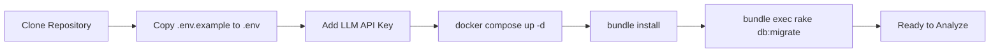
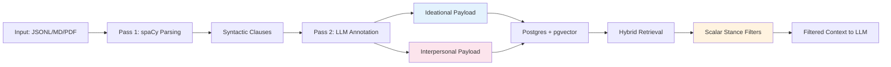

Get SFL Engine running in under 10 minutes. This guide walks you through the minimal setup needed to analyze your first conversation or document using the stance-filtered RAG pipeline.

## Prerequisites

Before installing SFL Engine, ensure your development environment has the following dependencies:

| Requirement | Version | Purpose |
|-------------|---------|---------|
| Ruby | 4.0.1+ | Core runtime environment |
| Bundler | Latest | Dependency management |
| Docker & Docker Compose | Latest | Database and cache services |
| API Key | OpenAI/Anthropic/etc. | LLM annotation (Pass 2) |

The Ruby version is pinned to 4.0.1 in [`.ruby-version`](.ruby-version) and verified by the Gemfile lock file. Docker Compose is required for the database and Redis stack that powers the storage layer, though bare-metal Postgres is also supported if you prefer direct service management. For the LLM-powered annotation layer, you'll need an API key from a supported provider — the system uses the dspy.rb framework for provider abstraction.

Sources: [Gemfile](Gemfile#L1-L20), [docker-compose.yml](docker-compose.yml#L1-L30)

## Installation Methods

### Option 1: Docker Compose Setup (Recommended)

The fastest way to get started is using Docker Compose, which handles all infrastructure dependencies automatically:



Start by cloning the repository and copying the environment template:

```bash
git clone <repository-url>
cd sfl-engine
cp .env.example .env
```

Edit `.env` to add your LLM provider credentials. The minimal configuration requires setting your annotation model — see [Environment Configuration](4-environment-configuration) for all available options.

Then start the infrastructure services:

```bash
docker compose up -d
```

This launches Postgres with pgvector support on port 5433 and Redis on port 6380, with health checks ensuring both services are ready before the application starts. The compose configuration uses non-standard ports to avoid conflicts with system services already running on the default ports.

Sources: [docker-compose.yml](docker-compose.yml#L1-L30), [.env.example](.env.example#L1-L9)

### Option 2: Bare Metal Setup

For development environments where you prefer managing services directly, SFL Engine supports bare-metal Postgres and Redis installations. This approach gives you more control but requires manual service configuration.

The key difference from Docker Compose is that you'll need to ensure Postgres has the pgvector extension installed and that your connection parameters match what the application expects. The [Docker Compose Setup](3-docker-compose-setup) page provides detailed configuration guidance for both approaches.

After your database is running, install Ruby dependencies and prepare the database schema:

```bash
bundle install
bundle exec rake db:migrate
```

The migration process creates the core tables for storing annotated clauses and their associated payloads — see [Database Schema](18-database-schema) for the complete table structure.

Sources: [db/migrations/001_create_clauses.rb](db/migrations/001_create_clauses.rb#L1-L36)

## Your First Analysis

### Basic CLI Usage

SFL Engine provides four primary analysis commands through the `sfl-analyze` CLI tool. The most common starting point is analyzing a conversation transcript in JSONL format:

```bash
bundle exec sfl-analyze conversation sample.jsonl
```

This command runs the full two-pass pipeline on your input and produces a detailed report in `./output/latest/`. The pipeline consists of Pass 1 (syntactic parsing via spaCy) and Pass 2 (LLM annotation for stance metadata), with results stored in Postgres if you use the `--store` flag.

Sources: [exe/sfl-analyze](exe/sfl-analyze#L1-L18), [lib/sfl/cli.rb](lib/sfl/cli.rb#L38-L76)

### Sample Input Format

Conversation files use JSONL format with one message per line. Each line requires at minimum a `name` field for the speaker and a `mes` field for the message content:

```jsonl
{"name":"Alice","is_user":true,"send_date":"June 10, 2026 2:30pm","mes":"Hey, I'm running into a weird issue with the auth flow.","extra":{"token_count":15}}
{"name":"Bob","is_user":false,"send_date":"June 10, 2026 2:31pm","mes":"Hmm, that's strange. Are you seeing any patterns in the logs?","extra":{"token_count":14}}
{"name":"Alice","is_user":true,"send_date":"June 10, 2026 2:33pm","mes":"Yeah, it seems to be happening with refresh tokens specifically.","extra":{"token_count":12}}
```

The `is_user` field distinguishes user messages from system/assistant messages, while `extra` can contain arbitrary metadata. See [CLI Usage](23-cli-usage) for the complete field reference and supported input formats.

Sources: [spec/fixtures/inputs/sample.jsonl](spec/fixtures/inputs/sample.jsonl#L1-L6)

### Common Analysis Options

The CLI supports several useful flags for customizing analysis behavior:

| Flag | Purpose | Applies To |
|------|---------|------------|
| `--pass1-only` | Skip LLM annotation (use placeholder values) | conversation, documentation |
| `--store` | Persist results to database for retrieval | conversation, documentation, knowledge-base |
| `--narrative` | Generate narrative summary via LLM | conversation, documentation |
| `--topics N` | Enable topic modeling with N topics (or 0 for auto-discovery) | conversation, documentation |
| `--output-dir DIR` | Specify custom output directory | all commands |
| `--resume` | Reuse cached Pass 2 results from previous run | conversation, documentation, knowledge-base |

For example, to analyze a documentation file and store the results for later retrieval:

```bash
bundle exec sfl-analyze documentation README.md --store --output-dir ./output/readme-analysis
```

The `--store` flag is particularly important if you want to use the `context` subcommand for semantic retrieval later — without it, the analysis exists only in the output report and cannot be queried.

Sources: [lib/sfl/cli.rb](lib/sfl/cli.rb#L112-L135), [lib/sfl/cli.rb](lib/sfl/cli.rb#L140-L158)

## Understanding the Architecture

SFL Engine implements a two-pass annotation pipeline that separates ideational content (what happened) from interpersonal stance (how it was presented) at the storage layer. This architectural pattern enables the rhetorical firewall that filters persuasive elements before they reach your LLM:



The key innovation is that ideational and interpersonal payloads live in separate database tables with independent indexes. This means retrieval policies can filter on stance dimensions (mood, modality, tenor, attitude) without constraining topic relevance — the system finds relevant facts first, then removes rhetorical manipulation from that result set before synthesis.

Sources: [README.md](README.md#L59-L80), [docs/introduction.md](docs/introduction.md#L60-L95)

### Core Project Structure

Understanding the directory layout helps you navigate the codebase when extending functionality:

```
sfl-engine/
├── lib/sfl/
│   ├── core/           # Pipeline orchestration, types, ports
│   ├── store/          # Postgres repositories, retrieval algorithms
│   ├── llm/            # dspy.rb annotators and provider configs
│   ├── analysis/       # Analysis sources and topic modeling
│   ├── cli/            # Command-line interface
│   └── ingest/         # File classification and dispatch logic
├── db/migrations/      # Database schema definitions
├── spec/               # Test suite with golden master fixtures
├── exe/                # Entry points: sfl-analyze, sfl-api, sfl-review
└── docker/             # Docker configuration files
```

The `lib/sfl/core/` directory contains the pipeline orchestration logic that wires together the two passes and manages type contracts. Storage and retrieval live in `lib/sfl/store/`, which implements the hybrid retriever combining vector similarity with keyword search. See [Two-Pass Pipeline Architecture](7-two-pass-pipeline-architecture) for deeper details on how these components interact.

Sources: [README.md](README.md#L139-L148), [lib/sfl/boot.rb](lib/sfl/boot.rb#L1-L63)

## Running the HTTP API

For programmatic access, SFL Engine provides an HTTP API server built on the Roda web framework:

```bash
bundle exec sfl-api
```

By default, this starts the API server on port 3001. The server exposes endpoints for pipeline execution, retrieval, and review queue management. The health check endpoint is available immediately:

```bash
curl http://localhost:3001/health
```

The API server can also be run via Docker Compose using the `app` profile:

```bash
docker compose --profile app up -d
```

This approach is useful when you want to run the entire stack (database, cache, and API) as containerized services. The API routes are defined in the `app/routes/` directory, with each route file handling a specific domain — see [Roda Routes Architecture](25-roda-routes-architecture) for the complete endpoint reference.

Sources: [exe/sfl-api](exe/sfl-api#L1-L24), [app/routes](app/routes)

## Troubleshooting Common Issues

### Database Connection Errors

If you encounter connection errors, first verify that Docker Compose services are running and healthy:

```bash
docker compose ps
```

Both `postgres` and `redis` should show a status of "healthy". If they're not, check the logs:

```bash
docker compose logs postgres
```

For bare-metal setups, verify your `DATABASE_URL` environment variable matches your Postgres configuration. The compose file uses port 5433 to avoid conflicts with system Postgres, which is a common source of connection issues.

Sources: [docker-compose.yml](docker-compose.yml#L20-L32)

### LLM Annotation Failures

Pass 2 annotation requires a valid LLM API key configured in your `.env` file. If you see errors about missing credentials or authentication failures:

1. Verify your `.env` file exists and is readable
2. Check that the required model configuration variables are set
3. For debugging, you can run with `--pass1-only` to skip LLM annotation and see if Pass 1 completes successfully

The `--allow-fallback` flag lets the pipeline exit successfully even when some clauses couldn't be annotated, though this produces a degraded result set that shouldn't be used for production retrieval.

Sources: [.env.example](.env.example#L1-L9), [lib/sfl/cli.rb](lib/sfl/cli.rb#L129-L131)

## What's Next?

Now that you have SFL Engine running, here's the recommended learning path:

1. **[Two-Pass Pipeline Architecture](7-two-pass-pipeline-architecture)** — Understand how the two analysis passes work together and why this separation matters
2. **[Systemic Functional Linguistics Concepts](6-systemic-functional-linguistics-concepts)** — Learn the linguistic theory behind ideational and interpersonal payload separation
3. **[CLI Usage](23-cli-usage)** — Explore all available commands and options for advanced analysis workflows
4. **[HTTP API Reference](24-http-api-reference)** — Integrate SFL Engine into your applications programmatically

For production deployment guidance, continue to the Installation & Setup section beginning with [Docker Compose Setup](3-docker-compose-setup) and [Environment Configuration](4-environment-configuration).