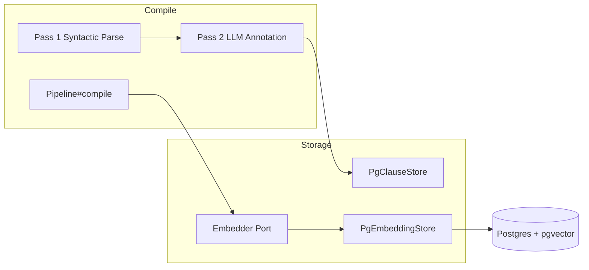

## Architecture Overview

SFL Engine stores clause vectors in a dedicated Postgres table powered by the `pgvector` extension. The storage layer is split at the port level: `Store::PgClauseStore` owns clause text, payloads, and annotation metadata, while `Store::PgEmbeddingStore` owns only the dense vectors and their status metadata. Both are written together at the end of one pipeline run, but they model different persistence concerns and use different schemas.

The embedding pipeline follows a strict write contract. `Pipeline#compile` embeds only **leaf clauses** — a clause whose `parent_clause_id` is not referenced by any other clause — and feeds them through the `Embedder` port in a single batch. The resulting `Hash<clause_id, Vector>` is handed to `embedding_store.replace_document`, which atomically deletes every existing vector for that document and re-inserts the new set inside one transaction [[lib/sfl/core/pipeline.rb#L220-L230]](lib/sfl/core/pipeline.rb#L220-L230). Idempotency lives in the interface, not in caller discipline: re-embedding the same document twice leaves no stale vectors behind [[lib/sfl/store/pg_embedding_store.rb#L8-L18]](lib/sfl/store/pg_embedding_store.rb#L8-L18).

### Embedding Pipeline



The embedding phase is intentionally **per-document and leaf-only**. A document's embedding run replaces every existing vector row for its clauses, and leaves parent chunks untouched because they are never embedded in the first place. The `leaf_clauses` helper in `Pipeline#embed_all` builds a `Set` of all `parent_clause_id` values and rejects any clause that appears in it [[lib/sfl/core/pipeline.rb#L232-L235]](lib/sfl/core/pipeline.rb#L232-L235). Until a chunk-splitting pass populates `parent_clause_id`, every clause is a leaf and the filter is a no-op.

### Vector Storage and Retrieval

```mermaid
classDiagram
    class Embedder {
        +embed(text) Array<Float>
        +embed_batch(texts) Array<Array<Float>>
    }
    class EmbeddingStore {
        <<port>>
        +replace_document(document_id, embeddings_by_clause_id)
    }
    class PgEmbeddingStore {
        -VECTOR_DIMENSIONS 768
        +replace_document(...)
        -insert_succeeded()
        -check_dimensions!()
        -mark_embedded()
        -mark_failed()
        -row()
    }
    class Embedder~Ollama~ {
        +fetch(text)
        +fetch_batch(texts)
        -validate_vector!()
    }
    class PgHybridRetriever {
        +retrieve(query) Array<RetrievalResult>
        -semantic_search()
        -keyword_search()
        -reciprocal_rank_fusion()
    }
    EmbeddingStore <|.. PgEmbeddingStore
    Embedder <|.. Embedder~Ollama~
    PgEmbeddingStore --> PG["embeddings table + vector(768)"]
    PgHybridRetriever --> PG
    PgHybridRetriever --> Embedder
```

## The Database Schema

Three migrations define the embedding surface, plus the platform wiring that makes `pgvector` usable.

### Migration 004: `embeddings` Table

The embeddings table is the pgvector surface. Its shape is deliberately flat: only the columns the vector pipeline needs, with a foreign key to `clauses.external_id` that is **cascade-deleted** with the clause, so no orphan vectors can ever survive a clause deletion [[db/migrations/004_create_embeddings.rb#L20-L30]](db/migrations/004_create_embeddings.rb#L20-L30).

```ruby
create_table(:embeddings) do
  primary_key :id
  foreign_key :clause_id, :clauses, type: String, null: false,
    key: :external_id, on_delete: :cascade
  column :embedding, "vector(768)"
  String :model, null: false, default: "embeddinggemma:latest"
  DateTime :created_at, null: false, default: Sequel::CURRENT_TIMESTAMP

  index %i[clause_id model], unique: true
  index :embedding, type: :hnsw, opclass: :vector_cosine_ops
end
```

Two design decisions worth highlighting:

- **`vector(768)` is fixed at migration time.** The pgvector column width is baked in when the table is created, but the model identifier is a free `ENV` variable. If an operator points `SFL_TASK_EMBEDDING_MODEL` at a provider whose output width differs from 768, the mismatch reaches Postgres raw and surfaces deep inside `Sequel#multi_insert` as a bare `PG::DataException: expected 768 dimensions, not 1024`. The current implementation closes this gap by validating dimension count in Ruby **before** the `INSERT`, raising a clear `SFL::Store::Error` that names the configured model and the expected column width [[lib/sfl/store/pg_embedding_store.rb#L39-L49]](lib/sfl/store/pg_embedding_store.rb#L39-L49).
- **HNSW over IVFFlat.** PGVector 0.6.2 supports both index types. IVFFlat needs a representative sample of rows before it builds useful clusters and requires periodic `REINDEX` as the table grows. HNSW builds incrementally with no training step and is pgvector's own recommended default for new indexes since 0.5.0. The migration leaves `m/ef_construction` at pgvector's defaults (16 / 64) with a note to revisit them if a later corpus slice shows a measured need [[db/migrations/004_create_embeddings.rb#L8-L17]](db/migrations/004_create_embeddings.rb#L8-L17).

The unique index on `[:clause_id, :model]` is the reason `replace_document` can rely on a pure delete-then-insert rather than a rescue-and-update fallback. Legacy's `EmbeddingRepository#store` inserted one row at a time and recovered from `Sequel::UniqueConstraintViolation` when a clause was re-embedded; modern SFL never hits that path because the delete is scoped to the whole document first [[lib/sfl/store/pg_embedding_store.rb#L13-L18]](lib/sfl/store/pg_embedding_store.rb#L13-L18).

### Migration 008: `embedding_status` and `embedding_error` on `clauses`

Before this column existed, a clause with no embeddings row was indistinguishable from a clause where embedding was simply never requested, and there was no way to later ask "which clauses need to be (re-)embedded". Migration 008 adds two columns that turn that gap into a queryable field [[db/migrations/008_add_embedding_status_to_clauses.rb#L3-L10]](db/migrations/008_add_embedding_status_to_clauses.rb#L3-L10).

```ruby
alter_table(:clauses) do
  add_column :embedding_status, String, null: false, default: "pending"
  add_column :embedding_error, String, text: true
  add_index :embedding_status
end
```

The status enum is enforced by the type layer, not by a Postgres check constraint:

| Status | Meaning |
|--------|---------|
| `pending` | DB column default; insert has never produced a real vector yet [[lib/sfl/core/types/embedding_status.rb#L2-L5]](lib/sfl/core/types/embedding_status.rb#L2-L5) |
| `embedded` | A real vector was successfully written to `embeddings`; `embedding_error` is reset to `nil` |
| `failed` | The embed attempt returned no usable vector for that clause; `embedding_error` carries the reason |
| `not_applicable` | Clause is a parent chunk; never embedded, so it must never sit at `pending` forever and must not be rewritten by the redriver [[lib/sfl/core/types/embedding_status.rb#L3-L7]](lib/sfl/core/types/embedding_status.rb#L3-L7) |

Every newly-inserted clause defaults to `pending` at the DB level through the column's own `default` attribute, verified by a live round-trip in the `PgClauseStore` spec. The Ruby layer never has to store the default explicitly [[db/migrations/008_add_embedding_status_to_clauses.rb#L12-L15]](db/migrations/008_add_embedding_status_to_clauses.rb#L12-L15).

### Extension Setup: `vector` and `pg_trgm`

`Store::Database` enables the pgvector extension idempotently in one method:

```ruby
def self.setup_extensions(db)
  db.execute("CREATE EXTENSION IF NOT EXISTS vector")
  db.execute("CREATE EXTENSION IF NOT EXISTS pg_trgm")
  nil
end
```

The two extensions are deliberately paired: `vector` provides the HNSW cosine index for semantic search; `pg_trgm` powers the keyword arm of the hybrid retriever. Both are marked `CREATE EXTENSION IF NOT EXISTS`, meaning the call is safe to repeat on every boot and the method exists purely to support environments where the extensions are not yet installed — CI and fresh local Postgres [[lib/sfl/store/database.rb#L59-L71]](lib/sfl/store/database.rb#L59-L71).

## The Embedding Contract

`Store::EmbeddingStore` is a narrow port. Only one method is defined, and it models a **document-level, batch-visible** write:

```ruby
module Core::Ports::EmbeddingStore
  def replace_document(document_id, embeddings_by_clause_id)
    raise NotImplementedError, "#{self.class} must implement #replace_document"
  end
end
```

The payload is a hash of `clause_id` to `Array<Float>`. A `nil` or empty array value for a clause_id is a **signal**, not a data value: it means that clause's embed attempt failed for that one item, and it must **not** be inserted as a degenerate row. An empty or garbage vector row would look like a real embedding to any downstream cosine-similarity search. The contract is therefore:

1. Partition the payload into `succeeded` (truthy, non-empty vector) and `failed` (nil or empty).
2. In one transaction: delete every `embeddings` row for this document's `clause_id`s under the configured model, bulk-insert the succeeded rows, then mark each succeeded clause `embedded` and each failed clause `failed` [[lib/sfl/store/pg_embedding_store.rb#L73-L85]](lib/sfl/store/pg_embedding_store.rb#L73-L85).

`PgEmbeddingStore` implements this with a single SQL `INSERT ... multi_insert` over the succeeded rows, then two separate `UPDATE` statements on `clauses` to flip status and clear or record the error [[lib/sfl/store/pg_embedding_store.rb#L91-L135]](lib/sfl/store/pg_embedding_store.rb#L91-L135). Dimension validation happens inside `insert_succeeded`, before any row reaches Postgres.

The delete scope of `replace_document` is a deliberate refinement over the natural reading of the hash keys. `embeddings` has no `document_id` column of its own, so the delete scope is every `clause_id` belonging to this document per the `clauses` table — **not** just the keys in `embeddings_by_clause_id`. Scoping by the new payload's own keys would only clear rows being immediately re-inserted, leaving any clause dropped from this embed run (or whose clause was deleted) with a stale vector, which is exactly the failure mode the class exists to close [[lib/sfl/store/pg_embedding_store.rb#L60-L67]](lib/sfl/store/pg_embedding_store.rb#L60-L67).

### Node and Edge Types

The embedding surface is also exposed through two read-side types that power the graph endpoints.

`Core::Types::GraphNode` maps to the frontend's graph view of stored clauses. It carries the clause `id`, `parent_id`, `document_id`, `text`, and the three scalar stance fields (`mood`, `tenor`, `process_type`) that the retriever inlines into every ranked row, plus `node_type` defaulting to `"clause"` and a `readability` payload [[lib/sfl/core/types/graph_node.rb#L2-L12]](lib/sfl/core/types/graph_node.rb#L2-L12).

`Core::Types::GraphEdge` models one relationship in that graph view. `edge_type` is an enum with two members: `"parent_child"` for the structural parent/child chunk link, and `"semantic_similarity"` for a similarity-derived link carrying an optional numeric `weight`. The two edge kinds are produced by two different queries — `parent_child_edges` reads `clauses.parent_clause_id` directly, while `semantic_neighbors` reuses the pgvector cosine-distance pattern by running `1 - (embedding <=> seed_embedding)` against the embeddings table [[lib/sfl/store/pg_graph_repository.rb#L2-L16]](lib/sfl/store/pg_graph_repository.rb#L2-L16).

## The Hybrid Retriever

`Store::PgHybridRetriever` is the primary consumer of the vector column. It is the Postgres-backed hybrid retriever that merges semantic (pgvector cosine) search with keyword (Postgres full-text) search, combined via Reciprocal Rank Fusion (RRF) [[lib/sfl/store/pg_hybrid_retriever.rb#L8-L10]](lib/sfl/store/pg_hybrid_retriever.rb#L8-L10).

```mermaid
flowchart TD
    R[RetrievalQuery] --> SC[Semantic Search]
    R --> KC[Keyword Search]
    SC --> RRF[RRF Merge]
    KC --> RRF
    RRF --> OUT[RetrievalResult[]]
    style SC fill:#dbeafe
    style KC fill:#dbeafe
    style RRF fill:#f3e8fb
```

The semantic arm encodes the query through the injected `Embedder` port and orders embeddings by pgvector's `<=>` cosine-distance operator:

```ruby
vector = Pgvector.encode(vector_values)
scope = ClauseFilters.apply(joined_from_embeddings, filters)
scope
  .order(Sequel.lit("embedding <=> ?", vector))
  .limit(limit)
  .select(*result_columns)
  .to_a.each_with_index.map { |row, idx| row.merge(semantic_rank: idx + 1) }
```

The keyword arm uses Postgres full-text search with `to_tsvector` and `plainto_tsquery`, ordering by `ts_rank`. Both arms apply every `RetrievalFilters` attribute into the SQL `WHERE` clause **before** their `ORDER BY` and `LIMIT`, which is the F8 regression fix: legacy ran both arms unfiltered at `limit * 3`, merged, *then* filtered, which starved selective filters below the final limit. Here the candidate pool per arm is already filter-matching, and the RRF merge stays a small Ruby-side merge over at most `2 * (limit * 3)` rows [[lib/sfl/store/pg_hybrid_retriever.rb#L11-L21]](lib/sfl/store/pg_hybrid_retriever.rb#L11-L21).

The semantic arm also contains a defensive guard: an empty vector from `Null::Embedder` (or a real embedder returning "nothing to embed") short-circuits with `[]` rather than sending a malformed `<=>` comparison to Postgres [[lib/sfl/store/pg_hybrid_retriever.rb#L53-L60]](lib/sfl/store/pg_hybrid_retriever.rb#L53-L60).

The result row shape is identical for both arms so the RRF merge can see identically-shaped rows regardless of which arm a clause_id came from. The columns inlined onto every ranked hit include `clause_id`, `text`, `document_id`, `parent_clause_id`, `mood`, `tenor`, `modality_weight`, `annotation_source`, `untrusted`, and `process_type`. These scalars ride along for free because both arms already join `interpersonal_payloads` and `ideational_payloads` to apply filters, and `modality_weight`/`annotation_source` were added so `ContextSynthesizer` never needs a second per-clause lookup to partition citable versus fallback-sourced rows [[lib/sfl/store/pg_hybrid_retriever.rb#L98-L119]](lib/sfl/store/pg_hybrid_retriever.rb#L98-L119).

## Retrieval Filters

`RetrievalFilters` is a typed Dry::Struct that every scalar stance filter must pass through before reaching SQL. The `schema.strict` declaration means a typo'd key like `:mod` instead of `:mood` raises `Dry::Struct::Error::UnknownKeywordError` at construction time instead of silently no-oping, which was the legacy failure mode [[lib/sfl/core/types/retrieval_filters.rb#L2-L12]](lib/sfl/core/types/retrieval_filters.rb#L2-L12).

| Attribute | Type | SQL translation |
|-----------|------|-----------------|
| `mood` | `MoodType.optional` | `{ interpersonal_payloads.mood => value }` |
| `min_modality` | `ModalityWeight.optional` | `interpersonal_payloads.modality_weight >= value` |
| `max_modality` | `ModalityWeight.optional` | `interpersonal_payloads.modality_weight <= value` |
| `min_tenor` | `TenorValue.optional` | `interpersonal_payloads.tenor >= value` |
| `max_tenor` | `TenorValue.optional` | `interpersonal_payloads.tenor <= value` |
| `process_type` | `ProcessType.optional` | `{ ideational_payloads.process_type => value }` |
| `source_type` | `String.optional` | `{ clauses.source_type => value }` |

`source_type` is intentionally a free-form provenance tag rather than an enum, because it grows without a fixed set and there is no reason to constrain it to one [[lib/sfl/core/types/retrieval_filters.rb#L14-L21]](lib/sfl/core/types/retrieval_filters.rb#L14-L21).

## Embedding Redriver

`Store::EmbeddingRedriver` is the operator-facing admin command that re-drives embeddings for every clause whose `embedding_status` is `pending` or `failed`. It is not a pipeline stage and has no port contract: it is an isolated class with one entry point and three summary fields. The Rake task `embeddings:redrive` wires it together with the Ollama-backed `Embedder` and `PgEmbeddingStore` [[lib/sfl/store/embedding_redriver.rb#L8-L15]](lib/sfl/store/embedding_redriver.rb#L8-L15).

The data-loss guard is the reason the redriver exists as a separate class at all. `replace_document` deletes **every** embeddings row for a document before re-inserting, so re-driving only the gapped subset and calling `replace_document` with just that subset would silently delete the already-good vectors of every other, already-embedded clause in the same document. Instead, the redriver reads back the current vectors for that document's non-gapped clauses first and merges them with the freshly re-driven ones before calling `replace_document`. The full current embedding set for the document goes in, not just the delta [[lib/sfl/store/embedding_redriver.rb#L21-L34]](lib/sfl/store/embedding_redriver.rb#L21-L34).

The batch is grouped by `document_id`, not one clause at a time, because embeddings are written per-document via `replace_document` and the `Embedder` port itself is batch-oriented (`#embed_batch`) [[lib/sfl/store/embedding_redriver.rb#L17-L19]](lib/sfl/store/embedding_redriver.rb#L17-L19).

| Summary field | Meaning |
|---------------|---------|
| `documents_processed` | Number of documents that had at least one gapped clause |
| `redriven` | Count of clauses successfully given a new vector |
| `still_failed` | Count of clauses whose retry also returned no usable vector [[lib/sfl/store/embedding_redriver.rb#L52-L61]](lib/sfl/store/embedding_redriver.rb#L52-L61) |

The batch strategy also guarantees a closed retry loop: a clause that was `pending` or `failed` before the redriver call is either `embedded` after it, or `failed` with an updated error and a non-zero `still_failed` count [[spec/store/embedding_redriver_spec.rb#L14-L33]](spec/store/embedding_redriver_spec.rb#L14-L33).

## Configuration

Embedding behavior is configured exclusively through `ENV` at boot time, never read directly by the storage or retrieval classes. The relevant variables are:

| Variable | Default | Role |
|-----------|---------|------|
| `EMBEDDING_MODEL` | `embeddinggemma:latest` | Model identifier stored alongside every vector; scoped by the `[:clause_id, :model]` unique index [[lib/sfl/store/pg_embedding_store.rb#L37-L38]](lib/sfl/store/pg_embedding_store.rb#L37-L38) |
| `SFL_TASK_EMBEDDING_MODEL` | — | Picked by an operator; must produce a 768-dimensional vector to match the migrated column width |
| `SFL_TASK_EMBEDDING_PROVIDER` | — | Provider name; the adapter is local/Ollama-only and the provider kwarg is otherwise ignored [[lib/sfl/llm/embedder.rb#L26-L28]](lib/sfl/llm/embedder.rb#L26-L28) |

The Gemfile pins the three storage dependencies explicitly:

```ruby
gem "pg"
gem "pgvector"
gem "sequel"
```

[[Gemfile#L125-L128]](Gemfile#L125-L128)

## Verification

The port-level behavior is covered by focused specs rather than shared "it behaves like the port" examples. `PgEmbeddingStore` does not include the generic embedding-store port shared example, because that shared example writes a 2-dimensional vector and Postgres itself rejects a dimension mismatch against the fixed `vector(768)` column. The examples below assert on the behavior this adapter actually needs instead [[spec/store/pg_embedding_store_spec.rb#L2-L13]](spec/store/pg_embedding_store_spec.rb#L2-L13).

| Scenario | Expected outcome |
|----------|-------------------|
| Bulk insert of one vector per clause_id | One row per clause_id, scoped by `model` |
| Replace a document twice | No stale vectors left behind |
| Round-trip through pgvector | Encoded vector decodes back to the exact input vector |
| Succeeded clause | `embedding_status` = `embedded`, `embedding_error` = nil |
| Nil or empty vector | No `embeddings` row inserted; clause marked `failed` with an error note; rest of document continues |
| 1024-dimensional vector against `vector(768)` | Raises `SFL::Store::Error` naming the model and both widths; zero rows inserted [[spec/store/pg_embedding_store_spec.rb#L24-L57]](spec/store/pg_embedding_store_spec.rb#L24-L57) |

The redriver is verified on six scenarios: picking up a never-embedded clause, retrying a failed clause, leaving already-embedded clauses untouched, keeping a clause failed when the retry also fails, reporting the summary counts, and doing nothing when nothing needs (re-)embedding [[spec/store/embedding_redriver_spec.rb]](spec/store/embedding_redriver_spec.rb).

The hybrid retriever's RRF math is pinned by pure-calculation examples: symmetric ranks produce equal scores, and an item present in both arms scores higher than an item present in only one [[spec/store/pg_hybrid_retriever_spec.rb#L3-L23]](spec/store/pg_hybrid_retriever_spec.rb#L3-L23). The F8 regression is proven end-to-end with 15 high-relevance non-matching clauses that would fill an unfiltered `limit * 3` candidate window on their own, plus exactly 2 low-relevance matching clauses; the filter must still return exactly the two matching rows [[spec/store/pg_hybrid_retriever_spec.rb#L46-L74]](spec/store/pg_hybrid_retriever_spec.rb#L46-L74).

## Cross-References

- **Data Model & Types**: `[AnnotatedClause Type](annotatedclause-type)` and `[Database Schema](database-schema)` explain the clause row shape and the full migration history that embedding reuses.
- **Storage & Retrieval**: `[Postgres Integration](postgres-integration)` and `[Hybrid Retrieval with RRF](hybrid-retrieval-with-rrf)` cover the broader persistence layer and the retrieval algorithm this page's retriever implements.
- **APIs & Interfaces**: `[CLI Usage](cli-usage)` and `[HTTP API Reference](http-api-reference)` show how `embeddings:redrive` and the `/retrieve` route surface these capabilities to callers.
- **Architecture & Design**: `[Two-Pass Pipeline Architecture](two-pass-pipeline-architecture)` and `[Hexagonal Architecture Pattern](hexagonal-architecture-pattern)` describe the port/adaptor boundaries this page documents.

## Sources