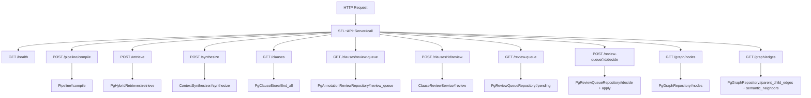
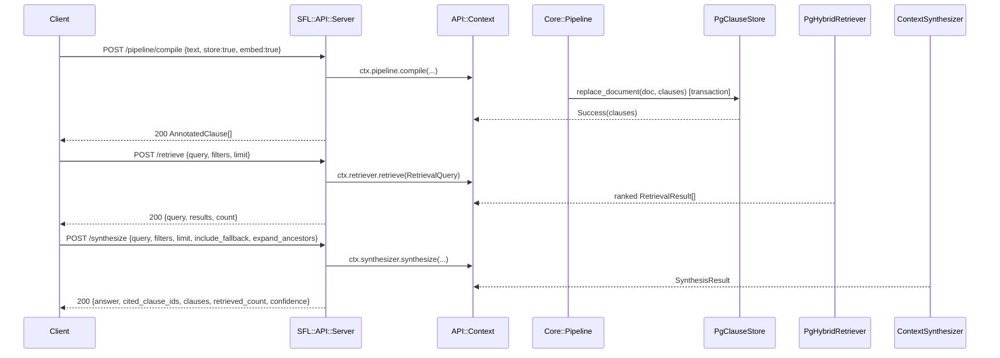

The `sfl-engine` HTTP API is a Rack application (`SFL::API::Server`) exposing the two-pass SFL compiler, hybrid retrieval, context synthesis, clause management, annotation review queues, and the graph view as a set of synchronous HTTP routes. All routes serialize `SFL::Core::Types` value objects through `SFL::Core::Wire.dump`, which converts every `Time` attribute to an ISO8601 string, so the wire format is JSON-native and survives a JSON round trip.

> **Host and port:** The engine reads `HOST` and `PORT` environment variables (see `docker-compose.yml`, where the service image binds `HOST=0.0.0.0` and `PORT=3001`). The documentation examples use `http://localhost:3001`, which is the default for local development. All `curl` commands assume that base URL unless noted otherwise.

> **Routing note:** The codebase refactored the legacy async `Compiler::API::Server` surface away in favor of a synchronous, single-purpose router: `POST /pipeline/compile` is always synchronous, and `POST /clauses/:id/review` no longer jobs out — the re-annotation path runs Pass 2 inline. The only retained async branch is removed entirely.

---

## Wire format

Every route serializes Ruby `Dry::Struct` value objects. `AnnotatedClause` is the primary document shape returned by `/pipeline/compile`, `/clauses`, and the review-queue `edit` branch.

### `AnnotatedClause`

```json
{
  "id": "clause-uuid",
  "text": "The engine compiles the text.",
  "syntactic": {
    "id": "syntactic-uuid",
    "text": "The engine compiles the text.",
    "tokens": [...],
    "groups": [...],
    "root_index": 2,
    "sentence_index": 0,
    "document_id": "doc-uuid",
    "parent_clause_id": null,
    "readability": null
  },
  "ideational": {
    "clause_id": "clause-uuid",
    "process_type": "material",
    "participants": [...],
    "circumstances": [...],
    "raw_transitivity": {}
  },
  "interpersonal": {
    "clause_id": "clause-uuid",
    "mood": "declarative",
    "modality_weight": 0.8,
    "tenor": 0.5,
    "speaker_attitude": "objective",
    "reasoning": "...",
    "annotation_source": "llm",
    "reasoning_trace": {
      "premises": [{ "label": "...", "value": "..." }],
      "inference_rule": "SFL mood + modality rule",
      "conclusion": { "mood": "declarative", "modality_weight": 0.8 },
      "confidence": 0.92,
      "derivation_hash": "sha256-hex-string",
      "generated_at": "2023-01-01T00:00:00Z"
    },
    "raw_classification": "declarative",
    "classification_status": "canonical",
    "untrusted": false
  },
  "textual": null,
  "document_id": "doc-uuid",
  "compiled_at": "2023-01-01T00:00:00Z",
  "untrusted": false
}
```

Sources: `/home/b08x/WorkspaceV3/sfl-engine/docs/api-reference.md` (wire format section); `/home/b08x/WorkspaceV3/sfl-engine/lib/sfl/core/types/annotated_clause.rb`; `/home/b08x/WorkspaceV3/sfl-engine/lib/sfl/core/wire.rb`

### `RetrievalResult`

```json
{
  "clause_id": "clause-uuid",
  "text": "The engine compiles the text.",
  "document_id": "doc-uuid",
  "rrf_score": 0.95,
  "semantic_rank": 1,
  "keyword_rank": 2,
  "mood": "indicative",
  "tenor": 0.5,
  "process_type": "material",
  "modality_weight": 0.8,
  "annotation_source": "llm",
  "untrusted": false,
  "parent_clause_id": null
}
```

Sources: `/home/b08x/WorkspaceV3/sfl-engine/docs/api-reference.md`; `/home/b08x/WorkspaceV3/sfl-engine/lib/sfl/core/types/retrieval_result.rb`

---

## Route map

The following diagram shows how each route maps to a single `API::Context` collaborator.



Sources: `/home/b08x/WorkspaceV3/sfl-engine/lib/sfl/api/server.rb`; `/home/b08x/WorkspaceV3/sfl-engine/lib/sfl/api/context.rb`

---

## Health

### `GET /health`

Verifies API availability with no request body and no authentication.

**Request:** None.

**Response (200):**

```json
{
  "status": "ok"
}
```

**Example:**

```bash
curl -X GET http://localhost:3001/health
```

The route is also exempt from CORS filtering, and the server returns `204` with `access-control-allow-methods` and `access-control-allow-headers` on an `OPTIONS` preflight. A non-allowlisted origin receives no `access-control-allow-origin` header.

Sources: `/home/b08x/WorkspaceV3/sfl-engine/docs/api-reference.md`; `/home/b08x/WorkspaceV3/sfl-engine/app/routes/health.rb`; `/home/b08x/WorkspaceV3/sfl-engine/lib/sfl/api/server.rb` (CORS/OPTIONS handling)

---

## Compilation

### `POST /pipeline/compile`

Compiles raw text into an array of `AnnotatedClause` objects using the two-pass pipeline (Pass 1 spaCy sidecar, Pass 2 LLM annotation). The call is **synchronous**; there is no background job endpoint. `resume` is hard-coded to `false`, so the API never resumes a cached CLI session. The commit boundary is a single transaction that deletes then inserts the document's clauses (`replace_document`), so the store stays consistent even on recompile.

**Request body:**

| Field | Type | Required | Default | Description |
|---|---|---|---|---|
| `text` | string | Yes | — | Raw text to compile. Must be non-empty after trimming. |
| `document_id` | string | No | `api-<uuid>` | Document identifier persisted to `clauses.document_id`. |
| `store` | boolean | No | `false` | Persist clauses to Postgres (`PgClauseStore#replace_document`). |
| `embed` | boolean | No | `false` | Trigger vector embedding generation for the stored clauses. |

**Response (200):** Array of `AnnotatedClause` (Wire format).

**Errors:**

| Status | Condition |
|---|---|
| 400 | `text` is missing or empty after trimming. |
| 500 | `Pipeline#compile` returns a `Failure` (e.g., sidecar timeout). The raw failure detail is not surfaced to the client. |

**Example:**

```bash
curl -X POST http://localhost:3001/pipeline/compile \
  -H "Content-Type: application/json" \
  -d '{"text": "Compile this text.", "store": true, "embed": true}'
```

Sources: `/home/b08x/WorkspaceV3/sfl-engine/docs/api-reference.md`; `/home/b08x/WorkspaceV3/sfl-engine/app/routes/pipeline.rb`; `/home/b08x/WorkspaceV3/sfl-engine/lib/sfl/api/server.rb` (`compile_pipeline`); `/home/b08x/WorkspaceV3/sfl-engine/lib/sfl/store/pg_clause_store.rb` (`replace_document`)

---

## Retrieval

### `POST /retrieve`

Performs hybrid retrieval using reciprocal rank fusion (RRF) of a vector arm and a keyword arm, with scalar stance filters applied in SQL against `interpersonal_payloads` and `ideational_payloads`.

**Request body:**

| Field | Type | Required | Default | Description |
|---|---|---|---|---|
| `query` | string | Yes | — | Search query. Must be non-empty after trimming. |
| `filters` | object | No | `{}` | `RetrievalFilters` (see below). Only non-nil keys are applied. |
| `limit` | integer | No | `10` | Maximum results. Minimum is 1. |

**`RetrievalFilters` fields:**

| Field | Type | Values |
|---|---|---|
| `mood` | string | `declarative`, `interrogative`, `imperative`, `exclamative`, `indicative`, `minor`, `fragment` |
| `process_type` | string | `material`, `mental`, `relational`, `behavioral`, `verbal`, `existential` |
| `source_type` | string | free-form provenance tag, e.g. `api`, `chat_native`, `vault_markdown` |
| `min_modality` | float | 0.0 – 1.0 |
| `max_modality` | float | 0.0 – 1.0 |
| `min_tenor` | float | 0.0 – 1.0 |
| `max_tenor` | float | 0.0 – 1.0 |

**Response (200):**

```json
{
  "query": "search term",
  "results": [
    {
      "clause_id": "clause-uuid",
      "text": "The engine compiles the text.",
      "rrf_score": 0.95,
      "semantic_rank": 1,
      "keyword_rank": 2,
      "mood": "indicative",
      "tenor": 0.5,
      "process_type": "material",
      "modality_weight": 0.8,
      "annotation_source": "llm",
      "untrusted": false,
      "parent_clause_id": null
    }
  ],
  "count": 1
}
```

**Errors:**

| Status | Condition |
|---|---|
| 400 | `query` is missing or empty. |

**Example:**

```bash
curl -X POST http://localhost:3001/retrieve \
  -H "Content-Type: application/json" \
  -d '{"query": "database", "filters": {"mood": "indicative"}, "limit": 5}'
```

Sources: `/home/b08x/WorkspaceV3/sfl-engine/docs/api-reference.md`; `/home/b08x/WorkspaceV3/sfl-engine/app/routes/retrieve.rb`; `/home/b08x/WorkspaceV3/sfl-engine/lib/sfl/api/server.rb` (`retrieve`); `/home/b08x/WorkspaceV3/sfl-engine/lib/sfl/core/types/retrieval_filters.rb`; `/home/b08x/WorkspaceV3/sfl-engine/lib/sfl/store/pg_hybrid_retriever.rb`

---

## Synthesis

### `POST /synthesize`

Performs retrieval-augmented generation by retrieving the top-ranked clauses, then synthesizing an answer with the `ContextSynthesizer`.

**Request body:**

| Field | Type | Required | Default | Description |
|---|---|---|---|---|
| `query` | string | Yes | — | Question to answer. Must be non-empty after trimming. |
| `filters` | object | No | `{}` | Same `RetrievalFilters` keys as `/retrieve`, passed as a **symbolized hash** to the synthesizer. |
| `limit` | integer | No | `10` | Maximum clauses to retrieve as context. Minimum is 1. |
| `include_fallback` | boolean | No | `false` | Fall back to general LLM knowledge if retrieved context is insufficient. |
| `expand_ancestors` | boolean | No | `false` | Expand retrieved child clauses up to their root parents before synthesis. |

**Response (200):**

```json
{
  "query": "What is the database?",
  "answer": "The database is PostgreSQL.",
  "cited_clause_ids": ["clause-uuid"],
  "clauses": [
    {
      "clause_id": "clause-uuid",
      "text": "The engine compiles the text.",
      "rrf_score": 0.95,
      "semantic_rank": 1,
      "keyword_rank": 2,
      "mood": "indicative",
      "tenor": 0.5,
      "process_type": "material",
      "modality_weight": 0.8,
      "annotation_source": "llm",
      "untrusted": false,
      "parent_clause_id": null
    }
  ],
  "retrieved_count": 1,
  "confidence": 0.95
}
```

**Errors:**

| Status | Condition |
|---|---|
| 400 | `query` is missing or empty. |

**Example:**

```bash
curl -X POST http://localhost:3001/synthesize \
  -H "Content-Type: application/json" \
  -d '{"query": "How does the pipeline work?", "include_fallback": true, "expand_ancestors": true}'
```

Sources: `/home/b08x/WorkspaceV3/sfl-engine/docs/api-reference.md`; `/home/b08x/WorkspaceV3/sfl-engine/app/routes/synthesize.rb`; `/home/b08x/WorkspaceV3/sfl-engine/lib/sfl/api/server.rb` (`synthesize`); `/home/b08x/WorkspaceV3/sfl-engine/lib/sfl/retrieval/context_synthesizer.rb`

---

## Clause management

### `GET /clauses`

Lists and filters persisted clauses. `document_id` and `annotation_source` are applied to the outer `clauses` table, while the retrieval-style scalar filters (`mood`, `process_type`, `source_type`, `min_modality`, `max_modality`, `min_tenor`, `max_tenor`) are applied inside the joined payload tables. All filter values are case-sensitive and must be valid; the `RetrievalFilters` Dry::Struct uses `schema.strict`, so a typo in a key raises at construction time rather than silently no-op-ing.

**Query parameters:**

| Parameter | Type | Required | Default | Description |
|---|---|---|---|---|
| `document_id` | string | No | — | Filter by document ID. |
| `annotation_source` | string | No | — | Filter by source, e.g. `llm`, `spacy`. |
| `source_type` | string | No | — | Filter by source type (free-form provenance). |
| `mood` | string | No | — | Filter by mood. |
| `process_type` | string | No | — | Filter by process type. |
| `min_modality` | float | No | — | Filter minimum modality weight. |
| `max_modality` | float | No | — | Filter maximum modality weight. |
| `min_tenor` | float | No | — | Filter minimum tenor. |
| `max_tenor` | float | No | — | Filter maximum tenor. |
| `limit` | integer | No | `50` | Pagination limit (minimum 1). |
| `offset` | integer | No | `0` | Pagination offset. |

**Response (200):**

```json
{
  "clauses": [
    {
      "id": "clause-uuid",
      "text": "The engine compiles the text.",
      "syntactic": { ... },
      "ideational": { ... },
      "interpersonal": { ... },
      "textual": null,
      "document_id": "doc-uuid",
      "compiled_at": "2023-01-01T00:00:00Z",
      "untrusted": false
    }
  ],
  "total": 100,
  "limit": 50,
  "offset": 0
}
```

**Example:**

```bash
curl -X GET "http://localhost:3001/clauses?document_id=doc-uuid&limit=10"
```

Sources: `/home/b08x/WorkspaceV3/sfl-engine/docs/api-reference.md`; `/home/b08x/WorkspaceV3/sfl-engine/app/routes/clauses.rb`; `/home/b08x/WorkspaceV3/sfl-engine/lib/sfl/api/server.rb` (`list_clauses`); `/home/b08x/WorkspaceV3/sfl-engine/lib/sfl/store/pg_clause_store.rb`; `/home/b08x/WorkspaceV3/sfl-engine/lib/sfl/store/clause_filters.rb`

---

### `GET /clauses/review-queue`

Gets the paginated **annotation review queue** — the audit log of accepted/rejected/re_annotated annotation decisions on clauses. This is a separate endpoint from the content-review queue (`GET /review-queue`).

**Query parameters:**

| Parameter | Type | Required | Default | Description |
|---|---|---|---|---|
| `limit` | integer | No | `50` | Pagination limit (minimum 1). |
| `offset` | integer | No | `0` | Pagination offset. |

**Response (200):**

```json
{
  "clauses": [
    {
      "id": "review-uuid",
      "clause_id": "clause-uuid",
      "decision": "accepted",
      "original_annotation_source": "llm",
      "reviewer": "admin",
      "notes": "Looks fine",
      "reviewed_at": "2023-01-01T00:00:00Z"
    }
  ],
  "total": 5,
  "limit": 50,
  "offset": 0
}
```

**Example:**

```bash
curl -X GET http://localhost:3001/clauses/review-queue
```

Sources: `/home/b08x/WorkspaceV3/sfl-engine/docs/api-reference.md`; `/home/b08x/WorkspaceV3/sfl-engine/app/routes/clauses.rb` (`review-queue`); `/home/b08x/WorkspaceV3/sfl-engine/lib/sfl/store/pg_annotation_review_repository.rb`

---

### `POST /clauses/:id/review`

Submits a review decision on a flagged clause's annotation. This is the annotation-confidence review flow, tracked separately from the content-review queue.

**Request body:**

| Field | Type | Required | Default | Description |
|---|---|---|---|---|
| `decision` | string | Yes | — | One of `accepted`, `rejected`, `re_annotated`. |
| `reviewer` | string | No | — | Reviewer identifier. |
| `notes` | string | No | — | Optional context for the decision. |

**Response (200):** `AnnotationReview` (Wire format).

**Behavior:**

- `accepted` / `rejected` record the audit row only; they never touch the clause payload.
- `re_annotated` re-runs Pass 2 (the single-clause `LLM::EngineBuilder` path) against the clause's already-stored syntactic + ideational payload, writes the new interpersonal payload, then records the audit row. This is the inline version of the legacy `ReannotateClauseJob`.

**Errors:**

| Status | Condition |
|---|---|
| 400 | `decision` is not one of `accepted`, `rejected`, `re_annotated`. |
| 404 | `ClauseReviewService#review` returns nil — the clause does not exist. |

**Example:**

```bash
curl -X POST http://localhost:3001/clauses/clause-uuid/review \
  -H "Content-Type: application/json" \
  -d '{"decision": "accepted", "reviewer": "admin", "notes": "Signs off on interpersonal annotation"}'
```

Sources: `/home/b08x/WorkspaceV3/sfl-engine/docs/api-reference.md`; `/home/b08x/WorkspaceV3/sfl-engine/app/routes/clauses.rb`; `/home/b08x/WorkspaceV3/sfl-engine/lib/sfl/api/clause_review_service.rb`

---

## Content review

### `GET /review-queue`

Gets pending **content reviews** — quarantined generated text (low-quality, fallback, or vision-model output) pending human approval. Separate from the annotation-confidence queue at `/clauses/review-queue`.

**Query parameters:**

| Parameter | Type | Required | Default | Description |
|---|---|---|---|---|
| `modality` | string | No | — | Filter by modality type, e.g. `image`, `text`, `audio`. |
| `limit` | integer | No | `50` | Pagination limit (minimum 1). |
| `offset` | integer | No | `0` | Pagination offset. |

**Response (200):**

```json
{
  "items": [
    {
      "id": "review-item-uuid",
      "modality": "image",
      "document_id": "doc-uuid",
      "source_file": "/path/to/file",
      "generated_text": "The model's draft text.",
      "reason": "low_quality_score",
      "source_type": "api",
      "content_type": "markdown",
      "status": "pending",
      "created_at": "2023-01-01T00:00:00Z"
    }
  ],
  "total": 12,
  "limit": 50,
  "offset": 0
}
```

**Example:**

```bash
curl -X GET "http://localhost:3001/review-queue?limit=10"
```

Sources: `/home/b08x/WorkspaceV3/sfl-engine/docs/api-reference.md`; `/home/b08x/WorkspaceV3/sfl-engine/app/routes/review_queue.rb` (`review-queue list`); `/home/b08x/WorkspaceV3/sfl-engine/lib/sfl/store/pg_review_queue_repository.rb`

---

### `POST /review-queue/:id/decide`

Approves, rejects, or edits a pending content-review entry. All three branches are synchronous.

**Request body:**

| Field | Type | Required | Default | Description |
|---|---|---|---|---|
| `decision` | string | Yes | — | One of `approve`, `edit`, `reject`. |
| `edited_text` | string | Conditional | — | Required when `decision` is `edit`. |
| `reviewer` | string | No | — | Reviewer identifier. |

**Response (200):**

```json
{
  "review": {
    "id": "review-item-uuid",
    "modality": "image",
    "document_id": "doc-uuid",
    "source_file": "/path/to/file",
    "generated_text": "The model's draft text.",
    "reason": "low_quality_score",
    "source_type": "api",
    "content_type": "markdown",
    "status": "approved",
    "reviewer": "admin",
    "reviewed_at": "2023-01-01T00:00:00Z"
  },
  "clauses": [ /* only present when decision == "edit" */ ]
}
```

**Decision semantics:**

| Decision | Behavior |
|---|---|
| `approve` | Marks the row `approved`. Clause storage is untouched (idempotent, no recompile). |
| `reject` | Marks the row `rejected`, then clears the document's stored clauses via `PgClauseStore#replace_document(document_id, [])`. |
| `edit` | Recompiles the edited text through `Pipeline#compile(edited_text, document_id:, store: true, embed: true, resume: false)` in a single transaction, replacing the document's clauses. Returns the new clauses. |

**Errors:**

| Status | Condition |
|---|---|
| 400 | `decision` is invalid; or `edit` is supplied without `edited_text`. |
| 404 | Review item not found. |

**Example:**

```bash
curl -X POST http://localhost:3001/review-queue/review-item-uuid/decide \
  -H "Content-Type: application/json" \
  -d '{"decision": "approve"}'
```

Sources: `/home/b08x/WorkspaceV3/sfl-engine/docs/api-reference.md`; `/home/b08x/WorkspaceV3/sfl-engine/app/routes/review_queue.rb`; `/home/b08x/WorkspaceV3/sfl-engine/lib/sfl/store/pg_review_queue_repository.rb`

---

## Graph

### `GET /graph/nodes`

Fetches clause-graph nodes — clauses in the knowledge-graph view, scoped optionally to one document.

**Query parameters:**

| Parameter | Type | Required | Default | Description |
|---|---|---|---|---|
| `document_id` | string | No | — | Filter by document ID. |

**Response (200):** Array of `GraphNode` (Wire format). Each node carries the clause's SFL stance scalars plus readability metrics.

```json
[
  {
    "id": "clause-uuid",
    "parent_id": null,
    "document_id": "doc-uuid",
    "text": "The engine compiles the text.",
    "mood": "declarative",
    "tenor": 0.5,
    "process_type": "material",
    "node_type": "clause",
    "readability": {
      "flesch": 12.5,
      "kincaid": 6.0,
      "fog": 9.0,
      "word_count": 8
    }
  }
]
```

**Example:**

```bash
curl -X GET "http://localhost:3001/graph/nodes?document_id=doc-uuid"
```

Sources: `/home/b08x/WorkspaceV3/sfl-engine/docs/api-reference.md`; `/home/b08x/WorkspaceV3/sfl-engine/app/routes/graph.rb`; `/home/b08x/WorkspaceV3/sfl-engine/lib/sfl/store/pg_graph_repository.rb`; `/home/b08x/WorkspaceV3/sfl-engine/lib/sfl/core/types/graph_node.rb`

---

### `GET /graph/edges`

Fetches structural parent/child edges and semantic-similarity neighbor edges.

**Query parameters:**

| Parameter | Type | Required | Default | Description |
|---|---|---|---|---|
| `document_id` | string | No | — | Filter by document ID (scope for structural edges only). |

**Response (200):** Array of `GraphEdge` (Wire format).

```json
[
  {
    "from_id": "parent-clause-uuid",
    "to_id": "child-clause-uuid",
    "edge_type": "parent_child"
  },
  {
    "from_id": "seed-clause-uuid",
    "to_id": "neighbor-clause-uuid",
    "edge_type": "semantic_similarity",
    "weight": 0.87
  }
]
```

- `parent_child` edges: `from_id` is the parent's clause id, `to_id` is the child's.
- `semantic_similarity` edges: computed from `embeddings` cosine distance (`1 - pgvector` cosine distance), scoped to a single seed clause with `k=5` and a `min_similarity: 0.75` floor.

**Example:**

```bash
curl -X GET "http://localhost:3001/graph/edges?document_id=doc-uuid"
```

Sources: `/home/b08x/WorkspaceV3/sfl-engine/docs/api-reference.md`; `/home/b08x/WorkspaceV3/sfl-engine/app/routes/graph.rb`; `/home/b08x/WorkspaceV3/sfl-engine/lib/sfl/store/pg_graph_repository.rb`; `/home/b08x/WorkspaceV3/sfl-engine/lib/sfl/core/types/graph_edge.rb`

---

## Request/response conventions

### JSON body parsing

Every POST route reads the request body with `Rack::Request`, parses it as JSON, and raises `ArgumentError` for malformed bodies. The server maps `ArgumentError` to HTTP 400. Invalid JSON produces `400 { "error": "Invalid JSON body: ..." }`.

### Error envelope

All error responses use a consistent shape:

```json
{ "error": "message", "request_id": "<uuid>" }
```

- The `request_id` is a `SecureRandom.uuid` generated per request and logged server-side.
- The raw exception message is **not** sent to clients (a deliberate security boundary). It appears only when the server is constructed with `debug_errors: true` (`SFL_API_DEBUG_ERRORS=true`).
- 404 responses additionally echo the failed resource id, e.g. `{ "error": "Not Found", "path": "/nonexistent" }` for unknown routes, and `{ "error": "clause not found", "id": "..." }` for a missing clause.

### CORS

The server is a strict allowlist CORS implementation. Allowed origins are read from `SFL_API_CORS_ORIGINS` at boot (comma-separated). Preflight requests (`OPTIONS`) return `204` with the allowlisted methods and headers.

Sources: `/home/b08x/WorkspaceV3/sfl-engine/lib/sfl/api/server.rb`; `/home/b08x/WorkspaceV3/sfl-engine/.env.example` (references `SFL_API_CORS_ORIGINS`); `/home/b08x/WorkspaceV3/sfl-engine/spec/api/server_spec.rb`

### Wire serialization

All success payloads are serialized with `SFL::Core::Wire.dump`. This converts `Time` attributes to ISO8601 strings and leaves everything else as JSON-serializable data. The `retrieval_result` and `synthesis_result` shapes are therefore JSON-native and do not require a `load_*` counterpart in the Wire module.

Sources: `/home/b08x/WorkspaceV3/sfl-engine/lib/sfl/core/wire.rb`

---

## End-to-end request sequence

The following sequence ties together the two most representative API interactions: compile → store → retrieve → synthesize.



Sources: `/home/b08x/WorkspaceV3/sfl-engine/lib/sfl/api/server.rb`; `/home/b08x/WorkspaceV3/sfl-engine/lib/sfl/api/context.rb`; `/home/b08x/WorkspaceV3/sfl-engine/lib/sfl/core/pipeline.rb`

---

## Navigation

- For route health and lifecycle: see [Roda Routes Architecture](25-roda-routes-architecture).
- For the underlying database tables and wire format, see [Data Model](18-database-schema).
- For the two-pass pipeline being invoked by `/pipeline/compile`: see [Two-Pass Pipeline Architecture](7-two-pass-pipeline-architecture).
- For the hybrid retrieval and RRF scoring used by `/retrieve` and `/synthesize`: see [Hybrid Retrieval with RRF](20-hybrid-retrieval-with-rrf).
- For the lens, argument, and stance concepts used in the filters: see [Systemic Functional Linguistics Concepts](6-systemic-functional-linguistics-concepts).