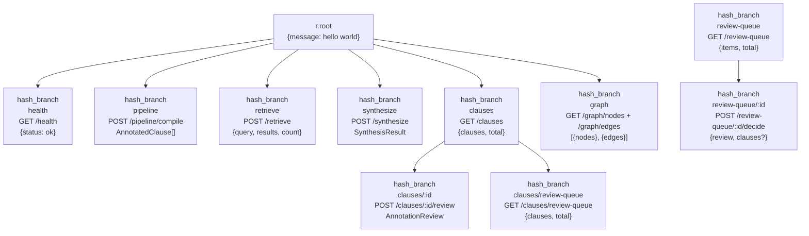
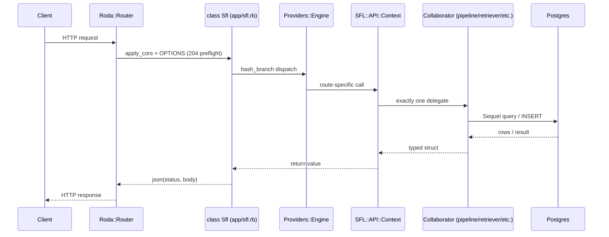

The Roda routes layer in `sfl-engine` is the **HTTP driving adapter** of a hexagonal (ports-and-adapters) architecture. It translates browser and CLI-generated HTTP requests into use-case calls against a single, shared composition root (`Providers::Engine` → `SFL::API::Context`), then serializes the responses. All business logic lives one level deeper — in `SFL::Core` (pipeline, retrievers, annotators) and `SFL::Store` (Postgres repositories). The routes layer itself contains **zero business logic**: it validates input, delegates to exactly one Context collaborator per route, applies CORS, and formats JSON.

> **Scope note:** This page documents the Roda application surface (`app/sfl.rb` + `app/routes/*.rb` + `config.ru` + `app/config/providers/engine.rb`). For the database schema that backs these routes, see [Data Model](data-model.md). For the underlying two-pass pipeline this layer invokes, see [Two-Pass Pipeline Architecture](7-two-pass-pipeline-architecture).

## Routing Topology: One Roda App, Eleven Branch Points

`app/sfl.rb` declares `class Sfl < Roda` and loads all routes via `autoload_hash_branch_dir("./app/routes")`. Each route file is a `class Sfl` with a `hash_branch` block. The top-level route tree is:



Every branch uses `r.is` or `r.on String` to match path segments. Two routes use the `r.on String` dynamic-segment pattern — `/clauses/:id/review` and `/review-queue/:id/decide` — because the resource ID must be captured before matching the fixed `review`/`decide` suffix. Both branch points share the same `ReviewDecision` / `ReviewQueueDecision` enums for input validation, keeping the contract consistent.

Sources: [app/sfl.rb](app/sfl.rb#L1-L64) · [app/routes/health.rb](app/routes/health.rb#L1-L8) · [app/routes/pipeline.rb](app/routes/pipeline.rb#L1-L18) · [app/routes/retrieve.rb](app/routes/retrieve.rb#L1-L26) · [app/routes/synthesize.rb](app/routes/synthesize.rb#L1-L24) · [app/routes/clauses.rb](app/routes/clauses.rb#L1-L73) · [app/routes/review_queue.rb](app/routes/review_queue.rb#L1-L77) · [app/routes/graph.rb](app/routes/graph.rb#L1-L27)

## Composition Root: The Shared Wiring Path

The most important architectural fact about the Roda layer is that it does **not** build its collaborators itself. `config.ru` → `run Sfl` → `Providers::Engine.boot` → `SFL::API::Context.build`. The same `Context` struct is consumed by the CLI (`exe/sfl-analyze`), the TUI (`exe/sfl-tui`), and the HTTP daemon, which is what guarantees feature parity across all four modes.

```mermaid
flowchart LR
    config.ru["config.ru<br/>run Sfl"]
    engine["Providers::Engine<br/>.boot(sfl_boot)"]
    context["SFL::API::Context<br/>Struct — one object graph<br/>shared by CLI + Roda"]
    
    config.ru --> engine
    engine --> context
    context --> pipeline["ctx.pipeline<br/>Core::Pipeline<br/>two-pass compile"]
    context --> retriever["ctx.retriever<br/>PgHybridRetriever<br/>RRF + scalar filters"]
    context --> synthesizer["ctx.synthesizer<br/>ContextSynthesizer<br/>RAG generation"]
    context --> clause_store["ctx.clause_store<br/>PgClauseStore<br/>persist/list"]
    context --> review_q["ctx.review_queue_repo<br/>PgReviewQueueRepository<br/>content review"]
    context --> annot_q["ctx.annotation_review_repo<br/>PgAnnotationReviewRepository<br/>annotation audit"]
    context --> pass2["ctx.pass_two<br/>LLM::Engine<br/>Pass 2 annotator"]
    context --> review_svc["ctx.clause_review_service<br/>ClauseReviewService<br/>transaction wrapper"]
    context --> graph["ctx.graph_repository<br/>PgGraphRepository<br/>graph view"]
    
    subgraph sfl-engine ["sfl-engine"]
        context
    end
    
    subgraph cli ["CLI (exe/sfl-analyze)"]
        cli_ctx["SFL::API::Context"]
    end
    
    cli_ctx -.->|"same Context type"| context
```

`SFL::API::Context` is a `Struct` with `keyword_init: true` — a lightweight, immutable value object. Every route hits exactly one of its fields, never raw SQL or config. This is the **T4 principle** (one factory, not four near-identical copies) applied to composition: the HTTP API never has its own separate wiring.

The `Context.build` method deliberately wraps `CLI.build_pipeline` / `CLI.build_collaborators` rather than duplicating that wiring — the same fix applied by `Pipeline#compile`'s single composition point.

Sources: [app/config/providers/engine.rb](app/config/providers/engine.rb#L1-L20) · [lib/sfl/api/context.rb](lib/sfl/api/context.rb#L1-L80) · [config.ru](config.ru#L1-L7)

## Request Lifecycle: From Rack to Use Case

Every incoming request passes through a consistent sequence. `config.ru` mounts `Rack::Static` for `/public` and runs the `Sfl` Roda app.



Three cross-cutting concerns are handled **inside** the Roda app, not delegated:

1. **CORS** — `apply_cors` echoes the `Origin` request header only if it is in `Providers::Engine.cors_origins` (an allowlist, no wildcard). `CORS_HEADERS` pins `GET, POST, OPTIONS` and `content-type` [app/sfl.rb](app/sfl.rb#L28-L49).
2. **Error handling** — `error` block renders a full exception page in development; `handle_error` returns `400` for `ArgumentError` and `500` with a `request_id` (UUID) logged server-side for production. `not_found` returns `{error: "Not Found", path: request.path_info}` [app/sfl.rb](app/sfl.rb#L45-L62).
3. **OPTIONS preflight** — `r.halt 204` before routing, no body [app/sfl.rb](app/sfl.rb#L15-L17).

`SFL::API::Server` (legacy Rack) is **retained only** until Roda request-spec parity is reached; the Roda app is the live surface [docs/ecosystem-architecture.md](docs/ecosystem-architecture.md#L214-L216).

Sources: [app/sfl.rb](app/sfl.rb#L1-L64) · [config.ru](config.ru#L1-L7) · [docs/ecosystem-architecture.md](docs/ecosystem-architecture.md#L194-L216)

## Route Details

### GET /health

The simplest route. No collaborators. Returns `{"status": "ok"}`.

`health.rb` uses `hash_branch("health")` → `r.is` → `r.get`. No request body, no DB, no error paths.

Sources: [app/routes/health.rb](app/routes/health.rb#L1-L8)

### POST /pipeline/compile

Compiles raw text into `AnnotatedClause[]` via the two-pass pipeline. Body: `{text:, document_id?, store?, embed?}`.

| Parameter | Type | Required | Default |
|---|---|---|---|
| `text` | string | Yes | — |
| `document_id` | string | No | `"api-<uuid>"` |
| `store` | boolean | No | `false` |
| `embed` | boolean | No | `false` |

Route: `hash_branch("pipeline")` → `r.is "compile"` → `r.post`. The route validates `text` is present, derives `document_id`, then calls `ctx.pipeline.compile(text, document_id:, store:, embed:, resume: false)`. The `resume: false` is deliberate: API requests are not a resumable multi-turn CLI session, so the cache port is resolved to the Null cache [lib/sfl/api/context.rb](lib/sfl/api/context.rb#L37-L39). Errors: `400` if `text` is missing; `500` if compilation fails (the failure path is the sync exception that propagates to `handle_error`) [app/routes/pipeline.rb](app/routes/pipeline.rb#L8-L15).

Sources: [app/routes/pipeline.rb](app/routes/pipeline.rb#L1-L18) · [lib/sfl/core/pipeline.rb](lib/sfl/core/pipeline.rb#L1-L150)

### POST /retrieve

Hybrid retrieval (pgvector semantic + Postgres full-text keyword) merged with Reciprocal Rank Fusion (RRF). Body: `{query:, filters?, limit?}`.

| Parameter | Type | Required | Default |
|---|---|---|---|
| `query` | string | Yes | — |
| `filters` | object | No | `{}` |
| `limit` | integer | No | `10` |

`build_retrieval_filters` converts the raw body into a `Core::Types::RetrievalFilters` Dry::Struct — strict schema, so a typo'd key raises instead of silently no-oping. `mood`, `process_type`, `source_type` filter as strings; modality/tenor as floats in [0.0, 1.0]. `limit` is clamped with `[body.fetch("limit", 10).to_i, 1].max` to prevent 0/negative routes [app/routes/retrieve.rb](app/routes/retrieve.rb#L1-L26).

Sources: [app/routes/retrieve.rb](app/routes/retrieve.rb#L1-L26) · [lib/sfl/core/types/retrieval_filters.rb](lib/sfl/core/types/retrieval_filters.rb#L1-L41)

### POST /synthesize

RAG generation: hybrid retrieval feeds a numbered, SFL-annotated evidence block to a `DSPy::Predict` synthesis call. Body: `{query:, filters?, limit?, include_fallback?, expand_ancestors?}`.

| Parameter | Type | Required | Default |
|---|---|---|---|
| `query` | string | Yes | — |
| `filters` | object | No | `{}` |
| `limit` | integer | No | `10` |
| `include_fallback` | boolean | No | `false` |
| `expand_ancestors` | boolean | No | `false` |

The route delegates to `ctx.synthesizer.synthesize(query, filters:, limit:, include_fallback:, expand_ancestors:)`. `include_fallback: false` excludes fallback/stub annotations from what the LLM sees and what citations can reference — a fallback 0.5 should not silently ground an answer. `expand_ancestors: true` widens a child chunk's evidence with its ancestor chain, requiring `clause_store` to be injected [lib/sfl/retrieval/context_synthesizer.rb](lib/sfl/retrieval/context_synthesizer.rb#L17-L56).

Sources: [app/routes/synthesize.rb](app/routes/synthesize.rb#L1-L24) · [lib/sfl/retrieval/context_synthesizer.rb](lib/sfl/retrieval/context_synthesizer.rb#L1-L140)

### GET /clauses

Paginated, filterable listing of stored `AnnotatedClause` records. Query params: `document_id`, `annotation_source`, `source_type`, `mood`, `process_type`, `min_modality`, `max_modality`, `min_tenor`, `max_tenor`, `limit` (50), `offset` (0).

Route: `hash_branch("clauses")` → `r.is` (no segment) → `r.get`. Calls `ctx.clause_store.find_all` with `build_retrieval_filters(p.slice(*STRING_CLAUSE_FILTERS, *NUMERIC_CLAUSE_FILTERS))`. Note: `document_id` and `annotation_source` are the only two filters that bypass `RetrievalFilters` (they are not its attributes); they are applied directly to the Sequel scope while scalar stance filters go through `ClauseFilters` [app/routes/clauses.rb](app/routes/clauses.rb#L12-L22).

Sources: [app/routes/clauses.rb](app/routes/clauses.rb#L1-L73) · [lib/sfl/store/pg_clause_store.rb](lib/sfl/store/pg_clause_store.rb#L1-L180) (via `find_all`)

### POST /clauses/:id/review

Human-in-the-loop annotation review. Body: `{decision:, reviewer?, notes?}`.

| Parameter | Type | Required | Default |
|---|---|---|---|
| `decision` | string | Yes | — |
| `reviewer` | string | No | — |
| `notes` | string | No | — |

`decision` must be one of `Core::Types::ReviewDecision` (`accepted`, `rejected`, `re_annotated`). The `r.on String` branch captures `clause_id`, then `r.is "review"` + `r.post` matches. The route validates the decision and delegates to `ctx.clause_review_service.review(clause_id:, decision:, reviewer:, notes:)`. The service wraps the re-annotation write and audit record in a **single database transaction** (issue #2 fix). `accepted`/`rejected` only record the audit row; `re_annotated` re-runs Pass 2 only (no full `Pipeline#compile`), updates the interpersonal payload, and records the audit row — all in one transaction [lib/sfl/api/clause_review_service.rb](lib/sfl/api/clause_review_service.rb#L1-L45).

Sources: [app/routes/clauses.rb](app/routes/clauses.rb#L55-L73) · [lib/sfl/api/clause_review_service.rb](lib/sfl/api/clause_review_service.rb#L1-L45)

### GET /clauses/review-queue

Paginated annotation review queue: clauses whose `annotation_source` is not in `TRUSTED_ANNOTATION_SOURCES`, excluding already-accepted clauses. Query params: `limit` (50), `offset` (0). This is the **annotation-confidence** queue (audit trail), **not** the content-review queue at `/review-queue` [app/routes/clauses.rb](app/routes/clauses.rb#L24-L27).

Sources: [app/routes/clauses.rb](app/routes/clauses.rb#L24-L27) · [lib/sfl/store/pg_annotation_review_repository.rb](lib/sfl/store/pg_annotation_review_repository.rb#L1-L110)

### GET /review-queue

Paginated content-review queue (quarantined generated text awaiting human approval). Body: `{modality?, limit?, offset?}`. Delegated to `ctx.review_queue_repo.pending(modality:, limit:, offset:)` — this is the **content-review** flow, entirely separate from `/clauses/review-queue` [app/routes/clauses.rb](app/routes/clauses.rb#L24-L27).

Sources: [app/routes/review_queue.rb](app/routes/review_queue.rb#L14-L23) · [lib/sfl/store/pg_review_queue_repository.rb](lib/sfl/store/pg_review_queue_repository.rb#L1-L90)

### POST /review-queue/:id/decide

Approve, reject, or edit a pending content-review entry. Route: `hash_branch("review-queue")` → `r.on String` (captures `id`) → `r.is "decide"` → `r.post`.

| Parameter | Type | Required | Default |
|---|---|---|---|
| `decision` | string | Yes | — |
| `edited_text` | string | Cond. | required if `decision == "edit"` |
| `reviewer` | string | No | — |

| Decision | Behavior |
|---|---|
| `approve` | Marks reviewed; **storage untouched** |
| `reject` | Marks reviewed; clears stored clauses via `Pipeline#replace_document(document_id, [])` |
| `edit` | Recompiles the edited text through the full pipeline, stores, embeds, and replaces the document's clauses |

The route performs a three-step sequence: `find` → `apply_review_queue_decision` → `decide`. The `edit` branch is the only place a route calls `Pipeline#compile` directly (because it must recompile and persist synchronously) [app/routes/review_queue.rb](app/routes/review_queue.rb#L43-L77).

Sources: [app/routes/review_queue.rb](app/routes/review_queue.rb#L1-L77) · [lib/sfl/core/pipeline.rb](lib/sfl/core/pipeline.rb#L110-L129)

### GET /graph/nodes and GET /graph/edges

The server-side replacement for the frontend graph state. Both return data from `ctx.graph_repository` (a `PgGraphRepository`):

| Endpoint | Method | Delegates to |
|---|---|---|
| `/graph/nodes?document_id?` | GET | `graph_repository.nodes(document_id:)` → `GraphNode[]` |
| `/graph/edges?document_id?` | GET | `graph_repository.parent_child_edges(document_id:)` + `graph_repository.semantic_neighbors(...)` → `GraphEdge[]` |

Edges combine **structural** (parent/child chunk links) and **semantic** (pgvector cosine-similarity neighbors, min_similarity 0.75, k=5) edges. The graph is read-only from the client's perspective — no `/graph/:node` mutation routes exist.

Sources: [app/routes/graph.rb](app/routes/graph.rb#L1-L27) · [lib/sfl/store/pg_graph_repository.rb](lib/sfl/store/pg_graph_repository.rb#L1-L120)

## How Data Serialization Works

Every route that returns structured data serializes via `SFL::Core::Wire.dump`. This is a deliberate boundary: `Dry::Struct` types carry `Time` values that do not survive JSON round-trip. `Wire.dump` stringifies every `Time` to ISO8601, and `Wire.load_annotated_clause`/`load_conversation_turn` reverse the conversion on the way back in [lib/sfl/core/wire.rb](lib/sfl/core/wire.rb#L1-L60).

Payload type mapping (what arrives at `/clauses`, `/retrieve`, `/synthesize`, `/graph`):

| Logical concept | Wire shape |
|---|---|
| `AnnotatedClause` | `{"id", "text", "syntactic": {...}, "ideational": {...}, "interpersonal": {...}, "textual?" , "document_id", "compiled_at", "untrusted"}` |
| `RetrievalResult` | `{"clause_id", "text", "document_id", "rrf_score", "semantic_rank", "keyword_rank", "mood", "tenor", "process_type", "modality_weight", "annotation_source", "untrusted", "parent_clause_id"}` |
| `GraphNode` | `{"id", "parent_id", "document_id", "text", "mood", "tenor", "process_type", "node_type", "readability?"}` |
| `GraphEdge` | `{"from_id", "to_id", "edge_type", "weight?"}` |
| `SynthesisResult` | `{"query", "answer", "cited_clause_ids", "clauses", "retrieved_count", "confidence"}` |
| `AnnotationReview` | `{clause_id, decision, original_annotation_source, reviewer, notes, reviewed_at, created_at}` |

The `Wire` module is the **only** serialization path in the codebase — routes never call `JSON.generate` on domain objects directly.

Sources: [lib/sfl/core/wire.rb](lib/sfl/core/wire.rb#L1-L60) · [lib/sfl/core/types/annotated_clause.rb](lib/sfl/core/types/annotated_clause.rb#L1-L22) · [lib/sfl/core/types/retrieval_result.rb](lib/sfl/core/types/retrieval_result.rb#L1-L25) (inferred from wire dump usage)

## Ports and Adapters: Where the Routes Layer Fits

The Roda app is the **driving adapter** in the hexagon. This diagram maps the code namespaces to pattern roles:

```mermaid
flowchart BT
    subgraph Driving Adapters (Periphery)
        RodaApp["Roda app<br/>app/sfl.rb + app/routes/*"]
        CLI["CLI<br/>exe/sfl-analyze<br/>exe/sfl-tui<br/>exe/sfl-review"]
    end
    
    subgraph Use Cases / Domain
        Pipeline["Core::Pipeline<br/>two-pass compile"]
        Analysis["Analysis::Engine<br/>sources, scorers"]
    end
    
    subgraph Driven Adapters (Infrastructure)
        LLM["LLM::Annotators<br/>Pass 2"]
        Store["SFL::Store<br/>Pg repositories"]
        Ingest["Ingest::Orchestrator"]
    end
    
    subgraph Core (No outward deps)
        Ports["Core::Ports<br/>ClauseStore, Retriever,<br/>Embedder, Annotator"]
        Types["Core::Types<br/>Dry::Struct DTOs"]
    end
    
    RodaApp --> Pipeline
    CLI --> Pipeline
    RodaApp --> Analysis
    CLI --> Analysis
    
    Pipeline --> LLM
    Pipeline --> Store
    Pipeline --> Ingest
    Analysis --> LLM
    Analysis --> Store
    
    LLM --> Ports
    Store --> Ports
    Ports --> Types
```

Key invariants:

- **Routes never build collaborators.** The Roda app and CLI share one `SFL::API::Context` built at composition time. This is why `app/routes/*.rb` files are ~30–70 lines each — they are dispatch + validation + delegation, not factories.
- **The `Store` and `LLM` subnamespaces contain only concrete implementations.** No port interfaces live there; the ports are in `Core::Ports` and are consumed by domain objects, not by routes.
- **`Core::Types` is dependency-free.** `Dry::Struct` value objects cross process boundaries (JSON, CLI output, database, API) but know nothing about HTTP, Postgres, or LLMs.

Sources: [lib/sfl/api/context.rb](lib/sfl/api/context.rb#L1-L80) · [lib/sfl/core/pipeline.rb](lib/sfl/core/pipeline.rb#L1-L150) · [lib/sfl/store/pg_clause_store.rb](lib/sfl/store/pg_clause_store.rb#L1-L180)

## HTTP Error Contract

The Roda app defines three error paths, all returning JSON:

| Route | HTTP Status | Body |
|---|---|---|
| Missing required field (`text`, `query`, `edited_text`) | `400` | `{ error: "<message>" }` (via `ArgumentError`) |
| Unknown path | `404` | `{ error: "Not Found", path: request.path_info }` |
| Unexpected exception | `500` | `{ error: "Internal Server Error", request_id: "<uuid>", message?: "<raw exception>" }` |

All exceptions are logged to stderr with `request_id`, class, route, message, and a 10-line backtrace excerpt. In non-production, the exception page is rendered from `/public/exception_page.css` [app/sfl.rb](app/sfl.rb#L45-L62). The `request_id` pattern gives operators a way to correlate a client-reported failure with server-side logs.

Sources: [app/sfl.rb](app/sfl.rb#L45-L62) · [spec/api/server_spec.rb](spec/api/server_spec.rb#L136-L194)

## Design Rationale

The Roda routes layer embodies four deliberate decisions:

1. **Thin HTTP adapter.** Routes contain no business logic, no model construction, no direct DB calls. Every route's body is roughly: read params → validate → one delegate → serialize. This keeps the HTTP surface fungible: the CLI, TUI, and future frontend consume the same use cases through one Context.
2. **One composition root.** `Providers::Engine` + `SFL::API::Context` is shared by all four modes (CLI, TUI, review GUI, HTTP daemon). Changes to collaborators cannot drift between CLI and API — the tri-mode guarantee holds.
3. **Synchronous-only API.** `sfl-jobs` was dropped in Phase 5, so `/pipeline/compile` and `/clauses/:id/review` are always synchronous. The legacy async branches (POST `/workflows`, Gush/Sidekiq-backed) were explicitly deleted, not ported. This simplifies both the code and the deployment [lib/sfl/api/server.rb](lib/sfl/api/server.rb#L1-L30).
4. **Strict schema validation via Dry::Struct.** `RetrievalFilters` and `RetrievalQuery` are `schema.strict` Dry::Structs; a typo'd key raises immediately at the boundary rather than being silently ignored. This is the "never let bad data cross a process boundary" discipline applied to the HTTP layer.

Sources: [app/sfl.rb](app/sfl.rb#L1-L64) · [lib/sfl/api/context.rb](lib/sfl/api/context.rb#L1-L80) · [lib/sfl/core/pipeline.rb](lib/sfl/core/pipeline.rb#L1-L150)

## Related Pages

For the surrounding architecture, see:

- [Two-Pass Pipeline Architecture](7-two-pass-pipeline-architecture) — the use case the `/pipeline/compile` route delegates to
- [Hexagonal Architecture Pattern](8-hexagonal-architecture-pattern) — the broader pattern the Roda layer is the driving adapter of
- [Data Model](data-model.md) — the Postgres schema backing `PgClauseStore`, `PgHybridRetriever`, and graph queries
- [Hybrid Retrieval with RRF](20-hybrid-retrieval-with-rrf) — retrieval policy behind `/retrieve` and `/synthesize`
- [Review Queues](29-review-queues) — both review flows (`/clauses/:id/review` and `/review-queue/:id/decide`)
- [CLI Usage](23-cli-usage) and [HTTP API Reference](24-http-api-reference) — the CLI and HTTP surface that share this composition