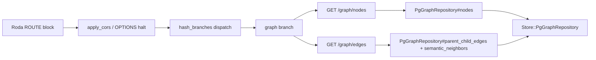

The `GET /graph/nodes` and `GET /graph/edges` endpoints expose the clause-level knowledge graph as JSON. They are the **server-side replacement for the syncopated-context-compiler (SCC) subfeature** whose in-memory `ConvoGraph` + `query.ts` executor (built in `src/lib/graph/`) has been subsumed. Instead of keeping the whole graph in browser state, the engine persists every clause with a self-referential `parent_clause_id` and exposes two read-only roots over a `PgGraphRepository` that reuses the same three-table join (`clauses` + `ideational_payloads` + `interpersonal_payloads`) the rest of the app already builds.

---

## Route Registration and Wiring

The graph endpoints live in `app/routes/graph.rb` and are wired into the Roda router via the `hash_branch("graph")` DSL in `app/sfl.rb`. The `Providers::Engine` class (app/config/providers/engine.rb) wraps `SFL::API::Context.build`, and the `graph_repository` is one of nine fields the `Context.build` factory assembles — so every route, including the graph endpoints, pulls from the same composition root the CLI uses for `Pipeline#compile`. This keeps the HTTP adapter and the CLI on a single object graph.

**Route dispatch diagram:**



The endpoints are **read-only**: both handlers call repository queries and `SFL::Core::Wire.dump`, never a write path. `Sources: [app/routes/graph.rb](app/routes/graph.rb#L1-L23)`

---

## GET /graph/nodes

### Purpose

Fetches clause graph nodes — the `AnnotatedClause` rows that form the knowledge graph (external_id, text, document_id, mood, tenor, process_type, readability). Optional `document_id` scope limits the result to one document. The response is an **array of `GraphNode` Wire-format objects**, not a `{ clauses: [...] }` envelope.

### Request

| Parameter | Type | Required | Default | Description |
|-----------|------|----------|---------|-------------|
| `document_id` | string | No | — | Filter to a single document's clauses |

### Implementation

The route handler is a single `r.get` block:

```ruby
r.is "nodes" do
  r.get do
    document_id = presence(r.params["document_id"])
    ctx.graph_repository.nodes(document_id:).map { |n| SFL::Core::Wire.dump(n) }
  end
end
```

`document_id` is coerced through `presence` (falsy values become `nil`, meaning "all documents"). The repository then executes a **three-table inner join** (`clauses` ⟕ `ideational_payloads` ⟕ `interpersonal_payloads`), optionally scopes by `document_id`, selects a fixed column set, and maps each row to a `Core::Types::GraphNode`.

**Column projection in `PgGraphRepository#nodes`:**

```ruby
scope.select(
  Sequel[:clauses][:external_id].as(:id),
  Sequel[:clauses][:parent_clause_id].as(:parent_id),
  Sequel[:clauses][:document_id],
  Sequel[:clauses][:text],
  Sequel[:clauses][:readability_flesch],
  Sequel[:clauses][:readability_kincaid],
  Sequel[:clauses][:readability_fog],
  Sequel[:clauses][:word_count],
  Sequel[:interpersonal_payloads][:mood],
  Sequel[:interpersonal_payloads][:tenor],
  Sequel[:ideational_payloads][:process_type]
).all.map { |row| build_node(row) }
```

`Sources: [app/routes/graph.rb](app/routes/graph.rb#L3-L8) · [lib/sfl/store/pg_graph_repository.rb](lib/sfl/store/pg_graph_repository.rb#L20-L37)`

### GraphNode data model

`GraphNode` is a `Dry::Struct` — a value object, not a persisted entity — living in `lib/sfl/core/types/graph_node.rb`. Its attribute set is deliberately **flatted** from the three-table join:

| Attribute | Source table | Type |
|-----------|-------------|------|
| `id` | `clauses.external_id` | `String` |
| `parent_id` | `clauses.parent_clause_id` | `String` (optional) |
| `document_id` | `clauses.document_id` | `String` (optional) |
| `text` | `clauses.text` | `String` |
| `mood` | `interpersonal_payloads.mood` | `MoodType` (optional) |
| `tenor` | `interpersonal_payloads.tenor` | `TenorValue` (optional) |
| `process_type` | `ideational_payloads.process_type` | `ProcessType` (optional) |
| `node_type` | constant | `"clause"` |
| `readability` | `clauses` readability columns | `Readability` (optional) |

`Sources: [lib/sfl/core/types/graph_node.rb](lib/sfl/core/types/graph_node.rb#L10-L20)`

### Readability computation

`build_readability` guards against all-null readability columns: it returns `nil` unless at least one of `readability_flesch`, `readability_kincaid`, `readability_fog`, or `word_count` is present. This mirrors the `clauses` table migration (`011_add_parent_clause_id_to_clauses.rb`) which adds the four readability columns as plain nullable floats alongside `parent_clause_id` — every clause gets scored by `Analysis::ReadabilityScorer`, not just chunks with children.

`Sources: [lib/sfl/store/pg_graph_repository.rb](lib/sfl/store/pg_graph_repository.rb#L95-L103) · [db/migrations/011_add_parent_clause_id_to_clauses.rb](db/migrations/011_add_parent_clause_id_to_clauses.rb)`

---

## GET /graph/edges

### Purpose

Fetches **structural** (parent/child chunking) and **semantic** (embedding-derived similarity) edges for clauses. The response is a flattened array of `GraphEdge` Wire-format objects. Like `/nodes`, it supports optional `document_id` scoping; but unlike `/nodes`, the two edge kinds are **not** combined in a single query — they are fetched in two repository calls and concatenated in Ruby.

### Request

| Parameter | Type | Required | Default | Description |
|-----------|------|----------|---------|-------------|
| `document_id` | string | No | — | Filter to one document's clauses |

### Implementation

```ruby
r.is "edges" do
  r.get do
    document_id = presence(r.params["document_id"])
    repo = ctx.graph_repository

    structural = repo.parent_child_edges(document_id:)
    semantic = repo.nodes(document_id:).flat_map { |n| repo.semantic_neighbors(n.id) }

    (structural + semantic).map { |e| SFL::Core::Wire.dump(e) }
  end
end
```

`Sources: [app/routes/graph.rb](app/routes/graph.rb#L10-L20)`

### Structural edges: parent/child

`parent_child_edges` selects only `:external_id` and `:parent_clause_id` from `clauses`, excluding rows where `parent_clause_id` is `nil` (i.e., only "child" chunks, not roots). Each row is mapped to a `GraphEdge` with `edge_type: "parent_child"` and no weight:

```ruby
Core::Types::GraphEdge.new(from_id: row[:parent_clause_id], to_id: row[:external_id],
  edge_type: "parent_child")
```

The foreign key chain is defined by migration `011_add_parent_clause_id_to_clauses.rb`:

- `clauses.parent_clause_id` → `clauses.external_id` (`ON DELETE CASCADE`, named `:fk_clauses_parent_clause_id`)
- A `CHECK` constraint `fk_clauses_parent_not_self` prevents a clause from pointing to itself
- A `BEFORE INSERT OR UPDATE` Postgres trigger (`clauses_prevent_cycle_trigger`) walks the ancestor chain and raises on any cycle (multi-level cycles A→B→A are blocked)

`Sources: [app/routes/graph.rb](app/routes/graph.rb#L13-L16) · [lib/sfl/store/pg_graph_repository.rb](lib/sfl/store/pg_graph_repository.rb#L41-L49) · [db/migrations/011_add_parent_clause_id_to_clauses.rb](db/migrations/011_add_parent_clause_id_to_clauses.rb)`

### Semantic edges: embedding similarity

`semantic_neighbors(clause_id, k: 5, min_similarity: 0.75)`:

1. Looks up the seed clause's embedding row in `embeddings` via `clause_id`
2. Executes a **pgvector cosine-distance** query against `embeddings.embedding` using the `<=>` operator (`pgvector` extension)
3. Pushes `1 - cosine_distance` as a `similarity` projection
4. Applies a `HAVING` floor (`>= min_similarity`) and `ORDER BY` + `LIMIT k`
5. Returns the top `k` neighbors as `GraphEdge` objects with `edge_type: "semantic_similarity"` and `weight: similarity`

The query is scoped to a **single seed clause** (not a text query) and intentionally excludes the seed itself (`.exclude(clause_id:)`).

`Sources: [lib/sfl/store/pg_graph_repository.rb](lib/sfl/store/pg_graph_repository.rb#L59-L74)`

### GraphEdge data model

`GraphEdge` is a `Dry::Struct` in `lib/sfl/core/types/graph_edge.rb`:

| Attribute | Type | Constraints |
|-----------|------|-------------|
| `from_id` | `String` | always present |
| `to_id` | `String` | always present |
| `edge_type` | `String` | enum: `"parent_child"`, `"semantic_similarity"` |
| `weight` | `Float` (optional) | set for `semantic_similarity` edges only |

`Sources: [lib/sfl/core/types/graph_edge.rb](lib/sfl/core/types/graph_edge.rb#L9-L14)`

---

## Data Flow: From Clause to JSON

**Graph relay diagram:**

```mermaid
graph TD
  A[HTTP GET /graph/nodes?document_id=...] --> B[Roda route handler]
  B --> C{Providers::Engine]
  C --> D[ctx.graph_repository]
  D --> E[Store::PgGraphRepository]
  E --> F[Sequel query: clauses join payloads]
  E --> G[pgvector cosine similarity for neighbors]
  F --> H[GraphNode Dry::Struct]
  G --> I[GraphEdge Dry::Struct]
  H --> J[SFL::Core::Wire.dump]
  I --> J
  J --> K[JSON array response]
```

**Key architectural properties:**

- **No parallel query path**: `PgGraphRepository` reuses the same three-table join `PgClauseStore` / `PgHybridRetriever` already build, avoiding a second SQL route.
- **Wire serialization**:
  1. `GraphNode`/`GraphEdge` Dry::Structs are converted to hashes via `.to_h`
  2. `SFL::Core::Wire.dump` deep-stringifies every `Time` attribute to ISO8601 (so JSON round-trips survive job queues, HTTP, and file persistence)
  3. The `load_*` family (`load_annotated_clause`, `load_conversation_turn`, etc.) is the reverse path for clients that POST reconstructed objects
- **Types are value objects, not persisted**: `GraphNode`, `GraphEdge`, `Readability`, `RetrievalQuery`, `RetrievalFilters` all live in `lib/sfl/core/types/` and are deliberately separated from `SFL::Core::Types` (which only defines scalar/enum aliases). This is a deliberate T4 decision: separate the cross-process boundary from the domain types.
- **Read-only boundary**: neither endpoint writes to any table; the database is purely a query source here.

`Sources: [lib/sfl/core/wire.rb](lib/sfl/core/wire.rb#L19-L90) · [lib/sfl/store/pg_graph_repository.rb](lib/sfl/store/pg_graph_repository.rb) · [lib/sfl/core/types/graph_node.rb](lib/sfl/core/types/graph_node.rb) · [lib/sfl/core/types/graph_edge.rb](lib/sfl/core/types/graph_edge.rb)`

---

## Relationship to the Broader API

The graph endpoints are one of the seven HTTP route hash branches registered in `app/sfl.rb`:

| Branch | File | Method | Purpose |
|--------|------|--------|---------|
| `clauses` | `app/routes/clauses.rb` | GET, POST | Clause listing + review decisions |
| **`graph`** | **`app/routes/graph.rb`** | **GET** | **Nodes + edges** |
| `health` | `app/routes/health.rb` | GET | Pod healthcheck |
| `pipeline` | `app/routes/pipeline.rb` | POST | Compilation |
| `retrieve` | `app/routes/retrieve.rb` | POST | Hybrid retrieval (RRF) |
| `review_queue` | `app/routes/review_queue.rb` | GET, POST | Ingest review queue |
| `synthesize` | `app/routes/synthesize.rb` | POST | Context synthesis |

The graph routes were the **most consequential addition** in the Roda migration commit (`06a3b45`), per `docs/ecosystem-architecture.md`. They are the server-side replacement for the SCC subfeature's in-memory `ConvoGraph` and `query.ts` (215-line executor with its own schema DSL). The browser graph now caches over engine reads rather than holding a speculative full-graph dump in memory.

**Integration contract reference** (from `docs/ecosystem-architecture.md`):

| Route | Status | Purpose |
|-----|--------|---------|
| `GET /graph/nodes` | live | Graph nodes, optional `document_id` |
| `GET /graph/edges` | live | Structural parent/child + semantic neighbor edges |

`Sources: [docs/ecosystem-architecture.md](docs/ecosystem-architecture.md#L48-L60) · [docs/api-reference.md](docs/api-reference.md#L373-L405)`

---

## Table of Route Behavior

| Endpoint | HTTP | Query params | Repository method(s) | Response shape |
|----------|------|-------------|---------------------|----------------|
| `/graph/nodes` | GET | `document_id` (optional) | `nodes(document_id:)` | JSON array of `GraphNode` |
| `/graph/edges` | GET | `document_id` (optional) | `parent_child_edges(document_id:)` + `nodes(document_id:)`.flat_map `{ |n| semantic_neighbors(n.id) }` | JSON array of `GraphEdge` |

---

## Summary

The Graph API endpoints are a **read-only HTTP facade over a persisted clause graph**:

- **`GET /graph/nodes`** returns every clause row (scopeable by `document_id`) as a flat `GraphNode` Wire object — external_id, text, document_id, mood, tenor, process_type, and a nested `Readability` struct.
- **`GET /graph/edges`** returns structural `parent_child` edges (from the self-referential `parent_clause_id`) and semantic `semantic_similarity` edges (pgvector cosine neighbors of each node, scoped to `k=5` with `min_similarity=0.75`), flattened into a single array.
- The graph is **persisted, not in-memory**: every clause has a `parent_clause_id` self-reference with cycle-guard constraints, and `PgGraphRepository` reuses the same three-table join as the rest of the storage layer.
- The **types** (`GraphNode`, `GraphEdge`, `Readability`) live in `lib/sfl/core/types/` as `Dry::Struct` value objects, while **serialization crossing the process boundary** is handled by `SFL::Core::Wire`, which ISO8601-stringifies every `Time` attribute.
- The endpoints **subsume the syncopated-context-compiler's in-memory graph**; browser state is now a cache over engine reads instead of a speculative full-graph dump.

---

## What's Next

- [Postgres Integration](postgres-integration) — the three-table join pattern and `PgGraphRepository` reuse
- [Hybrid Retrieval with RRF](hybrid-retrieval-with-rrf) — how `PgHybridRetriever` and `PgGraphRepository` share the embeddings join
- [Vector Embeddings with pgvector](vector-embeddings-with-pgvector) — the `embeddings` table and cosine-distance queries
- [Core Pipeline Orchestration](core-pipeline-orchestration) — the `Pipeline#compile` that produces the clauses the graph exposes
- [CLI Usage](cli-usage) — how `Providers::Engine` and `SFL::API::Context.build` wire the same graph repository for CLI and HTTP