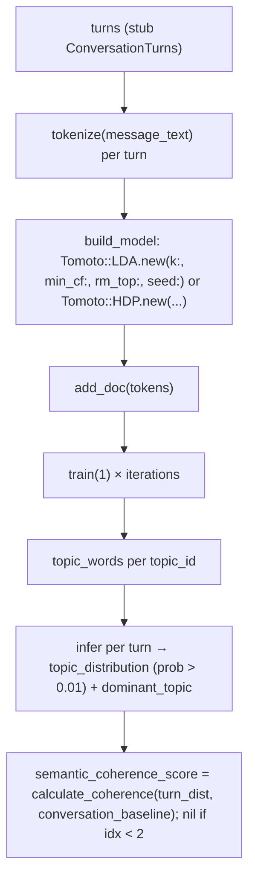

Topic modeling is the analysis subsystem that turns a text corpus into a **topic distribution per document**, plus **topic labels**, a **conversation baseline**, and **topic-shift events**. In this codebase it is the cross-turn lens applied at `Analysis::Engine#analyze`: every turn gets `topic_distribution` and `dominant_topic` on the compiled `Core::Types::ConversationTurn`, the model's label table is surfaced in the markdown/JSON reports, and shifts between consecutive turns become `KeyMoment` events. The whole feature is currently a single adapter around the native `tomoto` gem (LDA fixed-k / HDP auto-k) [lib/sfl/analysis/topic_modeler.rb:10-L14], and the centrepiece of the active refactor contract is in `docs/refactor/TOPIC-MODELING-HEXAGON-USER-STORIES.md` [docs/refactor/TOPIC-MODELING-HEXAGON-USER-STORIES.md:1-L100].

## How the pieces fit together

`Analysis::Engine#analyze` is the only place topic modeling is wired at runtime. For every `#analyze` call it:

1. Returns `[nil, nil, nil, []]` immediately when `topics: nil` or the corpus has fewer than 3 units (`lib/sfl/analysis/engine.rb:210`).
2. Builds one `TopicModeler` per call through `topic_modeler_factory` (`lib/sfl/analysis/engine.rb:58-L68`).
3. Fits it against **stub turns** — neutral `Core::Types::ConversationTurn` structs built from the source's units, with `clauses: []` and neutral `avg_tenor: 0.5` / `avg_modality: 0.5` defaults (`lib/sfl/analysis/engine.rb:209-L227`).
4. Returns `modeler.turns`, `modeler.topic_labels`, and `modeler.detect_topic_shifts` to the compile loop and `build_result` (`lib/sfl/analysis/engine.rb:85-L96`).

The compiled turns carry the fitted values forward:

- `Core::Types::ConversationTurn#topic_distribution` (default `nil`) and `#dominant_topic` (default `nil`) are consumed downstream at `lib/sfl/analysis/engine.rb:285-L286`, `:427`, `:432` (`lib/sfl/core/types/conversation_turn.rb:20-L22`).
- `AnalysisResult#topic_labels` (optional `Hash{Integer => Array<String>}`) and `#topic_evolution` (optional `Array<Hash>` of `{turn_id, timestamp, dominant_topic, topic_distribution}`) are declared at `lib/sfl/core/types/analysis_result.rb:17-L18` and emitted by the formatters at `lib/sfl/formatters/markdown_formatter.rb:216-L238` and `lib/sfl/formatters/json_formatter.rb:29-L32`.
- `metadata[:topics_enabled]` is `true` exactly when `topic_labels` is non-nil (`lib/sfl/analysis/engine.rb:202`).

The HDP/fixed-k switch, the `k` clamp, and the warning text are all in `Engine#topic_k` (`lib/sfl/analysis/engine.rb:480-L522`), which clamps the requested topic count down to `MAX(ceiling, MIN_TOPIC_K)` where `ceiling = doc_count / MIN_DOCS_PER_TOPIC` and `MIN_DOCS_PER_TOPIC = 3`, `MIN_TOPIC_K = 2`, with a `StderrLogger.warn` whenever a reduction happens (`lib/sfl/analysis/engine.rb:503-L522`). The rationale is behind `MIN_DOCS_PER_TOPIC = 3` / `MIN_TOPIC_K = 2`: LDA's posterior contraction needs the document count to grow with `k`, and `k=1` is degenerate because `dominant_topic_id` returns `nil` for any distribution with fewer than 2 topics (`lib/sfl/analysis/engine.rb:480-L501`).

## The current runtime loop (what actually executes today)

**`fit_topics` (Application service → domain port)**
```mermaid
flowchart LR
  UNITS["source.units  (Core::Loaders::Source duck)"]
  TOPICS["topics: Integer / 0 = HDP / nil = off"]
  GUARD["topics && units.size >= 3 ?"]
  STUBS["stub_turns per unit  (turn_id, speaker, message_text)"]
  FACTORY["topic_modeler_factory(k:)"]
  MODELER["TopicModeler#fit(stub_turns)"]
  LABELS["modeler.topic_labels"]
  SHIFTS["modeler.detect_topic_shifts"]
  GUARD -- no --> OUT[]
  GUARD -- yes --> STUBS
  STUBS --> FACTORY
  FACTORY --> MODELER
  MODELER --> LABELS
  MODELER --> SHIFTS
  OUT["[nil, nil, nil, []]"]
```
The modeler is **not** a port yet: there is no `Core::Ports::TopicModeler`, no `Null::TopicModeler`, no `Fake::TopicModeler` — the spec's stand-in `double("topic_modeler", fit: nil, turns: [], topic_labels: {0 => %w[a]}, detect_topic_shifts: [])` is the only contract exercise in the tree, and RuboCop still has to be silenced for it (`spec/analysis/engine_spec.rb:343-L360`) (`docs/refactor/TOPIC-MODELING-HEXAGON-USER-STORIES.md:154-L163`).

**`fit` → `assign_topic` → `assign_coherence_scores_to_turns` (`lib/sfl/analysis/topic_modeler.rb:100-L365`)**

`dominant_topic_id` is the corpus-derived calibration: `excess = (top_prob - uniform) / (1.0 - uniform)`, and the topic is kept only when `excess >= DEFAULT_DOMINANT_THRESHOLD (0.35)` (`lib/sfl/analysis/topic_modeler.rb:148-L156`). The `0.01` probability floor for a non-empty `topic_distribution` lives at `lib/sfl/analysis/topic_modeler.rb:332` (`docs/refactor/TOPIC-MODELING-HEXAGON-USER-STORIES.md:89-L163`).

**`turn_distributions` / `conversation_baseline` / `calculate_coherence` / `detect_topic_shifts` (`lib/sfl/analysis/topic_modeler.rb:191-L270`)**
- `turn_distributions` returns the per-turn distribution for every fitted turn, `[]` before fitting.
- `conversation_baseline` is the uniform-average topic distribution across every turn with a real distribution; `calculate_coherence(turn_dist, baseline_dist) = clamp(1.0 - cosine_distance, 0.0, 1.0).round(4)`; both are pure arithmetic over `Hash` distributions with no tomoto dependency (`lib/sfl/analysis/topic_modeler.rb:241-L270`).
- `detect_topic_shifts(threshold: 0.3)` walks `each_cons(2)`; a shift needs both turns to have a non-nil dominant topic, they must differ, and `cosine_distance(prev.topic_distribution, curr.topic_distribution) >= threshold`. The event shape is `{turn_id, type: "topic_shift", from_topic, to_topic, magnitude: distance.round(4), description}` (`lib/sfl/analysis/topic_modeler.rb:191-L221`).
- `Engine#topic_shifts_moments` maps each event into a `Core::Types::KeyMoment` via `s.slice(:turn_id, :type, :magnitude, :description)` — the exact shape `KeyMoment` declares (`lib/sfl/analysis/engine.rb:130-L131`).

## Tokenization and preprocessing (the domain-specific part)

The adapter uses `PragmaticTokenizer` for lightweight tokenization — intentionally no spaCy round-trip — with topic-modeling-specific options (`lib/sfl/analysis/topic_modeler.rb:86-L98`):

```ruby
TOKENIZER_OPTIONS = {
  language: "en",
  remove_urls: true, hashtags: :remove, mentions: :remove, clean: true,
  punctuation: :none, numbers: :none,
  downcase: true, stem: :porter,
  remove_stop_words: true, min_length: 3,
}.freeze
```

Two production findings are documented as deliberate decisions, not accidental leftovers:

1. **Unicode punctuation is normalized *before* tokenization** — not a second stoplist. `UNICODE_PUNCTUATION_MAP` (frozen at `lib/sfl/analysis/topic_modeler.rb:49-L69`) rewrites U+2019 (the LLM apostrophe) and other curly punctuation to ASCII, plus en/em dashes and ellipsis to ASCII equivalents, so the gem's `en` stoplist matches the text the tokenizer actually sees. The current `:30-L48` comment records the observed failure: LLM-generated prose used U+2019 throughout, so "it's" survived stopword removal and appeared in two different topics of a real run. `expand_contractions: true` was considered and rejected because it would only rewrite the gem's ~100-entry `CONTRACTIONS` hash, leaving every other curly-punctuation failure in place.
2. **No domain stoplist is added on purpose.** The observed contentless terms ("sound", "result", "terms", "thing") are real signal in a linguistics corpus tool; they became salient only because `k=10` over 8 documents forced the model to pad topics with residual vocabulary — the `k` clamp removes that pressure, and the principled lever already exists: `rm_top:` drops the N globally most frequent words measured on the corpus at hand (`lib/sfl/analysis/topic_modeler.rb:73-L85`).

## Persistence and model lifecycle

`#save(path)` raises `SFL::Analysis::Error` when there is no fitted model, and `#load_model(path)` loads `Tomoto::LDA.load(path)`, rebuilds labels, and marks the model fitted (`lib/sfl/analysis/topic_modeler.rb:223-L236`). However, **no caller persists or reloads**: `Engine#fit_topics` constructs a fresh modeler per `#analyze` call and discards it (`_modeler` at `lib/sfl/analysis/engine.rb:89`), so every run re-fits from scratch, topic ids are not comparable across runs over the same corpus, and there is no `topic_models` table in `db/migrations/` (`ls db/migrations/)` shows `001`-`011`, none topic-related) (`docs/refactor/TOPIC-MODELING-HEXAGON-USER-STORIES.md:158-L160`).

## How the current CLI surface maps to the modeler's parameter space

`SFL::CLI` exposes `--topics N` (Integer) on both `conversation` and `documentation` subcommands (`lib/sfl/cli.rb:68`, `:129`, `:139`), and `bench/pipeline_bench.rb:36-L41` defaults to `topics: 3`. The help text is the todo item: **"Number of topics for LDA; 0 = HDP (auto-discover)"** — which is exactly the tomoto parameter space, and a planned migration target for the BERTopic-equivalent semantics (`docs/refactor/TOPIC-MODELING-HEXAGON-USER-STORIES.md:1236-L1300`).

## Architecture posture: least hexagonal subsystem, one implementation

The `docs/refactor/TOPIC-MODELING-HEXAGON-USER-STORIES.md` ledger (read from the working tree, `cat -n` + `awk` + `grep` per its own evidence policy) characterises topic modeling as *"the least hexagonal subsystem in this codebase, and the only analysis capability with no port at all"* — one concrete implementation, one construction site, one already-injected seam (`keywords: `analysis` / `architecture` / `hexagonal` / `ports` / `adr`):

| Element | Location | Status |
|---|---|---|
| `Analysis::TopicModeler` | `lib/sfl/analysis/topic_modeler.rb:29` | concrete class, tomoto adapter |
| `require "tomoto"` / `require "pragmatic_tokenizer"` | `:3` / `:4` | in-process native gems, loaded at file load |
| Fixed-k LDA / HDP switch | `:295-L304` | `Tomoto::LDA.new(k:, min_cf:, rm_top:, seed:)` when `@k`, else `Tomoto::HDP.new(...)` |
| Training knobs | `:109-L111` | `k:`, `min_cf: 3`, `rm_top: 2`, `iterations: 100`, `seed: 42`, `burn_in: nil`, `dominant_threshold:` |
| Model persistence | `:223-L236` | `#save` / `#load_model` exist, no caller |
| Injected factory seam | `engine.rb:58` | `topic_modeler_factory: -> (k:) { TopicModeler.new(k:) }` |
| The only call site | `engine.rb:213` | factory call, then `modeler.fit(stub_turns)` |
| CLI surface | `cli.rb:68`, `:139` | `--topics N` ("0 = HDP"), parsed as Integer at `:139`, default `nil` at `:129` |
| Bench surface | `bench/pipeline_bench.rb:36`, `:41` | `options = { topics: 3, ... }` + `--topics N` |
| Formatter surface | `markdown_formatter.rb:216-238` | `#topic_modeling_section` called at `:46` |

**The public surface the Engine actually consumes is four methods** (`lib/sfl/analysis/engine.rb:214-L215`): `#fit(turns)`, `#turns`, `#topic_labels`, `#detect_topic_shifts` — and the spec's double confirms it (`spec/analysis/engine_spec.rb:344-L345`). No consumer touches tomoto (`docs/refactor/TOPIC-MODELING-HEXAGON-USER-STORIES.md:77-L96`).

## Downstream consumers and the golden-master posture

The same document's §1.1 table enumerates what already reads topic output, all with stable types: `Core::Types::ConversationTurn` carries `topic_distribution`, `dominant_topic`, `semantic_coherence_score` (`lib/sfl/core/types/conversation_turn.rb:20-L22`); `AnalysisResult` carries `topic_labels` and `topic_evolution` (`lib/sfl/core/types/analysis_result.rb:17-L18`); `Engine` reads those fields at `:285-L286`, `:425-L436`, `:462-L469`, `:471-L478`; and the Markdown formatter reads `topic_labels` plus `topic_evolution` at `lib/sfl/formatters/markdown_formatter.rb:217-L235`. There is no new consumer surface to migrate (`docs/refactor/TOPIC-MODELING-HEXAGON-USER-STORIES.md:160`).

There is **no characterization fixture for topic output**: the unit spec at `spec/analysis/topic_modeler_spec.rb:6-L13` pins exact topic ids and labels against a fixed corpus and seed — a unit pin on tomoto's own arithmetic that becomes meaningless the moment the backend changes — and the `AnalysisResult`-level golden master (`spec/analysis/engine_conversation_golden_master_spec.rb:6-L28`) runs the conversation path only (`docs/refactor/TOPIC-MODELING-HEXAGON-USER-STORIES.md:96-L100`).

## Open questions and owned decisions

The refactor plan's open-question ledger is the authoritative source for what is decided, deferred, and not yet verifiable in-tree:

- **Q1** (resolved in rev 2): the modelled unit is the **parent clause** from SFL-EMB-10, not the conversation turn (`lib/sfl/analysis/engine.rb:220-L230` in rev 1). Still, the `parent_clause_id` column is **present but unpopulated** (`db/migrations/011_add_parent_clause_id_to_clauses.rb:21`, indexed at `:27`, FK at `:28-L29`, self-reference CHECK at `:31-L33`), and `Core::Pipeline`'s own comment states it: *"Until a future chunk-splitting pass populates `parent_clause_id`, every clause is a leaf, so this is a no-op today"* (`lib/sfl/core/pipeline.rb:218-L219`), which is why `#leaf_clauses` (`lib/sfl/core/pipeline.rb:232-L235`) returns everything — its `parent_ids` set (`:233`) is empty. This is **R13**, a hard sequencing dependency on SFL-EMB-10 (`docs/refactor/TOPIC-MODELING-HEXAGON-USER-STORIES.md:88-L100`).
- **Q2** (resolved in rev 2): `#reduce_outliers` runs **by default**, `strategy: "distributions"` (default at `_bertopic.py:2385`), `threshold: 0` (default at `_bertopic.py:2387`), with both outlier counts stored (`outlier_count_raw` + `outlier_count_after_reduction`) and `topic_id_before_reduction` per document — so a corpus that clusters badly still reports badly even though the report renders cleanly (`docs/refactor/TOPIC-MODELING-HEXAGON-USER-STORIES.md:1080-L1120`).
- **Q3** (still open): `DEFAULT_DOMINANT_THRESHOLD = 0.35` is a normalised-excess-over-uniform rule calibrated against LDA; its re-derivation against BERTopic's real defaults is deferred until the sidecar exists and BERTopic is importable (`python3 -c "import bertopic"` fails on a missing `dateutil` in this sandbox). No value is asserted here; SFL-TOP-01's characterization specs remain the detector either way (`docs/refactor/TOPIC-MODELING-HEXAGON-USER-STORIES.md:1600-L1680`).
- **Q4** (resolved): the fit payload travels through a **shared temp volume** (NDJSON control line + `payload_path`), not through the pipe — the flush-per-line protocol is preserved byte-for-byte from `sidecar/spacy_sidecar.py:76-L78` (`docs/refactor/TOPIC-MODELING-HEXAGON-USER-STORIES.md:880-L900`).
- **Q5** (still open): how much data one fit sends to the sidecar is unmeasured; the per-run figure is what `Core::Ports::Instrumenter` is for (`docs/refactor/TOPIC-MODELING-HEXAGON-USER-STORIES.md:860-L880`).
- **Q6** (resolved): the graph index was rerunning and verified healthy (3,248 nodes / 5,564 edges, `full`, `complete`), yet `search_graph` and `get_architecture` still return `{}` while `trace_path` works — so those two are treated as unavailable, not re-fixed (`docs/refactor/TOPIC-MODELING-HEXAGON-USER-STORIES.md:1680-L1720`).
- **Q7** (resolved): minimum hardware baseline is recorded (i7-11800H / NVIDIA T1200 / 4 GB VRAM / compute 7.5). BERTopic with `embedding_model=None` runs CPU-only with no model file, so no device configuration is needed *this phase*; adopting representation models reintroduces the constraint (`docs/refactor/TOPIC-MODELING-HEXAGON-USER-STORIES.md:1720-L1760`).
- **R3**: a second embedding model is the largest design risk — BERTopic's default backend is a 384-dimension `sentence-transformers` model; the rule is one embedder (`Core::Ports::Embedder`), vectors supplied by Ruby, `embedding_model=None` in the sidecar, and `Core::Topics::TopicModelSpec` carrying `Core::Embedding::ModelSpec` by value so a model fitted on 768-dim Ollama vectors is a different model from one fitted on any other strategy (`docs/refactor/TOPIC-MODELING-HEXAGON-USER-STORIES.md:75-L88`).

## What is deliberately *not* implemented yet

Every item below is a `docs/refactor/TOPIC-MODELING-HEXAGON-USER-STORIES.md` story reference, not current code:

- No `Core::Ports::TopicModeler` port, no `Null::TopicModeler`, no `Fake::TopicModeler` (`docs/refactor/TOPIC-MODELING-HEXAGON-USER-STORIES.md:154-L163`).
- No `Core::Registry` entry for topic strategies (SFL-EMB-01) (`docs/refactor/TOPIC-MODELING-HEXAGON-USER-STORIES.md:660-L670`).
- No `Core::Decorators::{Logging,Caching,Instrumented}TopicModeler` chain (SFL-EMB-06/07) (`docs/refactor/TOPIC-MODELING-HEXAGON-USER-STORIES.md:670-L690`).
- No BERTopic sidecar (`sidecar/bertopic_sidecar.py`, `Dockerfile.bertopic`, `profiles: ["topics"]`) (SFL-TOP-04) (`docs/refactor/TOPIC-MODELING-HEXAGON-USER-STORIES.md:800-L840`).
- No `BertopicSidecar` adapter (`SFL::Analysis::TopicModelers::BertopicSidecar`, `SFL::Analysis::TopicModelError`) (SFL-TOP-05) (`docs/refactor/TOPIC-MODELING-HEXAGON-USER-STORIES.md:850-L890`).
- No `TopicModelSpec`, `TopicAssignment`, `TopicLabel`, `ParentClauseSelector`, `CoherenceScorer`, `ShiftDetector` domain core (`docs/refactor/TOPIC-MODELING-HEXAGON-USER-STORIES.md:690-L740`).
- No `Store::PgTopicModelRepository`, no `topic_models` / `topic_assignments` tables (SFL-TOP-09) (`docs/refactor/TOPIC-MODELING-HEXAGON-USER-STORIES.md:1100-L1180`).
- No `TopicModelers::Catalog` (`docs/refactor/TOPIC-MODELING-HEXAGON-USER-STORIES.md:670-L680`).
- No `Requirement: no new gem` constraint from the document is in force yet — `tomoto ~> 0.6` is still in the `Gemfile` at `:98` under a section comment at `:89-L96`, and `pragmatic_tokenizer` at `:78` is still required by `MarkdownSource` (`lib/sfl/core/loaders/markdown_source.rb:4`) (`docs/refactor/TOPIC-MODELING-HEXAGON-USER-STORIES.md:1810-L1830`).

## Reading path

- **Start here** if you only need the current behaviour: `Analysis::Engine#analyze` (`lib/sfl/analysis/engine.rb:85`) → `fit_topics` (`:209`) → `TopicModeler#fit` (`lib/sfl/analysis/topic_modeler.rb:100`).
- **Want the contract and the refactor plan**: `docs/refactor/TOPIC-MODELING-HEXAGON-USER-STORIES.md:1-L100` (§1 "What already exists" / §2 "Target Architecture").
- **Want the API surface that the new backend must honour**: `docs/refactor/TOPIC-MODELING-HEXAGON-USER-STORIES.md:720-L790` (§4a table of the BERTopic calls).
- **Want the exact literals the next implementation must preserve**: `DEFAULT_DOMINANT_THRESHOLD = 0.35` (`topic_modeler.rb:102`), the `0.01` probability floor (`:332`), the `threshold: 0.3` default (`:191`), the `first(5)` / `first(3)` label slicing (`markdown_formatter.rb:223`, `:231`).
- **Want the registry/spec architecture these stories share with the embedding hexagon**: `docs/refactor/EMBEDDING-HEXAGON-USER-STORIES.md` (SFL-EMB-01, SFL-EMB-03/04, SFL-EMB-06/07/08/10/14).