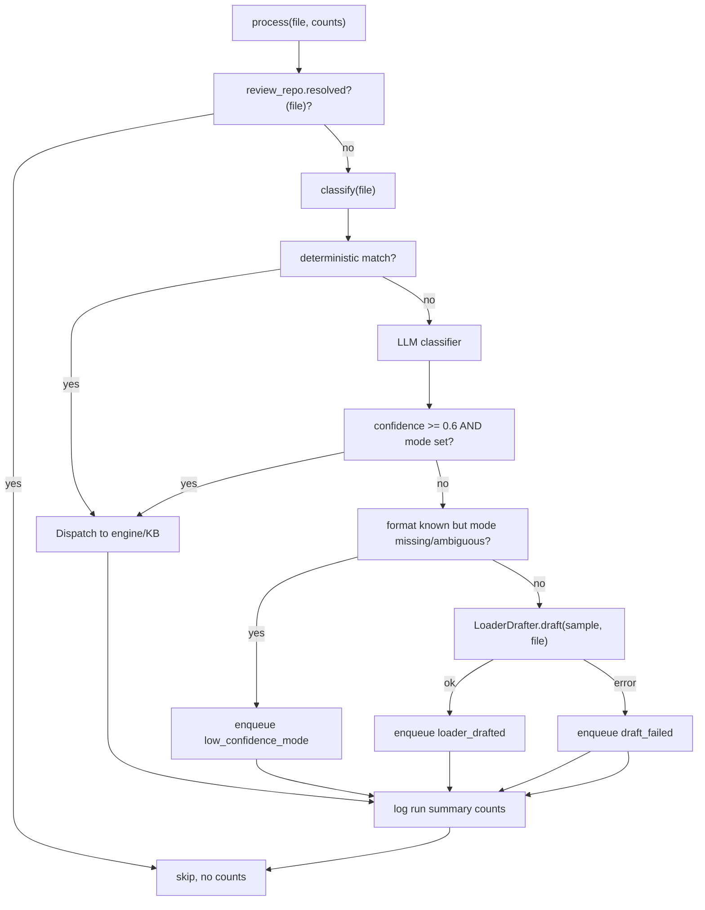

The `sfl-analyze ingest` subcommand is the surface entry point for **batch ingestion**: it walks a file or directory, classifies every file, and dispatches the recognized ones into the existing conversation/documentation/knowledge-base pipelines — or routes the unrecognized/ambiguous tail into a Postgres review queue. This page documents the orchestration layer: the five collaborators, the classification decision flow, the partial-failure isolation policy, the loader-drafting tier, and the review-queue schema.

**Architectural position.** `Ingest::Orchestrator` is deliberately deliberately kept thin: it is argv-parsing-adjacent wiring plus a per-file dispatch loop, and does not reimplement Pass 1/Pass 2 compilation. The existing `Analysis::Engine` and `Analysis::KnowledgeBaseSource` remain unmodified by this slice [lib/sfl/cli.rb#L150-L173].

## 1. The five collaborators

Every `Ingest::Orchestrator` is constructed with exactly five collaborators, mirroring the codebase's existing per-class DI convention [lib/sfl/cli.rb#L562-L569]:

| Collaborator | Role | Source |
|---|---|---|
| `conversation_engine` | `Analysis::Engine` — dispatch target for `conversation` and `documentation` modes | [lib/sfl/analysis/engine.rb#L28-L56] |
| `kb_source` | `Analysis::KnowledgeBaseSource` — dispatch target for `knowledge_base` mode | [lib/sfl/analysis/knowledge_base_source.rb#L25-L52] |
| `classifier` | `Core::Ports::Classifier` — LLM fallback for files `DeterministicRules` cannot classify | [lib/sfl/core/ports/classifier.rb#L6-L16] |
| `loader_drafter` | `Ingest::LoaderDrafter` — LLM-driven generator of new `Core::Loaders::Source` subclasses for unrecognized formats | [lib/sfl/ingest/loader_drafter.rb#L9-L25] |
| `review_repo` | `Store::PgIngestReviewRepository` — Postgres-backed admin/HITL review queue | [lib/sfl/store/pg_ingest_review_repository.rb#L8-L13] |

The composition root (`Boot.call`) provisions the classifier from the `:ingest_classification` task, which borrows its provider/model defaults from the (cheapest) embedding task [lib/sfl/boot.rb#L112-L119; lib/sfl/boot.rb#L128-L131]. The loader-drafter receives the `:loader_drafting` task, which borrows from the strongest general-purpose task (`pass_two_annotation`) [lib/sfl/boot.rb#L136-L140].

```mermaid
flowchart LR
  subgraph Ingest["Ingest::Orchestrator"]
    C["classifier"]
    L["loader_drafter"]
    R["review_repo"]
  end
  subgraph Dispatch["Dispatch targets (unmodified)"]
    E["Analysis::Engine"]
    K["Analysis::KnowledgeBaseSource"]
  end
  Input("ingest <input>") --> O["Ingest::Orchestrator#run"]
  O --> D["DeterministicRules.classify"]
  D -->|match| Disp[Dispatches]
  D -->|nil / low confidence| F["Classifier.classify (LLM)"]
  F -->|confident| Disp
  F -->|missing/ambiguous| L["LoaderDrafter.draft"]
  L --> R
  L -.->|retry later| R
  L -.->|draft fails| R
  R --> R2["PgIngestReviewEntries"]
  E --> E2["clauses / embeddings"]
  K --> K2["KB report / review queue"]
```

## 2. Classification: deterministic fast path first, LLM fallback only when needed

`#classify` implements a three-tier decision graph [lib/sfl/ingest/orchestrator.rb#L70-L92]:

1. `Ingest::DeterministicRules.classify(path)` — pure Ruby, zero network, zero file content. It consults extension whitelists and delegates JSON-export sniffing to `Analysis::ChatExportExpander.detect_format`, reusing the exact parsing logic already implemented in the conversation subsystem rather than re-parsing [lib/sfl/ingest/deterministic_rules.rb#L12-L46; lib/sfl/analysis/chat_export_expander.rb#L37-L47].
2. If no deterministic match, the orchestrator reads only `SAMPLE_BYTES = 4096` bytes of the file, then calls `classifier.classify(sample, file)` [lib/sfl/ingest/orchestrator.rb#L80-L83].
3. The LLM verdict is merged with the sample so the later drafting tier can reuse bytes it already read (avoids a second 4096-byte read) [lib/sfl/ingest/orchestrator.rb#L90-L92].

The deterministic rules are purely additive and never duplicated: each matcher delegates to an existing module (`Analysis::KnowledgeBaseSource::TEXT_EXTENSIONS`, `Core::Loaders::ImageSource::SUPPORTED_EXTENSIONS`, `Analysis::ChatExportExpander`) instead of inventing new rules [lib/sfl/ingest/deterministic_rules.rb#L4-L13].

## 3. Dispatch decision flow

`dispatch_or_review` applies a single, deterministic policy [lib/sfl/ingest/orchestrator.rb#L100-L121]:

- **Deterministic match** (no `:confidence` key): always dispatched with confidence = 1.0, matching today's extension/key behavior [lib/sfl/ingest/orchestrator.rb#L123-L129].
- **LLM verdict with `mode` and `confidence >= CONFIDENCE_THRESHOLD` (0.6)**: dispatched to the appropriate engine [lib/sfl/ingest/orchestrator.rb#L100-L106].
- **Format known but mode ambiguous**: written as `low_confidence_mode` into the review queue; never dispatched [lib/sfl/ingest/orchestrator.rb#L110-L114].
- **Format itself unknown (`format: "unknown"`)**: sent to `LoaderDrafter.draft`; if drafting succeeds the row is `loader_drafted`, if it raises `LoaderDrafter::Error` the row is `draft_failed` [lib/sfl/ingest/orchestrator.rb#L116-L145].

## 4. Dispatch targets: the two existing engines stay untouched

`dispatch` turns a classification into a `Core::Refs::FileRef` and delegates to the correct engine [lib/sfl/ingest/orchestrator.rb#L135-L154]:

- `mode: "conversation"` → `Analysis::ConversationSource` (or `DocumentationSource` for `mode: "documentation"`), each compiled through the same `Analysis::Engine.analyze` path the CLI already uses [lib/sfl/ingest/orchestrator.rb#L139-L151].
- `mode: "knowledge_base"` → `kb_source.analyze(ref)`, which is a separate file-walk/compile/assess loop built for KnowledgeArtifact reports rather than the turn-centric `AnalysisResult` shape [lib/sfl/analysis/knowledge_base_source.rb#L7-L48].

The `%w[.jsonl .srt .vtt .ass]` native chat extensions map directly to `chat_native` with `mode: "conversation"` [lib/sfl/ingest/deterministic_rules.rb#L49-L51]; `.md/.canvas/.pdf` map to `knowledge_base` via `vault_markdown`/`vault_canvas`/`vault_pdf` [lib/sfl/ingest/deterministic_rules.rb#L53-L59].

## 5. Partial-failure isolation (F11)

The per-file `process` method is the isolation boundary. A single file's failure never aborts the run: every failure mode is rescued and converted into a review-queue row instead of an exception [lib/sfl/ingest/orchestrator.rb#L86-L98]:

- `Analysis::Error`, `Core::Loaders::Error`, `Store::Error` — the normal pipeline/loader exceptions.
- `SystemCallError` — the raw `File.read` failures (file vanishing or permissions changing mid-walk) are **not** covered by `Analysis::Error`/`Core::Loaders::Error`/`Store::Error`, so they need a dedicated rescue. This was found by an SIFT audit of the CLI wiring and added specifically to keep the walk from crashing [lib/sfl/ingest/orchestrator.rb#L4-L10; lib/sfl/ingest/orchestrator.rb#L86-L98].

In both `draft_or_record_failure` and the LLM classification fallback, the same `review_repo.enqueue(path:, status:, reasoning:)` pattern applies, with `counts[:review_entries] += 1` [lib/sfl/ingest/orchestrator.rb#L94-L98; lib/sfl/ingest/orchestrator.rb#L129-L145].

The tests lock this in: a KB `analyze` raising `Analysis::Error` is caught per-file, remaining files continue to be dispatched, and a `SystemCallError` from a vanished file is converted to `draft_failed` rather than crashing the whole run [spec/ingest/orchestrator_spec.rb#L151-L205].

## 6. The loader-drafting tier

When the classifier returns `format: "unknown"` (the genuinely new-format tail), `LoaderDrafter` generates a candidate `Core::Loaders::Source` subclass and writes two artifacts:

1. A Ruby file at `loaders_dir` (`lib/sfl/core/loaders`) containing a class implementing `#each_unit` with the `Core::Loaders::Source` mixin contract [lib/sfl/ingest/loader_drafter.rb#L54-L66].
2. A review document at `docs_dir` (`docs/ingest-review`) containing field-mapping explanation and an explicit "**Not registered**" status banner [lib/sfl/ingest/loader_drafter.rb#L93-L112].

The LLM contract is `LLM::Signatures::LoaderDraftSignature`: `file_sample`, `filename`, `class_name`, `ruby_source`, `field_mapping_explanation`, `confidence` [lib/sfl/llm/signatures/loader_draft_signature.rb#L12-L36]. The drafted class name is validated against `/^[A-Z][A-Za-z0-9]*$/` before any file is written [lib/sfl/ingest/loader_drafter.rb#L73-L77]. The resulting files are hand-reviewed and wired in — the doc banner explicitly instructs the reviewer to add a `require` and a matching entry in `DeterministicRules` [lib/sfl/ingest/loader_drafter.rb#L86-L91]. This is a **drafting tier**, not an auto-registration tier: the orchestrator never runs a file with a freshly drafted loader.

## 7. The review queue

`Store::PgIngestReviewRepository` is the Postgres-backed ingest review queue, mirroring `PgReviewQueueRepository`'s shape deliberately so a future UI/CLI review subcommand needs no schema change [lib/sfl/store/pg_ingest_review_repository.rb#L8-L13; db/migrations/009_create_ingest_review_entries.rb#L8-L26]:

| Column | Type | Purpose |
|---|---|---|
| `id` | UUID | Primary key |
| `path` | text | The file path |
| `status` | default `"pending"` | `low_confidence_mode` \| `loader_drafted` \| `draft_failed` \| `resolved` |
| `format` / `mode` / `confidence` | String / String / Float | Classifier verdict retained for triage |
| `reasoning` | text | Why the file was queued |
| `loader_path` / `doc_path` | String | Set only for `loader_drafted` rows |
| `created_at` / `resolved_at` | DateTime | Lifecycle timestamps |

`resolved?(path)` is the idempotency check that lets a rerun skip already-handled files, and it is consulted at the top of every `process` call [lib/sfl/store/pg_ingest_review_repository.rb#L52-L58; lib/sfl/ingest/orchestrator.rb#L80-L81].

## 8. Upper-layer wiring summary

- `CLI.run_ingest` owns only argv parsing and the interrupt/trap around `orchestrator.run` [lib/sfl/cli.rb#L410-L425].
- `CLI.build_ingest_orchestrator` wires everything: two engine factories (`build_conversation_engine`, `build_kb_source`) are reused verbatim for the dispatch targets, and the review repository is created only when `options[:store]` is truthy [lib/sfl/cli.rb#L557-L569; lib/sfl/cli.rb#L486-L520].
- The ingest subcommand has **no** `--pass1-only` skip path: "there is no --pass1-only-equivalent skip path for this subcommand" — the classifier (Boot's `:ingest_classification` chat) and the loader-drafter's `:loader_drafting` chat are both load-bearing collaborators [lib/sfl/cli.rb#L399-L410].

## 9. Design invariants

- **Single source of truth for classification rules.** `DeterministicRules` delegates to existing modules rather than duplicating matching logic [lib/sfl/ingest/deterministic_rules.rb#L4-L13].
- **Partial-failure isolation is a promise, not an accident.** One bad file cannot stop the run, and every failure mode routes to the review queue with a `reasoning` string [lib/sfl/ingest/orchestrator.rb#L4-L18].
- **Review queue equals admin/HITL read layer.** No second consumer needs a swappable backend; the repository is intentionally not a `Core::Ports` adapter [lib/sfl/store/pg_ingest_review_repository.rb#L11-L13].
- **New formats come from the drafting tier, not from the orchestrator editing.** The LLM produces a candidate loader, and the reviewer registers it in `DeterministicRules` before it runs on real data [lib/sfl/ingest/loader_drafter.rb#L86-L91].