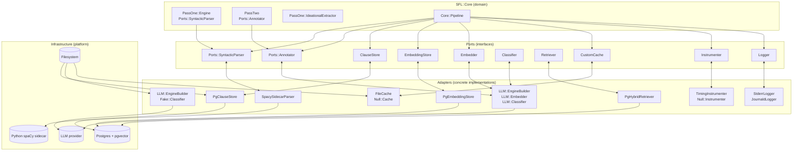

The Ports and Adapters pattern (also called Hexagonal Architecture or Use-Case/Tempire-Driven Design) isolates the domain core from external concerns by defining **ports** — abstract interfaces that declare *what* can be done — and **adapters** — concrete implementations that declare *how* it is done. SFL's core domain (Pass 1 parsing, Pass 2 LLM annotation, retrieval) never depends on a database, an LLM SDK, a filesystem, or a CLI progress bar directly. Every cross-cutting collaborator is injected through a port, so the same domain logic runs identically in production, tests, and documentation golden-master runs.

This page describes the port surface, the adapter lineup (Null, Fake, FileCache, StderrLogger, and the real Postgres adapters), and how the composition root wires them together.

## The Port Layer: Interfaces Without Impl

Every port lives under `lib/sfl/core/ports/` and follows one convention: a `module` with methods that raise `NotImplementedError` by default, and an abstract contract for every adapter to satisfy [lib/sfl/core/ports/annotator.rb](lib/sfl/core/ports/annotator.rb#L1-L33) [lib/sfl/core/ports/syntactic_parser.rb](lib/sfl/core/ports/syntactic_parser.rb#L1-L21).

**The adapter must satisfy the contract, not the implementation.** The shared example suite in `spec/support/shared_examples/ports.rb` encodes this at the RSpec level — every adapter (Null, Fake, real) is checked against its port's shared examples, so a new adapter cannot quietly drift from the interface [spec/support/shared_examples/ports.rb](spec/support/shared_examples/ports.rb#L1-L184).

### The six ports that run the compile use case

The compile pipeline touches six ports. The table below summarizes each port's purpose, its **one** abstract method, and the adapter lineup.

| Port | Module | One abstract method | Null adapter | Fake adapter | Real adapter |
|---|---|---|---|---|---|
| Syntactic parser | `Ports::SyntacticParser` | `parse(text, document_id:)` | `Null::SyntacticParser` | — | `PassOne::SpacySidecarParser` |
| Clause store | `Ports::ClauseStore` | `replace_document`, `find_by_document`, `ancestor_chain` | `Null::ClauseStore` | `Fake::ClauseStore` | `Store::PgClauseStore` |
| Embedding store | `Ports::EmbeddingStore` | `replace_document` | `Null::EmbeddingStore` | `Fake::EmbeddingStore` | `Store::PgEmbeddingStore` |
| Embedder | `Ports::Embedder` | `embed`, `embed_batch` | `Null::Embedder` | `Fake::Embedder` | `LLM::Embedder` |
| Classifier | `Ports::Classifier` | `classify(sample, path)` | `Null::Classifier` | `Fake::Classifier` | `LLM::Classifier` |
| Retriever | `Ports::Retriever` | `retrieve(query)` | `Null::Retriever` | — | `Store::PgHybridRetriever` |

Sources: [lib/sfl/core/ports/syntactic_parser.rb](lib/sfl/core/ports/syntactic_parser.rb#L1-L21) [lib/sfl/core/ports/annotator.rb](lib/sfl/core/ports/annotator.rb#L1-L33) [lib/sfl/core/ports/embedder.rb](lib/sfl/core/ports/embedder.rb#L1-L24) [lib/sfl/core/ports/classifier.rb](lib/sfl/core/ports/classifier.rb#L1-L26) [lib/sfl/core/ports/clause_store.rb](lib/sfl/core/ports/clause_store.rb#L1-L36) [lib/sfl/core/ports/retriever.rb](lib/sfl/core/ports/retriever.rb#L1-L23) [lib/sfl/core/ports/embedding_store.rb](lib/sfl/core/ports/embedding_store.rb#L1-L22)

### Supporting ports

Beyond the six compile ports, the pipeline and its collaborators use a second family of ports:

| Port | Module | One abstract method | Adapter |
|---|---|---|---|
| Cache | `Ports::Cache` | `partition(keys)`, `write(key, value)` | `Null::Cache`, `FileCache` |
| Instrumenter | `Ports::Instrumenter` | `instrument(name, payload, &)` | `Null::Instrumenter`, `TimingInstrumenter` |
| Logger | `Ports::Logger` | `debug/info/warn/error/fatal` | `Null::Logger`, `StderrLogger`, `JournaldLogger` |
| Breaker | `Ports::Breaker` | `call(label, &)` | `Null::Breaker`, `TimeoutBreaker` |
| Progress sink | `Ports::ProgressSink` | `start/advance/finish` | `Null::ProgressSink` |
| Loader | `Ports::Loader` | `each_unit` | `Fake::Loader` |
| Corpus source | `Ports::CorpusSource` | `each_ref` | `Adapters::FilesystemCorpusSource` |

Sources: [lib/sfl/core/ports/cache.rb](lib/sfl/core/ports/cache.rb#L1-L31) [lib/sfl/core/ports/instrumenter.rb](lib/sfl/core/ports/instrumenter.rb#L1-L21) [lib/sfl/core/ports/logger.rb](lib/sfl/core/ports/logger.rb#L1-L65) [lib/sfl/core/ports/breaker.rb](lib/sfl/core/ports/breaker.rb#L1-L26) [lib/sfl/core/ports/progress_sink.rb](lib/sfl/core/ports/progress_sink.rb#L1-L29) [lib/sfl/core/ports/loader.rb](lib/sfl/core/ports/loader.rb#L1-L26) [lib/sfl/core/ports/corpus_source.rb](lib/sfl/core/ports/corpus_source.rb#L1-L39)

## The Adapter Lineup

### Null adapters: "no-op by design"

Every Null adapter implements its port by doing the least work that is still *honest*. The Null Annotator's stub payloads carry `annotation_source: "stub"`, intentionally distinguishing placeholder values from real LLM output — this is the single structural fix for the golden-master bug where legacy branched on `--pass1-only` in two places [lib/sfl/core/ports/null/annotator.rb](lib/sfl/core/ports/null/annotator.rb#L1-L50) [lib/sfl/core/pipeline.rb](lib/sfl/core/pipeline.rb#L60-L80).

### Fake adapters: scriptable doubles for specs

Fake adapters are in-memory and deterministic. `Fake::ClauseStore` keeps a hash keyed by `document_id` and returns `.dup` so tests can't mutate live state across examples [lib/sfl/core/ports/fake/clause_store.rb](lib/sfl/core/ports/fake/clause_store.rb#L1-L30). `Fake::Embedder` takes a `vectors:` hash and a `default:` (768-dim zero vector by default), so specs can assert on semantic-arm ranking without hitting a real embedding API [lib/sfl/core/ports/fake/embedder.rb](lib/sfl/core/ports/fake/embedder.rb#L1-L38). `Fake::CorpusSource` yields hand-built Refs with no filesystem access [lib/sfl/core/ports/fake/corpus_source.rb](lib/sfl/core/ports/fake/corpus_source.rb#L1-L61).

### FileCache: the only file-backed adapter

`Core::Ports::FileCache` backs a cache in a directory of JSON files so `--resume` survives across process runs. Its `partition` method reads each key in the same pass that decides hit vs. miss — eliminating the legacy double-read bug (F10 contract) [lib/sfl/core/ports/file_cache.rb](lib/sfl/core/ports/file_cache.rb#L1-L75).

### StderrLogger and the two logger ports

`Core::Ports::StderrLogger` wraps Ruby's `::Logger` and outputs to `$stderr`, keeping stdout free for artifacts/reports. `Core::Ports::JournaldLogger` is a separate adapter that writes to the systemd journal daemon via the `journald/logger` gem. Both implement the same `Ports::Logger` contract, so the logger choice is a deployment concern, not a domain one [lib/sfl/core/ports/stderr_logger.rb](lib/sfl/core/ports/stderr_logger.rb#L1-L45) [lib/sfl/core/ports/journald_logger.rb](lib/sfl/core/ports/journald_logger.rb#L1-L46).

### Postgres adapters: the real backends

`Store::PgClauseStore`, `Store::PgEmbeddingStore`, `Store::PgHybridRetriever`, `Store::PgGraphRepository`, `Store::PgReviewQueueRepository`, and `Store::PgAnnotationReviewRepository` are the real implementations. They all include their port module, then satisfy the contract against Sequel + pgvector [lib/sfl/store/pg_clause_store.rb](lib/sfl/store/pg_clause_store.rb#L1-L357) [lib/sfl/store/pg_embedding_store.rb](lib/sfl/store/pg_embedding_store.rb#L1-L139).

**The split between ClauseStore and EmbeddingStore mirrors the legacy split between ClauseRepository and EmbeddingRepository.** Vector storage is a different backend/schema concern (pgvector) than clause text/annotation storage, even though both are written together at the end of one pipeline run [lib/sfl/core/ports/clause_store.rb](lib/sfl/core/ports/clause_store.rb#L1-L36) [lib/sfl/core/ports/embedding_store.rb](lib/sfl/core/ports/embedding_store.rb#L1-L22).

## How the Ports Fit the Pipeline

### Port roles in `Core::Pipeline`

`Core::Pipeline#compile` wires every port as a named constructor keyword. Nothing in the pipeline touches a concrete class — `pass_one` expects a `Ports::SyntacticParser`, `clause_store` expects a `Ports::ClauseStore`, and so on. The `pass_one_only:` flag (forwarded from `Analysis::Engine`) makes `Pipeline#annotate` return `Success(stub_annotate_all(pairs))` and call `Ports::Null::Annotator` instead of the real `pass_two` [lib/sfl/core/pipeline.rb](lib/sfl/core/pipeline.rb#L200-L264).

### The Port Adapter as a transport boundary, not just a storage boundary

`SpacySidecarParser` includes `Ports::SyntacticParser` and implements `parse` by speaking NDJSON over fd 0/1 to a sidecar subprocess. The parser's *only* external knowledge is "a subprocess with stdin/stdout pipes" — it does not know or care whether that subprocess is `python3 sidecar/spacy_sidecar.py`, a Docker container, or a future Rust rewrite [lib/sfl/core/pass_one/spacy_sidecar_parser.rb](lib/sfl/core/pass_one/spacy_sidecar_parser.rb#L1-L162). The sidecar README documents the same protocol-independence guarantee [sidecar/README.md](sidecar/README.md#L1-L62).

### Ports hide backend/schema details from the domain

`PgClauseStore#replace_document` is a single transactional entry point: delete every existing row for a document, then bulk-insert the new set. A re-run never leaves stale clauses behind. The "child rows vanish via ON DELETE CASCADE" design is invisible to callers — the port contract is only `replace_document` and `find_by_document` [lib/sfl/store/pg_clause_store.rb](lib/sfl/store/pg_clause_store.rb#L1-L357).

`PgEmbeddingStore#replace_document` follows the same F7 idempotency-as-contract pattern: delete every `embeddings` row for the document's clauses, then insert. Crucially, a `nil` or empty vector is *not* inserted — it flips `clauses.embedding_status` to `"failed"` with an `embedding_error` note, so a degenerate vector row never looks like a real embedding to any downstream cosine search (F11) [lib/sfl/store/pg_embedding_store.rb](lib/sfl/store/pg_embedding_store.rb#L1-L139) [db/migrations/008_add_embedding_status_to_clauses.rb](db/migrations/008_add_embedding_status_to_clauses.rb#L1-L25).

## How the Adapter Lineup Fits the API and CLI

### The composition root: `API::Context` and `CLI.build_pipeline`

Routes never construct adapters. `config.ru` boots `Providers::DB::Conn`, then calls `SFL::Boot.call`, then `Providers::Engine.boot(sfl_boot)`. `SFL::API::Context.build(boot_result)` is the single composition point for the HTTP server — it pulls every collaborator (pipeline, retriever, clause_store, pass_two, review repos) and returns one `Context` struct [lib/sfl/api/context.rb](lib/sfl/api/context.rb#L1-L84).

`CLI.build_pipeline` is the parallel composition point for the CLI, built from `Core::PassOne::SpacySidecarParser` + `Core::PassOne::Engine`, with `pass_two` chosen at runtime: `Ports::Null::Annotator` when `--pass1-only`, otherwise `LLM::EngineBuilder`. Storage, embedding, and cache are each selected by option flags (`--store`, `--resume`) [lib/sfl/cli.rb](lib/sfl/cli.rb#L474-L505).

### One pipeline, two surfaces

`API::Context` wires the *same* `Core::Pipeline` instance that the CLI builds (via `CLI.build_pipeline`), so `/pipeline/compile` and the CLI's `conversation`/`documentation` subcommands share identical Pass 1/Pass 2/store logic. The only difference: API routes call `:resume => false` with `store: true`, while the CLI's `--store` flag drives the `PgClauseStore`/`PgEmbeddingStore` wiring, and the CLI's `--resume` flag drives `FileCache` [lib/sfl/api/context.rb](lib/sfl/api/context.rb#L38-L65) [lib/sfl/cli.rb](lib/sfl/cli.rb#L474-L505).

## The FileRef Abstraction: Why CorpusSource Is a Port

`Ports::CorpusSource` declares an origin-of-bytes protocol: `each_ref` yields objects that respond to `#read`, `#name`, `#extension`, `#content_identity`, `#size_bytes`, `#mtime`, and `#source_id`. `FileRef` (a `Dry::Struct`) implements that for the filesystem; a future git-tree or HTTP adapter swaps in a different `each_ref` and the orchestrator never changes (SFL-ING-16). `Adapters::FilesystemCorpusSource` is the sole place outside a loader that calls `Dir.glob`/`File.file?` — all dot-directory exclusion, `.gitignore` honoring, and symlink-avoidance policy lives here [lib/sfl/core/ports/adapters/filesystem_corpus_source.rb](lib/sfl/core/ports/adapters/filesystem_corpus_source.rb#L1-L239) [lib/sfl/core/refs/file_ref.rb](lib/sfl/core/refs/file_ref.rb#L1-L53).

## Pattern Map: Ports, Adapters, and Infrastructure

*The domain core composes ports, not adapters. Infrastructure's only knowledge is the concrete adapter classes it constructs (the Composition Root does the wiring).*

## Test Strategy: What Each Adapter Proves

The test suite validates the adapter pattern at two levels:

1. **Interface compliance** — every adapter must satisfy the port's shared examples (`it_behaves_like "a syntactic parser port"`, `it_behaves_like "an annotator port"`, etc.). The `Retriever` spec proves that failing to implement a port raises `NotImplementedError` [spec/core/ports/retriever_spec.rb](spec/core/ports/retriever_spec.rb#L1-L30).

2. **Behavioral contracts** — `FileCache` proofs that a write round-trips as a hit with the same value, and that an unwritten key reports as a miss [spec/core/ports/file_cache_spec.rb](spec/core/ports/file_cache_spec.rb#L1-L56). `Fake::Classifier` proofs exact-text lookup plus a default fallback for unregistered samples [spec/core/ports/fake_adapters_spec.rb](spec/core/ports/fake_adapters_spec.rb#L1-L70).

## Key Design Decisions That Make the Pattern Work

- **Port modules raise `NotImplementedError`** so a missing adapter implementation fails fast at instantiation time, not deep inside a business flow. Even the `Retriever` spec intentionally subclasses a class that includes the port with no `#retrieve` override, asserting the `NotImplementedError` contract [spec/core/ports/retriever_spec.rb](spec/core/ports/retriever_spec.rb#L1-L30).

- **Ports are not "any interface" — they are minimal by design.** `Ports::Retriever` declares a single `retrieve(query)` method because "flexible for agents/API" means a stable, typed contract, not a proliferation of configuration knobs [lib/sfl/core/ports/retriever.rb](lib/sfl/core/ports/retriever.rb#L1-L23).

- **The same port can have multiple real adapters.** `Ports::Logger` has `Null::Logger` (tests), `StderrLogger` (CLI), and `JournaldLogger` (systemd deployments) — a deployment concern, not a domain one [lib/sfl/core/ports/logger.rb](lib/sfl/core/ports/logger.rb#L1-L65).

- **Composition happens in two places only.** `API::Context.build` for HTTP routes, and `CLI.build_pipeline`/`CLI.build_collaborators` for the CLI. Four legacy code paths that previously each duplicated this wiring were collapsed into one — the T4 fix [lib/sfl/cli.rb](lib/sfl/cli.rb#L445-L470) [lib/sfl/api/context.rb](lib/sfl/api/context.rb#L38-L65).

- **Type safety is the port's contract enforcer.** `RetrievalQuery` and `RetrievalFilters` use `Dry::Struct` with `schema.strict`, so a typo'd API field (e.g. `"qeury"`) raises immediately instead of silently constructing a query with the typo'd field ignored [lib/sfl/core/types/retrieval_query.rb](lib/sfl/core/types/retrieval_query.rb#L1-L24).

## Pattern Structure

| Layer | Responsibility | Example files |
|---|---|---|
| **Ports** (interfaces) | Define what the domain needs; abstract contracts | `lib/sfl/core/ports/*.rb` |
| **Adapters** (real implementations) | Implement ports against the real infrastructure | `lib/sfl/core/pass_one/spacy_sidecar_parser.rb`, `lib/sfl/store/pg_*` |
| **Fake adapters** (test doubles) | Scriptable in-memory implementations for specs | `lib/sfl/core/ports/fake/*` |
| **Null adapters** (no-op) | Cheap "do nothing but stay honest" doubles | `lib/sfl/core/ports/null/*` |
| **Composition root** | Constructs adapters and wires them into the domain | `lib/sfl/api/context.rb`, `lib/sfl/cli.rb` |

Sources: [lib/sfl/core/ports](lib/sfl/core/ports) [lib/sfl/core/pass_one/spacy_sidecar_parser.rb](lib/sfl/core/pass_one/spacy_sidecar_parser.rb#L1-L162) [lib/sfl/store](lib/sfl/store) [spec/support/shared_examples/ports.rb](spec/support/shared_examples/ports.rb)

## When to Add a New Port vs. When to Add a New Adapter

- **Add a new port** when a new domain capability emerges that the core should be able to use but which does not yet exist (e.g. a new analysis mode). The port's one abstract method should declare the smallest possible contract.
- **Add a new adapter** when an infrastructure concern changes — a new database backend, a new LLM provider, a new embedding service. The domain core should require zero changes, because no core file touches the adapter class name.
- **Add a new Fake adapter** when a spec needs deterministic behavior that `Fake::ClauseStore`/`Fake::Embedder`/`Fake::Classifier` do not already provide, following the `vectors:/default:` and `results:/default:` shapes already established.
- **Add a new Null adapter** when a port is required by a constructor but a real implementation is unavailable for a specific mode (e.g. `--pass1-only` needs `Ports::Null::Annotator`).

Sources: [lib/sfl/core/ports](lib/sfl/core/ports) [lib/sfl/core/pipeline.rb](lib/sfl/core/pipeline.rb#L200-L264)

## Cross-References

- **[Two-Pass Pipeline Architecture](7-two-pass-pipeline-architecture)** — where Pass 1/Pass 2 live and how ports are called by the pipeline stages.
- **[Hexagonal Architecture Pattern](8-hexagonal-architecture-pattern)** — the sibling pattern page describing the same ports/adapters boundary at a conceptual level.
- **[Rhetorical Firewall Design](9-rhetorical-firewall-design)** — how trusted vs. untrusted annotation sources are enforced (the `annotation_source` field that the Fake::Annotator's stub payloads and Null::Annotator both use).
- **[Golden Master Testing](32-golden-master-testing)** — the test discipline that depends on `Ports::Null::Annotator` to produce deterministic stubs.