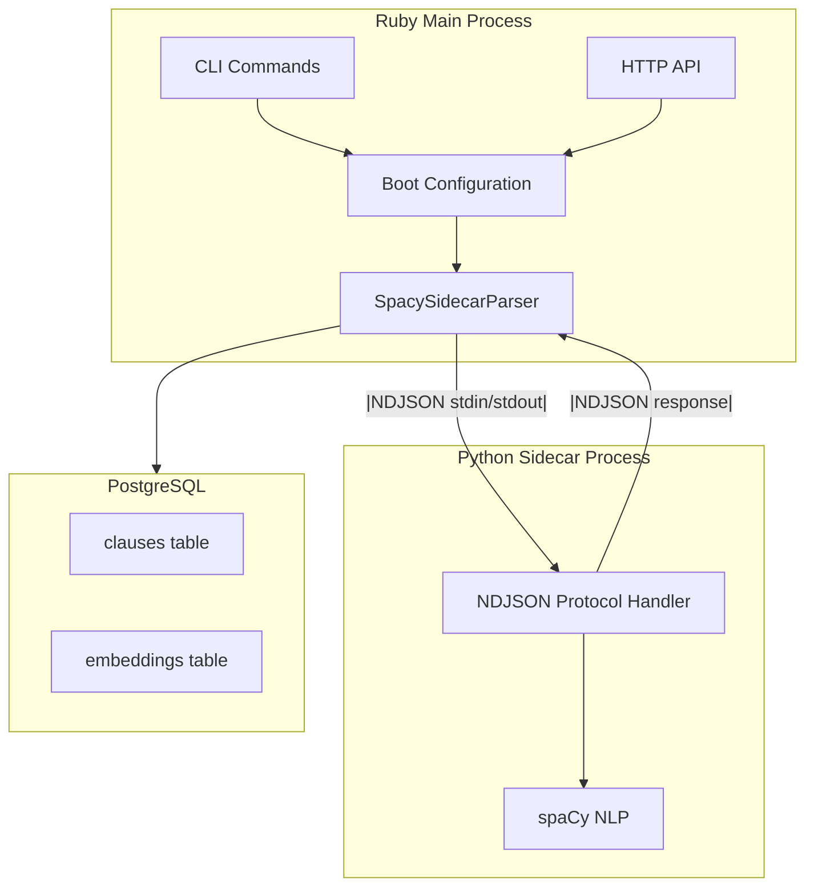
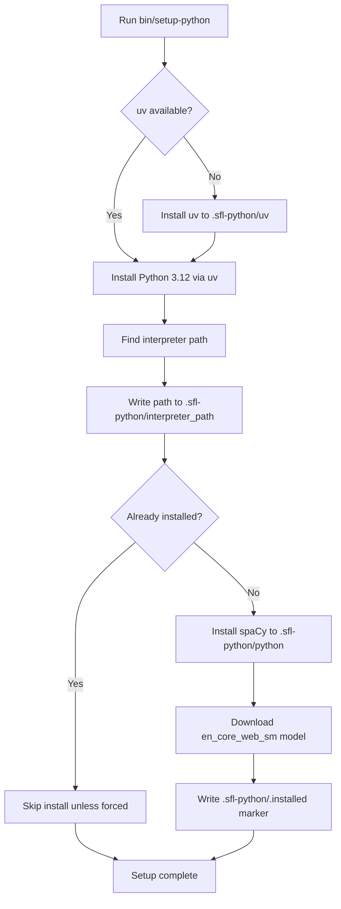
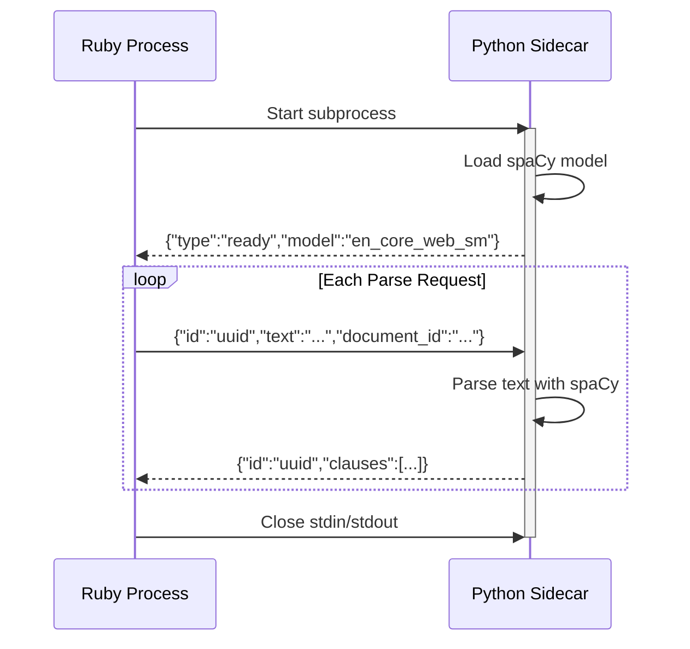
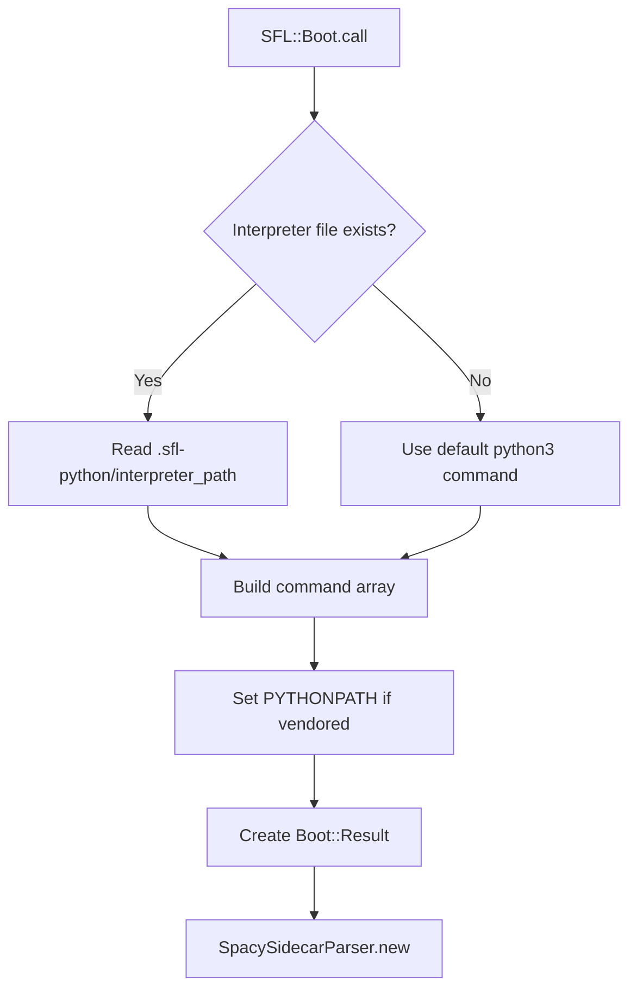

The Python sidecar is a spaCy subprocess that performs Pass 1 syntactic parsing for the SFL Engine's two-pass annotation pipeline. It runs outside the Ruby main process, communicating over a line-delimited JSON (NDJSON) protocol on stdin/stdout, which eliminates the hazards of the legacy in-process PyCall architecture (GIL/GVL deadlock risks, forced Sidekiq concurrency ceiling, and GC.start workarounds). This design keeps linguistic parsing isolated while maintaining fast, deterministic performance. Sources: [sidecar/README.md](sidecar/README.md#L1-L10)

## Recommended Reading Path

After completing this Python sidecar setup, continue with these topics in order:

- **[Postgres Integration](19-postgres-integration)** — Set up the database for storing parsed annotations
- **[Pass 1: Syntactic Parsing](11-pass-1-syntactic-parsing)** — Learn what the sidecar extracts from your text
- **[Database Schema](18-database-schema)** — Understand how parsed clauses are stored
- **[Two-Pass Pipeline Architecture](7-two-pass-pipeline-architecture)** — See how Pass 1 feeds into Pass 2 LLM annotation

## Architecture Overview

The sidecar operates as a separate process boundary between Ruby and Python, following a hexagonal architecture pattern where the Ruby process knows only about sending text requests and receiving structured clause responses. The transport layer (local Python or Docker container) is completely abstracted from the parser interface.



The sidecar maintains a single long-running subprocess for efficiency, handling multiple parse requests over its lifetime. Each request returns clause boundaries, part-of-speech tags, dependency relations, and morphological features needed for downstream annotation. Sources: [sidecar/spacy_sidecar.py](sidecar/spacy_sidecar.py#L11-L19), [lib/sfl/core/pass_one/spacy_sidecar_parser.rb](lib/sfl/core/pass_one/spacy_sidecar_parser.rb#L1-L18)

## Setup Methods

You can configure the Python sidecar in three ways, depending on your development environment and deployment needs. Each method uses the same NDJSON protocol, so the Ruby parser interface (`SpacySidecarParser`) works identically regardless of which transport you choose.

| Method | Use Case | Prerequisites | Command Path |
|--------|----------|---------------|--------------|
| **Local Python** | Active development, quick iteration | Python 3.12+, spaCy installed globally or via pip | `["python3", "sidecar/spacy_sidecar.py", "--model", "en_core_web_sm"]` |
| **Vendored Python** | Isolated development, reproducible builds | `bin/setup-python` script execution | Auto-detected from `.sfl-python/interpreter_path` |
| **Docker Container** | Production deployment, containerized environments | Docker daemon, built sidecar image | `["docker", "run", "-i", "--rm", "sfl-spacy-sidecar", "--model", "en_core_web_sm"]` |

Sources: [sidecar/README.md](sidecar/README.md#L30-L53), [bin/setup-python](bin/setup-python#L1-L18)

### Method 1: Local Python Setup

For active development, the simplest approach is to use your system's Python installation with spaCy installed globally. This method provides quick iteration and easy debugging since you can run the sidecar script directly for testing.

First, install Python 3.12 or later and the spaCy package:

```bash
pip install spacy
python3 -m spacy download en_core_web_sm
```

Then verify the installation works:

```bash
python3 sidecar/spacy_sidecar.py --model en_core_web_sm
```

You should see a ready message printed to stdout. The Ruby process will automatically invoke this command when you run any analysis, using the default `SpacySidecarParser` configuration. Sources: [sidecar/README.md](sidecar/README.md#L32-L35)

### Method 2: Vendored Python Setup

For reproducible builds and isolation from system Python changes, use the `bin/setup-python` script. This provisions a self-contained Python environment under `.sfl-python/` in the project directory, including a pinned Python version, spaCy, and the required model. This approach is recommended for most development workflows.

```bash
bin/setup-python
```

The script performs these steps automatically:



The script is idempotent — re-running it after the initial setup is a fast no-op unless you set `SFL_FORCE_PYTHON_VENDOR=1` to force reinstallation. Key files created:

- `.sfl-python/python/` — Vendored Python packages (spaCy, NumPy, click)
- `.sfl-python/uv/` — Isolated uv package manager installation
- `.sfl-python/interpreter_path` — Path to the pinned Python interpreter
- `.sfl-python/.installed` — Marker file tracking installation status

Sources: [bin/setup-python](bin/setup-python#L19-L39), [lib/sfl/boot.rb](lib/sfl/boot.rb#L78-L86)

**Environment Variables for Method 2:**

| Variable | Default | Purpose |
|----------|---------|---------|
| `SFL_PYTHON_VERSION` | `3.12` | Pin specific Python interpreter version |
| `SFL_SPACY_REQUIREMENT` | `spacy` | Override spaCy package requirement |
| `SPACY_MODEL` | `en_core_web_sm` | Choose alternative spaCy model |
| `SFL_FORCE_PYTHON_VENDOR` | unset | Set to `1` to force reinstallation |

The Boot module automatically detects the vendored interpreter and configures `SpacySidecarParser` to use it by setting `PYTHONPATH` to point at the vendored packages directory. Sources: [lib/sfl/boot.rb](lib/sfl/boot.rb#L246-L259)

### Method 3: Docker Container Setup

For production deployments or fully containerized environments, build the sidecar as a Docker image and run it as a container. The sidecar's `Dockerfile` packages spaCy and the default model into a minimal Python 3.12-slim base image.

```bash
docker build -t sfl-spacy-sidecar sidecar/
```

To use the containerized sidecar, you'll need to configure the parser explicitly with the docker run command. This is typically done in deployment configuration rather than in code:

```ruby
SFL::Core::PassOne::SpacySidecarParser.new(
  model: "en_core_web_sm",
  command: ["docker", "run", "-i", "--rm", "sfl-spacy-sidecar", "--model", "en_core_web_sm"]
)
```

The `-i` flag is critical — it keeps stdin open for the NDJSON protocol communication. The `--rm` flag automatically removes the container after it exits, preventing container accumulation. The protocol remains identical whether using local Python or Docker, so no code changes are needed beyond the command configuration. Sources: [sidecar/Dockerfile](sidecar/Dockerfile#L1-L17), [sidecar/README.md](sidecar/README.md#L44-L49)

## Communication Protocol

The sidecar speaks a simple NDJSON (newline-delimited JSON) protocol over stdin/stdout. Each line contains exactly one JSON object, and messages are flushed immediately after writing. This protocol is intentionally language-agnostic — the Ruby parser doesn't need to know whether it's talking to Python, Docker, or any other subprocess implementation.

### Protocol Flow



### Message Formats

**Startup Message (sidecar → Ruby):**
```json
{
  "type": "ready",
  "model": "en_core_web_sm"
}
```

**Request Message (Ruby → sidecar):**
```json
{
  "id": "550e8400-e29b-41d4-a716-446655440000",
  "text": "The migration was successful.",
  "document_id": "doc-123"
}
```

**Response Message (sidecar → Ruby):**
```json
{
  "id": "550e8400-e29b-41d4-a716-446655440000",
  "clauses": [
    {
      "id": "clause-uuid",
      "text": "The migration was successful.",
      "tokens": [...],
      "root_index": 2,
      "sentence_index": 0,
      "document_id": "doc-123"
    }
  ]
}
```

**Error Response:**
```json
{
  "id": "550e8400-e29b-41d4-a716-446655440000",
  "error": "Spacy model not loaded"
}
```

Sources: [sidecar/spacy_sidecar.py](sidecar/spacy_sidecar.py#L20-L27), [lib/sfl/core/pass_one/spacy_sidecar_parser.rb](lib/sfl/core/pass_one/spacy_sidecar_parser.rb#L71-L102)

### Clause Structure

Each clause in the response contains detailed syntactic information:

| Field | Type | Description |
|-------|------|-------------|
| `id` | string | Unique identifier for this clause |
| `text` | string | Full clause text |
| `tokens` | array | Token-level annotations |
| `root_index` | number | Index of the ROOT token in tokens array |
| `sentence_index` | number | Position within the document |
| `document_id` | string/null | Source document identifier |

Each token includes:

| Field | Type | Description |
|-------|------|-------------|
| `text` | string | Original token text |
| `lemma` | string | Base form of the word |
| `pos` | string | Coarse-grained part-of-speech |
| `tag` | string | Fine-grained part-of-speech |
| `dep` | string | Syntactic dependency relation |
| `head_index` | number | Position of head token (sentence-local) |
| `morphology` | object | Morphological features |
| `index` | number | Position within clause |

The head_index field is particularly important — it uses positional indexing (`token.head.i - sent.start`) rather than text lookup, which fixes a critical bug where duplicate words in a sentence would incorrectly share the same head. This architectural decision makes the bug class structurally impossible. Sources: [sidecar/README.md](sidecar/README.md#L56-L62), [sidecar/spacy_sidecar.py](sidecar/spacy_sidecar.py#L30-L55)

## Configuration and Integration

The sidecar integrates into the application through the Boot composition root, which resolves the correct command and environment configuration based on your setup method. The `SpacySidecarParser` is instantiated with the resolved configuration and passed to the Pass 1 engine.

### Boot Configuration Flow



The `Boot.resolve_pass1_command` method checks for the vendored interpreter file and constructs the appropriate command array. If the vendored Python is detected, it also sets `PYTHONPATH` to point at the vendored packages directory. Sources: [lib/sfl/boot.rb](lib/sfl/boot.rb#L246-L259)

### Environment Configuration

| Environment Variable | Default | Effect |
|----------------------|---------|--------|
| `SPACY_MODEL` | `en_core_web_sm` | Model name passed to sidecar |
| `DATABASE_URL` | required | Database connection for storing parsed clauses |
| `SFL_API_DEBUG_ERRORS` | `false` | Show detailed error responses in API |

The sidecar model is configurable at runtime via the `SPACY_MODEL` environment variable, allowing you to switch between different spaCy models (e.g., `en_core_web_md`, `en_core_web_lg`) without code changes. Sources: [lib/sfl/boot.rb](lib/sfl/boot.rb#L93-L98)

## Troubleshooting

### Common Issues

**Sidecar fails to start:**

If you see `SidecarError: sidecar did not signal ready within 30s`, the sidecar process is likely failing during spaCy model loading. Check that:

1. spaCy is installed: `python3 -c "import spacy; print(spacy.__version__)"`
2. The model is downloaded: `python3 -m spacy download en_core_web_sm`
3. Python version is compatible (3.12 recommended)

**Import errors for NumPy or spaCy dependencies:**

The setup script pins `numpy<2` to avoid compatibility issues with spaCy's native dependencies. If you see NumPy import errors, re-run `bin/setup-python` to ensure consistent package versions. Sources: [bin/setup-python](bin/setup-python#L77-L88)

**"uv not found" during setup:**

The script automatically installs uv if it's not available on PATH. Ensure `curl` is installed to download the uv installer. If you prefer, install uv manually first: [https://docs.astral.sh/uv/getting-started/installation/](https://docs.astral.sh/uv/getting-started/installation/)

**Broken pipe errors during parsing:**

The parser implements automatic recovery with one retry attempt. If transport failures persist, check system resource limits and ensure the sidecar process isn't being killed by the OS (OOM, process limits). Sources: [lib/sfl/core/pass_one/spacy_sidecar_parser.rb](lib/sfl/core/pass_one/spacy_sidecar_parser.rb#L115-L128)

### Debugging the Sidecar Directly

You can test the sidecar in isolation to diagnose issues:

```bash
# Run with verbose output
python3 sidecar/spacy_sidecar.py --model en_core_web_sm

# Then send a request via stdin (Ctrl+D to send)
echo '{"id":"test","text":"Hello world","document_id":null}' | python3 sidecar/spacy_sidecar.py --model en_core_web_sm
```

This lets you verify that the sidecar works correctly before integrating it with the Ruby application. Sources: [sidecar/spacy_sidecar.py](sidecar/spacy_sidecar.py#L95-L114)

## Performance Considerations

The sidecar maintains a single long-running process to avoid the overhead of spawning a new Python process for each parse request. The process is spawned with `pgroup: true` to isolate it from the Ruby process's signal handling, allowing graceful shutdown on Ctrl+C.

Throughput depends primarily on spaCy's parsing speed, which is approximately 10,000-15,000 tokens per second on modern hardware using the `en_core_web_sm` model. Larger models (`en_core_web_md`, `en_core_web_lg`) provide more accuracy but are significantly slower.

The NDJSON protocol's line-delimited design ensures that even large documents can be processed incrementally, with responses streamed back as sentences are parsed rather than waiting for the entire document to complete. Sources: [lib/sfl/core/pass_one/spacy_sidecar_parser.rb](lib/sfl/core/pass_one/spacy_sidecar_parser.rb#L59-L73)

## Next Steps

With your Python sidecar properly configured, you're ready to explore the syntactic parsing capabilities and how they feed into the broader annotation pipeline:

1. **[Pass 1: Syntactic Parsing](11-pass-1-syntactic-parsing)** — Deep dive into what linguistic features the sidecar extracts
2. **[Database Schema](18-database-schema)** — See how parsed clauses are structured in Postgres
3. **[CLI Usage](23-cli-usage)** — Run your first analysis with `sfl-analyze`
4. **[Two-Pass Pipeline Architecture](7-two-pass-pipeline-architecture)** — Understand how Pass 1 enables Pass 2 LLM annotation