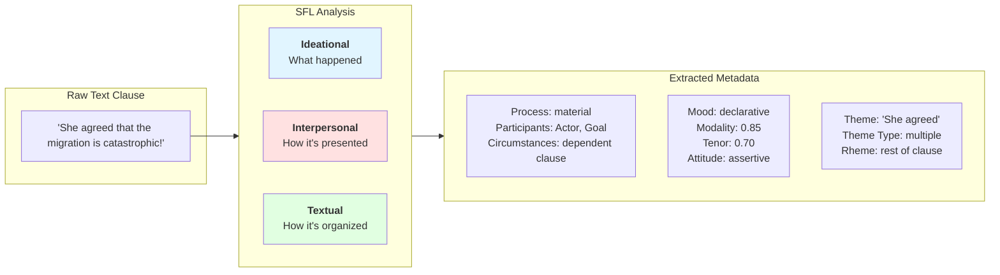
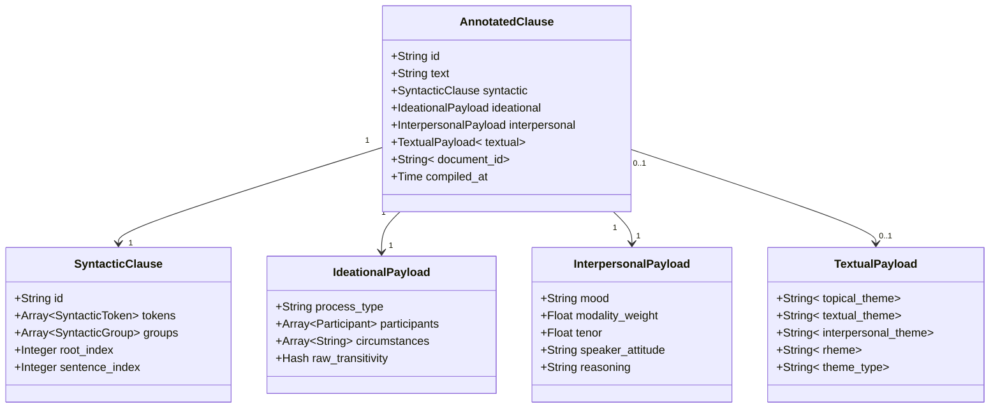
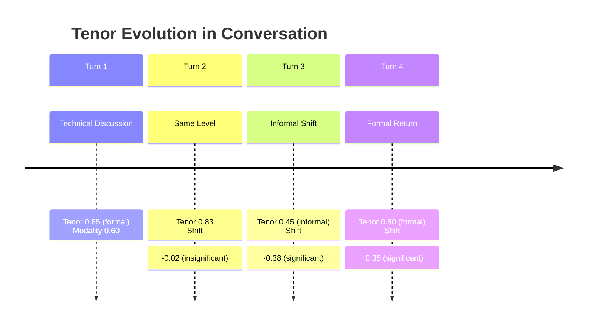
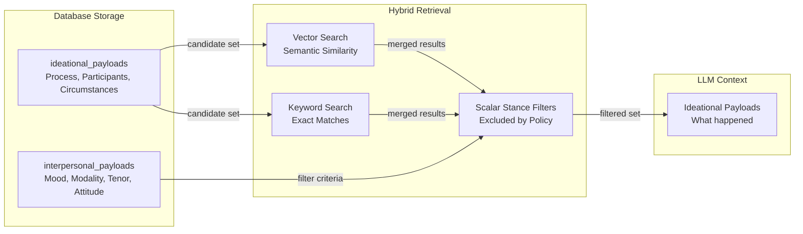

This page introduces the fundamental Systemic Functional Linguistics (SFL) concepts that power the sfl-engine's architecture. SFL provides a framework for analyzing how language simultaneously conveys three strands of meaning—what happened, how it's presented, and how it's organized. By extracting these metafunctions as separate, filterable metadata, the engine enables stance-aware retrieval and rhetorical filtering in RAG applications.

## The Three Metafunctions

Systemic Functional Linguistics, developed by M.A.K. Halliday, identifies three simultaneous metafunctions that every clause expresses. The sfl-engine implements these as separate payload types that can be analyzed, stored, and filtered independently.

### Ideational Metafunction

The ideational metafunction represents the **content of reality**—what happened in the world, who did what to whom, and under what circumstances. This is the "fact" layer that describes processes, participants, and settings. The engine extracts ideational metadata in Pass 1 using rule-based syntactic parsing via the spaCy sidecar.

**Components extracted**:
- **Process Type**: The nature of the activity (material, mental, relational, verbal, behavioral, existential)
- **Participants**: The semantic roles involved (Actor, Goal, Recipient, Attribute, etc.)
- **Circumstances**: Adjuncts providing context (time, place, manner, cause)

**Implementation**: The `IdeationalPayload` type stores these fields, extracted by `IdeationalExtractor` which maps spaCy dependency labels to SFL participant roles and classifies process types based on verb lemmas [ideational_payload.rb](lib/sfl/core/types/ideational_payload.rb#L1-L17) [ideational_extractor.rb](lib/sfl/core/pass_one/ideational_extractor.rb#L1-L154).

**Process types**:
| Type | Description | Example Clauses |
|------|-------------|-----------------|
| Material | Actions and events (doing/happening) | "She runs," "The system crashed" |
| Mental | Cognitive and emotional states (sensing/feeling) | "He thinks," "They believe" |
| Relational | Being and having (identifying/classifying) | "She is a developer," "The issue remains unresolved" |
| Verbal | Saying and reporting (verbalizing) | "He said that," "They announced" |
| Behavioral | physiological and psychological behaviors | "She smiled," "He slept" |
| Existential | Existence claims | "There exists a solution," "There are three options" |

**Participant roles** are extracted from dependency relationships:
- `nsubj` → Actor (subject of material process)
- `dobj` → Goal (direct object)
- `iobj` → Recipient (indirect object)
- `attr`/`oprd` → Attribute (complement)
- `pobj`/`prep`/`advmod` → Circumstance (adjuncts) [ideational_extractor.rb](lib/sfl/core/pass_one/ideational_extractor.rb#L23-L42)

### Interpersonal Metafunction

The interpersonal metafunction represents **the interaction between speaker and listener**—how the speaker positions themselves, their stance, and the social relationship encoded in the language. This is the "persuasion" layer that captures mood, modality, tenor, and attitude. The engine annotates interpersonal metadata in Pass 2 using LLM-based classification.

**Components extracted**:
- **Mood**: The clause's speech function (declarative, interrogative, imperative, exclamative, indicative, minor, fragment)
- **Modality Weight**: Certainty level on a 0.0–1.0 scale (0 = weak/hedged, 1 = strong/certain)
- **Tenor**: Formality register on a 0.0–1.0 scale (0 = informal, 1 = formal)
- **Speaker Attitude**: The evaluative stance (neutral, positive, negative, skeptical, assertive, etc.)

**Implementation**: The `InterpersonalPayload` type stores these fields, annotated by the LLM through `ClauseAnnotationSignature` and normalized via `ClassificationRegistry` [interpersonal_payload.rb](lib/sfl/core/types/interpersonal_payload.rb#L1-L23) [clause_annotation_signature.rb](lib/sfl/llm/signatures/clause_annotation_signature.rb#L1-L66).

**Mood types** with canonical values from the classification registry:
| Mood | Description | Example |
|------|-------------|---------|
| declarative | Statements of fact or opinion | "The migration failed." |
| interrogative | Questions | "Did the migration fail?" |
| imperative | Commands or requests | "Fix the migration." |
| exclamative | Exclamations | "What a failure!" |
| indicative | Simple present statements | "She agrees." |
| minor | Incomplete grammatical structures | "Yes," "Exactly." |
| fragment | Elliptical or incomplete clauses | "Disaster." |

The registry includes aliases and fuzzy matching to normalize LLM outputs (e.g., "question" → "interrogative", "exclamatory" → "exclamative") [classification_registry.rb](lib/sfl/core/classification_registry.rb#L40-L68).

**Modality and tenor** use coercible float types constrained between 0.0 and 1.0, allowing the LLM to return integer boundary values without causing type failures [modality_weight.rb](lib/sfl/core/types/modality_weight.rb#L1-L15) [tenor_value.rb](lib/sfl/core/types/tenor_value.rb#L1-L12).

### Textual Metafunction

The textual metafunction represents **how information is organized and flow is created** across clauses. It concerns the arrangement of information, theme-rheme structure, and cohesive devices that bind text together. This is the "organization" layer that supports readability and rhetorical effect.

**Components extracted**:
- **Topical Theme**: The starting point or main topic (subject, fronted element, or predicator)
- **Textual Theme**: Conjunctions and connectives at the start (however, therefore, and)
- **Interpersonal Theme**: Modal adjuncts and discourse markers at the start (surely, perhaps, well)
- **Rheme**: Everything that follows the theme (the new information)
- **Theme Type**: Classification of theme structure (unmarked, marked, multiple, topical, circumstantial, etc.)

**Implementation**: The `TextualPayload` type stores these fields, annotated by the LLM in Pass 2 alongside interpersonal metadata [textual_payload.rb](lib/sfl/core/types/textual_payload.rb#L1-L22).

**Theme type categories**:
| Theme Type | Description | Example |
|------------|-------------|---------|
| unmarked | Subject as theme (default) | "She agreed..." |
| marked | Non-subject fronted | "Reluctantly, she agreed..." |
| topical | Explicit topic marker | "As for the migration..." |
| multiple | Multiple theme elements | "Therefore, she agreed..." |
| interpersonal | Modal/discourse marker start | "Surely, she agreed..." |
| circumstantial | Time/place fronted | "Yesterday, she agreed..." |
| clausal | Subordinate clause as theme | "Because she was tired, she left." |

**Cohesion metrics** at the aggregation level track textual flow:
- **Repetition Score**: Lexical repetition density (unique content / total content)
- **Conjunction Density**: Ratio of coordinating/subordinating conjunctions
- **Pronoun Density**: Ratio of pronouns indicating reference chains [cohesion_analyzer.rb](lib/sfl/analysis/cohesion_analyzer.rb#L1-L51) [cohesion_metrics.rb](lib/sfl/core/types/cohesion_metrics.rb#L1-L15)

## Combined Clause Structure

The final annotated clause combines all three metafunctions into a single, type-safe structure:

The `AnnotatedClause` type represents the complete output of the two-pass compiler, combining syntactic, ideational, interpersonal, and textual metadata [annotated_clause.rb](lib/sfl/core/types/annotated_clause.rb#L1-L21). Each payload is stored in separate database tables with foreign key relationships to the clauses table, enabling independent querying and filtering [001_create_clauses.rb](db/migrations/001_create_clauses.rb#L1-L36) [002_create_ideational_payloads.rb](db/migrations/002_create_ideational_payloads.rb#L1-L26) [003_create_interpersonal_payloads.rb](db/migrations/003_create_interpersonal_payloads.rb#L1-L35).

## Dynamic Analysis with SFL Metadata

The extracted SFL metadata powers several dynamic analysis features that track how language evolves across documents and conversations.

### Tenor Tracking

The `TenorTracker` analyzes formality evolution across conversation turns, identifying significant shifts in register that may indicate changes in tone, audience awareness, or strategic positioning [tenor_tracker.rb](lib/sfl/analysis/tenor_tracker.rb#L1-L57).

Significant tenor shifts (delta > threshold, default 0.15) are detected and tagged as key moments, indicating transitions in social register or rhetorical strategy.

### Cohesion Analysis

The `CohesionAnalyzer` aggregates textual metafunction signals across clause collections to quantify how effectively text flows and references itself [cohesion_analyzer.rb](lib/sfl/analysis/cohesion_analyzer.rb#L1-L51).

**Metrics calculated**:
- **Repetition Score**: Measures lexical cohesion through content word reuse
- **Conjunction Density**: Measures logical connective frequency
- **Pronoun Density**: Measures referential chain density

High repetition combined with low pronoun density suggests lexical repetition without reference chaining, potentially indicating cohesion issues. High conjunction density suggests strong logical structure.

## Why Separate the Metafunctions?

The architectural decision to separate ideational, interpersonal, and textual metadata serves a critical purpose in the engine's security-oriented design for RAG applications.

### Fact-Interpretation Decoupling

By storing ideational and interpersonal payloads in separate database tables, the system can retrieve facts without their persuasive framing. This implements the "rhetorical firewall" pattern that filters stance characteristics before the LLM's context window is assembled.

The retrieval process uses Reciprocal Rank Fusion to merge vector and keyword search results, then applies scalar stance filters on interpersonal metadata to exclude clauses matching structural fingerprints of cognitive distortion (e.g., high modality weight with assertive attitude) before synthesis.

### Independent Indexing and Filtering

Separate tables enable independent indexing strategies:
- Ideational payload: indexed by process_type for semantic category filtering
- Interpersonal payload: composite index on mood + modality_weight + tenor for scalar stance filtering
- Textual payload: enables theme-based text organization queries

This independence allows retrieval policies to operate on the "how" without affecting the "what," preserving factual content while constraining rhetorical influence.

## Classification Normalization

The `ClassificationRegistry` provides centralized management for classification dimensions, ensuring type constraints and fuzzy-normalization logic never drift apart [classification_registry.rb](lib/sfl/core/classification_registry.rb#L1-L203).

**Normalization pipeline**:
1. **Transform**: Apply string transforms (e.g., remove parentheticals, split compound values)
2. **Exact Match**: Check against canonical values
3. **Alias Lookup**: Check against known aliases
4. **Fuzzy Match**: Jaro-Winkler similarity against canonical values and alias keys (threshold: 0.92)
5. **Default**: Return configured default value

This robust normalization handles LLM output variability (typos, adjectival forms, plural "s") without requiring manual alias entries for every near-miss variant.

## Next Steps

To understand how these SFL concepts are extracted and annotated in practice, continue to:

- **[Pass 1: Syntactic Parsing](11-pass-1-syntactic-parsing)** — Learn how the ideational metafunction is extracted using rule-based spaCy parsing
- **[Pass 2: LLM Annotation](12-pass-2-llm-annotation)** — Learn how interpersonal and textual metafunctions are annotated using structured LLM outputs
- **[Two-Pass Pipeline Architecture](7-two-pass-pipeline-architecture)** — See how both passes work together in the core pipeline
- **[Hybrid Retrieval with RRF](20-hybrid-retrieval-with-rrf)** — Understand how SFL metadata powers filtered retrieval for RAG security
- **[Scalar Stance Filters](22-scalar-stance-filters)** — Learn how interpersonal metadata is used for stance-based filtering