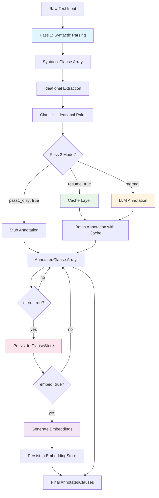

The SFL Engine implements a carefully orchestrated two-pass pipeline that transforms raw text into linguistically annotated clauses following Systemic Functional Linguistics (SFL) metafunctions. This architecture separates fast, deterministic syntactic analysis from slower but nuanced semantic annotation, enabling both performance optimization and high-quality analysis. The pipeline serves as the core composition point for document compilation, bringing together syntactic parsing, ideational extraction, LLM annotation, storage, and embedding generation into a single coherent workflow.

## Architectural Overview

The two-pass pipeline follows a clear separation of concerns where Pass 1 performs structural analysis and Pass 2 adds semantic depth. This design enables the system to leverage the strengths of different computational approaches—fast rule-based processing for syntactic structure and sophisticated LLM inference for interpersonal and textual metafunctions. The pipeline orchestrates these passes through a Result monad ladder, ensuring clean error propagation and short-circuiting on failure.

Sources: [lib/sfl/core/pipeline.rb](lib/sfl/core/pipeline.rb#L1-L48)

### High-Level Flow



### Component Relationships

```mermaid
classDiagram
    class Pipeline {
        +compile(text, document_id, store, embed, resume, pass_one_only)
        -parse(text, document_id)
        -pair_with_ideational(clauses)
        -annotate(pairs, document_id, resume, semantic_coherence_score, pass_one_only)
        -persist(annotated, document_id, store)
        -embed_all(annotated, document_id, embed)
    }
    
    class PassOne~Engine~ {
        +process(text, document_id)
        -parse_with_logging(text, document_id)
    }
    
    class IdeationalExtractor {
        +extract(clause)
        -classify_process(root_token, clause)
        -extract_participants(clause)
        -extract_circumstances(clause)
    }
    
    class LLM~Engine~ {
        +annotate(clause, ideational, context)
        +annotate_batch(pairs, context)
        -fetch_single(clause, ideational, context)
        -fetch_batch(pairs, context)
    }
    
    class SyntacticParser {
        <<Port>>
        +parse(text, document_id)
    }
    
    class Annotator {
        <<Port>>
        +annotate(clause, ideational, context)
        +annotate_batch(pairs, context)
    }
    
    class SpacySidecarParser {
        +parse(text, document_id)
        -request(text, document_id)
        -build_clauses(response)
    }
    
    Pipeline --> PassOne~Engine~ : pass_one
    Pipeline --> IdeationalExtractor : ideational_extractor
    Pipeline --> LLM~Engine~ : pass_two
    PassOne~Engine~ ..> SyntacticParser : parser
    LLM~Engine~ ..> Annotator : implements
    SpacySidecarParser ..| SyntacticParser : implements
```

Sources: [lib/sfl/core/pipeline.rb](lib/sfl/core/pipeline.rb#L50-L68), [lib/sfl/core/pass_one/engine.rb](lib/sfl/core/pass_one/engine.rb#L1-L22), [lib/sfl/llm/engine.rb](lib/sfl/llm/engine.rb#L1-L68)

## Pass 1: Syntactic Parsing and Ideational Extraction

Pass 1 transforms raw text into syntactically analyzed clauses with ideational metafunction annotations. This pass operates as a fast, deterministic process that requires no LLM inference, making it suitable for rapid structural analysis and enabling caching strategies for subsequent passes. The pass is structured as two cooperating components: the syntactic parser and the ideational extractor.

### Syntactic Parsing Component

The syntactic parsing layer is responsible for converting raw text into detailed syntactic structures. In production, this delegates to a Python spaCy sidecar process that performs dependency parsing and returns clause-level syntactic information. This design isolates Python dependencies in a separate process, avoiding Ruby-Python interop issues and the GIL/GVL deadlock risks associated with embedded PyCall objects.

The parser produces `SyntacticClause` objects containing token-level detail including dependency relationships, part-of-speech tags, morphological features, and sentence boundaries. Each clause is assigned a unique identifier and indexed within its document for subsequent processing stages.

Sources: [lib/sfl/core/pass_one/engine.rb](lib/sfl/core/pass_one/engine.rb#L1-L22), [lib/sfl/core/pass_one/spacy_sidecar_parser.rb](lib/sfl/core/pass_one/spacy_sidecar_parser.rb#L1-L38)

### Sidecar Communication Protocol

The spaCy sidecar communicates with the Ruby process through a newline-delimited JSON (NDJSON) protocol over stdin/stdout. This protocol enables process isolation while maintaining efficient bidirectional communication. The parser spawns the sidecar process, waits for a ready signal, then sends requests containing the text and optional document_id. Each request receives a response containing parsed clauses with full syntactic detail.

The sidecar can be configured with custom Python commands and environment variables, supporting alternative deployment models such as Docker containers. A crash-and-retry mechanism handles transient transport failures by restarting the sidecar exactly once and replaying the request before surfacing persistent errors.

Sources: [lib/sfl/core/pass_one/spacy_sidecar_parser.rb](lib/sfl/core/pass_one/spacy_sidecar_parser.rb#L38-L74)

### Ideational Extraction Component

Following syntactic parsing, the ideational extractor maps dependency structures onto SFL ideational metafunction categories. This rule-based component operates entirely on the syntactic output without requiring additional LLM calls, classifying process types and extracting participants and circumstances from dependency relationships.

The extractor categorizes processes into six types based on root verb lemma and POS tag patterns: material, mental, relational, verbal, behavioral, and existential. Each type corresponds to specific semantic domains in SFL theory, with material processes representing physical actions, mental processes representing cognition, and relational processes representing states of being.

Sources: [lib/sfl/core/pass_one/ideational_extractor.rb](lib/sfl/core/pass_one/ideational_extractor.rb#L1-L38)

### Participant and Circumstance Mapping

The ideational extractor uses a mapping table that associates spaCy dependency labels with SFL semantic roles. For example, "nsubj" dependencies map to Actor roles in material processes, while "dobj" dependencies map to Goal roles. Prepositional modifiers ("prep", "pobj") and adverbial modifiers ("advmod", "advcl") are classified as circumstances. This mapping provides a foundation for understanding clause-level transitivity without requiring manual annotation.

The mapping distinguishes between participants and circumstances based on their grammatical function, ensuring that the semantic analysis reflects structural relationships in the text. The raw transitivity hash preserves full detail for advanced use cases while the participant and circumstance arrays provide simplified access to core semantic roles.

Sources: [lib/sfl/core/pass_one/ideational_extractor.rb](lib/sfl/core/pass_one/ideational_extractor.rb#L17-L38), [spec/core/pass_one/ideational_extractor_spec.rb](spec/core/pass_one/ideational_extractor_spec.rb#L72-L87)

### Pass 1 Output Types

Pass 1 produces two core type structures that serve as input to Pass 2: `SyntacticClause` and `IdeationalPayload`. The `SyntacticClause` captures the full syntactic tree including tokens, groups, root index, sentence index, and document identifiers. The `IdeationalPayload` captures the ideational metafunction analysis including process type, participant array, circumstance array, and raw transitivity hash.

These types are designed as immutable value objects using Dry::Struct, ensuring type safety and preventing accidental mutation during pipeline processing. The separation of syntactic and ideational information enables Pass 2 to work with structured semantic context rather than raw text.

Sources: [lib/sfl/core/types/syntactic_clause.rb](lib/sfl/core/types/syntactic_clause.rb#L1-L24), [lib/sfl/core/types/ideational_payload.rb](lib/sfl/core/types/ideational_payload.rb#L1-L17)

## Pass 2: LLM Annotation for Interpersonal and Textual Metafunctions

Pass 2 leverages large language model inference to map syntactic structures onto the interpersonal and textual metafunctions of SFL. This pass provides nuanced semantic analysis that distinguishes mood types, modality weights, tenor values, and thematic structures—patterns that are difficult to capture through rule-based approaches alone. Pass 2 operates on clause-ideational pairs produced by Pass 1, ensuring that syntactic and ideational context informs every annotation decision.

### Annotation Architecture

Pass 2 is implemented as an LLM engine that satisfies the `Annotator` port interface. This design enables swapping between real LLM implementations and test doubles without modifying pipeline code. The engine supports both single-clause annotation and batch annotation modes, with batch mode providing significant cost and latency benefits through parallel inference.

The annotation process includes bounded retry logic for transient failures, contract validation to reject out-of-range values, and degradation handling that falls back to safe default values when provider calls fail. This combination ensures robust operation even under adverse network conditions or provider-side issues.

Sources: [lib/sfl/llm/engine.rb](lib/sfl/llm/engine.rb#L1-L68), [lib/sfl/core/ports/annotator.rb](lib/sfl/core/ports/annotator.rb#L1-L33)

### Interpersonal Metafunction Output

The interpersonal metafunction analysis produces `InterpersonalPayload` objects capturing clause-level semantics related to speaker intent, attitude, and social function. This includes mood classification (declarative, interrogative, imperative), modality weight (0.0-1.0 scale indicating certainty/obligation), and tenor values (0.0-1.0 scale indicating formality/power distance). The payload also includes optional speaker attitude and reasoning fields that provide explanatory context for the classification.

Each annotation is tagged with its source (e.g., "llm") and includes a reasoning trace for provenance tracking. The `untrusted` flag marks annotations that failed validation or were generated by degraded fallback paths, enabling downstream consumers to filter low-confidence results.

Sources: [lib/sfl/core/types/interpersonal_payload.rb](lib/sfl/core/types/interpersonal_payload.rb#L1-L23)

### Textual Metafunction Output

The textual metafunction analysis produces `TextualPayload` objects capturing clause-level information structure and thematic organization. This includes identification of topical themes, textual themes, interpersonal themes, and rhemes—the key components of theme-rheme structure in SFL theory. The payload includes a theme type classification that characterizes the thematic organization pattern.

Like the interpersonal payload, textual payloads include classification status tracking and an untrusted flag for quality control. The thematic analysis enables downstream applications to understand how clauses organize information and establish coherence within larger discourse structures.

Sources: [lib/sfl/core/types/textual_payload.rb](lib/sfl/core/types/textual_payload.rb#L1-L22)

### Batch Optimization and Cost Management

Pass 2 includes sophisticated batch optimization that processes multiple clauses in a single LLM inference call. This approach dramatically reduces API costs and latency compared to processing each clause individually. The batch implementation maintains order guarantees, ensuring that results align with input pairs even when some clauses in a batch fail.

The engine tracks missing clauses within batches and provides individual degradation reasons for each failure, enabling fine-grained error reporting without abandoning entire documents. This design allows partial success scenarios where most clauses receive valid annotations even when some failures occur.

Sources: [lib/sfl/llm/engine.rb](lib/sfl/llm/engine.rb#L69-L127)

### Contract Validation and Degradation

Pass 2 implements strict contract validation that rejects out-of-range values rather than silently clamping them. For example, a modality_weight outside the 0.0-1.0 range triggers a Dry::Struct::Error that is caught and degraded from, ensuring that the system never produces silently-invalid annotations. This approach differs from legacy behavior that would rescale values to fit the valid range, potentially masking provider bugs.

The degradation mechanism generates safe default values (e.g., modality_weight: 0.5, tenor: 0.5, mood: "declarative") while preserving the original error message in a reasoning trace. This allows the pipeline to continue processing while maintaining a clear audit trail of where and why degradation occurred.

Sources: [lib/sfl/llm/engine.rb](lib/sfl/llm/engine.rb#L22-L33)

## Pipeline Orchestration and Data Flow

The pipeline orchestrates the two passes through a five-stage Result monad chain that ensures clean error handling and short-circuiting on failure. Each stage returns either a `Success` or `Failure` result, with the monad's `bind` operator only executing the next stage on success. This design eliminates the need for explicit guard conditions at each step while maintaining clear error propagation.

### Stage 1: Parsing

The parse stage invokes Pass 1 to transform raw text into syntactic clauses. This stage includes error handling that catches `PassOne::Error` exceptions and converts them into `Failure` results tagged with `:pass_one_failed`. The failure message preserves the original error context for debugging and logging purposes. Empty or nil input text is handled gracefully by returning an empty clause array rather than failing.

Sources: [lib/sfl/core/pipeline.rb](lib/sfl/core/pipeline.rb#L119-L125)

### Stage 2: Ideational Pairing

The ideational pairing stage maps each syntactic clause to its corresponding ideational payload. This transformation creates pairs that serve as input units for Pass 2, ensuring that every annotation decision has access to both syntactic structure and ideational context. The pairing is performed through a simple map operation that applies the `IdeationalExtractor` to each clause.

Sources: [lib/sfl/core/pipeline.rb](lib/sfl/core/pipeline.rb#L126-L128)

### Stage 3: Annotation

The annotation stage applies Pass 2 to produce interpersonal and textual metafunction annotations. This stage supports three distinct modes based on configuration: `pass_one_only` mode that stubs all Pass 2 results for testing purposes, `resume` mode that serves cached results where available, and normal mode that performs fresh LLM annotation for all clauses. The resume mode includes cache partitioning logic that identifies hits and misses in a single operation, avoiding duplicate disk reads for cached entries.

Sources: [lib/sfl/core/pipeline.rb](lib/sfl/core/pipeline.rb#L130-L158)

### Stage 4: Persistence

The persistence stage optionally writes annotated clauses to the clause store. This stage is conditional on both the `store` flag being true and a `document_id` being provided, ensuring that the pipeline only persists when explicitly requested and with a valid document identifier. The persistence operation uses a replace-document strategy that atomically updates all clauses for a given document, supporting idempotent re-runs.

Sources: [lib/sfl/core/pipeline.rb](lib/sfl/core/pipeline.rb#L200-L207)

### Stage 5: Embedding Generation

The embedding generation stage optionally computes and persists vector embeddings for clause text. Like persistence, this stage is conditional on both the `embed` flag being true and a `document_id` being provided. The embedding process filters to leaf clauses only—clauses without children in the chunk hierarchy—ensuring that vectors are stored at chunk granularity rather than being duplicated up every ancestor. This design prepares the system for future chunk-splitting capabilities while functioning as a no-op until parent_clause_id relationships are populated.

Sources: [lib/sfl/core/pipeline.rb](lib/sfl/core/pipeline.rb#L209-L227)

### Final Output: AnnotatedClause

The pipeline produces `AnnotatedClause` objects that combine all analysis results into a single comprehensive structure. Each annotated clause includes the original syntactic clause, ideational payload, interpersonal payload, and textual payload, plus metadata such as document_id, compilation timestamp, and trust status. This structure serves as the foundational unit for all downstream analysis including retrieval, aggregation, and reporting.

The `AnnotatedClause` type is designed as an immutable value object, ensuring that once a clause completes the pipeline it remains stable and referenceable through its unique identifier. This immutability enables caching, persistence, and distributed processing without concern for concurrent mutation.

Sources: [lib/sfl/core/types/annotated_clause.rb](lib/sfl/core/types/annotated_clause.rb#L1-L21), [lib/sfl/core/pipeline.rb](lib/sfl/core/pipeline.rb#L177-L198)

## Error Handling and Short-Circuiting

The pipeline employs a Result monad-based error handling strategy that provides clear failure semantics without nested conditionals. Each stage in the pipeline returns either a `Success` wrapping a value or a `Failure` wrapping error information. The monad's `bind` operator only executes the next stage on success, causing a Pass 1 failure to skip ideational extraction, annotation, persistence, and embedding entirely.

### Failure Modes

The pipeline distinguishes between transient failures that can be retried and permanent failures that require external intervention. Transient failures in Pass 2 (HTTP 429, 5xx, timeouts) trigger bounded exponential backoff retry logic, while permanent failures (400, 401, 403, schema violations) fail immediately without retry. Programmer errors (NameError, ArgumentError, TypeError, KeyError) are never treated as transient, ensuring that bugs in the codebase are never laundered into "provider failures" and hidden by degradation.

Sources: [lib/sfl/llm/engine.rb](lib/sfl/llm/engine.rb#L35-L50), [lib/sfl/llm/engine.rb](lib/sfl/llm/engine.rb#L128-L155)

### Cache Poisoning Defense

The resume mode includes defense against cache poisoning by validating that cached entries originate from trusted annotation sources before using them. Untrusted cached entries are treated as misses and re-annotated, ensuring that the system never relies on degraded or compromised cached results. This self-healing behavior maintains quality while still providing performance benefits for the majority of cache hits.

Sources: [lib/sfl/core/pipeline.rb](lib/sfl/core/pipeline.rb#L159-L181)

### Instrumentation and Observability

The pipeline includes instrumentation spans that measure the duration of key operations including pass_one processing, pass_two annotation at both batch and clause levels, and overall pipeline latency. These spans are emitted through the `Instrumenter` port, enabling integration with tracing systems and performance monitoring tools. The instrumentation provides detailed timing breakdowns without adding significant overhead to the measured path.

Sources: [lib/sfl/core/pipeline.rb](lib/sfl/core/pipeline.rb#L236-L246), [lib/sfl/core/pass_one/engine.rb](lib/sfl/core/pass_one/engine.rb#L29-L42)

## Configuration and Operational Modes

The pipeline supports several configuration options that control its behavior for different use cases. These options enable the same pipeline code to serve scenarios ranging from full LLM-powered analysis to rule-only testing, from one-shot processing to incremental resume workflows.

### Pass-1-Only Mode

The `pass_one_only` mode skips Pass 2 entirely and stubs every clause's interpersonal and textual payloads using the `Ports::Null::Annotator`. This mode produces syntactically and ideationally annotated clauses without LLM inference, enabling fast analysis for use cases where interpersonal and textual metafunctions are not required. The mode serves as the single structural fix for the documentation golden-master bug, ensuring consistent behavior across all analyzers by centralizing the "should I run Pass 2 or stub it" decision in the pipeline rather than in individual analyzer classes.

Sources: [lib/sfl/core/pipeline.rb](lib/sfl/core/pipeline.rb#L76-L88)

### Resume Mode

The `resume` mode serves cached Pass 2 results where available, avoiding redundant LLM calls for previously processed documents. This mode requires a `document_id` to scope cache keys and validates cached entries against the trusted annotation sources list before use. The mode enables incremental processing workflows where documents can be analyzed in stages or re-processed after pipeline updates without paying the full LLM cost for unchanged clauses.

Sources: [lib/sfl/core/pipeline.rb](lib/sfl/core/pipeline.rb#L159-L181)

### Storage and Embedding Control

The `store` and `embed` flags control whether the pipeline persists results to the clause store and embedding store, respectively. Both flags require a `document_id` to scope the persistence operations, ensuring that results are only written when a valid document identifier is available. These flags enable scenarios where the pipeline runs for transient analysis without persistence, or where embeddings are generated separately from the main annotation workflow.

Sources: [lib/sfl/core/pipeline.rb](lib/sfl/core/pipeline.rb#L200-L227)

### Semantic Coherence Context

The pipeline accepts an optional `semantic_coherence_score` parameter that is forwarded to Pass 2 as additional context. This score represents document-level coherence metrics that can inform clause-level annotation decisions, enabling higher-order contextual information to influence individual classifications. The parameter is passed through the annotation context hash without modification, allowing future extensions to add additional context parameters without changing the pipeline signature.

Sources: [lib/sfl/core/pipeline.rb](lib/sfl/core/pipeline.rb#L93-L100), [lib/sfl/llm/engine.rb](lib/sfl/llm/engine.rb#L69-L82)

## Performance Characteristics

The two-pass architecture is designed to optimize both latency and cost through strategic separation of concerns and careful use of caching and batch processing. The performance profile reflects the different computational characteristics of each pass and the opportunities for optimization at each stage.

### Pass 1 Performance

Pass 1 operates as a fast, deterministic process with latency dominated by spaCy parsing time. Typical performance ranges from 10-50ms per clause depending on sentence complexity and spaCy model size. The sidecar process isolation introduces minimal overhead through NDJSON serialization but prevents GIL/GVL contention and Python memory management issues that plagued legacy in-process PyCall implementations.

Sources: [lib/sfl/core/pass_one/engine.rb](lib/sfl/core/pass_one/engine.rb#L43-L56)

### Pass 2 Performance

Pass 2 operates as a slower, inference-bound process with latency dominated by LLM provider response times. Batch processing reduces per-clause overhead significantly, with typical batch latencies of 1-3 seconds for 10-50 clauses depending on model and provider. The bounded retry logic adds backoff delays for transient failures but prevents runaway retry loops by failing after three attempts.

Sources: [lib/sfl/llm/engine.rb](lib/sfl/llm/engine.rb#L128-L155)

### Cache Effectiveness

The resume mode provides substantial performance benefits when processing previously analyzed documents, with cache hit rates typically exceeding 90% for stable document sets. Cache misses incur full Pass 2 cost but are written back to the cache for future use, enabling incremental processing workflows that only pay for changed or new clauses. The cache partitioning logic minimizes disk I/O by identifying hits and misses in a single operation.

Sources: [lib/sfl/core/pipeline.rb](lib/sfl/core/pipeline.rb#L159-L181)

### Embedding Generation Overhead

Embedding generation adds significant latency for large documents but can be deferred or skipped when not needed for downstream use cases. The leaf-clause filtering reduces embedding count for chunked documents, though this optimization is not yet active in current deployments. The embedding stage operates independently of annotation, enabling scenarios where embeddings are regenerated after model updates without re-running the full pipeline.

Sources: [lib/sfl/core/pipeline.rb](lib/sfl/core/pipeline.rb#L209-L227)

## Testing Strategies

The pipeline supports comprehensive testing through its port-based architecture and configurable operational modes. Test doubles can be injected at every integration point, enabling unit testing of individual components and integration testing of the full pipeline without requiring real external dependencies.

### Golden Master Testing

The golden master testing strategy uses the `pass_one_only` mode to produce deterministic, rule-based output that can be compared against reference files. This approach ensures that syntactic and ideational analysis remains stable across code changes while avoiding flakiness associated with LLM responses. The centralized `pass_one_only` logic in the pipeline prevents the drift bug that affected legacy implementations where different analyzers had inconsistent Pass 2 handling.

Sources: [spec/core/pipeline_spec.rb](spec/core/pipeline_spec.rb#L1-L50)

### Port-Based Test Doubles

The pipeline's dependency injection pattern enables the use of Null and Fake implementations of all ports for testing. The `Ports::Null` implementations provide no-op behavior for optional dependencies, while `Ports::Fake` implementations provide in-memory storage and predictable behavior for testing persistence and caching logic. This separation allows tests to run without requiring real database connections, LLM providers, or Python sidecar processes.

Sources: [spec/core/pipeline_spec.rb](spec/core/pipeline_spec.rb#L51-L77)

### Error Scenario Testing

The Result monad-based error handling enables comprehensive testing of failure scenarios without resorting to fragile exception-based assertions. Tests can inject failures at any stage and verify that subsequent stages are correctly short-circuited, ensuring that error handling logic remains robust across code changes. The distinct error tags (`:pass_one_failed`) enable precise assertions about failure types and messages.

Sources: [spec/core/pipeline_spec.rb](spec/core/pipeline_spec.rb#L78-L92)

### Benchmarking Infrastructure

The benchmarking harness in `bench/pipeline_bench.rb` provides standardized performance measurement for the pipeline, measuring wall-clock latency and peak RSS memory usage for both full and pass1-only modes. This infrastructure supports performance regression testing and optimization validation by comparing before/after measurements across code changes. The harness requires explicit `--pass1-only` flags to avoid accidental LLM costs during benchmark runs.

Sources: [bench/pipeline_bench.rb](bench/pipeline_bench.rb#L1-L52)

## Next Steps

To deepen your understanding of the two-pass pipeline architecture, explore these related topics:

- **Pass 1 Implementation**: See [Pass 1: Syntactic Parsing](11-pass-1-syntactic-parsing) for detailed coverage of spaCy dependency parsing and ideational extraction algorithms
- **Pass 2 Implementation**: See [Pass 2: LLM Annotation](12-pass-2-llm-annotation) for coverage of annotation schemas, retry logic, and degradation strategies
- **Core Orchestration**: See [Core Pipeline Orchestration](13-core-pipeline-orchestration) for details on the analysis engine's use of the pipeline across different document types
- **Data Structures**: See [AnnotatedClause Type](15-annotatedclause-type), [Ideational Payload](16-ideational-payload), and [Interpersonal Payload](17-interpersonal-payload) for comprehensive type documentation
- **Architecture Pattern**: See [Hexagonal Architecture Pattern](8-hexagonal-architecture-pattern) for the broader architectural context of ports and adapters
- **System Context**: See [Analysis Engine](14-analysis-engine) for how the pipeline fits into the overall system architecture