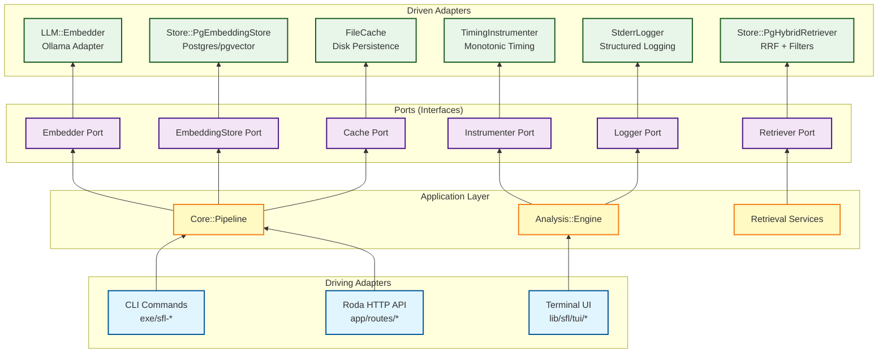

The hexagonal architecture pattern (also known as ports and adapters) is the foundational design principle of sfl-engine, providing clear separation between the core domain logic and external infrastructure concerns. This architectural approach enables the engine to support multiple interfaces—CLI, HTTP API, TUI, and GUI—without coupling business logic to any specific delivery mechanism.

Sources: [docs/refactor/EMBEDDING-HEXAGON-USER-STORIES.md](docs/refactor/EMBEDDING-HEXAGON-USER-STORIES.md), [docs/ecosystem-architecture.md](docs/ecosystem-architecture.md#32-architecture-pattern)

## Architectural Vision

The hexagonal architecture organizes code into concentric layers, with dependencies always pointing inward toward the pure Ruby core. The center contains domain types and port definitions—the "what" of the system without any infrastructure knowledge. The middle layer houses use cases and application services that orchestrate domain behavior. The outermost layer comprises driving and driven adapters that translate between external systems and the core.

This pattern ensures that changes to infrastructure—switching from Ollama to OpenAI for embeddings, or from Postgres to another database—never require modifications to domain logic. The core remains pure Ruby with zero external dependencies, while adapters handle all integration concerns.

Sources: [docs/architecture-diagrams.md](docs/architecture-diagrams.md#3-component-dependency-graph)

## Ports: The Contract Layer

Ports define the interfaces that the core domain requires from external systems. Each port is a Ruby module with methods that raise `NotImplementedError`, serving as a clear contract that concrete adapters must fulfill. Ports are located in `lib/sfl/core/ports/` and cover the full range of infrastructure concerns.

### Core Ports

| Port | Purpose | Key Methods |
|---|---|---|
| `Core::Ports::Embedder` | Convert text to vector embeddings | `#embed(text)`, `#embed_batch(texts)` |
| `Core::Ports::EmbeddingStore` | Persist embeddings by document | `#replace_document(document_id, embeddings_by_clause_id)` |
| `Core::Ports::Retriever` | Hybrid semantic + keyword retrieval | `#retrieve(query)` |
| `Core::Ports::Cache` | Memoize expensive computations | `#partition(keys)`, `#write(key, value)` |
| `Core::Ports::Instrumenter` | Wrap calls with tracing/metrics | `#instrument(name, payload, &block)` |
| `Core::Ports::Logger` | Structured logging with severity levels | `#debug`, `#info`, `#warn`, `#error`, `#fatal` |

These ports deliberately omit infrastructure specifics. The `Embedder` port doesn't mention HTTP endpoints or authentication; the `EmbeddingStore` port doesn't reference SQL or pgvector. This abstraction allows adapters to implement the same contract using entirely different technologies without affecting the core.

Sources: [lib/sfl/core/ports/embedder.rb](lib/sfl/core/ports/embedder.rb), [lib/sfl/core/ports/embedding_store.rb](lib/sfl/core/ports/embedding_store.rb), [lib/sfl/core/ports/retriever.rb](lib/sfl/core/ports/retriever.rb), [lib/sfl/core/ports/cache.rb](lib/sfl/core/ports/cache.rb)

## Adapters: The Implementation Layer

Adapters are concrete implementations of port contracts. They bridge the gap between the pure domain and external systems such as databases, LLM APIs, and file systems. sfl-engine maintains three categories of adapters: real adapters, null adapters, and fake adapters.

### Real Adapters

Real adapters provide actual infrastructure integration. For example, `SFL::LLM::Embedder` implements `Core::Ports::Embedder` by making HTTP requests to an Ollama server:

```ruby
class Embedder
  include Core::Ports::Embedder

  def initialize(model:, ollama_base_url:, breaker:, logger:)
    @model = model
    @base_uri = URI(ollama_base_url.chomp("/"))
    @breaker = breaker
    @logger = logger
  end

  def embed(text)
    breaker.call("embedder.embed") { fetch(text) }
  rescue => e
    fail_embed("embed", e)
  end
end
```

Similarly, `SFL::Store::PgEmbeddingStore` implements `Core::Ports::EmbeddingStore` using Sequel and pgvector:

```ruby
class PgEmbeddingStore
  include Core::Ports::EmbeddingStore

  def initialize(db, model: DEFAULT_MODEL)
    @db = db
    @model = model
  end

  def replace_document(document_id, embeddings_by_clause_id)
    document_clause_ids = @db[:clauses].where(document_id:).select(:external_id)
    succeeded, failed = embeddings_by_clause_id.partition { |_clause_id, vector| vector && !vector.empty? }

    @db.transaction do
      @db[:embeddings].where(clause_id: document_clause_ids, model: @model).delete
      insert_succeeded(succeeded)
      mark_embedded(succeeded)
      mark_failed(failed)
    end
  end
end
```

Notice that configuration (database connections, API URLs, model names) is injected via constructor parameters rather than read from environment variables. This ensures adapters remain testable and that the composition root controls all configuration decisions.

Sources: [lib/sfl/llm/embedder.rb](lib/sfl/llm/embedder.rb), [lib/sfl/store/pg_embedding_store.rb](lib/sfl/store/pg_embedding_store.rb)

### Null Adapters

Null adapters provide no-op implementations that return safe default values. They enable features to be disabled at runtime without special-casing logic throughout the codebase. For example, `Core::Ports::Null::Embedder` returns empty arrays:

```ruby
module Null
  class Embedder
    include Ports::Embedder

    def embed(_text)
      []
    end

    def embed_batch(texts)
      texts.map { |text| embed(text) }
    end
  end
end
```

This pattern is particularly useful for testing and for configuration scenarios where certain features should be disabled. The pipeline can simply receive a null adapter instead of a real one, and all downstream code works unchanged.

Sources: [lib/sfl/core/ports/null/embedder.rb](lib/sfl/core/ports/null/embedder.rb)

### Fake Adapters

Fake adapters provide deterministic implementations for specifications. Unlike null adapters, which return constant defaults, fake adapters can be configured to return specific values based on input. For example, `Core::Ports::Fake::Embedder` returns pre-configured vectors for specific texts:

```ruby
module Fake
  class Embedder
    include Ports::Embedder

    DIMENSIONS = 768

    def initialize(vectors: {}, default: Array.new(DIMENSIONS, 0.0))
      @vectors = vectors
      @default = default
    end

    def embed(text)
      @vectors.fetch(text, @default)
    end

    def embed_batch(texts)
      texts.map { |text| embed(text) }
    end
  end
end
```

This enables precise control over test scenarios without requiring actual API calls or database connections. Specs can verify behavior like semantic ranking by providing vectors that produce predictable similarity scores.

Sources: [lib/sfl/core/ports/fake/embedder.rb](lib/sfl/core/ports/fake/embedder.rb)

## Composition Roots: Wiring It All Together

Composition roots are the only places in the codebase where ports and adapters are assembled into working object graphs. sfl-engine has three main composition roots: `SFL::Boot`, `SFL::API::Context`, and the CLI builders. Each root constructs a complete set of collaborators and hands them to a driving adapter.

### Boot: The Primary Composition Root

`SFL::Boot` is the sole component that reads environment variables. It constructs all infrastructure dependencies and packages them into a `Boot::Result` struct:

```ruby
module Boot
  module_function def call(env: ENV, load_dotenv: true, require_db: true, require_llm: true, require_tracing: true)
    Dotenv.load if load_dotenv

    llm_config, lm_factory, embedder, classifier = build_llm_collaborators(env) if require_llm
    configure_tracing(env, tty:, input:) if require_tracing
    db = require_db ? connect_db(env) : nil

    Result.new(db:, llm_config:, lm_factory:, embedder:, classifier:, pass1_command:, pass1_env:, spacy_model:, api_debug_errors:, api_cors_origins:)
  end
end
```

The boot process is deliberately explicit: each collaborator has its own builder method (`build_llm_collaborators`, `build_embedder`, `connect_db`), making the wiring transparent and testable.

Sources: [lib/sfl/boot.rb](lib/sfl/boot.rb)

### API Context: HTTP-Ready Composition

`SFL::API::Context.build` constructs fully-initialized objects specifically for the HTTP API. It reuses CLI builders to ensure the API and CLI share identical behavior:

```ruby
class Context
  def self.build(boot_result)
    logger, instrumenter, breaker = CLI.build_collaborators
    pipeline = CLI.build_pipeline(boot_result, { store: true, resume: false }, breaker:, instrumenter:, logger:)
    pass_two = LLM::EngineBuilder.call(config: boot_result.llm_config, lm_factory: boot_result.lm_factory, breaker:, instrumenter:, logger:)
    
    new(
      pipeline:,
      retriever: Store::PgHybridRetriever.new(db: boot_result.db, embedder: boot_result.embedder),
      synthesizer: Retrieval::ContextSynthesizer.new(retriever: Store::PgHybridRetriever.new(db: boot_result.db, embedder: boot_result.embedder), lm: boot_result.lm_factory.for(:context_synthesis), clause_store:, breaker:, instrumenter:, logger:),
      # ... additional fields
    )
  end
end
```

This composition root is called from `config.ru`, the Rack entry point for the HTTP API daemon. Every Roda route accesses collaborators through `ctx = Providers::Engine.get`, which returns the cached `API::Context` instance.

Sources: [lib/sfl/api/context.rb](lib/sfl/api/context.rb), [app/sfl.rb](app/sfl.rb)

## Driving Adapters: External Interfaces

Driving adapters coordinate use cases by accepting input from external systems and translating it into method calls on the application core. sfl-engine supports multiple driving adapters that all consume the same composition root.

### CLI Adapter

The command-line interface parses arguments and invokes pipeline operations. The `CLI.build_pipeline` method selects real or null adapters based on command-line flags:

```ruby
module_function def build_pipeline(boot_result, options, breaker:, instrumenter:, logger:)
  parser = Core::PassOne::SpacySidecarParser.new(model: boot_result.spacy_model, command: boot_result.pass1_command, env: boot_result.pass1_env || {}, logger:)
  pass_one = Core::PassOne::Engine.new(parser:, instrumenter:, logger:)
  
  pass_two = if options[:pass1_only]
    Core::Ports::Null::Annotator.new
  else
    LLM::EngineBuilder.call(config: boot_result.llm_config, lm_factory: boot_result.lm_factory, breaker:, instrumenter:, logger:)
  end

  clause_store = Store::PgClauseStore.new(boot_result.db)
  embedding_store = options[:store] ? Store::PgEmbeddingStore.new(boot_result.db) : Core::Ports::Null::EmbeddingStore.new
  embedder = options[:store] ? boot_result.embedder : Core::Ports::Null::Embedder.new
  cache = options[:resume] ? Core::Ports::FileCache.new : Core::Ports::Null::Cache.new

  Core::Pipeline.new(pass_one:, pass_two:, clause_store:, embedding_store:, embedder:, cache:, logger:, instrumenter:)
end
```

This flexible wiring enables commands like `sfl-analyze --no-store` to skip embedding generation entirely, substituting null adapters for persistence.

Sources: [lib/sfl/cli.rb](lib/sfl/cli.rb)

### HTTP API Adapter

The Roda-based HTTP API translates REST requests into use case calls. Routes are organized by resource in `app/routes/`:

```ruby
# app/routes/retrieve.rb
route do |r|
  r.post do
    query = Core::Types::RetrievalQuery.new(r.params)
    results = ctx.retriever.retrieve(query)
    results.map(&:to_h)
  end
end
```

Each route accesses `ctx`, the shared `API::Context` instance maintained by `Providers::Engine`. This ensures the HTTP API cannot bypass business logic or access raw database connections.

Sources: [app/routes/retrieve.rb](app/routes/retrieve.rb), [app/config/providers/engine.rb](app/config/providers/engine.rb)

## Dependency Rule and Testability

The fundamental dependency rule of hexagonal architecture is that dependencies must point inward. This means the core domain cannot depend on any outer layer. In practice, this manifests in several key patterns:

1. **Constructor injection**: All dependencies are passed as constructor parameters, never instantiated within classes.

2. **No global state**: Classes cannot reference global singletons or class-level configuration. The only exception is `SFL::Boot`, which constructs globals and packages them for injection.

3. **Test doubles**: Any collaborator can be replaced with a null or fake adapter in specifications. For example, pipeline specs use `Fake::Embedder` to avoid actual LLM calls.

4. **Zero ENV reading outside Boot**: Classes like `LLM::Embedder` and `PgEmbeddingStore` receive configuration via parameters rather than calling `ENV.fetch` directly. (Note: `PgEmbeddingStore` currently has one ENV reference at line 37, documented as a legacy issue to be resolved).

This strict dependency discipline enables comprehensive unit testing without external dependencies. Specs run quickly and deterministically because they can substitute all I/O with test doubles.

Sources: [lib/sfl/llm/embedder.rb](lib/sfl/llm/embedder.rb#L19), [lib/sfl/core/pipeline.rb](lib/sfl/core/pipeline.rb#L30)

## Pipeline Orchestration

The `Core::Pipeline` class exemplifies hexagonal architecture principles by composing multiple ports into a coherent use case. The pipeline receives all required collaborators via its constructor:

```ruby
class Pipeline
  def initialize(
    pass_one:,
    pass_two:,
    ideational_extractor: PassOne::IdeationalExtractor.new,
    clause_store: Ports::Null::ClauseStore.new,
    embedding_store: Ports::Null::EmbeddingStore.new,
    embedder: Ports::Null::Embedder.new,
    cache: Ports::Null::Cache.new,
    logger: Ports::Null::Logger.new,
    instrumenter: Ports::Null::Instrumenter.new,
    readability_scorer: Analysis::ReadabilityScorer.new
  )
    @pass_one = pass_one
    @pass_two = pass_two
    # ... assign all collaborators
  end
end
```

The `#compile` method orchestrates the two-pass pipeline using dry-monads' Result type for error propagation:

```ruby
def compile(text, document_id: nil, store: true, embed: true, resume: false, semantic_coherence_score: nil, pass_one_only: false)
  result = parse(text, document_id)
    .bind { |clauses| Success(pair_with_ideational(clauses)) }
    .bind { |pairs| annotate(pairs, document_id, resume, semantic_coherence_score, pass_one_only) }
    .bind { |annotated| persist(annotated, document_id, store) }
    .bind { |annotated| embed_all(annotated, document_id, embed) }
  
  log_completion(document_id, result, started_at)
  result
end
```

Each stage returns a `Success` or `Failure` monad, and the `.bind` operator chains stages together, automatically short-circuiting on failure. The pipeline never directly references concrete implementations—it only interacts with ports like `@clause_store`, `@embedder`, and `@cache`.

Sources: [lib/sfl/core/pipeline.rb](lib/sfl/core/pipeline.rb#L30), [lib/sfl/core/pipeline.rb](lib/sfl/core/pipeline.rb#L84)

## Cross-Cutting Concerns

Hexagonal architecture cleanly separates cross-cutting concerns (logging, instrumentation, circuit breaking) from business logic. These concerns are implemented as ports that wrap other adapters.

### Instrumentation

The `Instrumenter` port wraps arbitrary blocks with named spans for tracing and metrics:

```ruby
module Instrumenter
  def instrument(name, payload = {}, &)
    raise NotImplementedError, "#{self.class} must implement #instrument"
  end
end
```

`TimingInstrumenter` provides a concrete implementation that records monotonic timing:

```ruby
class TimingInstrumenter
  include Ports::Instrumenter

  def instrument(name, payload = {})
    started_at = monotonic
    result = yield
    result
  ensure
    elapsed_ms = ((monotonic - started_at) * 1000).round(3)
    @mutex.synchronize { @spans << { name:, duration_ms: elapsed_ms, **payload } }
  end
end
```

The pipeline uses instrumentation to track Pass 2 annotation performance without embedding timing logic in the annotator itself.

Sources: [lib/sfl/core/ports/instrumenter.rb](lib/sfl/core/ports/instrumenter.rb), [lib/sfl/core/ports/timing_instrumenter.rb](lib/sfl/core/ports/timing_instrumenter.rb)

### Logging

The `Logger` port provides structured logging with severity levels modeled on Ruby's standard library:

```ruby
module Logger
  def debug(message = nil, &)
    raise NotImplementedError, "#{self.class} must implement #debug"
  end

  def info(message = nil, &)
    raise NotImplementedError, "#{self.class} must implement #info"
  end

  def warn(message = nil, &)
    raise NotImplementedError, "#{self.class} must implement #warn"
  end

  def error(message = nil, &)
    raise NotImplementedError, "#{self.class} must implement #error"
  end

  def fatal(message = nil, &)
    raise NotImplementedError, "#{self.class} must implement #fatal"
  end
end
```

`StderrLogger` wraps Ruby's built-in `Logger` class to satisfy this contract:

```ruby
class StderrLogger
  include Ports::Logger

  def initialize(level: ::Logger::INFO)
    @logger = ::Logger.new($stderr)
    @logger.level = level
  end

  def debug(message = nil, &)
    @logger.debug(message, &)
  end

  # ... similar wrappers for info, warn, error, fatal
end
```

This design allows log output to be redirected (to files, journald, or cloud logging services) by substituting different logger implementations, without any changes to business logic.

Sources: [lib/sfl/core/ports/logger.rb](lib/sfl/core/ports/logger.rb), [lib/sfl/core/ports/stderr_logger.rb](lib/sfl/core/ports/stderr_logger.rb)

## Architecture Diagram

The complete hexagonal architecture can be visualized as a layered system with driving adapters on the outside, use cases in the middle, ports defining interfaces, and driven adapters implementing infrastructure:



This diagram shows how driving adapters orchestrate use cases, which depend only on ports, not on concrete adapter implementations. Swapping adapters (e.g., switching from Ollama to OpenAI for embeddings) requires no changes to the application layer.

Sources: [docs/architecture-diagrams.md](docs/architecture-diagrams.md#3-component-dependency-graph)

## Benefits and Trade-offs

The hexagonal architecture pattern delivers several key benefits for sfl-engine:

### Benefits

**Testability**: Every component can be tested in isolation by substituting collaborators with null or fake adapters. Pipeline specs run without database connections or LLM API calls.

**Flexibility**: New adapters can be added without modifying core logic. For example, adding Redis caching or switching embedding providers only requires implementing the existing port interface.

**Parallel development**: Frontend and backend teams can work independently. The HTTP API exposes stable use case interfaces that remain consistent regardless of internal implementation changes.

**Clear boundaries**: The separation between ports (interfaces) and adapters (implementations) makes the codebase easier to understand and navigate. New contributors can quickly identify where to add features.

### Trade-offs

**Boilerplate**: Each port requires multiple adapter implementations (real, null, fake). This increases initial code volume but pays off in testability and flexibility.

**Indirection**: Following dependency chains through constructor injection can be more mentally demanding than direct instantiation. However, this complexity is intentional and confined to composition roots.

**Learning curve**: Developers must understand the ports/adapters pattern and dependency injection discipline. The null/fake double convention requires familiarity.

Sources: [docs/refactor/EMBEDDING-HEXAGON-USER-STORIES.md](docs/refactor/EMBEDDING-HEXAGON-USER-STORIES.md#1-context--problem-statement)

## Implementation Guidelines

When extending sfl-engine with new infrastructure capabilities, follow these hexagonal architecture patterns:

1. **Define a port first**: Create the interface in `lib/sfl/core/ports/` with method signatures that raise `NotImplementedError`. The port should describe what the system needs, not how any specific adapter works.

2. **Implement real adapters**: Add concrete implementations in appropriate namespace directories (`lib/sfl/llm/`, `lib/sfl/store/`, etc.). Ensure all configuration is constructor-injected.

3. **Add null and fake adapters**: Create no-op versions in `lib/sfl/core/ports/null/` and deterministic versions in `lib/sfl/core/ports/fake/` for testing.

4. **Wire in composition roots**: Add builder methods to `SFL::Boot` or `CLI.build_*` methods. Never instantiate adapters directly in use case classes.

5. **Inject into use cases**: Pass the new adapter through constructor parameters to classes that need it. Use sensible defaults (typically null adapters) so existing code continues to work.

6. **Write specs**: Test both real adapter behavior (with integration specs) and use case behavior (with unit specs using fake adapters).

This approach ensures new capabilities integrate cleanly with existing architecture without breaking the dependency rule or compromising testability.