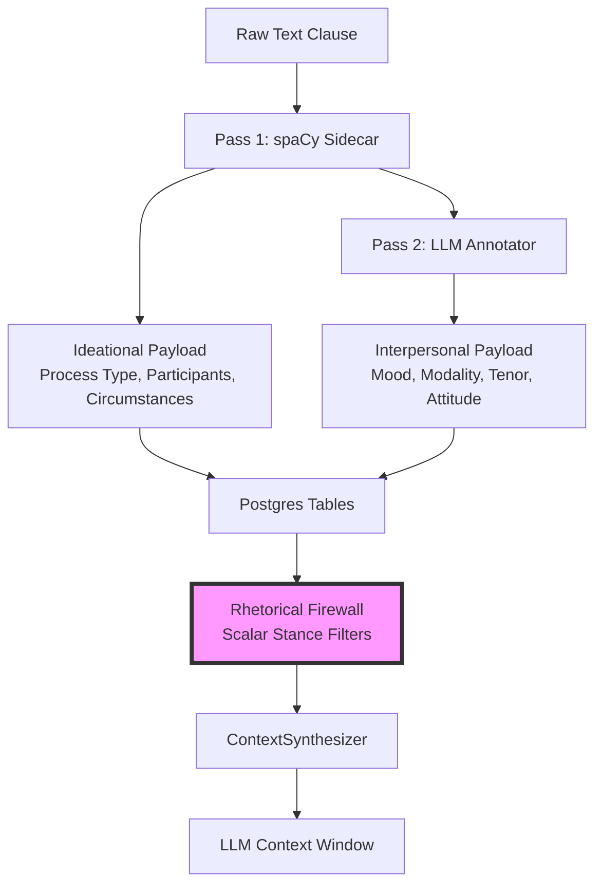
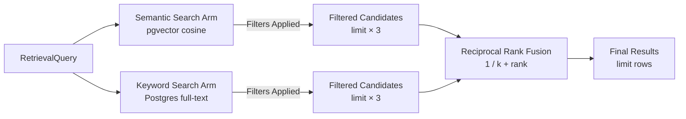

The Rhetorical Firewall is a foundational security pattern in sfl-engine that prevents contextual poisoning by separating factual content from rhetorical stance at the data storage layer. This architectural boundary enables retrieval policies to filter interpersonal metadata before it reaches the LLM's context window, creating a deterministic constraint on how persuasion, emotion, and social proof influence synthesis.

Sources: [README.md](README.md#L14-L50)

## The Problem: Fused Retrieval in Standard RAG

Traditional RAG pipelines embed raw text into dense vectors, creating an inseparable fusion between factual content and rhetorical stance. When the LLM receives retrieved text, it encounters both the fact and its persuasive framing simultaneously. This coupling creates a context-poisoning risk where adversarial content competes directly with behavioral defenses like "ignore manipulative tone." The instruction operates on the same channel as the adversarial content, making prompt-level interventions structurally weak.

Sources: [README.md](README.md#L39-L47)

## Architectural Foundation: Payload Separation

SFL Engine implements a Model-View-like separation at the data layer that mirrors Systemic Functional Linguistics' metafunction theory. This decomposition enables independent filtering of fact from interpretation:



**Ideational Payload** represents the Model-like factual representation: what happened (process types), who did what to whom (participants), and the surrounding circumstances. **Interpersonal Payload** represents the View-like presentation layer: mood, modality weight, tenor, and speaker attitude. While the analogy is architectural rather than literal—interpersonal metadata is not merely decorative presentation—it serves as a security-relevant signal for retrieval policy.

Sources: [README.md](README.md#L22-L35)

## Filter Dimensions: The Scalar Rhetorical Interface

The Rhetorical Firewall exposes seven scalar filter dimensions through the `RetrievalFilters` type, each mapped to SQL constraints that push filtering into the database query itself:

| Filter Dimension | Type | Range/Values | Security Relevance |
|------------------|------|--------------|-------------------|
| `mood` | String enum | declarative, interrogative, imperative, exclamative, indicative, minor, fragment | Excludes commands disguised as questions, rhetorical devices that demand compliance |
| `min_modality` | Float (0.0-1.0) | 0.0 (uncertain) to 1.0 (certain) | Filters hyperbolic certainty claims, social proof language |
| `max_modality` | Float (0.0-1.0) | 0.0 (uncertain) to 1.0 (certain) | Excludes hedging language when decisive content is required |
| `min_tenor` | Float (0.0-1.0) | 0.0 (informal) to 1.0 (formal) | Filters informal manipulation, emotional appeals |
| `max_tenor` | Float (0.0-1.0) | 0.0 (informal) to 1.0 (formal) | Excludes overly formal language that may obscure intent |
| `process_type` | String enum | material, mental, relational, verbal, behavioral, existential | Constraints to factual process types vs. mental state claims |
| `source_type` | String | Free-form provenance tag | Filters by content origin (chat_native, vault_markdown, api, etc.) |

Sources: [lib/sfl/core/types/retrieval_filters.rb](lib/sfl/core/types/retrieval_filters.rb#L10-L40)

## Implementation: SQL-Level Filter Application

The firewall pushes filter application into SQL WHERE clauses rather than post-hoc filtering, preventing candidate pool starvation. This critical design choice ensures that selective filters don't eliminate valid results simply because they ranked outside an unfiltered window.

The `ClauseFilters` module maps each filter dimension to a table-qualified SQL constraint:

```ruby
module ClauseFilters
  FIND_ALL_FILTERS = {
    mood: -> (v) { { Sequel[:interpersonal_payloads][:mood] => v } },
    min_modality: -> (v) { Sequel[:interpersonal_payloads][:modality_weight] >= v },
    max_modality: -> (v) { Sequel[:interpersonal_payloads][:modality_weight] <= v },
    min_tenor: -> (v) { Sequel[:interpersonal_payloads][:tenor] >= v },
    max_tenor: -> (v) { Sequel[:interpersonal_payloads][:tenor] <= v },
    process_type: -> (v) { { Sequel[:ideational_payloads][:process_type] => v } },
    source_type: -> (v) { { Sequel[:clauses][:source_type] => v } },
  }.freeze
end
```

Sources: [lib/sfl/store/clause_filters.rb](lib/sfl/store/clause_filters.rb#L10-L21)

## Hybrid Retrieval with Pre-Filtering

The `PgHybridRetriever` applies these filters to both semantic (vector) and keyword (full-text) search arms BEFORE ranking and merging via Reciprocal Rank Fusion. This F8 fix versus legacy behavior ensures that both arms search within the filtered candidate space:



The retriever multiplies the requested limit by 3 for each arm, applies filters via SQL WHERE constraints, then merges via RRF scoring. This architecture prevents the starvation bug where high-relevance non-matching clauses would crowd matching clauses out of the candidate pool entirely.

Sources: [lib/sfl/store/pg_hybrid_retriever.rb](lib/sfl/store/pg_hybrid_retriever.rb#L14-L65)

## Classification Normalization: The Canonical Registry

The firewall relies on the `ClassificationRegistry` to normalize LLM output into canonical values, preventing silent failures from typos or non-standard classifications. The registry supports exact matches, alias resolution, and fuzzy matching via Jaro-Winkler similarity scoring:

```ruby
MOOD = {
  canonical: %w[declarative interrogative imperative exclamative indicative minor fragment].freeze,
  aliases: {
    "rhetorical_question" => "interrogative",
    "exclamatory" => "exclamative",
    # ... 20+ alias mappings
  }.freeze,
  default: "declarative",
}.freeze
```

The fuzzy matching threshold (0.92) is calibrated against live Pass 2 output, ensuring that real near-misses ("subjective"→"subjunctive" at 0.944) are caught while garbage terms ("performative"→"imperative" at 0.809) fall through to the default with warnings.

Sources: [lib/sfl/core/classification_registry.rb](lib/sfl/core/classification_registry.rb#L13-L67)

## API Surface: HTTP Endpoints

The firewall exposes filtering capabilities through the `/retrieve` HTTP endpoint. Clients construct queries with optional filter constraints:

```ruby
POST /retrieve
{
  "query": "migration catastrophic",
  "limit": 10,
  "filters": {
    "mood": "declarative",
    "max_modality": 0.7,
    "min_tenor": 0.3
  }
}
```

The endpoint validates filter keys and values through the strict `RetrievalFilters` Dry::Struct, raising errors for typos or invalid dimensions rather than silently ignoring them. This contract provides a stable, introspectable schema for future MCP tool definitions or JSON API request bodies.

Sources: [app/routes/retrieve.rb](app/routes/retrieve.rb#L1-L18)

## Testing Validation: F8 Regression Protection

The test suite explicitly validates that selective filters don't starve results. A regression test seeds 15 high-relevance declarative clauses and 2 low-relevance imperative clauses, then queries with `mood: "imperative"` and `limit: 3`. The test confirms that both imperative clauses are returned regardless of how the declarative clauses would have ranked in an unfiltered query:

```ruby
it "returns exactly the filter-matching rows, not fewer than exist, even though " \
  "more non-matching candidates exist per arm than the unfiltered window would have surfaced" do
  query = SFL::Core::Types::RetrievalQuery.new(
    query: "widget", limit: 3, filters: { mood: "imperative" }
  )
  
  results = retriever.retrieve(query)
  
  expect(results.map(&:clause_id)).to contain_exactly("imperative-0", "imperative-1")
end
```

Sources: [spec/store/pg_hybrid_retriever_spec.rb](spec/store/pg_hybrid_retriever_spec.rb#L119-L134)

## Design Philosophy: Security by Separation

The Rhetorical Firewall implements security through structural separation rather than prompt-level competition. By enforcing the firewall at the data storage and retrieval layers, the system creates a deterministic boundary that prevents rhetorical metadata from being treated as inseparable factual context.

This approach aligns with cybersecurity's air-gapping principle: filter the undesirable signal before it enters the protected environment (the LLM's context window). The firewall does not claim to magically remove manipulation—it creates a verifiable boundary that requires synthesis to evaluate facticity separately from stance.

Sources: [README.md](README.md#L47-L55)

## Limitations and Scope

The firewall's effectiveness depends on three critical factors:

1. **Annotation Quality**: Pass 2 LLM annotations must accurately capture mood, modality, and tenor. Noisy annotations create filter leakage.
2. **Filter Policy**: Choosing appropriate scalar thresholds requires domain expertise and empirical calibration.
3. **Model Behavior**: Even with filtered context, the LLM may still infer stance from residual patterns or combine multiple low-modality clauses to reconstruct persuasive narratives.

The firewall is a structural defense that raises the bar for context poisoning, not a complete solution. It should be combined with other defenses including prompt engineering, adversarial testing, and human review workflows.

Sources: [README.md](README.md#L52-L58)

## Next Steps

To deepen your understanding of the Rhetorical Firewall's integration into the broader architecture:

- Read the [Two-Pass Pipeline Architecture](7-two-pass-pipeline-architecture) for details on how clauses are annotated with interpersonal metadata
- Explore the [Hybrid Retrieval with RRF](20-hybrid-retrieval-with-rrf) for the complete retrieval pipeline implementation
- Review the [Database Schema](18-database-schema) for the table structure that enables independent payload filtering
- Examine the [Scalar Stance Filters](22-scalar-stance-filters) for comprehensive filter usage patterns