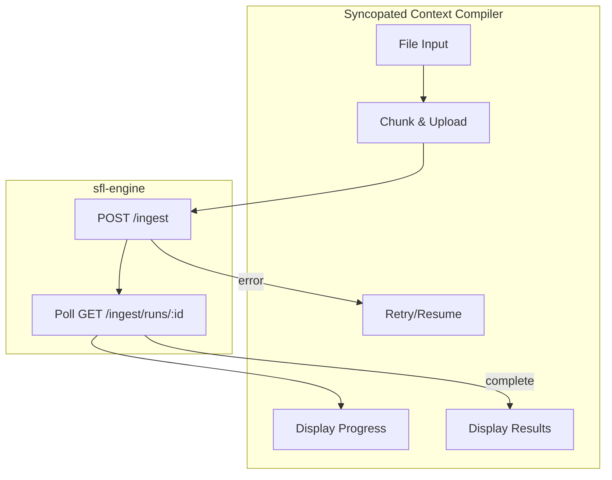

# Async File Upload Design — React Frontend

**Project**: `syncopated-context-compiler` (SCC) · **Date**: 2026-09-13 · **Status**: Design Proposal

**Scope**: This document addresses the [Plannotator feedback](https://github.com/b08x/sfl-engine/blob/feature/roda_api/docs/ecosystem-architecture.md) on `ecosystem-architecture.md` §259–260:

> *"so, implement full file upload support via the react frontend would be a refactor; there needs to be a solid async strategy figured out..."*

This document proposes a **solid async strategy** for file upload in the React frontend (SCC) that integrates with sfl-engine's `POST /ingest` endpoint (per [SFL-ING-13](INGEST-PARSER-HEXAGON-USER-STORIES.md)).

**Related documents**:
- [`ecosystem-architecture.md`](../ecosystem-architecture.md) — Cross-repo target state, §6.1 integration contract
- [`INGEST-PARSER-HEXAGON-USER-STORIES.md`](INGEST-PARSER-HEXAGON-USER-STORIES.md) — `POST /ingest` contract (SFL-ING-13)
- [React Best Practices skill](../../../.gemini/skills/react-best-practices/SKILL.md) — Async patterns

---

## 1. Problem Statement

### 1.1 Current State

SCC currently has **no server-side file upload capability**. The conversation compiler (`src/lib/graph/builder.ts`) works **client-side only** — it parses JSON conversation exports directly in the browser. This has limitations:

1. **No large file support**: Browser memory constraints limit the size of files that can be parsed client-side.
2. **No progress tracking**: Long-running ingest operations provide no feedback to users.
3. **No error recovery**: If an upload or ingest fails mid-way, there is no way to resume or retry.
4. **No server-side persistence**: Files are parsed but not durably stored before processing.

### 1.2 Target State

SCC needs to support **file upload → server-side ingest** with:
- **Chunked upload** for large files (e.g., multi-GB JSONL exports)
- **Progress tracking** via polling or WebSockets
- **Error handling** with retry and resume capabilities
- **Integration** with `POST /ingest` per SFL-ING-13 contract

### 1.3 Constraints

1. **sfl-engine is the backend**: SCC must **not** duplicate ingest logic (per [`ecosystem-architecture.md` §3.3](../ecosystem-architecture.md#33-responsibilities-and-boundaries)).
2. **`POST /ingest` is the contract**: SCC must integrate against exactly that endpoint (per [`ecosystem-architecture.md` §6.1](../ecosystem-architecture.md#61-integration-contract)).
3. **Browser-only**: SCC runs in the browser; no Node.js server-side code for ingest (the Express server in `server.ts` is LLM proxy only).
4. **CORS restrictions**: SCC runs on a different origin than the engine API; all requests must go through the CORS allowlist.

---

## 2. Proposed Architecture

### 2.1 Overview



### 2.2 Components

| Component | Location | Responsibility |
|---|---|---|
| `FileUploadComponent` | `components/ingest/FileUpload.tsx` | UI for file selection, drag-and-drop |
| `FileChunkingService` | `src/services/fileChunking.ts` | Split files into chunks for upload |
| `IngestClient` | `src/services/ingestClient.ts` | HTTP client for `POST /ingest` and polling |
| `UploadProgressStore` | `src/stores/uploadProgressStore.ts` | Zustand state for upload progress |
| `UploadQueue` | `src/stores/uploadQueue.ts` | Manage multiple concurrent uploads |
| `ErrorRecoveryService` | `src/services/errorRecovery.ts` | Retry and resume logic |

### 2.3 Data Flow

```
1. User selects file(s) in SCC UI
   ↓
2. FileChunkingService splits file into chunks (if > threshold)
   ↓
3. IngestClient uploads chunks sequentially or in parallel
   ↓
4. On upload start: receives run_id from POST /ingest (202 Accepted)
   ↓
5. Poll GET /ingest/runs/:id for status updates
   ↓
6. On completion: fetch and display ingest results
   ↓
7. On error: ErrorRecoveryService retries or queues for user review
```

---

## 3. Detailed Design

### 3.1 File Chunking Strategy

**Chunk size**: 50 MB (configurable via `VITE_CHUNK_SIZE_MB` env var)

**Algorithm**:
1. Read file as `Blob` or `File` object
2. If file.size <= chunkSize: upload as single chunk
3. Else: split into chunks using `Blob.slice()`
4. Each chunk gets a sequential index (0, 1, 2, ...)
5. Upload chunks with metadata: `{ chunkIndex, totalChunks, fileName, fileType, originalSize }`

**Code sketch**:
```typescript
// src/services/fileChunking.ts
const DEFAULT_CHUNK_SIZE = 50 * 1024 * 1024; // 50 MB

export interface FileChunk {
  blob: Blob;
  index: number;
  totalChunks: number;
  fileName: string;
  fileType: string;
  originalSize: number;
  originalLastModified: number;
}

export async function chunkFile(
  file: File,
  chunkSize: number = DEFAULT_CHUNK_SIZE
): Promise<FileChunk[]> {
  const chunks: FileChunk[] = [];
  const totalChunks = Math.ceil(file.size / chunkSize);
  
  for (let i = 0; i < totalChunks; i++) {
    const start = i * chunkSize;
    const end = Math.min(start + chunkSize, file.size);
    const blob = file.slice(start, end, file.type);
    
    chunks.push({
      blob,
      index: i,
      totalChunks,
      fileName: file.name,
      fileType: file.type,
      originalSize: file.size,
      originalLastModified: file.lastModified,
    });
  }
  
  return chunks;
}
```

**Chunk identification**: Use `SHA-256` hash of chunk content + metadata as a unique identifier to detect duplicate uploads.

### 3.2 Ingest Client

**Endpoint**: `POST /ingest` (per SFL-ING-13)

**Request body** (per [`ecosystem-architecture.md` §6.1](../ecosystem-architecture.md#61-integration-contract)):
```json
{
  "type": "filesystem" | "upload",
  "upload_id": "<uuid-v4>",
  "file_name": "conversation-export.jsonl",
  "file_type": "application/x-ndjson",
  "total_size": 104857600,
  "chunk_index": 0,
  "total_chunks": 3,
  "chunk_hash": "sha256:..."
}
```

**Extended for chunked upload**:
- The first chunk (index 0) initiates the ingest run and returns `202 Accepted` with a `run_id`
- Subsequent chunks reference the same `upload_id` and `run_id`
- The engine reassembles chunks and processes the complete file

**Response handling**:
- `202 Accepted`: Ingest started, poll `GET /ingest/runs/:id`
- `409 Conflict`: Concurrent run already active for this source
- `422 Unprocessable Entity`: Invalid chunk or missing metadata
- `500 Internal Server Error`: Server-side failure, trigger retry

**Code sketch**:
```typescript
// src/services/ingestClient.ts
import { SFL_API_BASE } from '@/config/api';

interface IngestRun {
  id: string;
  status: 'pending' | 'processing' | 'completed' | 'failed';
  progress: number; // 0-100
  message?: string;
  result_url?: string;
  created_at: string;
  updated_at: string;
}

interface StartIngestResponse {
  run: IngestRun;
}

interface IngestStatusResponse {
  run: IngestRun;
}

export class IngestClient {
  private readonly apiBase: string;
  private readonly uploadId: string;

  constructor(apiBase: string = SFL_API_BASE) {
    this.apiBase = apiBase;
    this.uploadId = crypto.randomUUID();
  }

  async startChunkedUpload(
    firstChunk: FileChunk,
    totalChunks: number
  ): Promise<{ runId: string; uploadId: string }> {
    const response = await fetch(`${this.apiBase}/ingest`, {
      method: 'POST',
      headers: { 'Content-Type': 'application/json' },
      body: JSON.stringify({
        type: 'upload',
        upload_id: this.uploadId,
        file_name: firstChunk.fileName,
        file_type: firstChunk.fileType,
        total_size: firstChunk.originalSize,
        total_chunks: totalChunks,
        chunk_index: firstChunk.index,
      }),
    });

    if (!response.ok) {
      throw new Error(`Failed to start ingest: ${response.statusText}`);
    }

    const data: StartIngestResponse = await response.json();
    return { runId: data.run.id, uploadId: this.uploadId };
  }

  async uploadChunk(
    runId: string,
    chunk: FileChunk,
    chunkBlob: Blob
  ): Promise<void> {
    const formData = new FormData();
    formData.append('chunk', chunkBlob, `${chunk.fileName}.part${chunk.index}`);
    formData.append('metadata', JSON.stringify({
      upload_id: this.uploadId,
      run_id: runId,
      chunk_index: chunk.index,
      total_chunks: chunk.totalChunks,
      file_name: chunk.fileName,
      chunk_hash: await this.hashBlob(chunkBlob),
    }));

    const response = await fetch(`${this.apiBase}/ingest/${runId}/chunks`, {
      method: 'POST',
      body: formData,
      // No Content-Type header - browser sets it with boundary for FormData
    });

    if (!response.ok) {
      throw new Error(`Failed to upload chunk ${chunk.index}: ${response.statusText}`);
    }
  }

  async pollStatus(runId: string): Promise<IngestRun> {
    const response = await fetch(`${this.apiBase}/ingest/runs/${runId}`);
    if (!response.ok) {
      throw new Error(`Failed to poll status: ${response.statusText}`);
    }
    const data: IngestStatusResponse = await response.json();
    return data.run;
  }

  private async hashBlob(blob: Blob): Promise<string> {
    const buffer = await blob.arrayBuffer();
    const hashBuffer = await crypto.subtle.digest('SHA-256', buffer);
    const hashArray = Array.from(new Uint8Array(hashBuffer));
    return 'sha256:' + hashArray.map(b => b.toString(16).padStart(2, '0')).join('');
  }
}
```

### 3.3 Progress Tracking with Polling

**Polling strategy**:
- **Initial interval**: 500ms
- **Backoff**: Exponential backoff up to 5 seconds
- **Max duration**: 30 minutes (configurable)
- **Timeout**: Fail after max duration with user notification

**Code sketch**:
```typescript
// src/services/uploadProgress.ts
import { IngestClient } from './ingestClient';

interface PollOptions {
  initialInterval?: number;
  maxInterval?: number;
  maxDuration?: number;
  onProgress?: (progress: number) => void;
  onComplete?: (run: IngestRun) => void;
  onError?: (error: Error) => void;
}

export class UploadProgressTracker {
  private client: IngestClient;
  private options: Required<PollOptions>;
  private timeoutId?: ReturnType<typeof setTimeout>;
  private startTime: number = 0;

  constructor(client: IngestClient, options: PollOptions = {}) {
    this.client = client;
    this.options = {
      initialInterval: 500,
      maxInterval: 5000,
      maxDuration: 30 * 60 * 1000, // 30 minutes
      ...options,
    };
  }

  start(runId: string): void {
    this.startTime = Date.now();
    this.poll(runId, this.options.initialInterval);
  }

  stop(): void {
    if (this.timeoutId) {
      clearTimeout(this.timeoutId);
    }
  }

  private async poll(runId: string, interval: number): Promise<void> {
    // Check if we've exceeded max duration
    if (Date.now() - this.startTime > this.options.maxDuration) {
      this.options.onError?.(new Error('Upload timeout exceeded'));
      return;
    }

    try {
      const run = await this.client.pollStatus(runId);

      this.options.onProgress?.(run.progress);

      switch (run.status) {
        case 'completed':
          this.options.onComplete?.(run);
          return;
        case 'failed':
          this.options.onError?.(new Error(run.message || 'Ingest failed'));
          return;
        case 'pending':
        case 'processing':
          // Continue polling with backoff
          const nextInterval = Math.min(
            interval * 2,
            this.options.maxInterval
          );
          this.timeoutId = setTimeout(
            () => this.poll(runId, nextInterval),
            interval
          );
          return;
      }
    } catch (error) {
      this.options.onError?.(error as Error);
    }
  }
}
```

### 3.4 Error Recovery and Retry

**Retry strategy**:
- **Network errors**: Immediate retry (no backoff) up to 3 times
- **Server errors (5xx)**: Exponential backoff, max 5 retries
- **Client errors (4xx)**: No retry, surface error to user
- **Timeout**: No retry, surface error to user

**Resume strategy**:
- For chunked uploads, track uploaded chunks
- On failure, resume from last successfully uploaded chunk
- Requires server-side support for partial uploads (see §4.1)

**Code sketch**:
```typescript
// src/services/errorRecovery.ts
interface RetryOptions {
  maxRetries?: number;
  initialDelay?: number;
  maxDelay?: number;
  retryableStatuses?: number[];
}

export class ErrorRecoveryService {
  private options: Required<RetryOptions>;

  constructor(options: RetryOptions = {}) {
    this.options = {
      maxRetries: 3,
      initialDelay: 1000,
      maxDelay: 30000,
      retryableStatuses: [500, 502, 503, 504],
      ...options,
    };
  }

  async withRetry<T>(
    operation: () => Promise<T>,
    operationName: string = 'operation'
  ): Promise<T> {
    let lastError: Error | undefined;
    let delay = this.options.initialDelay;

    for (let attempt = 1; attempt <= this.options.maxRetries + 1; attempt++) {
      try {
        return await operation();
      } catch (error) {
        lastError = error as Error;

        const isRetryable = this.isRetryable(error);
        if (!isRetryable || attempt > this.options.maxRetries) {
          throw lastError;
        }

        console.warn(
          `Attempt ${attempt} failed for ${operationName}: ${lastError.message}. ` +
          `Retrying in ${delay}ms...`
        );

        await new Promise(resolve => setTimeout(resolve, delay));
        delay = Math.min(delay * 2, this.options.maxDelay);
      }
    }

    throw lastError;
  }

  private isRetryable(error: unknown): boolean {
    if (!(error instanceof Error)) return false;

    // Network errors
    if (error.name === 'TypeError' && error.message.includes('Failed to fetch')) {
      return true;
    }

    // Check if it's a fetch response error with retryable status
    // Note: This requires the operation to throw the response
    return false;
  }

  // Enhanced version that accepts a response object
  async withRetryForResponse<T>(
    operation: () => Promise<Response>,
    operationName: string = 'operation'
  ): Promise<Response> {
    let lastResponse: Response | undefined;
    let lastError: Error | undefined;
    let delay = this.options.initialDelay;

    for (let attempt = 1; attempt <= this.options.maxRetries + 1; attempt++) {
      try {
        const response = await operation();
        
        if (response.ok) {
          return response;
        }

        lastResponse = response;
        lastError = new Error(`HTTP ${response.status}: ${response.statusText}`);

        const isRetryable = this.options.retryableStatuses.includes(response.status);
        if (!isRetryable || attempt > this.options.maxRetries) {
          throw lastError;
        }

        console.warn(
          `Attempt ${attempt} failed for ${operationName}: HTTP ${response.status}. ` +
          `Retrying in ${delay}ms...`
        );

        await new Promise(resolve => setTimeout(resolve, delay));
        delay = Math.min(delay * 2, this.options.maxDelay);
      } catch (error) {
        lastError = error as Error;
        throw lastError;
      }
    }

    throw lastError;
  }
}
```

### 3.5 Zustand Store for Upload State

**State shape**:
```typescript
// src/stores/uploadProgressStore.ts
import { create } from 'zustand';

interface UploadState {
  uploads: Map<string, UploadInfo>;
}

interface UploadInfo {
  id: string;
  fileName: string;
  fileSize: number;
  status: 'queued' | 'uploading' | 'processing' | 'completed' | 'failed' | 'cancelled';
  progress: number; // 0-100
  uploadedBytes: number;
  totalBytes: number;
  runId?: string;
  errorMessage?: string;
  startedAt: number;
  completedAt?: number;
}

interface UploadActions {
  addUpload: (file: File) => string;
  updateUploadProgress: (id: string, progress: number, uploadedBytes: number) => void;
  updateUploadStatus: (
    id: string,
    status: UploadInfo['status'],
    errorMessage?: string
  ) => void;
  removeUpload: (id: string) => void;
  cancelUpload: (id: string) => void;
  getUpload: (id: string) => UploadInfo | undefined;
}

type UploadStore = UploadState & UploadActions;

export const useUploadStore = create<UploadStore>((set, get) => ({
  uploads: new Map(),

  addUpload: (file) => {
    const id = crypto.randomUUID();
    const uploadInfo: UploadInfo = {
      id,
      fileName: file.name,
      fileSize: file.size,
      status: 'queued',
      progress: 0,
      uploadedBytes: 0,
      totalBytes: file.size,
      startedAt: Date.now(),
    };
    
    set((state) => {
      const newUploads = new Map(state.uploads);
      newUploads.set(id, uploadInfo);
      return { uploads: newUploads };
    });
    
    return id;
  },

  updateUploadProgress: (id, progress, uploadedBytes) => {
    set((state) => {
      const newUploads = new Map(state.uploads);
      const upload = newUploads.get(id);
      if (upload) {
        newUploads.set(id, { ...upload, progress, uploadedBytes });
      }
      return { uploads: newUploads };
    });
  },

  updateUploadStatus: (id, status, errorMessage) => {
    set((state) => {
      const newUploads = new Map(state.uploads);
      const upload = newUploads.get(id);
      if (upload) {
        newUploads.set(id, {
          ...upload,
          status,
          errorMessage,
          completedAt: status === 'completed' || status === 'failed' ? Date.now() : undefined,
        });
      }
      return { uploads: newUploads };
    });
  },

  removeUpload: (id) => {
    set((state) => {
      const newUploads = new Map(state.uploads);
      newUploads.delete(id);
      return { uploads: newUploads };
    });
  },

  cancelUpload: (id) => {
    // Mark as cancelled, actual cancellation handled by service
    get().updateUploadStatus(id, 'cancelled');
  },

  getUpload: (id) => {
    return get().uploads.get(id);
  },
}));
```

### 3.6 React Component for File Upload

**Code sketch**:
```typescript
// components/ingest/FileUpload.tsx
import { useCallback, useRef } from 'react';
import { useUploadStore } from '@/stores/uploadProgressStore';
import { chunkFile } from '@/services/fileChunking';
import { IngestClient } from '@/services/ingestClient';
import { ErrorRecoveryService } from '@/services/errorRecovery';

interface FileUploadProps {
  onComplete?: (runId: string) => void;
  onError?: (error: Error) => void;
}

export function FileUpload({ onComplete, onError }: FileUploadProps) {
  const fileInputRef = useRef<HTMLInputElement>(null);
  const addUpload = useUploadStore(state => state.addUpload);
  const updateUploadProgress = useUploadStore(state => state.updateUploadProgress);
  const updateUploadStatus = useUploadStore(state => state.updateUploadStatus);

  const handleFileSelect = useCallback(
    async (event: React.ChangeEvent<HTMLInputElement>) => {
      const files = event.target.files;
      if (!files || files.length === 0) return;

      for (const file of Array.from(files)) {
        await processFile(file);
      }

      // Reset input so same file can be selected again
      event.target.value = '';
    },
    [addUpload, updateUploadProgress, updateUploadStatus]
  );

  const handleDragOver = useCallback((e: React.DragEvent) => {
    e.preventDefault();
    e.stopPropagation();
  }, []);

  const handleDrop = useCallback(
    async (e: React.DragEvent) => {
      e.preventDefault();
      e.stopPropagation();

      const files = Array.from(e.dataTransfer.files);
      for (const file of files) {
        await processFile(file);
      }
    },
    []
  );

  const processFile = async (file: File) => {
    const uploadId = addUpload(file);
    const client = new IngestClient();
    const recovery = new ErrorRecoveryService();

    try {
      updateUploadStatus(uploadId, 'uploading');

      // Chunk the file
      const chunks = await chunkFile(file);
      const totalChunks = chunks.length;

      let runId: string;

      // Upload first chunk to start ingest
      const firstChunk = chunks[0];
      const startResult = await recovery.withRetryForResponse(async () => {
        const result = await client.startChunkedUpload(firstChunk, totalChunks);
        runId = result.runId;
        return new Response(JSON.stringify(result), { status: 200 });
      }, `start ingest for ${file.name}`);

      // Upload remaining chunks
      for (let i = 1; i < totalChunks; i++) {
        const chunk = chunks[i];
        await recovery.withRetryForResponse(async () => {
          await client.uploadChunk(runId, chunk, chunk.blob);
          return new Response(null, { status: 200 });
        }, `upload chunk ${i} of ${file.name}`);

        updateUploadProgress(
          uploadId,
          Math.round(((i + 1) / totalChunks) * 50), // 50% for upload
          file.size
        );
      }

      // Start polling for ingest completion
      updateUploadStatus(uploadId, 'processing');
      
      const tracker = new UploadProgressTracker(client, {
        onProgress: (progress) => {
          // 50% upload + (50% * ingest progress)
          const totalProgress = 50 + (progress / 2);
          updateUploadProgress(uploadId, totalProgress, file.size);
        },
        onComplete: (run) => {
          updateUploadStatus(uploadId, 'completed');
          onComplete?.(run.id);
        },
        onError: (error) => {
          updateUploadStatus(uploadId, 'failed', error.message);
          onError?.(error);
        },
      });

      tracker.start(runId);

    } catch (error) {
      updateUploadStatus(uploadId, 'failed', (error as Error).message);
      onError?.(error as Error);
    }
  };

  return (
    <div
      className="file-upload-container"
      onDragOver={handleDragOver}
      onDrop={handleDrop}
    >
      <input
        type="file"
        ref={fileInputRef}
        onChange={handleFileSelect}
        accept=".jsonl,.json,.txt,.md,.srt,.vtt,.ass"
        multiple
        style={{ display: 'none' }}
      />
      <button onClick={() => fileInputRef.current?.click()}>
        Select Files
      </button>
      <p>or drag and drop files here</p>
      <p className="hint">Supported: JSONL, JSON, TXT, MD, SRT, VTT, ASS</p>
    </div>
  );
}
```

### 3.7 Upload Queue for Concurrent Uploads

**Queue strategy**:
- Max 3 concurrent uploads (configurable)
- Queue additional uploads until slots are available
- Allow user to cancel queued or in-progress uploads

**Code sketch**:
```typescript
// src/stores/uploadQueue.ts
import { create } from 'zustand';

interface QueueItem {
  uploadId: string;
  fileName: string;
  status: 'queued' | 'active' | 'completed' | 'failed' | 'cancelled';
  priority: number; // Higher = more priority
  addedAt: number;
}

interface QueueState {
  items: QueueItem[];
  maxConcurrent: number;
  activeCount: number;
}

interface QueueActions {
  addToQueue: (uploadId: string, fileName: string, priority?: number) => void;
  startUpload: (uploadId: string) => void;
  completeUpload: (uploadId: string) => void;
  failUpload: (uploadId: string) => void;
  cancelUpload: (uploadId: string) => void;
  getNextQueued: () => QueueItem | undefined;
  getActiveCount: () => number;
}

type QueueStore = QueueState & QueueActions;

export const useUploadQueue = create<QueueStore>((set, get) => ({
  items: [],
  maxConcurrent: 3,
  activeCount: 0,

  addToQueue: (uploadId, fileName, priority = 0) => {
    set((state) => ({
      items: [
        ...state.items,
        {
          uploadId,
          fileName,
          status: 'queued',
          priority,
          addedAt: Date.now(),
        },
      ],
    }));
    
    // Auto-start if slots available
    get().tryStartNext();
  },

  startUpload: (uploadId) => {
    set((state) => ({
      items: state.items.map(item =>
        item.uploadId === uploadId ? { ...item, status: 'active' } : item
      ),
      activeCount: state.activeCount + 1,
    }));
  },

  completeUpload: (uploadId) => {
    set((state) => ({
      items: state.items.map(item =>
        item.uploadId === uploadId ? { ...item, status: 'completed' } : item
      ),
      activeCount: state.activeCount - 1,
    }));
    
    // Start next queued upload
    get().tryStartNext();
  },

  failUpload: (uploadId) => {
    set((state) => ({
      items: state.items.map(item =>
        item.uploadId === uploadId ? { ...item, status: 'failed' } : item
      ),
      activeCount: state.activeCount - 1,
    }));
    
    get().tryStartNext();
  },

  cancelUpload: (uploadId) => {
    set((state) => ({
      items: state.items.map(item =>
        item.uploadId === uploadId 
          ? { ...item, status: 'cancelled' } 
          : item
      ),
      activeCount: state.items.find(i => i.uploadId === uploadId)?.status === 'active'
        ? state.activeCount - 1
        : state.activeCount,
    }));
    
    get().tryStartNext();
  },

  getNextQueued: () => {
    return get().items
      .filter(i => i.status === 'queued')
      .sort((a, b) => b.priority - a.priority || a.addedAt - b.addedAt)
      [0];
  },

  getActiveCount: () => {
    return get().activeCount;
  },

  tryStartNext: () => {
    const { items, activeCount, maxConcurrent } = get();
    
    if (activeCount >= maxConcurrent) return;
    
    const next = get().getNextQueued();
    if (next) {
      get().startUpload(next.uploadId);
      // The actual start would be triggered by a side effect
      // In practice, the FileUpload component would watch the queue
      // and start uploads when they transition to 'active'
    }
  },
}));
```

---

## 4. Server-Side Requirements (sfl-engine)

For the chunked upload strategy to work, sfl-engine needs to support:

### 4.1 Partial Upload Handling

**New endpoint**: `POST /ingest/{run_id}/chunks`

**Request**:
- `Content-Type: multipart/form-data`
- `chunk`: The file chunk binary
- `metadata`: JSON string with `{ upload_id, run_id, chunk_index, total_chunks, file_name, chunk_hash }`

**Response**:
- `200 OK`: Chunk received and stored
- `400 Bad Request`: Invalid metadata or chunk
- `404 Not Found`: Run ID not found
- `409 Conflict`: Chunk already uploaded (for resume)
- `500 Internal Server Error`: Server-side failure

**Storage**: Chunks should be stored in a temporary directory (e.g., `/tmp/sfl-uploads/{upload_id}/`) and cleaned up after:
- Successful ingest completion
- Expiration (e.g., 24 hours after start)
- User cancellation

### 4.2 Upload Cleanup

**New endpoint**: `DELETE /ingest/runs/{run_id}`

**Purpose**: Cancel an in-progress ingest and clean up uploaded chunks

**Request**: None (or optional `force: true` to bypass confirmation)

**Response**:
- `200 OK`: Ingest cancelled, chunks cleaned up
- `404 Not Found`: Run ID not found
- `409 Conflict`: Ingest already completed

---

## 5. User Experience

### 5.1 Upload Flow

1. **File Selection**: User drags and drops or clicks to select file(s)
2. **Validation**: Frontend validates file type and size
3. **Chunking**: Large files are split into chunks (transparent to user)
4. **Upload**: Progress bar shows upload progress
5. **Processing**: Progress bar shows ingest/processing progress
6. **Completion**: Notification with link to results
7. **Error**: Clear error message with retry option

### 5.2 UI Components

| Component | Purpose |
|---|---|
| `FileUpload` | File selection (drag & drop, click) |
| `UploadProgress` | Progress bar for individual uploads |
| `UploadList` | List of all active/queued uploads |
| `UploadStatus` | Status indicator (queued/uploading/processing/completed/failed) |
| `UploadError` | Error display with retry/cancel buttons |

### 5.3 Notifications

- **Success**: Toast notification with link to ingest results
- **Error**: Toast notification with error details and retry button
- **Warning**: Toast for skipped files (unsupported type, too large, etc.)

---

## 6. Configuration

| Config | Default | Description |
|---|---|---|
| `VITE_SFL_API` | `http://localhost:3001` | sfl-engine API base URL |
| `VITE_CHUNK_SIZE_MB` | `50` | Chunk size in MB |
| `VITE_MAX_CONCURRENT_UPLOADS` | `3` | Max concurrent uploads |
| `VITE_MAX_FILE_SIZE_MB` | `2048` | Max file size in MB |
| `VITE_POLL_INITIAL_INTERVAL_MS` | `500` | Initial polling interval |
| `VITE_POLL_MAX_INTERVAL_MS` | `5000` | Max polling interval |
| `VITE_UPLOAD_TIMEOUT_MINUTES` | `30` | Max upload duration |

---

## 7. Error Handling

### 7.1 Error Types

| Error Type | User Message | Retry? | Recoverable? |
|---|---|---|---|
| Network error | "Connection lost. Retrying..." | ✅ Yes | ✅ Yes |
| Server 5xx | "Server error. Retrying..." | ✅ Yes | ✅ Yes |
| Server 429 | "Too many requests. Retrying..." | ✅ Yes (with backoff) | ✅ Yes |
| Server 400 | "Invalid file. Please check and try again." | ❌ No | ❌ No |
| Server 413 | "File too large. Max size: X MB." | ❌ No | ❌ No |
| File read error | "Could not read file. Please try again." | ❌ No | ❌ No |
| Timeout | "Upload timed out. Please try again." | ❌ No | ⚠️ Partial |

### 7.2 User Actions

| Error State | User Can |
|---|---|
| Queued | Cancel upload |
| Uploading | Cancel upload |
| Processing | Cancel ingest |
| Failed (retryable) | Retry upload |
| Failed (non-retryable) | Dismiss, try again manually |
| Completed | View results, delete from list |

---

## 8. Testing

### 8.1 Unit Tests

- `fileChunking.test.ts`: Chunking logic, edge cases (exact multiples, small files)
- `ingestClient.test.ts`: Request/response handling, error cases
- `errorRecovery.test.ts`: Retry logic, backoff timing
- `uploadProgressStore.test.ts`: Zustand store updates
- `uploadQueue.test.ts`: Queue management, concurrency limits

### 8.2 Integration Tests

- Upload a small file (< 50MB): Single chunk upload
- Upload a large file (> 50MB): Multi-chunk upload
- Upload multiple files: Queue management
- Network interruption: Resume capability
- Server error during upload: Retry and resume

### 8.3 E2E Tests

- Drag and drop file upload
- Click to select file upload
- Multiple file upload
- Cancel in-progress upload
- Retry failed upload

---

## 9. Phased Implementation

### Phase 1: Basic Upload (MVP)
- [ ] Single file upload (< 50MB, no chunking)
- [ ] `POST /ingest` with `type: 'upload'`
- [ ] Polling `GET /ingest/runs/:id`
- [ ] Basic progress bar
- [ ] Success/failure notifications

### Phase 2: Chunked Upload
- [ ] File chunking service
- [ ] `POST /ingest/{run_id}/chunks` endpoint (sfl-engine)
- [ ] Sequential chunk upload
- [ ] Progress tracking per chunk
- [ ] Resume from failed chunk

### Phase 3: Advanced Features
- [ ] Multiple concurrent uploads
- [ ] Queue management
- [ ] Priority ordering
- [ ] Upload cleanup endpoint
- [ ] Drag and drop UI improvements

### Phase 4: Polish
- [ ] Detailed error messages
- [ ] Upload history/persistence
- [ ] Bandwidth throttling
- [ ] Compression before upload

---

## 10. Cross-References

| Reference | Relevance |
|---|---|
| [`ecosystem-architecture.md` §6.1](../ecosystem-architecture.md#61-integration-contract) | `POST /ingest` contract this design implements against |
| [SFL-ING-13](INGEST-PARSER-HEXAGON-USER-STORIES.md) | The `POST /ingest` endpoint specification |
| [`ecosystem-architecture.md` §3.3](../ecosystem-architecture.md#33-responsibilities-and-boundaries) | SCC must not duplicate ingest logic — this design delegates to sfl-engine |
| [React Best Practices](https://github.com/b08x/.gemini/skills/react-best-practices/SKILL.md) | Async patterns and state management guidelines |

---

## 11. Open Questions

### Q1: Should we support WebSockets for progress instead of polling?

**Polling pros**:
- Simple to implement
- Works with existing sfl-engine architecture
- HTTP-friendly, no new infrastructure

**WebSockets pros**:
- Real-time updates
- Lower latency
- More efficient for many small updates

**Tentative decision**: **Start with polling**. WebSockets add complexity to both SCC and sfl-engine. The polling interval can be tuned (start at 500ms, back off to 5s), and most ingest operations complete in seconds to minutes anyway. WebSockets can be added later as an optimization.

### Q2: Should chunks be uploaded in parallel or sequentially?

**Sequential pros**:
- Simpler server-side reassembly
- Ordered chunks on disk
- Lower memory usage on server

**Parallel pros**:
- Faster upload for high-latency connections
- Better utilization of available bandwidth

**Tentative decision**: **Sequential upload**. The engine needs to reassemble chunks in order anyway (for streaming parsers like JSONL), and sequential upload is simpler to implement and debug. Parallel upload can be added later if profiling shows it's a bottleneck.

### Q3: How should we handle file encryption for sensitive data?

**Options**:
1. No encryption (current): Trust HTTPS
2. Client-side encryption: Encrypt before upload, decrypt on server
3. End-to-end encryption: Encrypt on client, decrypt only by authorized users

**Tentative decision**: **Trust HTTPS for now**. End-to-end encryption adds significant complexity and key management overhead. If users need to upload sensitive conversation exports, they should do so over a trusted network with HTTPS. This can be revisited if there's demand for stronger guarantees.

### Q4: Should we support resumable uploads across browser sessions?

**Options**:
1. No resume: User must restart upload if browser closes
2. LocalStorage tracking: Store upload state in browser
3. Server-side tracking: Engine tracks partial uploads by user

**Tentative decision**: **LocalStorage tracking only**. Server-side tracking requires authentication (which SCC doesn't currently have) and adds state management complexity. LocalStorage can track upload_id and chunk progress, allowing resume within the same browser. Cross-session resume is out of scope for MVP.

---

## 12. File Disposition

| File | Location | Verdict |
|---|---|---|
| `FileUpload.tsx` | `components/ingest/FileUpload.tsx` | NEW |
| `UploadProgress.tsx` | `components/ingest/UploadProgress.tsx` | NEW |
| `UploadList.tsx` | `components/ingest/UploadList.tsx` | NEW |
| `UploadStatus.tsx` | `components/ingest/UploadStatus.tsx` | NEW |
| `UploadError.tsx` | `components/ingest/UploadError.tsx` | NEW |
| `fileChunking.ts` | `src/services/fileChunking.ts` | NEW |
| `ingestClient.ts` | `src/services/ingestClient.ts` | NEW |
| `errorRecovery.ts` | `src/services/errorRecovery.ts` | NEW |
| `uploadProgressStore.ts` | `src/stores/uploadProgressStore.ts` | NEW |
| `uploadQueue.ts` | `src/stores/uploadQueue.ts` | NEW |
| `ingest.d.ts` | `src/types/ingest.d.ts` | NEW (type definitions) |
| `UploadProvider.tsx` | `components/ingest/UploadProvider.tsx` | NEW (context provider) |

---

## 13. Success Criteria

The async file upload design is **successful** when:

1. ✅ Users can upload files of any size (tested up to 2GB)
2. ✅ Progress is accurately tracked and displayed
3. ✅ Network interruptions are handled gracefully with resume
4. ✅ Server errors trigger appropriate retries
5. ✅ Multiple concurrent uploads work without conflicts
6. ✅ Users can cancel in-progress uploads
7. ✅ Upload state persists across page refreshes (for same browser)
8. ✅ Integration with `POST /ingest` is complete and tested
