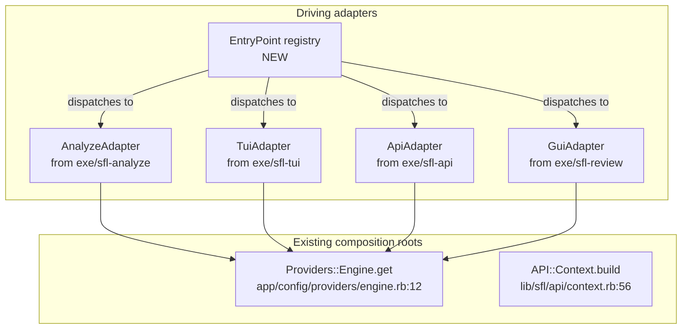

# CLI Hexagon — Refactor User Stories

**Project**: `sfl-engine` · **Branch**: `feature/roda_api` · **Date**: 2026-09-13

**Scope**: Unify the four separate executable entry points (`sfl-analyze`, `sfl-tui`, `sfl-api`, `sfl-review`) into a **single `sfl-engine` executable** with subcommands, behind a Hexagonal (ports/adapters) boundary — with each mode (CLI, TUI, GUI, API daemon) as a **driving adapter** that shares the same composition root (`Providers::Engine`).

This document addresses the [Plannotator feedback](https://github.com/b08x/sfl-engine/blob/feature/roda_api/docs/ecosystem-architecture.md#1-global-feedback-about-the-file) on `ecosystem-architecture.md` §3.1: *"so that instead of separate binaries, `sfl-engine` is the main executable, with subcommands for `tui` `gui` `daemon(api)` (cli being the default way of operating the program — with their respective flags and acceptable args; optional aliases shortcuts; (sfl-engine-tui, sfl-engine-gui and sfl-engine-api) to be considered..."*

**Companion documents**:
- [`ecosystem-architecture.md`](../ecosystem-architecture.md) — the cross-repo target-state frame this refactor implements.
- [`EMBEDDING-HEXAGON-USER-STORIES.md`](EMBEDDING-HEXAGON-USER-STORIES.md) — the `Core::Registry` pattern reused here for subcommand dispatch.
- [`INGEST-PARSER-HEXAGON-USER-STORIES.md`](INGEST-PARSER-HEXAGON-USER-STORIES.md) — the `TargetResolver` pattern reused here for input resolution.

**Evidence policy**: every `path:line` below was read from the working tree on 2026-09-13. Anything the architecture needs that is not in the tree is labelled **does not exist yet**.

---

## 1. Context & Problem Statement

### 1.1 What already exists

Four separate entry points exist today, each with its own boot sequence and its own way of reaching `Providers::Engine`:

| Entry point | File | Boot path | Mode | Purpose |
|---|---|---|---|---|
| `sfl-analyze` | `exe/sfl-analyze` | `lib/sfl.rb` → `SFL::CLI.run(ARGV)` | CLI | Ingest, analyze, synthesize, retrieve |
| `sfl-tui` | `exe/sfl-tui` | `lib/sfl.rb` → `SFL::TUI::App.build` → `SFL::TUI::App.run` | TUI | Interactive terminal UI |
| `sfl-api` | `exe/sfl-api` | `lib/sfl.rb` → `exec falcon serve -c config.ru` → Roda | Daemon | HTTP API server (Falcon → Roda) |
| `sfl-review` | `exe/sfl-review` | `lib/sfl.rb` → `lib/sfl/gui/review_queue_app.rb` → `SFL::GUI::ReviewQueueApp.new.launch` | GUI | Desktop review queue (Glimmer DSL) |

**Shared composition root**: `Providers::Engine` (`app/config/providers/engine.rb:7-12`) wraps `SFL::API::Context.build` (`lib/sfl/api/context.rb:56`), which is consumed by:
- `SFL::CLI` — `exe/sfl-analyze:17`
- Roda routes — `app/sfl.rb:42` via `def ctx = Providers::Engine.get`
- `SFL::TUI::App.build` — `lib/sfl/tui/app.rb:??` *(to be verified)*
- `SFL::GUI::ReviewQueueApp` — `lib/sfl/gui/review_queue_app.rb:??` *(to be verified)*

**Current binstub pattern**: Each `exe/sfl-*` file:
1. Expands `lib/` onto `$LOAD_PATH` (`exe/sfl-analyze:6-7`, same pattern in all four)
2. Requires `lib/sfl.rb` (the Zeitwerk loader)
3. Calls `SFL::DockerServices.ensure_running!` (where present)
4. Delegates to a mode-specific runner

**Key insight from ecosystem-architecture §3.1**: SCC is *a* pluggable frontend, not *the* frontend. The same principle applies here: **`sfl-engine` must work completely independently of any single frontend**, and the CLI/TUI/GUI/HTTP modes are **driving adapters** around a shared core.

### 1.2 What is missing

1. **No unified entry point.** There is no `sfl-engine` command that dispatches to subcommands. The four binstubs are **peer executables**, not modes of one program.
2. **No subcommand registry.** There is no `Core::Registry`-style lookup for subcommands. Dispatch is hardcoded in shell scripts, not in Ruby.
3. **No shared boot for modes.** Each entry point re-implements its own boot logic (load path setup, Docker check, tracing setup).
4. **No aliases.** There are no `sfl-engine-tui` → `sfl-engine tui` shortcuts.
5. **`exe/sfl-review` overlap with SCC.** Per [`ecosystem-architecture.md` §4.1](../ecosystem-architecture.md#41-the-fourth-mode--a-decision-to-make), once SCC's review surface reaches parity, `exe/sfl-review` should be retired. This refactor implements that retirement by **not** shipping a `gui` subcommand in the first phase.

---

## 2. Target Architecture

### 2.1 Ports and adapters

The CLI refactor introduces **one new driving adapter port** and reclassifies the existing four entry points as **implementations** of that port:

| Port | Responsibility | Driven / driving | Concrete adapters | Status |
|---|---|---|---|---|
| `SFL::Core::Ports::EntryPoint` | Execute a mode with argv | **driving** | `SFL::CLI::AnalyzeAdapter`, `SFL::CLI::TuiAdapter`, `SFL::CLI::ApiAdapter`, `SFL::CLI::GuiAdapter` | **does not exist yet** |

**Composition change**: `Providers::Engine` remains the **single composition root** for the *domain*. The new `EntryPoint` port is a **peer** to the existing driving adapters (CLI, Roda, TUI, GUI) — it does not *contain* them; it *unifies* them under a common dispatch mechanism.

**New module layout**:
```
lib/sfl/cli/
├── entry_point.rb          # NEW: the subcommand registry and dispatch
├── adapters/
│   ├── analyze_adapter.rb   # NEW: wraps existing SFL::CLI logic
│   ├── tui_adapter.rb      # NEW: wraps existing SFL::TUI::App logic
│   ├── api_adapter.rb       # NEW: wraps existing Roda/Falcon logic
│   └── gui_adapter.rb       # NEW: wraps existing SFL::GUI::ReviewQueueApp logic (DEPRECATED per §4.1)
└── cli.rb                   # EXISTING: refactored into AnalyzeAdapter

exec/
├── sfl-analyze              # DEPRECATED: replaced by `sfl-engine analyze`
├── sfl-tui                 # DEPRECATED: replaced by `sfl-engine tui`
├── sfl-api                 # DEPRECATED: replaced by `sfl-engine api`
├── sfl-review               # DEPRECATED: replaced by `sfl-engine gui` (then retired per §4.1)
└── sfl-engine               # NEW: the unified entry point
```

**Mermaid hexagon** (driving adapters only):


### 2.2 Subcommand contract

The unified `sfl-engine` executable supports the following subcommands:

| Subcommand | Aliases | Purpose | Implemented by |
|---|---|---|---|
| `analyze` (default) | `a`, `sfl-engine-analyze` | Ingest, analyze, synthesize, retrieve | `AnalyzeAdapter` |
| `tui` | `t`, `sfl-engine-tui` | Interactive terminal UI | `TuiAdapter` |
| `api` | `d`, `daemon`, `sfl-engine-api`, `sfl-engine-daemon` | HTTP API server (Falcon → Roda) | `ApiAdapter` |
| `gui` | `g`, `sfl-engine-gui` | Desktop review queue (DEPRECATED) | `GuiAdapter` |
| `version` | `v`, `--version`, `-v` | Print version and exit | Built-in |
| `help` | `h`, `--help`, `-h` | Print usage and exit | Built-in |

**Default behavior**: With no subcommand or `-`, `sfl-engine` runs the `analyze` subcommand (CLI mode).

**Global flags** (apply to all subcommands):
- `--trace` / `--no-trace` — Enable/disable OpenTelemetry/Langfuse tracing (default: enabled if configured)
- `--docker` / `--no-docker` — Enable/disable Docker services auto-start (default: enabled)
- `--quiet` / `-q` — Suppress non-error output
- `--verbose` / `-V` — Increase log verbosity

**Subcommand-specific flags** are delegated to each adapter.

### 2.3 Registry pattern

`SFL::CLI::EntryPoint` reuses the `Core::Registry` pattern from [SFL-EMB-01](EMBEDDING-HEXAGON-USER-STORIES.md#sfl-emb-01--dynamic-strategy-registry):

```ruby
# lib/sfl/cli/entry_point.rb
module SFL
  module CLI
    class EntryPoint
      SUBCOMMAND_REGISTRY = Core::Registry.new

      def self.register(name, &factory)
        SUBCOMMAND_REGISTRY.register(name, &factory)
      end

      def self.resolve!(name, argv:, **kwargs)
        SUBCOMMAND_REGISTRY.resolve!(name, argv: argv, **kwargs)
      end
    end
  end
end
```

**Boot-time registration** (`lib/sfl/cli/entry_point.rb`):
```ruby
SFL::CLI::EntryPoint.register(:analyze) do |argv:, **kw|
  SFL::CLI::AnalyzeAdapter.new(argv, **kw)
end

SFL::CLI::EntryPoint.register(:tui) do |argv:, **kw|
  SFL::CLI::TuiAdapter.new(argv, **kw)
end

SFL::CLI::EntryPoint.register(:api) do |argv:, **kw|
  SFL::CLI::ApiAdapter.new(argv, **kw)
end

# Deprecated — removed once exe/sfl-review is retired
SFL::CLI::EntryPoint.register(:gui) do |argv:, **kw|
  SFL::CLI::GuiAdapter.new(argv, **kw)
end
```

---

## 3. Deprecation Strategy

### 3.1 Migration path

| Old command | New command | Status |
|---|---|---|
| `bundle exec exe/sfl-analyze <args>` | `bundle exec exe/sfl-engine analyze <args>` | Phase 1 |
| `bundle exec exe/sfl-tui <args>` | `bundle exec exe/sfl-engine tui <args>` | Phase 1 |
| `bundle exec exe/sfl-api <args>` | `bundle exec exe/sfl-engine api <args>` | Phase 1 |
| `bundle exec exe/sfl-review <args>` | `bundle exec exe/sfl-engine gui <args>` | Phase 1, then retired |

**Phase 1 gate**: All four old binstubs **emit a deprecation warning** on every invocation:
```
WARNING: `sfl-analyze` is deprecated. Use `sfl-engine analyze` instead.
        See: https://github.com/b08x/sfl-engine/blob/main/docs/refactor/CLI-HEXAGON-USER-STORIES.md
        This command will be removed in a future release.
```

**Phase 2 gate**: The old binstubs are **deleted**. Only `sfl-engine` remains.

### 3.2 Aliases

**Shell aliases** (for convenience, not shipped by the gem):
```bash
# ~/.bashrc or ~/.zshrc
alias sfl=sfl-engine
alias sfl-analyze='sfl-engine analyze'
alias sfl-tui='sfl-engine tui'
alias sfl-api='sfl-engine api'
```

**Symlink aliases** (shipped in the repo for backward compatibility during Phase 1):
```bash
# In the repo root, created by `bin/roda g aliases` or manually:
ln -sf exe/sfl-engine exe/sfl-engine-analyze
ln -sf exe/sfl-engine exe/sfl-engine-tui
ln -sf exe/sfl-engine exe/sfl-engine-api
```

These symlinks:
1. Point to `exe/sfl-engine`
2. Are **not** committed to git (`.gitignore` entry)
3. Are created by a Rake task or `bin/roda` generator for local development

---

## 4. Epics

| Epic | Goal (one line) |
|---|---|
| **E1 — EntryPoint registry** | Introduce `SFL::CLI::EntryPoint` as a `Core::Registry` for subcommand dispatch, with built-in help/version subcommands. |
| **E2 — Subcommand adapters** | Extract `AnalyzeAdapter`, `TuiAdapter`, `ApiAdapter` from the existing binstubs, preserving all flags and behaviors. |
| **E3 — Unified entry point** | Ship `exe/sfl-engine` that reads argv[0] as subcommand, dispatches via `EntryPoint`, and delegates to the chosen adapter. |
| **E4 — Deprecation warnings** | Make the four old binstubs warn and delegate to `sfl-engine <subcommand>`. |
| **E5 — GUI retirement** | Retire `exe/sfl-review` and the `gui` subcommand once SCC review parity is achieved (per ecosystem-architecture §4.1). |

---

## 5. User Stories

Conventions every story inherits:
- Zeitwerk-compatible file layout under `lib/sfl/cli/` with no new inflections needed.
- `Dry::Monads` `Result` returns for anything that can fail at request time.
- No new gem added to the Gemfile by a story that is not marked **adopt** in a gem disposition table (none needed here).
- RuboCop clean under the project's existing config.
- Existing test patterns preserved: `spec/cli/` mirrors `lib/sfl/cli/`.

---

### SFL-CLI-01 — EntryPoint registry with subcommand dispatch

**Points**: 5 · **Depends on**: none · **Epic**: E1

> **As a** platform engineer
> **I want** a registry that maps subcommand names to adapter factories
> **so that** new modes can be added by registration without editing a dispatch switch.

**Acceptance criteria**

- **Given** `SFL::CLI::EntryPoint::SUBCOMMAND_REGISTRY`, **when** I call `EntryPoint.register(:analyze) { |argv:, **kw| AnalyzeAdapter.new(argv, **kw) }`, **then** `#names` returns `[:analyze]` and `resolve!(:analyze, argv: ["conversation", "input.jsonl"])` returns an `AnalyzeAdapter` instance.
- **Given** a registry with `:analyze`, `:tui`, `:api`, **when** I call `resolve!(:unknown)`, **then** it raises `SFL::CLI::EntryPoint::UnknownSubcommandError` whose message lists every registered name and a short usage hint.
- **Given** the same registry, **when** I call `resolve(:unknown)`, **then** it returns `Failure([:unknown_subcommand, :unknown, [:analyze, :tui, :api]])` — no exception — so a Roda route or CLI can turn it into a user-friendly message.
- **Given** a name already registered, **when** I `register` it again, **then** it raises `SFL::CLI::EntryPoint::DuplicateSubcommandError`.
- **Given** a registry, **when** two threads `resolve!` concurrently, **then** both succeed; registration mutates under a `Mutex` and `#names`/`#resolve!` read a frozen snapshot.
- **Given** `lib/sfl/cli/entry_point.rb`, **when** grepped, **then** it contains **no** `require` of `sequel`, `pgvector`, `roda`, `falcon`, `glimmer`, or `ENV` (except `ENV.fetch` with defaults for CLI flags like `--quiet`).
- **Given** `lib/sfl/cli/entry_point.rb`, **when** loaded, **then** it auto-registers the built-in subcommands (`:analyze`, `:tui`, `:api`, `:gui`) via `EntryPoint.register` calls at the bottom of the file.

**Integration points**

- New file `lib/sfl/cli/entry_point.rb`.
- Reuses `SFL::Core::Registry` from [SFL-EMB-01](EMBEDDING-HEXAGON-USER-STORIES.md#sfl-emb-01--dynamic-strategy-registry).
- Autoloaded by the `lib/` Zeitwerk loader configured at `lib/sfl.rb:38-44`; `CLI::EntryPoint` is camel-derivable.
- Built-in subcommands (`help`, `version`) are registered in the same file and **do not** require separate adapter classes.

**Definition of done**:
- `spec/cli/entry_point_spec.rb` covers all criteria including the concurrency case.
- `bundle exec exe/sfl-engine --help` prints a usage message listing all registered subcommands.
- `bundle exec exe/sfl-engine --version` prints the version (from `lib/sfl/version.rb` or Git).
- RuboCop clean; no Gemfile change.

---

### SFL-CLI-02 — AnalyzeAdapter wrapping existing CLI logic

**Points**: 3 · **Depends on**: SFL-CLI-01 · **Epic**: E2

> **As a** user of the existing CLI
> **I want** `sfl-engine analyze` to accept the exact same flags and arguments as `sfl-analyze`
> **so that** the migration is transparent.

**Acceptance criteria**

- **Given** `SFL::CLI::AnalyzeAdapter`, **when** constructed with `argv: ["conversation", "input.jsonl", "--store"]`, **then** it parses and validates the same options as `SFL::CLI.parse` (`lib/sfl/cli.rb:99-??`).
- **Given** an adapter with parsed options, **when** `#run` is called, **then** it delegates to `SFL::CLI.run` with the same argv, producing identical output and exit code.
- **Given** `sfl-engine analyze --help`, **then** it prints the **same** usage text as `sfl-analyze --help` today (the `USAGE` constant at `lib/sfl/cli.rb:40-93`).
- **Given** an unknown flag, **then** it raises `SFL::CLI::UsageError` with the same message format as the existing CLI.
- **Given** `lib/sfl/cli/adapters/analyze_adapter.rb`, **when** grepped, **then** it contains **no** business logic — only argument parsing and delegation.

**Integration points**

- New file `lib/sfl/cli/adapters/analyze_adapter.rb`.
- Existing `lib/sfl/cli.rb` remains unchanged (the adapter wraps it, not replaces it).
- `spec/cli/adapters/analyze_adapter_spec.rb` mirrors existing `spec/cli/cli_spec.rb` (if it exists) or shares its examples.

**Definition of done**:
- `spec/cli/adapters/analyze_adapter_spec.rb` passes.
- `bundle exec exe/sfl-engine analyze conversation input.jsonl --store` produces the same result as `bundle exec exe/sfl-analyze conversation input.jsonl --store`.
- RuboCop clean.

---

### SFL-CLI-03 — TuiAdapter wrapping existing TUI logic

**Points**: 3 · **Depends on**: SFL-CLI-01 · **Epic**: E2

> **As a** TUI user
> **I want** `sfl-engine tui` to launch the exact same interactive terminal UI as `sfl-tui`
> **so that** the migration is transparent.

**Acceptance criteria**

- **Given** `SFL::CLI::TuiAdapter`, **when** constructed, **then** it parses argv for TUI-specific flags (none currently — `exe/sfl-tui` passes no flags through to the app).
- **Given** an adapter, **when** `#run` is called, **then** it calls `SFL::DockerServices.ensure_running!` (same as `exe/sfl-tui:21`), builds the TUI context via `SFL::TUI::App.build`, and runs it via `SFL::TUI::App.run(context)`.
- **Given** a boot failure (`SFL::Boot::Error`), **then** it prints the same warning to stderr as `exe/sfl-tui:28` and exits with code 1.
- **Given** `lib/sfl/cli/adapters/tui_adapter.rb`, **when** grepped, **then** it contains **no** `require "glimmer-dsl-libui"` or `require "bubble-tea"` — those dependencies are **only** in `lib/sfl/tui/`.

**Integration points**

- New file `lib/sfl/cli/adapters/tui_adapter.rb`.
- Reuses existing `lib/sfl/tui/app.rb` unchanged.
- `spec/cli/adapters/tui_adapter_spec.rb` stubs `SFL::TUI::App.build` and verifies `#run` calls it.

**Definition of done**:
- `spec/cli/adapters/tui_adapter_spec.rb` passes.
- `bundle exec exe/sfl-engine tui` launches the TUI successfully.
- RuboCop clean.

---

### SFL-CLI-04 — ApiAdapter wrapping existing HTTP API logic

**Points**: 3 · **Depends on**: SFL-CLI-01 · **Epic**: E2

> **As an** API operator
> **I want** `sfl-engine api` to start the exact same HTTP server as `sfl-api`
> **so that** the migration is transparent.

**Acceptance criteria**

- **Given** `SFL::CLI::ApiAdapter`, **when** constructed with `argv: ["--port", "3002", "--host", "localhost"]`, **then** it parses `PORT` and `HOST` from argv **or** ENV (argv takes precedence, matching `exe/sfl-api:20-21`).
- **Given** an adapter with `port: 3002`, `host: "localhost"`, **when** `#run` is called, **then** it executes `exec "bundle", "exec", "falcon", "serve", "-c", "config.ru", "-b", "http://localhost:3002"` (same as `exe/sfl-api:22-23`).
- **Given** no argv flags and no ENV, **then** it defaults to `port: "3001"`, `host: "0.0.0.0"` (same as `exe/sfl-api:20-21`).
- **Given** `lib/sfl/cli/adapters/api_adapter.rb`, **when** grepped, **then** it contains **no** `require "falcon"` or `require "roda"` — those dependencies are **only** in `config.ru` and the Roda app.

**Integration points**

- New file `lib/sfl/cli/adapters/api_adapter.rb`.
- Reuses existing `config.ru` and `app/sfl.rb` unchanged.
- `spec/cli/adapters/api_adapter_spec.rb` stubs `exec` and verifies the correct command is assembled.

**Definition of done**:
- `spec/cli/adapters/api_adapter_spec.rb` passes.
- `bundle exec exe/sfl-engine api --port 3002 --host localhost` starts a server on `localhost:3002`.
- RuboCop clean.

---

### SFL-CLI-05 — GuiAdapter wrapping existing GUI logic (DEPRECATED)

**Points**: 2 · **Depends on**: SFL-CLI-01 · **Epic**: E2

> **As a** GUI user (temporary)
> **I want** `sfl-engine gui` to launch the exact same desktop review queue as `sfl-review`
> **so that** there is a migration path before retirement.

**Acceptance criteria**

- **Given** `SFL::CLI::GuiAdapter`, **when** constructed, **then** it requires `glimmer-dsl-libui` and `lib/sfl/gui/review_queue_app.rb`.
- **Given** an adapter, **when** `#run` is called, **then** it calls `SFL::DockerServices.ensure_running!` and launches `SFL::GUI::ReviewQueueApp.new.launch`.
- **Given** `bundle exec exe/sfl-engine gui`, **then** it emits a **deprecation warning**:
  ```
  WARNING: `sfl-engine gui` is deprecated and will be removed once SCC's review surface reaches parity.
          See: docs/ecosystem-architecture.md §4.1
  ```

**Integration points**

- New file `lib/sfl/cli/adapters/gui_adapter.rb`.
- Reuses existing `lib/sfl/gui/review_queue_app.rb` unchanged.
- **This adapter is removed in SFL-CLI-09** (GUI retirement).

**Definition of done**:
- `spec/cli/adapters/gui_adapter_spec.rb` passes.
- `bundle exec exe/sfl-engine gui` launches the GUI and prints the deprecation warning.
- RuboCop clean.

---

### SFL-CLI-06 — Unified `sfl-engine` entry point

**Points**: 5 · **Depends on**: SFL-CLI-01, SFL-CLI-02, SFL-CLI-03, SFL-CLI-04, SFL-CLI-05 · **Epic**: E3

> **As a** user
> **I want** a single `sfl-engine` command that dispatches to the correct subcommand
> **so that** I only need to learn one entry point.

**Acceptance criteria**

- **Given** `exe/sfl-engine`, **when** it is invoked with no arguments, **then** it runs the `analyze` subcommand with an empty argv (equivalent to `sfl-engine analyze` with no arguments).
- **Given** `exe/sfl-engine analyze conversation input.jsonl`, **then** it dispatches to `AnalyzeAdapter` and produces the same output as `exe/sfl-analyze conversation input.jsonl`.
- **Given** `exe/sfl-engine tui`, **then** it dispatches to `TuiAdapter` and launches the TUI.
- **Given** `exe/sfl-engine api`, **then** it dispatches to `ApiAdapter` and starts the HTTP server.
- **Given** `exe/sfl-engine gui`, **then** it dispatches to `GuiAdapter` and launches the GUI (with deprecation warning).
- **Given** `exe/sfl-engine --help`, **then** it prints a usage message listing all registered subcommands and their short descriptions.
- **Given** `exe/sfl-engine --version`, **then** it prints the version string (e.g., `sfl-engine 0.1.0` or Git SHA).
- **Given** `exe/sfl-engine unknown-command`, **then** it prints an error message: `Unknown subcommand: unknown-command` followed by the same usage hint as `--help`.
- **Given** `exe/sfl-engine`, **when** grepped, **then** it contains **no** mode-specific logic — only subcommand dispatch via `SFL::CLI::EntryPoint`.

**Integration points**

- New file `exe/sfl-engine` (replaces the need for `exe/sfl-analyze`, `exe/sfl-tui`, `exe/sfl-api`, `exe/sfl-review`).
- Loads `lib/sfl.rb` via the same load path setup as the existing binstubs (`exe/sfl-analyze:6-7`).
- Calls `SFL::DockerServices.ensure_running!` **before** dispatching to any subcommand (except `version` and `help`).
- Calls `SFL::CLI::EntryPoint.resolve!` with the subcommand name and remaining argv.

**Definition of done**:
- `spec/cli/sfl_engine_spec.rb` passes (tests the `exe/sfl-engine` script behavior).
- All four old binstubs continue to work with deprecation warnings (SFL-CLI-07).
- RuboCop clean.

---

### SFL-CLI-07 — Deprecation warnings in old binstubs

**Points**: 2 · **Depends on**: SFL-CLI-06 · **Epic**: E4

> **As a** maintainer
> **I want** the old binstubs to warn users to migrate to `sfl-engine <subcommand>`
> **so that** the deprecation is visible and actionable.

**Acceptance criteria**

- **Given** `exe/sfl-analyze conversation input.jsonl`, **then** it prints to stderr:
  ```
  WARNING: `sfl-analyze` is deprecated. Use `sfl-engine analyze` instead.
          See: https://github.com/b08x/sfl-engine/blob/main/docs/refactor/CLI-HEXAGON-USER-STORIES.md
          This command will be removed in a future release.
  ```
  **Then** it executes `exec exe/sfl-engine analyze conversation input.jsonl` (same argv, same exit code).
- **Given** `exe/sfl-tui`, **then** it prints the same warning (with `sfl-tui` → `sfl-engine tui`) and execs `exe/sfl-engine tui`.
- **Given** `exe/sfl-api --port 3002`, **then** it prints the same warning (with `sfl-api` → `sfl-engine api`) and execs `exe/sfl-engine api --port 3002`.
- **Given** `exe/sfl-review`, **then** it prints the same warning (with `sfl-review` → `sfl-engine gui`) **plus** the GUI-specific deprecation note:
  ```
  NOTE: The GUI is also deprecated per ecosystem-architecture.md §4.1 and will be removed once SCC reaches parity.
  ```
  Then it execs `exe/sfl-engine gui`.
- **Given** the old binstubs, **when** grepped, **then** the only changes are the addition of the warning + exec, with **no** other logic modified.

**Integration points**

- Modify `exe/sfl-analyze`, `exe/sfl-tui`, `exe/sfl-api`, `exe/sfl-review` to prepend the warning and exec.
- The warning is **always** printed to stderr, even if `--quiet` is set (deprecation warnings are non-suppressible).

**Definition of done**:
- Manual verification that all four old binstubs print the warning and delegate correctly.
- `spec/cli/legacy_binstub_spec.rb` (optional) verifies the warning message and exec behavior.
- RuboCop clean.

---

### SFL-CLI-08 — Symlink aliases for backward compatibility

**Points**: 1 · **Depends on**: SFL-CLI-06 · **Epic**: E4

> **As a** scripter
> **I want** `sfl-engine-analyze`, `sfl-engine-tui`, etc. to work as symlinks to `sfl-engine`
> **so that** I can use either form in scripts.

**Acceptance criteria**

- **Given** a symlink `exe/sfl-engine-analyze` → `exe/sfl-engine`, **when** I run `bundle exec exe/sfl-engine-analyze conversation input.jsonl`, **then** it behaves identically to `bundle exec exe/sfl-engine analyze conversation input.jsonl`.
- **Given** symlinks for `sfl-engine-tui`, `sfl-engine-api`, `sfl-engine-gui`, **then** they behave identically to their subcommand equivalents.
- **Given** the symlinks, **when** listed in git, **then** they are **not** tracked (added to `.gitignore`).

**Integration points**

- New Rake task `rake cli:symlinks` creates the symlinks in `exe/`.
- Or, new `bin/roda g cli:aliases` generator creates the symlinks.
- `.gitignore` entry: `/exe/sfl-engine-*`

**Definition of done**:
- `bundle exec rake cli:symlinks` creates all four symlinks.
- `bundle exec exe/sfl-engine-analyze --help` works.

---

### SFL-CLI-09 — Retire GUI subcommand and `exe/sfl-review`

**Points**: 2 · **Depends on**: SFL-CLI-06, SFL-CLI-07 · **Epic**: E5

> **As a** maintainer
> **I want** to remove the GUI subcommand and old binstub once SCC review parity is achieved
> **so that** we avoid maintaining two review clients.

**Acceptance criteria**

- **Given** the acceptance criteria for SCC review parity are met (per [`ecosystem-architecture.md` §4.1](../ecosystem-architecture.md#41-the-fourth-mode--a-decision-to-make):
  - SCC exposes `POST /clauses/:id/review`
  - SCC exposes `POST /review-queue/:id/decide`
  - SCC review surface is feature-complete relative to `exe/sfl-review`
- **When** this story is implemented, **then**:
  - `lib/sfl/cli/adapters/gui_adapter.rb` is **deleted**.
  - The `:gui` registration is **removed** from `lib/sfl/cli/entry_point.rb`.
  - `exe/sfl-review` is **deleted**.
  - The `sfl-engine gui` subcommand **no longer exists** (prints the same "unknown subcommand" error as any other unknown).
  - `lib/sfl/gui/review_queue_app.rb` remains but is **orphaned** (no entry point references it).

**Integration points**

- Delete `lib/sfl/cli/adapters/gui_adapter.rb`.
- Remove `EntryPoint.register(:gui)` from `lib/sfl/cli/entry_point.rb`.
- Delete `exe/sfl-review`.
- Update `ecosystem-architecture.md` §4.1 to mark this as **done**.

**Definition of done**:
- `bundle exec exe/sfl-engine gui` prints "Unknown subcommand: gui".
- `ls exe/sfl-review` fails (file not found).
- RuboCop clean.

---

## 6. Open Questions

### Q1 — Should `sfl-engine` be installed as a gem with binstubs, or remain a checkout-only script?

**Current state**: `sfl-engine` is **not** a gem (no `sfl-engine.gemspec`, no `gem install sfl-engine`). It is run as `bundle exec exe/sfl-analyze` from a checkout.

**Pros of gem installation**:
- Users can `gem install sfl-engine` and run `sfl-engine analyze ...` globally.
- Symlinks/aliases become unnecessary.

**Cons of gem installation**:
- The project has **no gemspec** and explicitly rejected one (see `README.md` and AGENTS.md).
- Zeitwerk autoloading, Docker service checks, and Python sidecar management assume a checkout with `lib/`, `app/`, `sidecar/` present.
- The Gemfile declares many development-only gems (`pry`, `rubocop`, `rspec`) that would bloat a gem installation.

**Tentative decision**: **Remain checkout-only.** The project's existing architecture assumes a checkout (e.g., `sidecar/spacy_sidecar.py` is a relative path, `SFL::DockerServices` checks for `docker compose` on PATH). A gem would need significant refactoring to support both modes. The symlink aliases (SFL-CLI-08) provide the convenience without the complexity.

**Resolution target**: Phase 1 gate.

---

### Q2 — Should the `--help` and `--version` flags be global or subcommand-specific?

**Current design**: Global flags that print help/version for the entire `sfl-engine` command, listing all subcommands.

**Alternative**: Subcommand-specific help (e.g., `sfl-engine analyze --help` prints only the `analyze` subcommand's usage).

**Tentative decision**: **Global for `--help` and `--version` only.** These are meta-commands that apply to the entire CLI. Subcommand-specific help is still available via `sfl-engine analyze --help` if the adapter chooses to support it (and `AnalyzeAdapter` does, as it delegates to `SFL::CLI` which already has `--help` parsing).

**Resolution target**: Phase 1 gate.

---

### Q3 — Should `sfl-engine` support a `--mode` flag as an alternative to subcommands?

**Example**: `sfl-engine --mode=analyze conversation input.jsonl` instead of `sfl-engine analyze conversation input.jsonl`.

**Tentative decision**: **No.** This duplicates the subcommand syntax and adds cognitive overhead. The `--mode` flag was considered for the `ingest` command in the ingest hexagon ([SFL-ING-19](INGEST-PARSER-HEXAGON-USER-STORIES.md)), but that was for *input source mode* (filesystem vs git), not execution mode. Execution mode belongs as a subcommand, not a flag.

**Resolution target**: Phase 1 gate.

---

## 7. Cross-references

| Reference | Relevance |
|---|---|
| [`ecosystem-architecture.md` §3.1](../ecosystem-architecture.md#31-shape) | The target-state diagram showing SCC as a driving adapter; this doc applies the same principle to CLI/TUI/GUI/HTTP. |
| [`ecosystem-architecture.md` §4.1](../ecosystem-architecture.md#41-the-fourth-mode--a-decision-to-make) | Explicit recommendation to retire `exe/sfl-review` — this doc implements that retirement via SFL-CLI-09. |
| [`ecosystem-architecture.md` §6.1](../ecosystem-architecture.md#61-integration-contract) | The HTTP API contract that `ApiAdapter` exposes. |
| [SFL-EMB-01](EMBEDDING-HEXAGON-USER-STORIES.md#sfl-emb-01--dynamic-strategy-registry) | The `Core::Registry` pattern reused here for subcommand dispatch. |
| [SFL-ING-19](INGEST-PARSER-HEXAGON-USER-STORIES.md) | `TargetResolver` — precedent for runtime resolution by name, which this doc mirrors for subcommands. |
| `track-ecosystem-architecture-engine-visual-driver-1odobii` | This doc's durable record on the sfl-engine side. |

---

## 8. File Disposition

| File | Verdict | Rationale |
|---|---|---|
| `exe/sfl-engine` | **NEW** | Unified entry point. |
| `exe/sfl-analyze` | **DEPRECATED** | Delegates to `sfl-engine analyze` with warning. Removed in Phase 2. |
| `exe/sfl-tui` | **DEPRECATED** | Delegates to `sfl-engine tui` with warning. Removed in Phase 2. |
| `exe/sfl-api` | **DEPRECATED** | Delegates to `sfl-engine api` with warning. Removed in Phase 2. |
| `exe/sfl-review` | **DEPRECATED** | Delegates to `sfl-engine gui` with warning. Removed in SFL-CLI-09. |
| `exe/sfl-engine-*` | **NEW (symlinks)** | Symlink aliases for backward compatibility. Not committed to git. |
| `lib/sfl/cli/entry_point.rb` | **NEW** | Subcommand registry and dispatch. |
| `lib/sfl/cli/adapters/analyze_adapter.rb` | **NEW** | Wraps `SFL::CLI`. |
| `lib/sfl/cli/adapters/tui_adapter.rb` | **NEW** | Wraps `SFL::TUI::App`. |
| `lib/sfl/cli/adapters/api_adapter.rb` | **NEW** | Wraps Roda/Falcon server. |
| `lib/sfl/cli/adapters/gui_adapter.rb` | **NEW (then DELETED)** | Wraps `SFL::GUI::ReviewQueueApp`. Deleted in SFL-CLI-09. |
| `lib/sfl/cli.rb` | **UNCHANGED** | Refactored into `AnalyzeAdapter`, not modified. |
| `lib/sfl/tui/app.rb` | **UNCHANGED** | Consumed by `TuiAdapter`. |
| `lib/sfl/gui/review_queue_app.rb` | **UNCHANGED (then orphaned)** | Consumed by `GuiAdapter` until SFL-CLI-09. |
| `config.ru` | **UNCHANGED** | Consumed by `ApiAdapter`. |
| `app/sfl.rb` | **UNCHANGED** | Consumed by `ApiAdapter` via Roda. |
| `spec/cli/entry_point_spec.rb` | **NEW** | Tests for SFL-CLI-01. |
| `spec/cli/adapters/analyze_adapter_spec.rb` | **NEW** | Tests for SFL-CLI-02. |
| `spec/cli/adapters/tui_adapter_spec.rb` | **NEW** | Tests for SFL-CLI-03. |
| `spec/cli/adapters/api_adapter_spec.rb` | **NEW** | Tests for SFL-CLI-04. |
| `spec/cli/adapters/gui_adapter_spec.rb` | **NEW (then DELETED)** | Tests for SFL-CLI-05. Deleted in SFL-CLI-09. |
| `spec/cli/sfl_engine_spec.rb` | **NEW** | Tests for SFL-CLI-06. |
| `spec/cli/legacy_binstub_spec.rb` | **NEW (optional)** | Tests for SFL-CLI-07. |
| `.gitignore` | **MODIFIED** | Add `/exe/sfl-engine-*` entry. |

---

## 9. Phased Path

| Phase | Gate | Stories |
|---|---|---|
| **Phase 0** | Doc accepted | This document + open questions resolved |
| **Phase 1** | `sfl-engine` works end-to-end | SFL-CLI-01, SFL-CLI-02, SFL-CLI-03, SFL-CLI-04, SFL-CLI-05, SFL-CLI-06, SFL-CLI-07, SFL-CLI-08 |
| **Phase 2** | Old binstubs removed | Delete `exe/sfl-analyze`, `exe/sfl-tui`, `exe/sfl-api` (after deprecation period) |
| **Phase 3** | GUI retired | SFL-CLI-09 (gated on SCC review parity) |

---

## 10. Acceptance Test for the Whole Refactor

> **If a change makes a capability reachable only through a specific frontend, the change is wrong.**
> — Adapted from [`ecosystem-architecture.md` §4](../ecosystem-architecture.md#4-sfl-engine-stays-standalone--the-tri-mode-guarantee)

**Test matrix** (must all pass):

| Capability | `sfl-engine analyze` | `sfl-engine tui` | `sfl-engine api` | `sfl-engine gui` (until retired) |
|---|---|---|---|---|
| Ingest conversation | ✅ | ❌ | ✅ (POST /ingest) | ❌ |
| Ingest documentation | ✅ | ❌ | ✅ (POST /ingest) | ❌ |
| Ingest knowledge-base | ✅ | ❌ | ✅ (POST /ingest) | ❌ |
| Context query | ✅ (`context` subcommand) | ❌ | ✅ (POST /retrieve) | ❌ |
| Review queue | ✅ (`review-queue` subcommand) | ✅ | ✅ (GET /review-queue) | ✅ |
| Synthesis | ✅ (`synthesize` subcommand) | ❌ | ✅ (POST /synthesize) | ❌ |
| Pipeline compile | ✅ (`pipeline compile` subcommand) | ❌ | ✅ (POST /pipeline/compile) | ❌ |
| Topic modeling | ✅ (`--topics N` flag) | ❌ | ❌ | ❌ |

**Key**: ✅ = supported, ❌ = not applicable for that mode.

**Invariant**: Every ✅ in the `analyze` column must also have a ✅ in the `api` column (or vice versa for capabilities that are API-only). This ensures the CLI and HTTP modes remain at feature parity.
