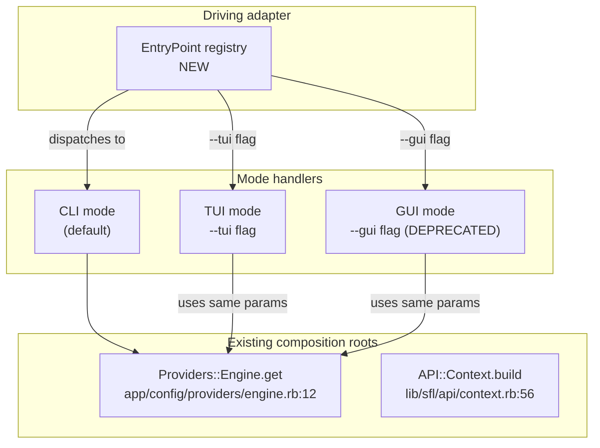

# CLI Hexagon — Refactor User Stories

**Project**: `sfl-engine` · **Branch**: `feature/roda_api` · **Date**: 2026-09-13

**Scope**: Unify the four separate executable entry points (`sfl-analyze`, `sfl-tui`, `sfl-api`, `sfl-review`) into a **single `sfl-engine` executable** with subcommands, behind a Hexagonal (ports/adapters) boundary — with **mode flags (`--tui`, `--gui`, `--api`)** that launch interactive or daemon modes for any subcommand, all sharing the same composition root (`Providers::Engine`).

This document addresses the [Plannotator feedback](https://github.com/b08x/sfl-engine/blob/feature/roda_api/docs/ecosystem-architecture.md#1-global-feedback-about-the-file) on `ecosystem-architecture.md` §3.1: *"so that instead of separate binaries, `sfl-engine` is the main executable, with subcommands for `tui` `gui` `daemon(api)` (cli being the default way of operating the program — with their respective flags and acceptable args; optional aliases shortcuts; (sfl-engine-tui, sfl-engine-gui and sfl-engine-api) to be considered..."*

**Revision Note**: Based on Plannotator annotation feedback (2026-09-13), the original adapter-per-mode design has been **reimagined** to use a **mode-flag pattern** where subcommands accept `--tui` and `--gui` flags to switch between CLI, TUI, and GUI interfaces, with CLI flags taking precedence and interactive modes providing entry forms for the same parameters.

**Companion documents**:
- [`ecosystem-architecture.md`](../ecosystem-architecture.md) — the cross-repo target-state frame this refactor implements.
- [`EMBEDDING-HEXAGON-USER-STORIES.md`](EMBEDDING-HEXAGON-USER-STORIES.md) — the `Core::Registry` pattern reused here for subcommand dispatch.
- [`INGEST-PARSER-HEXAGON-USER-STORIES.md`](INGEST-PARSER-HEXAGON-USER-STORIES.md) — the `TargetResolver` pattern reused here for input resolution.

**Evidence policy**: every `path:line` below was read from the working tree on 2026-09-13. Anything the architecture needs that is not in the tree is labelled **does not exist yet**.

---

## 1. Context & Problem Statement

### 1.1 What already exists

Four separate entry points exist today, each with its own boot sequence and its own way of reaching `Providers::Engine`:

| Entry point | File | Boot path | Mode | Purpose |
|---|---|---|---|---|
| `sfl-analyze` | `exe/sfl-analyze` | `lib/sfl.rb` → `SFL::CLI.run(ARGV)` | CLI | Ingest, analyze, synthesize, retrieve |
| `sfl-tui` | `exe/sfl-tui` | `lib/sfl.rb` → `SFL::TUI::App.build` → `SFL::TUI::App.run` | TUI | Interactive terminal UI |
| `sfl-api` | `exe/sfl-api` | `lib/sfl.rb` → `exec falcon serve -c config.ru` → Roda | Daemon | HTTP API server (Falcon → Roda) |
| `sfl-review` | `exe/sfl-review` | `lib/sfl.rb` → `lib/sfl/gui/review_queue_app.rb` → `SFL::GUI::ReviewQueueApp.new.launch` | GUI | Desktop review queue (Glimmer DSL) |

**Shared composition root**: `Providers::Engine` (`app/config/providers/engine.rb:7-12`) wraps `SFL::API::Context.build` (`lib/sfl/api/context.rb:56`), which is consumed by:
- `SFL::CLI` — `exe/sfl-analyze:17`
- Roda routes — `app/sfl.rb:42` via `def ctx = Providers::Engine.get`
- `SFL::TUI::App.build` — `lib/sfl/tui/app.rb:??` *(to be verified)*
- `SFL::GUI::ReviewQueueApp` — `lib/sfl/gui/review_queue_app.rb:??` *(to be verified)*

**Current binstub pattern**: Each `exe/sfl-*` file:
1. Expands `lib/` onto `$LOAD_PATH` (`exe/sfl-analyze:6-7`, same pattern in all four)
2. Requires `lib/sfl.rb` (the Zeitwerk loader)
3. Calls `SFL::DockerServices.ensure_running!` (where present)
4. Delegates to a mode-specific runner

**Key insight from ecosystem-architecture §3.1**: SCC is *a* pluggable frontend, not *the* frontend. The same principle applies here: **`sfl-engine` must work completely independently of any single frontend**, and the **mode flags (`--tui`, `--gui`)** allow users to switch between interfaces while using the same subcommand and parameter set.

### 1.2 What is missing

1. **No unified entry point.** There is no `sfl-engine` command that dispatches to subcommands. The four binstubs are **peer executables**, not modes of one program.
2. **No subcommand registry.** There is no `Core::Registry`-style lookup for subcommands. Dispatch is hardcoded in shell scripts, not in Ruby.
3. **No shared boot for modes.** Each entry point re-implements its own boot logic (load path setup, Docker check, tracing setup).
4. **No mode flags.** There is no `--tui` or `--gui` flag to switch interfaces within a subcommand.
5. **No mode-interface unification.** The CLI, TUI, and GUI do not share a common parameter schema; adding `--tui` to a CLI command does not present the same options in an interactive form.
6. **`exe/sfl-review` overlap with SCC.** Per [`ecosystem-architecture.md` §4.1](../ecosystem-architecture.md#41-the-fourth-mode--a-decision-to-make), once SCC's review surface reaches parity, `exe/sfl-review` should be retired. This refactor implements that retirement by **not** shipping a `gui` mode flag for the `review` subcommand in the first phase.

---

## 2. Target Architecture

### 2.1 Ports and adapters

The CLI refactor introduces **one new driving adapter port** for subcommand dispatch and **mode handlers** that switch between CLI, TUI, and GUI interfaces based on flags:

| Port | Responsibility | Driven / driving | Concrete implementations | Status |
|---|---|---|---|---|
| `SFL::Core::Ports::EntryPoint` | Execute a subcommand with argv and mode flags | **driving** | `SFL::CLI::EntryPoint` (dispatch), `SFL::CLI::ModeHandlers::TuiHandler`, `SFL::CLI::ModeHandlers::GuiHandler` | **does not exist yet** |

**Composition change**: `Providers::Engine` remains the **single composition root** for the *domain*. The new `EntryPoint` port dispatches to subcommand implementations, and **mode handlers** activate when `--tui` or `--gui` flags are present, wrapping the subcommand's CLI logic with an interactive interface.

**New module layout**:
```
lib/sfl/cli/
├── entry_point.rb              # NEW: the subcommand registry and dispatch
├── mode_handlers/
│   ├── tui_handler.rb         # NEW: launches TUI for a subcommand, pre-populating from CLI args
│   ├── gui_handler.rb         # NEW: launches GUI for a subcommand (DEPRECATED per §4.1)
│   └── base_handler.rb        # NEW: shared interface for mode handlers
├── commands/
│   ├── ingest_command.rb      # NEW: handles `sfl-engine ingest` with --tui/--gui support
│   ├── analyze_command.rb     # NEW: handles `sfl-engine analyze` with --tui/--gui support
│   ├── context_command.rb     # NEW: handles `sfl-engine context` with --tui/--gui support
│   └── ...
└── cli.rb                       # EXISTING: logic extracted into command classes

exec/
├── sfl-analyze                # DEPRECATED: replaced by `sfl-engine analyze`
├── sfl-tui                   # DEPRECATED: replaced by `sfl-engine analyze --tui`
├── sfl-api                   # DEPRECATED: replaced by `sfl-engine api` (special case)
├── sfl-review                 # DEPRECATED: replaced by `sfl-engine review --gui` (then retired per §4.1)
└── sfl-engine                 # NEW: the unified entry point
```

**Mermaid hexagon** (driving adapter with mode handlers):


### 2.2 Subcommand contract

The unified `sfl-engine` executable supports the following subcommands, each accepting **mode flags** (`--tui`, `--gui`) to switch interfaces:

| Subcommand | Aliases | Purpose | Mode support |
|---|---|---|---|
| `analyze` (default) | `a`, `sfl-engine-analyze` | Ingest, analyze, synthesize, retrieve | CLI (default), TUI, GUI |
| `ingest` | `i`, `sfl-engine-ingest` | Ingest documents, conversations, knowledge-bases | CLI (default), TUI |
| `context` | `c`, `sfl-engine-context` | Query context | CLI (default), TUI |
| `review` | `r`, `sfl-engine-review` | Review queue (DEPRECATED with GUI mode) | CLI (default), GUI |
| `api` | `d`, `daemon`, `sfl-engine-api`, `sfl-engine-daemon` | HTTP API server (Falcon → Roda) | **CLI only** (daemon mode) |
| `version` | `v`, `--version`, `-v` | Print version and exit | Built-in |
| `help` | `h`, `--help`, `-h` | Print usage and exit | Built-in |

**Default behavior**: With no subcommand or `-`, `sfl-engine` runs the `analyze` subcommand in **CLI mode**.

**Global flags** (apply to all subcommands):
- `--trace` / `--no-trace` — Enable/disable OpenTelemetry/Langfuse tracing (default: enabled if configured)
- `--docker` / `--no-docker` — Enable/disable Docker services auto-start (default: enabled)
- `--quiet` / `-q` — Suppress non-error output
- `--verbose` / `-V` — Increase log verbosity

**Mode flags** (mutually exclusive, only one per invocation):
- `--tui` — Launch interactive terminal UI for this subcommand. CLI flags provided take precedence; TUI prompts for missing required parameters.
- `--gui` — Launch desktop GUI for this subcommand (DEPRECATED per §4.1). CLI flags provided take precedence; GUI presents forms for missing required parameters.

**Subcommand-specific flags** are shared between CLI, TUI, and GUI modes. Each subcommand defines its parameter schema once, and all modes consume it.

### 2.3 Registry pattern

`SFL::CLI::EntryPoint` reuses the `Core::Registry` pattern from [SFL-EMB-01](EMBEDDING-HEXAGON-USER-STORIES.md#sfl-emb-01--dynamic-strategy-registry) for subcommand dispatch, with **mode flag detection** before delegating to command implementations:

```ruby
# lib/sfl/cli/entry_point.rb
module SFL
  module CLI
    class EntryPoint
      SUBCOMMAND_REGISTRY = Core::Registry.new
      MODE_HANDLERS = {
        tui: ModeHandlers::TuiHandler,
        gui: ModeHandlers::GuiHandler
      }.freeze

      def self.register(name, &factory)
        SUBCOMMAND_REGISTRY.register(name, &factory)
      end

      def self.resolve!(name, argv:, **kwargs)
        SUBCOMMAND_REGISTRY.resolve!(name, argv: argv, **kwargs)
      end

      # Detects --tui or --gui and delegates to mode handler
      def self.run(subcommand_name, argv)
        mode = detect_mode(argv)
        command = resolve!(subcommand_name, argv: filter_mode_flags(argv), **kwargs)
        
        case mode
        when :tui
          ModeHandlers::TuiHandler.new(command, pre_populated_args: parse_cli_args(argv)).run
        when :gui
          ModeHandlers::GuiHandler.new(command, pre_populated_args: parse_cli_args(argv)).run
        else
          command.run
        end
      end

      private_class_method def self.detect_mode(argv)
        if argv.include?("--tui")
          :tui
        elsif argv.include?("--gui")
          :gui
        else
          :cli
        end
      end
    end
  end
end
```

**Boot-time registration** (`lib/sfl/cli/entry_point.rb`):
```ruby
# Register subcommands (not modes — modes are flags)
SFL::CLI::EntryPoint.register(:analyze) do |argv:, **kw|
  Commands::AnalyzeCommand.new(argv, **kw)
end

SFL::CLI::EntryPoint.register(:ingest) do |argv:, **kw|
  Commands::IngestCommand.new(argv, **kw)
end

SFL::CLI::EntryPoint.register(:context) do |argv:, **kw|
  Commands::ContextCommand.new(argv, **kw)
end

SFL::CLI::EntryPoint.register(:api) do |argv:, **kw|
  Commands::ApiCommand.new(argv, **kw)
end

SFL::CLI::EntryPoint.register(:review) do |argv:, **kw|
  Commands::ReviewCommand.new(argv, **kw)
end
```

---

## 3. Deprecation Strategy

### 3.1 Migration path

| Old command | New command | Status |
|---|---|---|
| `bundle exec exe/sfl-analyze <args>` | `bundle exec exe/sfl-engine analyze <args>` | Phase 1 |
| `bundle exec exe/sfl-tui` | `bundle exec exe/sfl-engine analyze --tui` | Phase 1 |
| `bundle exec exe/sfl-tui <args>` | `bundle exec exe/sfl-engine <subcommand> --tui <args>` | Phase 1 |
| `bundle exec exe/sfl-api <args>` | `bundle exec exe/sfl-engine api <args>` | Phase 1 |
| `bundle exec exe/sfl-review` | `bundle exec exe/sfl-engine review --gui` | Phase 1, then retired |
| `bundle exec exe/sfl-review <args>` | `bundle exec exe/sfl-engine review --gui <args>` | Phase 1, then retired |

**Phase 1 gate**: All four old binstubs **emit a deprecation warning** on every invocation:
```
WARNING: `sfl-analyze` is deprecated. Use `sfl-engine analyze` instead.
        For TUI mode: use `sfl-engine analyze --tui`
        See: https://github.com/b08x/sfl-engine/blob/main/docs/refactor/CLI-HEXAGON-USER-STORIES.md
        This command will be removed in a future release.
```

**Phase 2 gate**: The old binstubs are **deleted**. Only `sfl-engine` remains.

### 3.2 Aliases

**Shell aliases** (for convenience, not shipped by the gem):
```bash
# ~/.bashrc or ~/.zshrc
alias sfl=sfl-engine
alias sfl-analyze='sfl-engine analyze'
alias sfl-tui='sfl-engine analyze --tui'
alias sfl-api='sfl-engine api'
```

**Symlink aliases** (shipped in the repo for backward compatibility during Phase 1):
```bash
# In the repo root, created by `bin/roda g aliases` or manually:
ln -sf exe/sfl-engine exe/sfl-engine-analyze
ln -sf exe/sfl-engine exe/sfl-engine-tui
ln -sf exe/sfl-engine exe/sfl-engine-api
```

These symlinks:
1. Point to `exe/sfl-engine`
2. Are **not** committed to git (`.gitignore` entry)
3. Are created by a Rake task or `bin/roda` generator for local development
4. Note: `sfl-engine-tui` symlink maps to the `--tui` mode flag, not a separate subcommand

---

## 4. Epics

| Epic | Goal (one line) |
|---|---|
| **E1 — EntryPoint registry** | Introduce `SFL::CLI::EntryPoint` as a `Core::Registry` for subcommand dispatch with mode flag detection (`--tui`, `--gui`). |
| **E2 — Mode handlers** | Implement `TuiHandler` and `GuiHandler` that wrap command classes with interactive interfaces, sharing the same parameter schema. |
| **E3 — Subcommand implementations** | Extract `IngestCommand`, `AnalyzeCommand`, `ContextCommand`, `ApiCommand`, `ReviewCommand` from existing binstubs, each supporting mode flags. |
| **E4 — Unified entry point** | Ship `exe/sfl-engine` that reads argv[0] as subcommand, detects mode flags, dispatches via `EntryPoint`, and delegates to command + mode handler. |
| **E5 — Deprecation warnings** | Make the four old binstubs warn and delegate to `sfl-engine <subcommand> [--tui|--gui]`. |
| **E6 — GUI retirement** | Retire `exe/sfl-review` and the `--gui` mode flag once SCC review parity is achieved (per ecosystem-architecture §4.1). |

---

## 5. User Stories

Conventions every story inherits:
- Zeitwerk-compatible file layout under `lib/sfl/cli/` with no new inflections needed.
- `Dry::Monads` `Result` returns for anything that can fail at request time.
- No new gem added to the Gemfile by a story that is not marked **adopt** in a gem disposition table (none needed here).
- RuboCop clean under the project's existing config.
- Existing test patterns preserved: `spec/cli/` mirrors `lib/sfl/cli/`.
- **Mode flag precedence**: CLI-provided arguments always take precedence over interactive input. Mode handlers pre-populate forms with CLI values.

---

### SFL-CLI-01 — EntryPoint registry with subcommand dispatch and mode flag detection

**Points**: 5 · **Depends on**: none · **Epic**: E1

> **As a** platform engineer
> **I want** a registry that maps subcommand names to command factories with mode flag detection (`--tui`, `--gui`)
> **so that** subcommands can seamlessly switch between CLI, TUI, and GUI interfaces using the same parameter schema.

**Acceptance criteria**

- **Given** `SFL::CLI::EntryPoint::SUBCOMMAND_REGISTRY`, **when** I call `EntryPoint.register(:analyze) { |argv:, **kw| Commands::AnalyzeCommand.new(argv, **kw) }`, **then** `#names` returns `[:analyze]` and `resolve!(:analyze, argv: ["conversation", "input.jsonl"])` returns a `Commands::AnalyzeCommand` instance.
- **Given** a registry with `:analyze`, `:ingest`, `:context`, `:api`, **when** I call `resolve!(:unknown)`, **then** it raises `SFL::CLI::EntryPoint::UnknownSubcommandError` whose message lists every registered name and a short usage hint.
- **Given** the same registry, **when** I call `resolve(:unknown)`, **then** it returns `Failure([:unknown_subcommand, :unknown, [:analyze, :ingest, :context, :api]])` — no exception — so a Roda route or CLI can turn it into a user-friendly message.
- **Given** a name already registered, **when** I `register` it again, **then** it raises `SFL::CLI::EntryPoint::DuplicateSubcommandError`.
- **Given** a registry, **when** two threads `resolve!` concurrently, **then** both succeed; registration mutates under a `Mutex` and `#names`/`#resolve!` read a frozen snapshot.
- **Given** `EntryPoint.run(:analyze, ["--tui", "conversation", "input.jsonl"])`, **then** it detects `:tui` mode, resolves the `analyze` command, and delegates to `ModeHandlers::TuiHandler` with pre-populated args from CLI parsing.
- **Given** `EntryPoint.run(:analyze, ["conversation", "input.jsonl"])`, **then** it defaults to `:cli` mode and calls `command.run` directly.
- **Given** `EntryPoint.run(:analyze, ["--tui", "--gui", "input.jsonl"])`, **then** it raises `SFL::CLI::EntryPoint::ConflictingModeError` (mutually exclusive flags).
- **Given** `lib/sfl/cli/entry_point.rb`, **when** grepped, **then** it contains **no** `require` of `sequel`, `pgvector`, `roda`, `falcon`, `glimmer`, or `ENV` (except `ENV.fetch` with defaults for CLI flags like `--quiet`).
- **Given** `lib/sfl/cli/entry_point.rb`, **when** loaded, **then** it auto-registers the built-in subcommands (`:analyze`, `:ingest`, `:context`, `:api`, `:review`) via `EntryPoint.register` calls at the bottom of the file.

**Integration points**

- New file `lib/sfl/cli/entry_point.rb`.
- New directory `lib/sfl/cli/mode_handlers/` with base handler interface.
- Reuses `SFL::Core::Registry` from [SFL-EMB-01](EMBEDDING-HEXAGON-USER-STORIES.md#sfl-emb-01--dynamic-strategy-registry).
- Autoloaded by the `lib/` Zeitwerk loader configured at `lib/sfl.rb:38-44`; `CLI::EntryPoint` is camel-derivable.
- Built-in subcommands (`help`, `version`) are registered in the same file and **do not** require separate command classes.

**Definition of done**:
- `spec/cli/entry_point_spec.rb` covers all criteria including the concurrency case and mode detection.
- `bundle exec exe/sfl-engine --help` prints a usage message listing all registered subcommands.
- `bundle exec exe/sfl-engine --version` prints the version (from `lib/sfl/version.rb` or Git).
- RuboCop clean; no Gemfile change.

---

### SFL-CLI-02 — ModeHandlers for TUI and GUI modes

**Points**: 5 · **Depends on**: SFL-CLI-01 · **Epic**: E2

> **As a** user who prefers interactive interfaces
> **I want** `--tui` and `--gui` flags to launch interactive forms for any subcommand
> **so that** I can use the same command with a different interface.

**Acceptance criteria**

- **Given** `SFL::CLI::ModeHandlers::BaseHandler`, **when** inspected, **then** it defines a common interface: `#run(command, pre_populated_args:)` and `#interactive_prompt(command)`.
- **Given** `SFL::CLI::ModeHandlers::TuiHandler`, **when** instantiated with a command and `pre_populated_args: { source: "./docs", store: true }`, **then** calling `#run` launches the TUI, pre-populates the form with the provided args, and prompts only for missing required parameters.
- **Given** `SFL::CLI::ModeHandlers::GuiHandler`, **when** instantiated with a command and `pre_populated_args: { source: "./docs" }`, **then** calling `#run` launches the GUI, pre-populates the form fields, and shows input fields only for missing required parameters.
- **Given** a TUI/GUI handler with all required args pre-populated from CLI, **when** `#run` is called, **then** it executes the command immediately without showing any prompts.
- **Given** `lib/sfl/cli/mode_handlers/tui_handler.rb`, **when** grepped, **then** it contains **no** `require "glimmer-dsl-libui"` or `require "bubble-tea"` — those dependencies are **only** loaded lazily when the mode is activated.
- **Given** `lib/sfl/cli/mode_handlers/gui_handler.rb`, **when** grepped, **then** it contains **no** direct instantiation of GUI classes — it uses lazy loading via `SFL::GUI` namespace.
- **Given** both handlers, **when** CLI args conflict with TUI/GUI defaults, **then** CLI args take precedence (e.g., `--source /tmp` overrides any default in the TUI form).

**Integration points**

- New directory `lib/sfl/cli/mode_handlers/` with `base_handler.rb`, `tui_handler.rb`, `gui_handler.rb`.
- `tui_handler.rb` depends on existing `lib/sfl/tui/app.rb` infrastructure.
- `gui_handler.rb` depends on existing `lib/sfl/gui/` infrastructure.
- `spec/cli/mode_handlers/tui_handler_spec.rb` and `spec/cli/mode_handlers/gui_handler_spec.rb` verify pre-population and precedence.

**Definition of done**:
- `spec/cli/mode_handlers/` tests pass.
- `bundle exec exe/sfl-engine analyze --tui` launches the TUI with the analyze form.
- `bundle exec exe/sfl-engine ingest --source ./docs --tui` pre-populates source and only prompts for missing fields.
- RuboCop clean.

---

### SFL-CLI-03 — IngestCommand with mode flag support

**Points**: 5 · **Depends on**: SFL-CLI-01, SFL-CLI-02 · **Epic**: E3

> **As a** user ingesting content
> **I want** `sfl-engine ingest` to accept `--tui` and `--gui` flags
> **so that** I can use an interactive form to enter ingest parameters.

**Acceptance criteria**

- **Given** `SFL::CLI::Commands::IngestCommand`, **when** constructed with `argv: ["--source", "./docs", "--collection", "worknotes", "--store"]`, **then** it parses and validates the same options as the existing `sfl-analyze` ingest logic.
- **Given** a command with parsed options, **when** `#run` is called in CLI mode, **then** it executes the ingest pipeline identically to `exe/sfl-analyze` with the same flags.
- **Given** a command constructed with `argv: ["--tui"]`, **then** the `EntryPoint` detects `:tui` mode and delegates to `TuiHandler` with an empty `pre_populated_args` hash.
- **Given** a command constructed with `argv: ["--source", "./docs", "--tui"]`, **then** the `EntryPoint` detects `:tui` mode and delegates to `TuiHandler` with `pre_populated_args: { source: "./docs" }`.
- **Given** a command, **when** queried for its parameter schema, **then** it returns a list of required and optional parameters that the TUI/GUI can use to build forms.
- **Given** `lib/sfl/cli/commands/ingest_command.rb`, **when** grepped, **then** it contains **no** TUI or GUI code — only CLI parsing and execution logic.

**Integration points**

- New file `lib/sfl/cli/commands/ingest_command.rb`.
- Extracts ingest logic from existing `lib/sfl/cli.rb` (shared with `AnalyzeCommand`).
- `spec/cli/commands/ingest_command_spec.rb` tests CLI mode execution.

**Definition of done**:
- `spec/cli/commands/ingest_command_spec.rb` passes.
- `bundle exec exe/sfl-engine ingest --source ./docs --collection worknotes --store` produces the same result as `bundle exec exe/sfl-analyze` with equivalent flags.
- `bundle exec exe/sfl-engine ingest --tui` launches the TUI ingest form.
- RuboCop clean.

---

### SFL-CLI-04 — AnalyzeCommand with mode flag support

**Points**: 5 · **Depends on**: SFL-CLI-01, SFL-CLI-02 · **Epic**: E3

> **As a** user running analysis
> **I want** `sfl-engine analyze` to accept `--tui` and `--gui` flags
> **so that** I can use the same command with an interactive interface.

**Acceptance criteria**

- **Given** `SFL::CLI::Commands::AnalyzeCommand`, **when** constructed with `argv: ["conversation", "input.jsonl", "--store", "--limit", "10"]`, **then** it parses and validates the same options as `SFL::CLI.parse` (`lib/sfl/cli.rb:99-??`).
- **Given** a command with parsed options, **when** `#run` is called in CLI mode, **then** it delegates to the existing `SFL::CLI` execution path, producing identical output and exit code.
- **Given** `sfl-engine analyze --help`, **then** it prints the **same** usage text as `sfl-analyze --help` today (the `USAGE` constant at `lib/sfl/cli.rb:40-93`).
- **Given** a command with `argv: ["--tui", "conversation", "input.jsonl"]`, **then** the `EntryPoint` detects `:tui` mode and delegates to `TuiHandler` with `pre_populated_args: { input_type: "conversation", input_path: "input.jsonl" }`.
- **Given** a command with `argv: ["conversation", "input.jsonl", "--store"]`, **then** the command's parameter schema identifies `input_type`, `input_path`, `store`, `limit` as the configurable parameters for TUI/GUI forms.
- **Given** an unknown flag passed to the command, **then** it raises `SFL::CLI::UsageError` with the same message format as the existing CLI.
- **Given** `lib/sfl/cli/commands/analyze_command.rb`, **when** grepped, **then** it contains **no** business logic duplication — it delegates to existing `SFL::CLI` for execution.

**Integration points**

- New file `lib/sfl/cli/commands/analyze_command.rb`.
- Wraps existing `lib/sfl/cli.rb` logic without modification.
- `spec/cli/commands/analyze_command_spec.rb` mirrors existing `spec/cli/cli_spec.rb`.

**Definition of done**:
- `spec/cli/commands/analyze_command_spec.rb` passes.
- `bundle exec exe/sfl-engine analyze conversation input.jsonl --store` produces the same result as `bundle exec exe/sfl-analyze conversation input.jsonl --store`.
- `bundle exec exe/sfl-engine analyze --tui` launches the TUI with analyze parameters.
- RuboCop clean.

---

### SFL-CLI-05 — ContextCommand with mode flag support

**Points**: 3 · **Depends on**: SFL-CLI-01, SFL-CLI-02 · **Epic**: E3

> **As a** user querying context
> **I want** `sfl-engine context` to accept `--tui` and `--gui` flags
> **so that** I can use an interactive form to enter my query.

**Acceptance criteria**

- **Given** `SFL::CLI::Commands::ContextCommand`, **when** constructed with `argv: ["what happened?", "--limit", "10"]`, **then** it parses and validates the same options as the existing context query logic.
- **Given** a command with parsed options, **when** `#run` is called in CLI mode, **then** it executes the context query and prints results identically to `exe/sfl-analyze context` with the same flags.
- **Given** a command with `argv: ["--tui"]`, **then** the `EntryPoint` detects `:tui` mode and delegates to `TuiHandler` which prompts for the query string and optional parameters.
- **Given** a command with `argv: ["--limit", "10", "--tui"]`, **then** the `EntryPoint` detects `:tui` mode and delegates to `TuiHandler` with `pre_populated_args: { limit: "10" }`, prompting only for the query.
- **Given** `sfl-engine context --help`, **then** it prints usage text for context subcommand.
- **Given** `lib/sfl/cli/commands/context_command.rb`, **when** grepped, **then** it contains **no** TUI or GUI code — only CLI parsing and execution logic.

**Integration points**

- New file `lib/sfl/cli/commands/context_command.rb`.
- Extracts context query logic from existing `lib/sfl/cli.rb`.
- `spec/cli/commands/context_command_spec.rb` tests CLI mode execution.

**Definition of done**:
- `spec/cli/commands/context_command_spec.rb` passes.
- `bundle exec exe/sfl-engine context "what happened?" --limit 10` produces the same result as `bundle exec exe/sfl-analyze context "what happened?" --limit 10`.
- `bundle exec exe/sfl-engine context --tui` launches the TUI with a query prompt.
- RuboCop clean.

---

### SFL-CLI-06 — ApiCommand (daemon mode)

**Points**: 3 · **Depends on**: SFL-CLI-01 · **Epic**: E3

> **As an** API operator
> **I want** `sfl-engine api` to start the HTTP server with the same flags as `sfl-api`
> **so that** the migration is transparent for API users.

**Acceptance criteria**

- **Given** `SFL::CLI::Commands::ApiCommand`, **when** constructed with `argv: ["--port", "3002", "--host", "localhost"]`, **then** it parses `PORT` and `HOST` from argv **or** ENV (argv takes precedence, matching `exe/sfl-api:20-21`).
- **Given** a command with `port: 3002`, `host: "localhost"`, **when** `#run` is called, **then** it executes `exec "bundle", "exec", "falcon", "serve", "-c", "config.ru", "-b", "http://localhost:3002"` (same as `exe/sfl-api:22-23`).
- **Given** no argv flags and no ENV, **then** it defaults to `port: "3001"`, `host: "0.0.0.0"` (same as `exe/sfl-api:20-21`).
- **Given** `sfl-engine api --tui`, **then** it raises `SFL::CLI::EntryPoint::InvalidModeError` with message: "`--tui` and `--gui` flags are not supported for the `api` subcommand (daemon mode only)".
- **Given** `sfl-engine api --gui`, **then** it raises the same `InvalidModeError`.
- **Given** `lib/sfl/cli/commands/api_command.rb`, **when** grepped, **then** it contains **no** `require "falcon"` or `require "roda"` — those dependencies are **only** in `config.ru` and the Roda app.

**Integration points**

- New file `lib/sfl/cli/commands/api_command.rb`.
- Reuses existing `config.ru` and `app/sfl.rb` unchanged.
- `spec/cli/commands/api_command_spec.rb` stubs `exec` and verifies the correct command is assembled.

**Definition of done**:
- `spec/cli/commands/api_command_spec.rb` passes.
- `bundle exec exe/sfl-engine api --port 3002 --host localhost` starts a server on `localhost:3002`.
- RuboCop clean.

---

### SFL-CLI-07 — ReviewCommand with GUI mode (DEPRECATED)

**Points**: 2 · **Depends on**: SFL-CLI-01, SFL-CLI-02 · **Epic**: E3

> **As a** review user (temporary)
> **I want** `sfl-engine review --gui` to launch the desktop review queue
> **so that** there is a migration path before SCC reaches parity.

**Acceptance criteria**

- **Given** `SFL::CLI::Commands::ReviewCommand`, **when** constructed with `argv: ["--gui"]`, **then** the `EntryPoint` detects `:gui` mode and delegates to `GuiHandler` for the review interface.
- **Given** a command with `argv: ["--limit", "20", "--gui"]`, **then** the `EntryPoint` detects `:gui` mode and delegates to `GuiHandler` with `pre_populated_args: { limit: "20" }`.
- **Given** `bundle exec exe/sfl-engine review --gui`, **then** it emits a **deprecation warning**:
  ```
  WARNING: `sfl-engine review --gui` is deprecated and will be removed once SCC's review surface reaches parity.
          See: docs/ecosystem-architecture.md §4.1
  ```
- **Given** `lib/sfl/cli/commands/review_command.rb`, **when** grepped, **then** it contains **no** direct GUI instantiation — only CLI parsing for review parameters.

**Integration points**

- New file `lib/sfl/cli/commands/review_command.rb`.
- Reuses existing `lib/sfl/gui/review_queue_app.rb` via `GuiHandler`.
- **This command's `--gui` mode is removed in SFL-CLI-09** (GUI retirement).

**Definition of done**:
- `spec/cli/commands/review_command_spec.rb` passes.
- `bundle exec exe/sfl-engine review --gui` launches the GUI and prints the deprecation warning.
- RuboCop clean.

---

### SFL-CLI-08 — Unified `sfl-engine` entry point

**Points**: 5 · **Depends on**: SFL-CLI-01, SFL-CLI-02, SFL-CLI-03, SFL-CLI-04, SFL-CLI-05, SFL-CLI-06, SFL-CLI-07 · **Epic**: E4

> **As a** user
> **I want** a single `sfl-engine` command that dispatches to subcommands with mode flag support
> **so that** I can use one entry point for all interfaces.

**Acceptance criteria**

- **Given** `exe/sfl-engine`, **when** it is invoked with no arguments, **then** it runs the `analyze` subcommand with an empty argv (equivalent to `sfl-engine analyze` with no arguments).
- **Given** `exe/sfl-engine analyze conversation input.jsonl`, **then** it dispatches to `AnalyzeCommand` and produces the same output as `exe/sfl-analyze conversation input.jsonl`.
- **Given** `exe/sfl-engine analyze --tui conversation input.jsonl`, **then** it dispatches to `AnalyzeCommand`, detects `:tui` mode, and delegates to `TuiHandler` with pre-populated args.
- **Given** `exe/sfl-engine ingest --source ./docs --tui`, **then** it dispatches to `IngestCommand`, detects `:tui` mode, and launches the TUI with source pre-populated.
- **Given** `exe/sfl-engine api`, **then** it dispatches to `ApiCommand` and starts the HTTP server.
- **Given** `exe/sfl-engine review --gui`, **then** it dispatches to `ReviewCommand`, detects `:gui` mode, and launches the GUI (with deprecation warning).
- **Given** `exe/sfl-engine --help`, **then** it prints a usage message listing all registered subcommands, their short descriptions, and available mode flags.
- **Given** `exe/sfl-engine --version`, **then** it prints the version string (e.g., `sfl-engine 0.1.0` or Git SHA).
- **Given** `exe/sfl-engine unknown-command`, **then** it prints an error message: `Unknown subcommand: unknown-command` followed by the same usage hint as `--help`.
- **Given** `exe/sfl-engine analyze --tui --gui`, **then** it prints an error message: `Conflicting mode flags: --tui and --gui are mutually exclusive`.
- **Given** `exe/sfl-engine`, **when** grepped, **then** it contains **no** mode-specific logic — only subcommand dispatch via `SFL::CLI::EntryPoint.run`.

**Integration points**

- New file `exe/sfl-engine` (replaces the need for `exe/sfl-analyze`, `exe/sfl-tui`, `exe/sfl-api`, `exe/sfl-review`).
- Loads `lib/sfl.rb` via the same load path setup as the existing binstubs (`exe/sfl-analyze:6-7`).
- Calls `SFL::DockerServices.ensure_running!` **before** dispatching to any subcommand (except `version` and `help`).
- Calls `SFL::CLI::EntryPoint.run` with the subcommand name, full argv (including mode flags), and global flags.

**Definition of done**:
- `spec/cli/sfl_engine_spec.rb` passes (tests the `exe/sfl-engine` script behavior with mode flags).
- All four old binstubs continue to work with deprecation warnings (SFL-CLI-09).
- RuboCop clean.

---

### SFL-CLI-09 — Deprecation warnings in old binstubs

**Points**: 2 · **Depends on**: SFL-CLI-08 · **Epic**: E5

> **As a** maintainer
> **I want** the old binstubs to warn users to migrate to `sfl-engine <subcommand> [--tui|--gui]`
> **so that** the deprecation is visible and actionable.

**Acceptance criteria**

- **Given** `exe/sfl-analyze conversation input.jsonl`, **then** it prints to stderr:
  ```
  WARNING: `sfl-analyze` is deprecated. Use `sfl-engine analyze` instead.
          For TUI mode: use `sfl-engine analyze --tui`
          See: https://github.com/b08x/sfl-engine/blob/main/docs/refactor/CLI-HEXAGON-USER-STORIES.md
          This command will be removed in a future release.
  ```
  **Then** it executes `exec exe/sfl-engine analyze conversation input.jsonl` (same argv, same exit code).
- **Given** `exe/sfl-tui`, **then** it prints the same warning (with `sfl-tui` → `sfl-engine analyze --tui`) and execs `exe/sfl-engine analyze --tui`.
- **Given** `exe/sfl-tui <args>`, **then** it prints the same warning and execs `exe/sfl-engine analyze --tui <args>`.
- **Given** `exe/sfl-api --port 3002`, **then** it prints the same warning (with `sfl-api` → `sfl-engine api`) and execs `exe/sfl-engine api --port 3002`.
- **Given** `exe/sfl-review`, **then** it prints the same warning (with `sfl-review` → `sfl-engine review --gui`) **plus** the GUI-specific deprecation note:
  ```
  NOTE: The GUI is also deprecated per ecosystem-architecture.md §4.1 and will be removed once SCC reaches parity.
  ```
  Then it execs `exe/sfl-engine review --gui`.
- **Given** the old binstubs, **when** grepped, **then** the only changes are the addition of the warning + exec, with **no** other logic modified.

**Integration points**

- Modify `exe/sfl-analyze`, `exe/sfl-tui`, `exe/sfl-api`, `exe/sfl-review` to prepend the warning and exec.
- The warning is **always** printed to stderr, even if `--quiet` is set (deprecation warnings are non-suppressible).

**Definition of done**:
- Manual verification that all four old binstubs print the warning and delegate correctly.
- `spec/cli/legacy_binstub_spec.rb` (optional) verifies the warning message and exec behavior.
- RuboCop clean.

---

### SFL-CLI-10 — Symlink aliases for backward compatibility

**Points**: 1 · **Depends on**: SFL-CLI-08 · **Epic**: E4

> **As a** scripter
> **I want** `sfl-engine-analyze`, `sfl-engine-tui`, etc. to work as symlinks to `sfl-engine`
> **so that** I can use either form in scripts.

**Acceptance criteria**

- **Given** a symlink `exe/sfl-engine-analyze` → `exe/sfl-engine`, **when** I run `bundle exec exe/sfl-engine-analyze conversation input.jsonl`, **then** it behaves identically to `bundle exec exe/sfl-engine analyze conversation input.jsonl`.
- **Given** a symlink `exe/sfl-engine-tui` → `exe/sfl-engine`, **when** I run `bundle exec exe/sfl-engine-tui`, **then** it behaves identically to `bundle exec exe/sfl-engine analyze --tui`.
- **Given** symlinks for `sfl-engine-api`, **then** they behave identically to their subcommand equivalents.
- **Given** the symlinks, **when** listed in git, **then** they are **not** tracked (added to `.gitignore`).

**Integration points**

- New Rake task `rake cli:symlinks` creates the symlinks in `exe/`.
- Or, new `bin/roda g cli:aliases` generator creates the symlinks.
- `.gitignore` entry: `/exe/sfl-engine-*`

**Definition of done**:
- `bundle exec rake cli:symlinks` creates all four symlinks.
- `bundle exec exe/sfl-engine-analyze --help` works.
- `bundle exec exe/sfl-engine-tui` launches the TUI.

---

### SFL-CLI-11 — Retire GUI mode flag and `exe/sfl-review`

**Points**: 2 · **Depends on**: SFL-CLI-08, SFL-CLI-09, SFL-CLI-10 · **Epic**: E6

> **As a** maintainer
> **I want** to remove the `--gui` mode flag and old `exe/sfl-review` binstub once SCC review parity is achieved
> **so that** we avoid maintaining two review clients.

**Acceptance criteria**

- **Given** the acceptance criteria for SCC review parity are met (per [`ecosystem-architecture.md` §4.1](../ecosystem-architecture.md#41-the-fourth-mode--a-decision-to-make):
  - SCC exposes `POST /clauses/:id/review`
  - SCC exposes `POST /review-queue/:id/decide`
  - SCC review surface is feature-complete relative to `exe/sfl-review`
- **When** this story is implemented, **then**:
  - `lib/sfl/cli/mode_handlers/gui_handler.rb` is **deleted**.
  - `lib/sfl/cli/commands/review_command.rb` is **deleted** (or repurposed without `--gui` support).
  - `exe/sfl-review` is **deleted**.
  - The `--gui` flag **no longer exists** for any subcommand (prints the same "unknown flag" error as any other unknown flag).
  - `lib/sfl/gui/review_queue_app.rb` remains but is **orphaned** (no entry point references it).

**Integration points**

- Delete `lib/sfl/cli/mode_handlers/gui_handler.rb`.
- Remove `--gui` support from `lib/sfl/cli/entry_point.rb` mode detection.
- Delete `exe/sfl-review`.
- Update `ecosystem-architecture.md` §4.1 to mark this as **done**.

**Definition of done**:
- `bundle exec exe/sfl-engine review --gui` prints "Unknown flag: --gui".
- `ls exe/sfl-review` fails (file not found).
- RuboCop clean.

---

## 6. Open Questions

### Q1 — Should `sfl-engine` be installed as a gem with binstubs, or remain a checkout-only script?

**Current state**: `sfl-engine` is **not** a gem (no `sfl-engine.gemspec`, no `gem install sfl-engine`). It is run as `bundle exec exe/sfl-analyze` from a checkout.

**Pros of gem installation**:
- Users can `gem install sfl-engine` and run `sfl-engine analyze ...` globally.
- Symlinks/aliases become unnecessary.

**Cons of gem installation**:
- The project has **no gemspec** and explicitly rejected one (see `README.md` and AGENTS.md).
- Zeitwerk autoloading, Docker service checks, and Python sidecar management assume a checkout with `lib/`, `app/`, `sidecar/` present.
- The Gemfile declares many development-only gems (`pry`, `rubocop`, `rspec`) that would bloat a gem installation.

**Tentative decision**: **Remain checkout-only.** The project's existing architecture assumes a checkout (e.g., `sidecar/spacy_sidecar.py` is a relative path, `SFL::DockerServices` checks for `docker compose` on PATH). A gem would need significant refactoring to support both modes. The symlink aliases (SFL-CLI-10) provide the convenience without the complexity.

**Resolution target**: Phase 1 gate.

---

### Q2 — Should subcommands support both `--tui` and individual subcommands like `sfl-engine tui`?

**Current design**: Mode flags only (`--tui`, `--gui`). The old `sfl-engine tui` subcommand is **not** implemented.

**Alternative**: Support both `sfl-engine analyze --tui` (mode flag) and `sfl-engine tui` (legacy subcommand) for backward compatibility.

**Tentative decision**: **Mode flags only.** Having both would create two paths to the same functionality, increasing maintenance burden. Users of `sfl-tui` should migrate to `sfl-engine analyze --tui`. The deprecation warnings (SFL-CLI-09) guide users to the new pattern.

**Resolution target**: Phase 1 gate.

---

### Q3 — How should TUI/GUI forms be generated from command parameter schemas?

**Approach 1**: Each command defines a `parameter_schema` method returning structured metadata (required/optional params, types, descriptions) that TUI/GUI handlers use to build forms.

**Approach 2**: Extract parameter definitions into shared YAML/JSON configs that both CLI parsing and mode handlers consume.

**Tentative decision**: **Approach 1 (programmatic schema).** Keeps everything in Ruby, type-safe, and co-located with command logic. The schema is simple enough (param name, type, required flag, description) to define inline in each command class.

---

## 7. Cross-references

| Reference | Relevance |
|---|---|
| [`ecosystem-architecture.md` §3.1](../ecosystem-architecture.md#31-shape) | The target-state diagram showing SCC as a driving adapter; this doc applies the same principle with **mode flags** (`--tui`, `--gui`) for interface switching. |
| [`ecosystem-architecture.md` §4.1](../ecosystem-architecture.md#41-the-fourth-mode--a-decision-to-make) | Explicit recommendation to retire `exe/sfl-review` — this doc implements that retirement via SFL-CLI-11 (removing `--gui` mode flag). |
| [`ecosystem-architecture.md` §6.1](../ecosystem-architecture.md#61-integration-contract) | The HTTP API contract that `ApiCommand` exposes via Roda/Falcon. |
| [SFL-EMB-01](EMBEDDING-HEXAGON-USER-STORIES.md#sfl-emb-01--dynamic-strategy-registry) | The `Core::Registry` pattern reused here for subcommand dispatch. |
| [SFL-ING-19](INGEST-PARSER-HEXAGON-USER-STORIES.md) | `TargetResolver` — precedent for runtime resolution by name, which this doc mirrors for subcommands. |
| `track-ecosystem-architecture-engine-visual-driver-1odobii` | This doc's durable record on the sfl-engine side. |

---

## 8. Revision History

| Date | Change | Author |
|---|---|---|
| 2026-09-13 | **Reimagined architecture based on Plannotator feedback** — Replaced adapter-per-mode design with mode-flag pattern (`--tui`, `--gui`). Adapters retired in favor of mode handlers that wrap command implementations. Subcommands now accept mode flags to switch interfaces. See Revision Note at top of document. | Plannotator annotation |

---

## 8. File Disposition

| File | Verdict | Rationale |
|---|---|---|
| `exe/sfl-engine` | **NEW** | Unified entry point with mode flag support. |
| `exe/sfl-analyze` | **DEPRECATED** | Delegates to `sfl-engine analyze` with warning. Removed in Phase 2. |
| `exe/sfl-tui` | **DEPRECATED** | Delegates to `sfl-engine analyze --tui` with warning. Removed in Phase 2. |
| `exe/sfl-api` | **DEPRECATED** | Delegates to `sfl-engine api` with warning. Removed in Phase 2. |
| `exe/sfl-review` | **DEPRECATED** | Delegates to `sfl-engine review --gui` with warning. Removed in SFL-CLI-11. |
| `exe/sfl-engine-*` | **NEW (symlinks)** | Symlink aliases for backward compatibility. Not committed to git. |
| `lib/sfl/cli/entry_point.rb` | **NEW** | Subcommand registry and dispatch with mode flag detection. |
| `lib/sfl/cli/mode_handlers/` | **NEW** | Directory containing `base_handler.rb`, `tui_handler.rb`, `gui_handler.rb`. |
| `lib/sfl/cli/commands/` | **NEW** | Directory containing `ingest_command.rb`, `analyze_command.rb`, `context_command.rb`, `api_command.rb`, `review_command.rb`. |
| `lib/sfl/cli.rb` | **UNCHANGED** | Logic extracted into command classes; not modified. |
| `lib/sfl/tui/app.rb` | **UNCHANGED** | Consumed by `TuiHandler`. |
| `lib/sfl/gui/review_queue_app.rb` | **UNCHANGED (then orphaned)** | Consumed by `GuiHandler` until SFL-CLI-11. |
| `config.ru` | **UNCHANGED** | Consumed by `ApiCommand`. |
| `app/sfl.rb` | **UNCHANGED** | Consumed by `ApiCommand` via Roda. |
| `spec/cli/entry_point_spec.rb` | **NEW** | Tests for SFL-CLI-01. |
| `spec/cli/mode_handlers/tui_handler_spec.rb` | **NEW** | Tests for SFL-CLI-02. |
| `spec/cli/mode_handlers/gui_handler_spec.rb` | **NEW (then DELETED)** | Tests for SFL-CLI-02. Deleted in SFL-CLI-11. |
| `spec/cli/commands/ingest_command_spec.rb` | **NEW** | Tests for SFL-CLI-03. |
| `spec/cli/commands/analyze_command_spec.rb` | **NEW** | Tests for SFL-CLI-04. |
| `spec/cli/commands/context_command_spec.rb` | **NEW** | Tests for SFL-CLI-05. |
| `spec/cli/commands/api_command_spec.rb` | **NEW** | Tests for SFL-CLI-06. |
| `spec/cli/commands/review_command_spec.rb` | **NEW (then DELETED)** | Tests for SFL-CLI-07. Deleted in SFL-CLI-11. |
| `spec/cli/sfl_engine_spec.rb` | **NEW** | Tests for SFL-CLI-08. |
| `spec/cli/legacy_binstub_spec.rb` | **NEW (optional)** | Tests for SFL-CLI-09. |
| `.gitignore` | **MODIFIED** | Add `/exe/sfl-engine-*` entry. |

---

## 9. Phased Path

| Phase | Gate | Stories |
|---|---|---|
| **Phase 0** | Doc accepted | This document + open questions resolved |
| **Phase 1** | `sfl-engine` works end-to-end | SFL-CLI-01, SFL-CLI-02, SFL-CLI-03, SFL-CLI-04, SFL-CLI-05, SFL-CLI-06, SFL-CLI-07, SFL-CLI-08, SFL-CLI-09, SFL-CLI-10 |
| **Phase 2** | Old binstubs removed | Delete `exe/sfl-analyze`, `exe/sfl-tui`, `exe/sfl-api` (after deprecation period) |
| **Phase 3** | GUI retired | SFL-CLI-11 (gated on SCC review parity) |

---

## 10. Acceptance Test for the Whole Refactor

> **If a change makes a capability reachable only through a specific frontend, the change is wrong.**
> — Adapted from [`ecosystem-architecture.md` §4](../ecosystem-architecture.md#4-sfl-engine-stays-standalone--the-tri-mode-guarantee)

**Test matrix** (must all pass for CLI and TUI modes):

| Capability | `sfl-engine analyze` (CLI) | `sfl-engine analyze --tui` | `sfl-engine ingest --tui` | `sfl-engine api` | `sfl-engine review --gui` (until retired) |
|---|---|---|---|---|---|
| Ingest conversation | ✅ | ✅ | ✅ | ✅ (POST /ingest) | ❌ |
| Ingest documentation | ✅ | ✅ | ✅ | ✅ (POST /ingest) | ❌ |
| Ingest knowledge-base | ✅ | ✅ | ✅ | ✅ (POST /ingest) | ❌ |
| Context query | ✅ | ✅ | ❌ | ✅ (POST /retrieve) | ❌ |
| Review queue | ✅ (`review` subcommand) | ❌ | ❌ | ✅ (GET /review-queue) | ✅ |
| Synthesis | ✅ (`synthesize` subcommand) | ✅ | ❌ | ✅ (POST /synthesize) | ❌ |
| Pipeline compile | ✅ (`pipeline compile` subcommand) | ✅ | ❌ | ✅ (POST /pipeline/compile) | ❌ |
| Topic modeling | ✅ (`--topics N` flag) | ✅ | ❌ | ❌ | ❌ |

**Key**: ✅ = supported, ❌ = not applicable for that mode/subcommand.

**Invariant 1**: Every ✅ in the CLI column must also have a ✅ in the `api` column (or vice versa for capabilities that are API-only). This ensures the CLI and HTTP modes remain at feature parity.

**Invariant 2**: For every subcommand that supports `--tui`, the TUI mode must expose the **exact same parameters** as the CLI mode, with CLI-provided values taking precedence.

**Invariant 3**: The `--tui` and `--gui` flags work consistently across all subcommands that support them (all except `api`).
