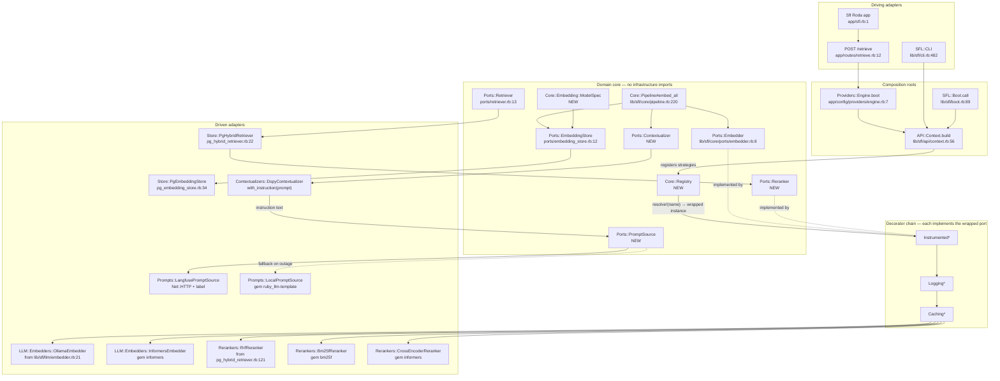

# Embedding Hexagon — Refactor User Stories

**Project**: `sfl-engine` · **Branch**: `feature/roda_api` · **Date**: 2026-09-12

**Scope**: dynamically generate, store, and re-rank embeddings behind a Hexagonal (ports/adapters)
boundary, with runtime-swappable Strategy implementations resolved through a Dynamic Registry and
wrapped by Middleware Decorators for logging, caching, and observability.

**Evidence policy**: every `path:line` below was read from the working tree or resolved through a
codebase-memory graph call (see §6). Anything the architecture needs that is not in the tree is
labelled **does not exist yet**.

**Rev 2 changes** (2026-09-13): four open questions answered by the project owner — the vector layout
is **table-per-dimension** (sibling tables per width), the four zero-call-site gems each have a stated
purpose, Langfuse's default `production`/`latest` labels apply, and the enrichment A/B gets a
retrieval-quality evaluation in Langfuse. The `ruby_llm` question is withdrawn. SFL-EMB-04 is
rewritten for sibling tables and SFL-EMB-11, R1, R2, R13, §2.1 and E3 follow it.

---

## 1. Context & Problem Statement

### 1.1 What already exists

This codebase is **already partially hexagonal**. A `Core::Ports` namespace holds contract modules
with `NotImplementedError` bodies, and each has real / `Null` / `Fake` adapters.

| Existing port | File | Contract |
|---|---|---|
| `Core::Ports::Embedder` | `lib/sfl/core/ports/embedder.rb:8` | `#embed(text)` (`:11`), `#embed_batch(texts)` (`:17`) |
| `Core::Ports::EmbeddingStore` | `lib/sfl/core/ports/embedding_store.rb:12` | `#replace_document(document_id, embeddings_by_clause_id)` (`:16`) |
| `Core::Ports::Retriever` | `lib/sfl/core/ports/retriever.rb:13` | `#retrieve(query)` (`:16`) |
| `Core::Ports::Cache` | `lib/sfl/core/ports/cache.rb:14` | `#partition(keys)` (`:16`), `#write(key, value)` (`:23`) |
| `Core::Ports::Instrumenter` | `lib/sfl/core/ports/instrumenter.rb:9` | `#instrument(name, payload = {}, &)` (`:14`) |

Adapter directories confirm the Null/Fake double convention:
`lib/sfl/core/ports/null/` holds 12 files including `embedder.rb`, `embedding_store.rb`,
`retriever.rb`; `lib/sfl/core/ports/fake/` holds 5 including `embedder.rb`, `embedding_store.rb`.

**Embedding generation (driven adapter)** — `SFL::LLM::Embedder`, `lib/sfl/llm/embedder.rb:21`,
`include Core::Ports::Embedder` at `:22`. It is a hand-rolled `Net::HTTP` client against Ollama
`/api/embed` (`lib/sfl/llm/embedder.rb:80`, `:87`). Its own header records that it **deliberately
replaced the RubyLLM embedder** "to eliminate gem bloat and dependency issues"
(`lib/sfl/llm/embedder.rb:10-11`), that a failed call **raises** `SFL::LLM::Error` rather than
returning nil (`:16-17`), and that configuration is **fully injected and this class never reads ENV
itself** (`:19-20`). Cross-cutting collaborators are already constructor-injected, not decorated:
`breaker:`, `logger:` at `lib/sfl/llm/embedder.rb:33-34`. Vector sanity is enforced in
`#validate_vector!`, `lib/sfl/llm/embedder.rb:95-101`.

It is constructed at exactly one place: `SFL::Boot.build_embedder`,
`lib/sfl/boot.rb:200`, returning `LLM::Embedder.new(model:, provider:, ollama_base_url:, breaker:)`
at `lib/sfl/boot.rb:204-209`, wired into `Boot::Result` at `lib/sfl/boot.rb:89` and `:101`.

**Storage (driven adapter)** — `SFL::Store::PgEmbeddingStore`, `lib/sfl/store/pg_embedding_store.rb:34`,
`include Core::Ports::EmbeddingStore` at `:35`. Sequel + pgvector (`:3-4`). Writes are
delete-then-insert inside one transaction, `#replace_document`,
`lib/sfl/store/pg_embedding_store.rb:73-85`. Vectors are encoded with `Pgvector.encode`
(`:131`).

**Retrieval / ranking (driven adapter)** — `SFL::Store::PgHybridRetriever`,
`lib/sfl/store/pg_hybrid_retriever.rb:22`, `include Core::Ports::Retriever` at `:23`. Two arms:
`#semantic_search` (pgvector cosine `embedding <=> ?`, `lib/sfl/store/pg_hybrid_retriever.rb:58-71`,
ordering at `:67`) and `#keyword_search` (Postgres `to_tsvector`/`ts_rank`,
`lib/sfl/store/pg_hybrid_retriever.rb:73-83`). They are merged by Reciprocal Rank Fusion in Ruby,
`#reciprocal_rank_fusion` at `lib/sfl/store/pg_hybrid_retriever.rb:121-129` and `#accumulate_rrf` at
`:134-140`, with `RRF_K = 60` and `CANDIDATE_MULTIPLIER = 3` at `:25-26`.

**Pipeline (application service)** — `SFL::Core::Pipeline#compile`, `lib/sfl/core/pipeline.rb:84`,
a `Dry::Monads` bind chain (`lib/sfl/core/pipeline.rb:90-94`) ending in
`#embed_all` (`lib/sfl/core/pipeline.rb:220-230`), which calls `embedder.embed_batch` at `:225` and
`embedding_store.replace_document` at `:227`. Failure shape is
`Failure([:pass_one_failed, message])` per the doc comment at `lib/sfl/core/pipeline.rb:78-79`.

**Parent/child chunking** — the schema landed: `db/migrations/011_add_parent_clause_id_to_clauses.rb`
adds `parent_clause_id` (`:21`), an FK to `clauses.external_id` (`:28-29`), a self-reference CHECK
(`:31-33`), and a `clauses_prevent_cycle` trigger walking the ancestor chain
(`db/migrations/011_add_parent_clause_id_to_clauses.rb:37-65`). `Pipeline#embed_all` already embeds
**leaves only** via `#leaf_clauses` (`lib/sfl/core/pipeline.rb:232-235`). Its own comment states the
current reality: *"Until a future chunk-splitting pass populates `parent_clause_id`, every clause is a
leaf, so this is a no-op today"* (`lib/sfl/core/pipeline.rb:218-219`). `parent_clause_id` is already
selected and surfaced by the retriever (`lib/sfl/store/pg_hybrid_retriever.rb:111`, `:157`).

**Roda app wiring and shared boot** — `config.ru:1` requires `boot.rb`; `config.ru:7` is `run Sfl`.
`boot.rb:9` requires `lib/sfl.rb` (the Zeitwerk loader for `lib/`, `lib/sfl.rb:38-44`, `setup` at
`lib/sfl.rb:48`), then builds a **second** Zeitwerk loader for `app/` at `boot.rb:12-20`.
`boot.rb:45-50` calls `SFL::Boot.call(...)`, assigns `sfl_boot.db = DB` (`boot.rb:51`), and hands the
result to `Providers::Engine.boot` (`boot.rb:52`). `Providers::Engine.boot` delegates to
`SFL::API::Context.build` (`app/config/providers/engine.rb:7`) and exposes `.get`
(`app/config/providers/engine.rb:12`). The Roda class is `Sfl < Roda`, `app/sfl.rb:1`, with
`autoload_hash_branches` (`app/sfl.rb:3-4`) and `def ctx = Providers::Engine.get` (`app/sfl.rb:42`).
`POST /retrieve` calls `ctx.retriever.retrieve(...)` at `app/routes/retrieve.rb:12`.
`bin/roda` is a Thor CLI whose `db:migrate` requires `../boot` (`bin/roda:10`) and runs
`Sequel::Migrator` (`bin/roda:17`).

**Composition roots (three of them, deliberately funnelled)** —
`SFL::API::Context.build`, `lib/sfl/api/context.rb:56`, which reuses `CLI.build_collaborators`
(`:57`) and `CLI.build_pipeline` (`:58`), and constructs `Store::PgHybridRetriever` twice at
`lib/sfl/api/context.rb:67` and `:69`. `CLI.build_pipeline` at `lib/sfl/cli.rb:482` selects real vs
Null adapters by flag: `embedding_store` at `lib/sfl/cli.rb:495`, `embedder` at `lib/sfl/cli.rb:496`,
`cache` at `lib/sfl/cli.rb:497`, assembling `Core::Pipeline.new` at `lib/sfl/cli.rb:499`.
`CLI.build_collaborators` at `lib/sfl/cli.rb:562` returns `[StderrLogger, TimingInstrumenter,
Null::Breaker]` (`lib/sfl/cli.rb:564-567`).

**ruby_llm usage** — there are **no `RubyLLM.` call sites** in `lib/` or `app/`. Every hit is a
comment: `lib/sfl/llm/embedder.rb:10`, `lib/sfl/core/loaders/image_source.rb:8` and `:30`,
`lib/sfl/llm/engine.rb:11`, `lib/sfl/boot.rb:73`, `lib/sfl/llm/response_symbolizer.rb:7`,
`lib/sfl/llm/task_config.rb:8`, `lib/sfl/retrieval/context_synthesizer.rb:12`,
`lib/sfl/analysis/narrative_generator.rb:12`, `lib/sfl/analysis/knowledge_base_source.rb:66`.
`gem "ruby_llm"` is **not** a direct entry in the Gemfile; the Gemfile carries
`ruby_llm-docker` (`Gemfile:53`), `ruby_llm-mcp` (`Gemfile:54`), `ruby_llm-template` (`Gemfile:55`),
and `nexo_ai` (`Gemfile:52`), so `ruby_llm` is present only transitively in `Gemfile.lock`.
The live LLM path is DSPy: `LLM::LMFactory` requires `"dspy"` (`lib/sfl/llm/lm_factory.rb:3`) and
returns `DSPy::LM.new(identifier, **kwargs)` (`lib/sfl/llm/lm_factory.rb:30`).

### 1.2 What is missing

1. **No re-ranking anywhere.** A case-insensitive grep for `rerank|re_rank|cross_encoder|cross-encoder`
   across `lib/ app/ spec/ db/` returns **zero** matches. There is no `Core::Ports::Reranker` —
   **does not exist yet**. The only ranking is RRF fused inline inside `PgHybridRetriever`
   (`lib/sfl/store/pg_hybrid_retriever.rb:121-140`), i.e. an algorithm welded to a Postgres adapter
   and unusable over any other candidate source.
2. **No strategy registry.** `SFL::Core::ClassificationRegistry`
   (`lib/sfl/core/classification_registry.rb:12`) is a static lookup of SFL mood/theme vocabularies
   (`MOOD` table at `:33`, fuzzy normalisation constants at `:24` and `:29`) — it registers **values**,
   not behaviours. A registry that maps a strategy name to a constructor **does not exist yet**.
3. **No decorator middleware.** Cross-cutting concerns are done by constructor-injecting
   `breaker:`/`instrumenter:`/`logger:` into every adapter individually
   (`lib/sfl/llm/embedder.rb:33-34`, `lib/sfl/retrieval/context_synthesizer.rb:27-29`). Nothing
   implements a port *by wrapping another implementation of the same port*. There is also **no
   embedding cache**: `Core::Ports::Cache` is documented as *"Caches Pass 2 annotation results"*
   (`lib/sfl/core/ports/cache.rb:7`) and is wired only into `Pipeline` (`lib/sfl/cli.rb:497`).
4. **Embedding dimension is hard-wired to one model.** `VECTOR_DIMENSIONS = 768` at
   `lib/sfl/store/pg_embedding_store.rb:49`, guarded by `#check_dimensions!`
   (`lib/sfl/store/pg_embedding_store.rb:99-106`), matching `column :embedding, "vector(768)"` in
   `db/migrations/004_create_embeddings.rb:24` and its HNSW index at `:29`. The class comment
   documents this as the root cause of a real 2026-08-02 production failure
   (`lib/sfl/store/pg_embedding_store.rb:39-48`). **Swapping the embedding model at runtime today
   breaks storage.**
5. **`PgEmbeddingStore` reads ENV at load time.**
   `DEFAULT_MODEL = ENV.fetch("EMBEDDING_MODEL", "embeddinggemma:latest")` at
   `lib/sfl/store/pg_embedding_store.rb:37`, contradicting the project's own stated rule at
   `lib/sfl/llm/embedder.rb:19-20`. It is also duplicated as a migration default at
   `db/migrations/004_create_embeddings.rb:25`.
6. **No chunk-splitting pass.** Confirmed by `lib/sfl/core/pipeline.rb:218-219` — the schema exists,
   the producer **does not exist yet**.
7. **Four gems are declared but never called.** `bm25f` (`Gemfile:108`), `informers`
   (`Gemfile:154`), `algorithms` (`Gemfile:209`), `image_processing` (`Gemfile:202`) have **zero
   call sites** in `lib/` or `app/` (greps for `BM25|Bm25`, `Informers`, `Containers::` return
   nothing).
8. **No spec for the embedder.** `spec/llm/` contains no `embedder_spec.rb`. Neighbouring specs
   exist — `spec/store/pg_embedding_store_spec.rb`, `spec/store/pg_hybrid_retriever_spec.rb`,
   `spec/store/embedding_redriver_spec.rb`, `spec/core/pipeline_spec.rb`.
9. **No contextual enrichment of chunks.** Nothing prepends an LLM-written summary of a chunk's
   place in its document before embedding it. `Pipeline#embed_all` passes clause text straight to
   `embedder.embed_batch` (`lib/sfl/core/pipeline.rb:225`). A contextualiser **does not exist yet**.
10. **No prompt source, and Langfuse is export-only.** Prompts in this codebase are DSPy signature
    `description` strings (`lib/sfl/llm/signatures/synthesis_signature.rb:13`) — there is no
    retrievable, versioned prompt. The Langfuse integration is **outbound spans only**:
    `lib/sfl/llm/tracing.rb:3` requires `dspy/o11y/langfuse` and `:14-16` sets `LANGFUSE_HOST`,
    `LANGFUSE_PUBLIC_KEY`, `LANGFUSE_SECRET_KEY`; `SFL::Boot.configure_tracing`
    (`lib/sfl/boot.rb:215-227`) runs a reachability check and passes the same credentials. Langfuse
    **prompt management** is a separate REST API and **no client for it exists yet**. `ruby_llm-template`
    is declared (`Gemfile:55`) with zero call sites and there are **no `.erb` files in the repository**.

---

## 2. Target Architecture

**Bounded contexts** (existing module names kept): `SFL::Core` = domain + ports; `SFL::LLM` =
inference driven adapters; `SFL::Store` = persistence driven adapters; `SFL::Retrieval` = retrieval
application services; `SFL::API` + `Sfl` (Roda) + `SFL::CLI` = driving adapters.

### 2.1 Ports and adapters

| Port | Responsibility | Driven / driving | Concrete adapters | Backing gem | Status |
|---|---|---|---|---|---|
| `Core::Ports::Embedder` | text → vector(s) | driven | `LLM::Embedders::OllamaEmbedder` (extracted from `lib/sfl/llm/embedder.rb:21`); `LLM::Embedders::InformersEmbedder`; `Null::Embedder`; `Fake::Embedder` | none (Net::HTTP) / `informers` | port exists; Informers adapter new |
| `Core::Ports::EmbeddingStore` | persist vectors per document | driven | `Store::PgEmbeddingStore` (`lib/sfl/store/pg_embedding_store.rb:34`), resolving one sibling table per vector width (`embeddings_768`, `embeddings_1024`) from the injected `ModelSpec` | `sequel`, `pgvector` | exists, needs change |
| `Core::Ports::Retriever` | candidate generation | driven | `Store::PgHybridRetriever` (`lib/sfl/store/pg_hybrid_retriever.rb:22`) | `sequel`, `pgvector` | exists |
| `Core::Ports::Reranker` | reorder a candidate list for a query | driven | `Retrieval::Rerankers::RrfReranker` (extracted from `lib/sfl/store/pg_hybrid_retriever.rb:121-140`); `Retrieval::Rerankers::Bm25fReranker`; `Retrieval::Rerankers::CrossEncoderReranker`; `Null`/`Fake` | `bm25f`, `informers` | **does not exist yet** |
| `Core::Ports::PromptSource` | name + label → versioned prompt template | driven | `LLM::Prompts::LangfusePromptSource` (REST, cached); `LLM::Prompts::LocalPromptSource` (ERB on disk); `Null`/`Fake` | `ruby_llm-template` (local); none (Net::HTTP for Langfuse) | **does not exist yet** |
| `Core::Ports::Contextualizer` | (document, chunk) → context sentence | driven | `LLM::Contextualizers::DspyContextualizer`; `Null` (identity); `Fake` | `dspy` (already the spine) | **does not exist yet** |
| `Core::Ports::Cache` | memoize by content key | driven | `Core::Ports::FileCache` (`lib/sfl/core/ports/file_cache.rb:23`); `Null::Cache`; `Fake::Cache` | none | exists, reused for embeddings |
| `Core::Ports::Instrumenter` | named span around a call | driven (cross-cutting) | `Core::Ports::TimingInstrumenter` (`lib/sfl/core/ports/timing_instrumenter.rb:10`); OTel span adapter | `dspy-o11y-langfuse`, `opentelemetry-sdk` (`Gemfile:63`) | exists |
| `Core::Ports::Logger` / `Breaker` | structured logging / timeout | driven (cross-cutting) | `StderrLogger`, `JournaldLogger`, `TimeoutBreaker` (`lib/sfl/boot.rb:208`) | `journald-logger` (`Gemfile:66`) | exists |
| HTTP entry | expose compile/retrieve/strategies | **driving** | `Sfl` Roda app (`app/sfl.rb:1`), routes under `app/routes/` | `roda` (`Gemfile:139`) | exists |
| CLI entry | operator commands | **driving** | `SFL::CLI` (`lib/sfl/cli.rb`), `bin/roda` Thor (`bin/roda:5`) | `thor` | exists |

New domain-core collaborators (zero infrastructure imports):

- `SFL::Core::Registry` — `lib/sfl/core/registry.rb` — **does not exist yet**. `#register(name, &factory)`,
  `#resolve!(name, **kwargs)` (raises `Core::Registry::UnknownStrategyError`),
  `#resolve(name, **kwargs)` → `Dry::Monads::Result`, `#names`.
- `SFL::Core::Embedding::ModelSpec` — `lib/sfl/core/embedding/model_spec.rb` — **does not exist yet**.
  A `Dry::Struct` of `{strategy:, model:, dimensions:}`; the value that makes a vector's provenance
  explicit and is the basis of every cache key.
- `SFL::Core::Prompting::PromptSpec` — `lib/sfl/core/prompting/prompt_spec.rb` — **does not exist yet**.
  A `Dry::Struct` of `{name:, version:, label:, template:}`. `version` is what makes a prompt change
  a *cache-invalidating* fact rather than a silent one, exactly as `ModelSpec#dimensions` does for
  vector width.
- `SFL::Core::Decorators::{Logging,Caching,Instrumented}Embedder` and `…Reranker` —
  `lib/sfl/core/decorators/` — **does not exist yet**. Each `include`s the same port it wraps.

### 2.2 The hexagon

Reading order for the ingest path: `Pipeline` splits a document (SFL-EMB-10), asks
`Ports::Contextualizer` for a context sentence per leaf (SFL-EMB-13) — which resolves its
instruction through `Ports::PromptSource` (SFL-EMB-12) — then embeds `context + clause` and stores
the vector against a `ModelSpec`, the enriched text, and a `prompt_version`.

Dependency direction: `Core` (entities, ports, `Registry`, `ModelSpec`, `Pipeline`) imports nothing
from `LLM`, `Store`, `API`, or `Sfl`. Adapters import `Core`. Composition roots import everything.
Decorators sit in `Core` because they depend only on a port contract — never on Sequel, Net::HTTP,
ONNX, or Roda.

### 2.3 Decorator chain contract

Outermost first: `Instrumented → Logging → Caching → concrete strategy`. The span therefore covers
cache lookups, so hit/miss ratio is observable. Each decorator's constructor takes `inner:` plus its
one collaborator (`instrumenter:`, `logger:`, `cache:` + `spec:`) and nothing else. The chain is
assembled by `Core::Decorators::Chain.wrap(inner, instrumenter:, logger:, cache:, spec:)`; omitting a
collaborator omits that layer, so a Null-wired CLI run costs nothing.

---

## 3. Gem Disposition Table

Fifteen gems from `sfl-engine-refactor-gemlist.json`. "Present" = already declared in `Gemfile` on
this branch (the Gemfile is modified but not committed; line numbers are current working-tree lines).

| # | Gem | Hexagon layer | Present? | Verdict | Rationale (risk fields: invasiveness / coupling / abstraction_leak) | Story |
|---|---|---|---|---|---|---|
| 1 | `algorithms` | domain core (data structure) | yes, `Gemfile:209`, zero call sites | **defer** | 2 / 1 / low — cheap and harmless, but the current fusion is a `Hash` accumulate + `sort_by` over at most `2 × limit × 3` rows (`lib/sfl/store/pg_hybrid_retriever.rb:121-129`). A `Containers::PriorityQueue` only pays off once candidate pools grow by an order of magnitude. Adopt on a measurement, not on principle. | SFL-EMB-05 (optional) |
| 2 | `bm25f` | driven adapter (Reranker strategy) | yes, `Gemfile:108`, zero call sites | **adopt** | 3 / 1 / low — lowest-coupling way to get a lexical re-rank that is independent of Postgres `ts_rank`. Its dependency `pragmatic_tokenizer` is already declared (`Gemfile:78`), so adoption adds no new transitive surface. Field weights map onto the SFL payload columns already selected at `lib/sfl/store/pg_hybrid_retriever.rb:107-118`. | SFL-EMB-05 |
| 3 | `dspy` | cross-cutting LLM runtime (already the spine) | yes, `Gemfile:45`, used at `lib/sfl/llm/lm_factory.rb:3,30` | **adopt as-is, do not extend** | 4 / 4 / **high** — this is the one high-coupling/high-leak gem that must stay, because removing it would rewrite the whole Pass 2 path (`lib/sfl/llm/lm_factory.rb`, `lib/sfl/llm/classifier.rb`, `lib/sfl/llm/annotators/*`, `lib/sfl/llm/signatures/*`). Explicit justification for keeping it: it is already load-bearing and already quarantined behind `Core::Ports::Annotator`/`Classifier`. Explicit constraint: **no new `DSPy::` reference may appear in `Core::Ports::Reranker`, `Core::Registry`, or any embedding strategy** — its Sorbet-typed signatures are exactly the abstraction leak the hexagon exists to contain. | SFL-EMB-04 (as a negative constraint) |
| 4 | `dspy-gepa` | cross-cutting (prompt optimiser) | no | **reject** | 3 / 1 / medium in isolation, but it `depends on dspy` (4 / 4 / high) and `gepa`, so its effective leak is dspy's. Prompt/few-shot optimisation is orthogonal to vector generation and re-ranking; nothing in this refactor optimises a prompt. Revisit only if a *generative* re-ranker (LLM-as-judge) is chosen over the cross-encoder. | — (out of scope) |
| 5 | `dspy-o11y-langfuse` | cross-cutting (observability) | yes, `Gemfile:48` | **adopt** | 1 / 2 / low — the lowest-risk gem in the list. It only registers an OTel exporter, and `opentelemetry-sdk` / `opentelemetry-exporter-otlp` are already declared (`Gemfile:62-63`). It is consumed *behind* `Core::Ports::Instrumenter` (`lib/sfl/core/ports/instrumenter.rb:9`), whose own comment already names this boundary: *"so core/ never requires opentelemetry-* directly"* (`:7-8`). | SFL-EMB-07 |
| 6 | `image_processing` | **none — irrelevant** | yes, `Gemfile:202`, zero call sites | **reject** | 3 / 1 / medium. Plainly: **this gem has no role in embeddings or re-ranking.** It resizes and converts raster images via ImageMagick/libvips. The only image path in this codebase is `lib/sfl/core/loaders/image_source.rb`, which passes an image to a vision-capable chat object (`lib/sfl/core/loaders/image_source.rb:30`) — it never manipulates pixels. No story consumes it. Do not invent one. Removing it from the Gemfile is out of scope for this refactor but worth a separate cleanup card. | — (none) |
| 7 | `informers` | driven adapter (Embedder **and** Reranker strategies) | yes, `Gemfile:154`, zero call sites | **adopt** | 3 / 1 / medium — the leak is real and named: `onnxruntime` is a native extension and `tokenizers` pulls a Rust binary, so the model/dimension pair becomes a deploy-time fact. That leak is contained by `Core::Embedding::ModelSpec` declaring `dimensions:` explicitly rather than discovering it at runtime. Pays for itself twice: a local embedding strategy with no HTTP hop (contrast the Ollama hop at `lib/sfl/llm/embedder.rb:109-111`) and the only realistic cross-encoder re-ranker in Ruby. | SFL-EMB-03, SFL-EMB-05 |
| 8 | `ohm` | driven adapter (Redis persistence) | no | **reject** | 4 / 2 / **high** — explicit rejection required. A second ORM beside Sequel (`Gemfile:126`) means two object-mapping idioms, two validation systems, and Redis-key layout leaking into model classes. The refactor's only Redis-shaped need is an embedding cache, and `Core::Ports::Cache` (`lib/sfl/core/ports/cache.rb:14`) is already the contract for that — a Redis `Cache` adapter is ~30 lines against a raw client. Paying a high-leak ORM for a two-method port is a bad trade. | — (rejected in SFL-EMB-06) |
| 9 | `ohm-contrib` | driven adapter (Redis) | no | **reject** | 4 / 1 / high — callbacks, timestamping and typecasting for Ohm models. Requires adopting `ohm` first (rejected). This codebase already gets typecasting from `dry-types`/`dry-struct` (`Gemfile:29-30`). | — |
| 10 | `ohm-sorted` | driven adapter (Redis) | no | **reject** | 4 / 1 / high — sorted indices over Ohm models. Duplicates what pgvector's HNSW index (`db/migrations/004_create_embeddings.rb:29`) plus in-Ruby RRF (`lib/sfl/store/pg_hybrid_retriever.rb:121-129`) already deliver, in a second datastore with its own consistency story. | — |
| 11 | `ruby_llm` | driven adapter (hosted embedding provider) | **not a direct Gemfile entry**; transitive via `ruby_llm-mcp` (`Gemfile:54`) / `ruby_llm-template` (`Gemfile:55`) | **defer** | 3 / **4** / medium — high coupling, and this codebase already made the opposite decision on purpose: `lib/sfl/llm/embedder.rb:10-11` records that RubyLLM was *removed* from the embedding path "to eliminate gem bloat and dependency issues". Re-promoting it to a direct dependency needs a concrete trigger — a hosted embedding model that Ollama and Informers cannot serve. Registered as a **named but unimplemented** strategy so the seam exists without the dependency. | SFL-EMB-03 (name reserved, adapter not built) |
| 12 | `shared_tools` | driving adapter (agent tools) | no | **reject** | 3 / 3 / medium, but its dependency list is the problem: `dentaku`, `nokogiri`, `openweathermap`, `ruby_llm-mcp`, `sequel`, `zeitwerk`. A weather API client has no place in an embedding refactor's dependency graph. Nothing in the ports table needs it. | — |
| 13 | `roda` | **driving adapter** (runtime spine) | yes, `Gemfile:139`, in use at `app/sfl.rb:1` | **adopt (already adopted)** | 5 / 1 / medium — invasiveness 5 is accurate and already paid: the migration happened (commit `06a3b45`). Coupling 1 is what makes it safe — routes are thin, and `app/routes/retrieve.rb:12` already delegates straight into a port via `ctx.retriever`. New strategy-selection endpoints follow that same one-line-delegation shape. | SFL-EMB-09 |
| 14 | `ruby_llm-template` | driven adapter (local `PromptSource`) | yes, `Gemfile:55`, zero call sites, no `.erb` files exist | **adopt — narrow role** | 3 / 1 / medium. *Revised from "defer".* The original rationale — no prompt exists in the embedding path — described the tree accurately but assumed the path stays prompt-free. Contextual enrichment (SFL-EMB-13) puts an LLM call between chunking and embedding, so a prompt with interpolated variables (`{{document}}`, `{{chunk}}`) becomes the embedding path's own artefact. Adopted for **one job only**: rendering the on-disk fallback of a Langfuse-managed prompt, behind `Core::Ports::PromptSource`. It is **not** adopted as a general prompt layer — the existing DSPy signatures (`lib/sfl/llm/signatures/`) stay the idiom for typed structured output, and a second prompt system competing with them is the failure mode to avoid. Coupling 1 is what keeps this safe: ERB in, string out, no runtime of its own. | SFL-EMB-12 |
| 15 | `rubyllm-semantic_router` | driving adapter (query routing) | no | **reject (for now)** | 3 / 1 / medium, but depends on `ruby_llm` (coupling 4, deferred above). More importantly it is an *architectural duplicate*: embeddings + kNN lookup is precisely what `PgHybridRetriever#semantic_search` already does in SQL (`lib/sfl/store/pg_hybrid_retriever.rb:58-71`). Adopting it would create a second, in-memory retrieval implementation with its own index lifecycle competing with pgvector's HNSW. If per-query strategy selection is ever needed, `Core::Registry` (SFL-EMB-01) already provides the seam with no new gem. | — (rejected in SFL-EMB-09) |

**Summary**: adopt 6 (`bm25f`, `dspy`, `dspy-o11y-langfuse`, `informers`, `roda`,
`ruby_llm-template`) · defer 2 (`algorithms`, `ruby_llm`) · reject 7 (`dspy-gepa`,
`image_processing`, `ohm`, `ohm-contrib`, `ohm-sorted`, `shared_tools`, `rubyllm-semantic_router`).

**A note on what `dspy-o11y-langfuse` does and does not give you.** It registers an OpenTelemetry
*exporter* — spans travel **out** to Langfuse (`lib/sfl/llm/tracing.rb:3`, credentials set at
`:14-16`). Reading a prompt **back in** from Langfuse's prompt-management API is a different
direction over a different HTTP endpoint, and this gem provides none of it. SFL-EMB-12 therefore
adds a small Net::HTTP client rather than a gem, reusing the `LANGFUSE_HOST` / `LANGFUSE_PUBLIC_KEY`
/ `LANGFUSE_SECRET_KEY` triple already resolved at `lib/sfl/boot.rb:225-227` — consistent with the
project's stated preference for a hand-rolled client over dependency weight
(`lib/sfl/llm/embedder.rb:10-11`).

---

## 4. Epics

| Epic | Goal (one line) |
|---|---|
| **E1 — Composition substrate** | Introduce `Core::Registry` and `Core::Embedding::ModelSpec` so any port implementation can be named, registered, and resolved at runtime — and make the composition roots construct each collaborator exactly once. |
| **E2 — Embedding generation hexagon** | Turn the single Ollama embedder into a family of interchangeable `Ports::Embedder` strategies (Ollama, Informers) selected by name. |
| **E3 — Model-aware vector storage** | Make `PgEmbeddingStore` carry a `ModelSpec` so a model swap changes the target **table** and index instead of raising a dimension error. |
| **E4 — Re-ranking hexagon** | Define `Core::Ports::Reranker`, extract RRF out of the Postgres adapter, and add lexical (bm25f) and cross-encoder (informers) strategies. |
| **E5 — Middleware decorators** | Add logging, caching, and observability decorators that implement the ports they wrap, composed in a fixed chain. |
| **E6 — Driving adapters & chunk producer** | Expose strategy selection through Roda and the CLI, and populate `parent_clause_id` so leaf-only embedding stops being a no-op. |
| **E7 — Contextual enrichment** | Fetch a versioned prompt from Langfuse (local ERB fallback) and use it to prepend document context to each chunk before embedding; persist the enriched text and its prompt version alongside the vector, and put the prompt version inside the cache key. |

---

## 5. User Stories

Conventions every story inherits (verified against the tree, see §1.1): Zeitwerk-compatible file
layout under `lib/sfl/` with inflections registered in `lib/sfl.rb:12-30` when a name is not
camel-derivable; `Dry::Monads` `Result` returns for anything that can fail at request time (pattern
at `lib/sfl/core/pipeline.rb:90-94`); Sequel datasets, never raw SQL strings except the
already-established `Sequel.lit` vector/tsquery fragments; RSpec specs mirroring the source path
under `spec/` (e.g. `spec/store/pg_embedding_store_spec.rb`); no new gem added to the Gemfile by a
story that is not marked **adopt** in §3; rubocop clean under the project's existing
`rubocop-sequel`/`rubocop-rspec`/`rubocop-thread_safety` config.

---

### SFL-EMB-01 — Dynamic strategy registry

**Points**: 5 · **Depends on**: none · **Epic**: E1

> **As a** platform engineer
> **I want** a registry that maps a strategy name to a factory and resolves it on demand
> **so that** embedding and re-ranking implementations can be swapped by name without editing a
> composition root.

**Acceptance criteria**

- **Given** an empty `SFL::Core::Registry`, **when** I `register(:ollama) { |**kw| OllamaEmbedder.new(**kw) }`,
  **then** `#names` returns `[:ollama]` and `#resolve!(:ollama, model: "x")` returns an `OllamaEmbedder`.
- **Given** a registry with `:ollama`, **when** I `resolve!(:nope)`, **then** it raises
  `SFL::Core::Registry::UnknownStrategyError` whose message lists every registered name.
- **Given** the same registry, **when** I `resolve(:nope)`, **then** it returns
  `Failure([:unknown_strategy, :nope, [:ollama]])` — no exception — so a Roda route can turn an
  unknown strategy into HTTP 400 rather than 500.
- **Given** a name already registered, **when** I `register` it again, **then** it raises
  `SFL::Core::Registry::DuplicateStrategyError` (silent replacement would make boot order
  significant).
- **Given** a registry, **when** two threads `resolve!` concurrently, **then** both succeed;
  registration mutates under a `Mutex` and `#names`/`#resolve!` read a frozen snapshot
  (`rubocop-thread_safety` is enabled, `Gemfile:235`).
- **Given** `lib/sfl/core/registry.rb`, **when** grepped, **then** it contains **no** `require` of
  `sequel`, `pgvector`, `net/http`, `dspy`, `informers`, `roda`, or `ENV`.

**Integration points**

- New file `lib/sfl/core/registry.rb`. Sibling precedent for a `Core`-level module with a lookup
  table and no infrastructure: `lib/sfl/core/classification_registry.rb:12` (note: that one
  registers *values*, this one registers *behaviour* — the two must not be merged).
- Autoloaded by the `lib/` Zeitwerk loader configured at `lib/sfl.rb:38-44`; `Registry` is
  camel-derivable so **no** new inflection is needed at `lib/sfl.rb:12-30`.
- `Dry::Monads` is already a direct dependency, `Gemfile:28`; the `Success`/`Failure` idiom is
  established at `lib/sfl/core/pipeline.rb:90-94`.

**Definition of done**: `spec/core/registry_spec.rb` covers all six criteria including the
concurrency case; `spec/zeitwerk_spec.rb` (existing) still passes eager-load; rubocop clean; no
Gemfile change.

---

### SFL-EMB-02 — `Core::Ports::Reranker` port with Null and Fake doubles

**Points**: 3 · **Depends on**: none · **Epic**: E4

> **As a** domain developer
> **I want** a re-ranking contract in `Core::Ports`
> **so that** ranking algorithms stop being welded to the Postgres retriever and can be tested
> without a database.

**Acceptance criteria**

- **Given** `SFL::Core::Ports::Reranker`, **when** a class includes it without defining
  `#rerank(query, results)`, **then** calling it raises `NotImplementedError` naming the class —
  identical to `lib/sfl/core/ports/retriever.rb:17`.
- **Given** the contract, **then** `#rerank` accepts a `String` query and an
  `Array<Core::Types::RetrievalResult>` and returns an `Array<Core::Types::RetrievalResult>` of the
  **same length**, reordered. `RetrievalResult` already exists at
  `lib/sfl/core/types/retrieval_result.rb` and is constructed at
  `lib/sfl/store/pg_hybrid_retriever.rb:144-158`.
- **Given** `Null::Reranker`, **when** `#rerank` is called, **then** it returns the input array
  unchanged (identity), mirroring the Null convention in `lib/sfl/core/ports/null/` (12 files).
- **Given** `Fake::Reranker`, **when** `#rerank` is called, **then** it reverses the input and
  records the call, mirroring `lib/sfl/core/ports/fake/embedder.rb`.
- **Given** **any** reranker adapter and an **empty** candidate array, **then** it returns `[]`
  without calling the model, the tokenizer, or the network. This is asserted for every adapter via a
  shared RSpec example group.

**Integration points**

- New: `lib/sfl/core/ports/reranker.rb`, `lib/sfl/core/ports/null/reranker.rb`,
  `lib/sfl/core/ports/fake/reranker.rb`.
- Contract style copied verbatim from `lib/sfl/core/ports/retriever.rb:13-19`.
- Shared examples belong in `spec/support/` (directory exists).

**Definition of done**: `spec/core/ports/reranker_spec.rb` plus a shared example group
`"a reranker"` in `spec/support/`; both doubles pass it; rubocop clean.

---

### SFL-EMB-03 — Embedder strategies and catalog

**Points**: 8 · **Depends on**: SFL-EMB-01 · **Epic**: E2

> **As an** operator
> **I want** to choose the embedding strategy by name at boot
> **so that** I can run a local ONNX model or the Ollama HTTP model without a code change.

**Acceptance criteria**

- **Given** `lib/sfl/llm/embedder.rb:21`, **when** the story is done, **then** its body lives at
  `lib/sfl/llm/embedders/ollama_embedder.rb` as `SFL::LLM::Embedders::OllamaEmbedder` with the
  **same** constructor keywords (`model:`, `ollama_base_url:`, `provider:`, `breaker:`, `logger:` —
  `lib/sfl/llm/embedder.rb:29-35`) and the same raise-on-failure contract
  (`lib/sfl/llm/embedder.rb:120-123`). `SFL::LLM::Embedder` remains as a deprecated constant
  assignment so no existing caller breaks.
- **Given** `SFL::LLM::Embedders::InformersEmbedder`, **when** `#embed_batch(texts)` is called,
  **then** it returns one vector per input in input order, and every vector passes the same
  `#validate_vector!` invariant as `lib/sfl/llm/embedder.rb:95-101` (Array, non-empty, all finite
  Numerics).
- **Given** either strategy, **when** it is constructed, **then** it reads **no** `ENV` — enforcing
  the rule stated at `lib/sfl/llm/embedder.rb:19-20`.
- **Given** `SFL::LLM::Embedders::Catalog.register_into(registry)`, **when** called, **then**
  `registry.names` includes `:ollama` and `:informers`, and `:ruby_llm` is **absent** — the
  `ruby_llm` name is reserved in the catalog's documentation only, per §3 row 11.
- **Given** each registered strategy, **when** resolved, **then** the factory also returns a
  `Core::Embedding::ModelSpec` (`strategy:`, `model:`, `dimensions:`) so the caller never has to
  guess the vector width.
- **Given** `embed_batch([])`, **then** it returns `[]` with no HTTP call and no model load
  (existing guard at `lib/sfl/llm/embedder.rb:61`).

**Integration points**

- Move source of `lib/sfl/llm/embedder.rb:1-126`; update the single construction site
  `SFL::Boot.build_embedder`, `lib/sfl/boot.rb:200-209` (see SFL-EMB-08).
- New: `lib/sfl/llm/embedders/ollama_embedder.rb`, `lib/sfl/llm/embedders/informers_embedder.rb`,
  `lib/sfl/llm/embedders/catalog.rb`, `lib/sfl/core/embedding/model_spec.rb`.
- `informers` already declared, `Gemfile:154` — **no Gemfile change**.
- `dry-struct` for `ModelSpec`, already declared `Gemfile:29`; precedent
  `lib/sfl/core/types/retrieval_result.rb`.

**Definition of done**: `spec/llm/embedders/ollama_embedder_spec.rb` (the first embedder spec in the
repo — `spec/llm/` currently has none), `spec/llm/embedders/informers_embedder_spec.rb` (model load
stubbed), `spec/llm/embedders/catalog_spec.rb`; a shared `"an embedder"` example group in
`spec/support/` that `Null::Embedder`, `Fake::Embedder` and both real adapters satisfy.

---

### SFL-EMB-04 — Model-aware `PgEmbeddingStore` and migration 012

**Points**: 8 · **Depends on**: SFL-EMB-03 · **Epic**: E3

> **As an** operator
> **I want** the vector store to know which model produced each row and how wide it is
> **so that** swapping the embedding strategy does not produce a `PG::DataException` mid-write.

**Acceptance criteria**

**Layout: sibling tables per width.** Open question 1 is answered — the project uses
**table-per-dimension**, not column-per-dimension, in the sibling form: one table per vector width,
identical in every column but the width of `embedding`. The width is then a property of the
*relation*, which removes the `dimensions` column, removes it from the unique key, and makes an
unprovisioned width a missing table rather than a NULL column. The cost is stated rather than
glossed: any question asked *across* widths is a `UNION`, and SFL-EMB-11's convergence check is
exactly such a question.

**Acceptance criteria**

- **Given** `db/migrations/012_*.rb`, **when** migrated, **then** the existing `embeddings` table is
  **renamed** to `embeddings_768` — not copied — so its rows, its `on_delete: :cascade` FK
  (`db/migrations/004_create_embeddings.rb:21-22`) and its existing HNSW index
  (`:29`) all survive the migration untouched. A rename is the whole of the 768 path; there is no
  backfill and no data movement.
- **Given** the same migration, **then** `embeddings_1024` is created with the identical column set
  and `embedding vector(1024)`, its own `[:clause_id, :model]` unique index mirroring
  `db/migrations/004_create_embeddings.rb:28`, and its own HNSW `vector_cosine_ops` index mirroring
  `:29` — created `CONCURRENTLY` where the migration framework allows it (R1).
- **Given** either table, **then** the unique index stays `[:clause_id, :model]` and **no
  `dimensions` column is added to either**. The width is the table's name; storing it in a row as
  well would be a second source of truth for a fact the relation already carries.
- **Given** the same migration, **then** both tables carry `contextualized_text TEXT NULL` and
  `prompt_version TEXT NULL` — the exact text that produced the vector and the prompt version that
  produced that text (populated by SFL-EMB-13; `NULL` on every existing row and on every row embedded
  without enrichment). They belong on the embedding tables, not on `clauses`, because their value
  varies per `(clause_id, model, width)` row, which is precisely these tables' grain — the same clause
  embedded under two specs can legitimately carry two different enriched texts. The cascading FK
  disposes of them with the clause in both tables, so no new lifecycle rule is introduced.
- **Given** `PgEmbeddingStore#replace_document`, **then** it accepts and writes those two fields, and
  **omitting** them writes `NULL` rather than failing — a caller with no contextualiser wired is a
  supported caller, not a degraded one.
- **Given** `PgEmbeddingStore.new(db, spec:)`, **then** the class constant
  `VECTOR_DIMENSIONS = 768` (`lib/sfl/store/pg_embedding_store.rb:49`) is deleted and replaced by a
  frozen `TABLE_FOR = { 768 => :embeddings_768, 1024 => :embeddings_1024 }`; every query in the class
  targets `TABLE_FOR.fetch(spec.dimensions)`. `#check_dimensions!`
  (`lib/sfl/store/pg_embedding_store.rb:99-106`) keeps comparing the vector's own length against
  `spec.dimensions`, because a short vector from a misconfigured embedder is still a bug the store
  must catch before the insert.
- **Given** a `ModelSpec` whose `dimensions` has **no** entry in `TABLE_FOR`, **when** the store is
  constructed, **then** it raises `Store::Error` naming the model, the width, and the migration to
  add — and it raises **at construction**, not at first write, because the table's absence is knowable
  at boot. This strictly improves on the message at `lib/sfl/store/pg_embedding_store.rb:102-105`,
  which exists because of a real 2026-08-02 failure (`:39-48`) and which could only fire mid-write.
- **Given** `DEFAULT_MODEL = ENV.fetch(...)` at `lib/sfl/store/pg_embedding_store.rb:37`, **then** it
  is **removed**; the model arrives only via the injected `spec:`, matching the project rule at
  `lib/sfl/llm/embedder.rb:19-20`.
- **Given** two specs for the same clause (768-dim and 1024-dim), **when** both are written, **then**
  the rows live in different tables and `#replace_document` for one spec deletes only from that
  spec's table — the per-model delete scope at `lib/sfl/store/pg_embedding_store.rb:78` is retained
  *inside* the table, and cross-width isolation now comes from the relation rather than from a
  predicate.
- **Given** the F7 idempotency contract, **then** delete-then-insert still happens inside one
  transaction (`lib/sfl/store/pg_embedding_store.rb:77-83`) and the failed-vector →
  `embedding_status = "failed"` behaviour (`:119-125`) is unchanged.
- **Given** `PgHybridRetriever#semantic_search`, **then** its `embedding <=> ?` ordering
  (`lib/sfl/store/pg_hybrid_retriever.rb:67`) and its join (`:86-90`) both target
  `TABLE_FOR.fetch(spec.dimensions)` and filter by `model` alone. The `dimensions` predicate the
  column layout would have needed is **absent by construction** — a query vector cannot reach another
  width's vectors, because they are not in the relation being scanned. A spec asserts the generated
  SQL names exactly one embedding table.
- **Given** a query that must span widths, **then** there is no such query in this phase, and a spec
  asserts it: no production code path issues a `UNION` across `embeddings_*`. The one place that
  legitimately needs the cross-width view is SFL-EMB-11, which owns it.
- **Constraint**: no `DSPy::` reference is introduced into `Store` or `Core` by this story (§3 row 3).

**Integration points**

- `lib/sfl/store/pg_embedding_store.rb:34-136` (rewrite), `db/migrations/004_create_embeddings.rb`
  (its table is **renamed** by 012, the migration file itself is not edited), new
  `db/migrations/012_*.rb` whose `down` renames `embeddings_768` back and drops `embeddings_1024`,
  `lib/sfl/store/pg_hybrid_retriever.rb:58-71` and `:85-90`.
- Construction sites to update: `lib/sfl/cli.rb:495`, `lib/sfl/api/context.rb` (via
  `CLI.build_pipeline` at `:58`).
- `SFL::Store::EmbeddingRedriver` (`lib/sfl/store/embedding_redriver.rb:35`) takes `model:` today and
  must take `spec:`; its read-back-and-merge guard is documented at
  `lib/sfl/store/embedding_redriver.rb:22-34` and must be preserved.
- Migrations run via `bin/roda:17` (`Sequel::Migrator.run(db, "db/migrations")`).

**Definition of done**: `spec/store/pg_embedding_store_spec.rb` extended for both widths and for the
unprovisioned-width raise **at construction**; `spec/store/pg_hybrid_retriever_spec.rb` extended to
assert the generated SQL names exactly one embedding table; `spec/store/embedding_redriver_spec.rb`
updated; the migration's `down` restores `embeddings` with its rows intact and is exercised by a
round-trip spec; rubocop-sequel clean.

---

### SFL-EMB-05 — Re-ranking strategies and catalog

**Points**: 8 · **Depends on**: SFL-EMB-01, SFL-EMB-02 · **Epic**: E4

> **As a** retrieval developer
> **I want** RRF, BM25F, and cross-encoder re-rankers behind one port
> **so that** ranking quality can be changed per deployment without touching SQL.

**Acceptance criteria**

- **Given** `Retrieval::Rerankers::RrfReranker`, **then** it contains the fusion logic currently at
  `lib/sfl/store/pg_hybrid_retriever.rb:121-140`, including `RRF_K = 60`
  (`lib/sfl/store/pg_hybrid_retriever.rb:25`), and `PgHybridRetriever` delegates to it rather than
  owning it. Existing `spec/store/pg_hybrid_retriever_spec.rb` expectations on result ordering pass
  unchanged.
- **Given** `Retrieval::Rerankers::Bm25fReranker`, **when** ranking, **then** it scores over the
  fields already present on `RetrievalResult` (`text`, plus the SFL payload fields selected at
  `lib/sfl/store/pg_hybrid_retriever.rb:107-118`) with per-field weights injected at construction,
  and never issues a database query.
- **Given** `Retrieval::Rerankers::CrossEncoderReranker` (informers), **when** ranking `n`
  candidates, **then** it issues exactly **one** batched model call, not `n`.
- **Given** **any** reranker and `results == []`, **then** it returns `[]` immediately — no model
  load, no tokenizer, no division by a zero-length corpus (BM25F's IDF term is undefined on an empty
  corpus; this is the explicit guard).
- **Given** a candidate list with one element, **then** every reranker returns it unchanged.
- **Given** `Retrieval::Rerankers::Catalog.register_into(registry)`, **then** `registry.names`
  includes `:rrf`, `:bm25f`, `:cross_encoder`.
- **Given** `algorithms` (`Gemfile:209`), **then** it is **not** introduced by this story; a
  benchmark under `bench/` (directory exists, `bench/pipeline_bench.rb`) is the gate for adopting a
  priority queue later.

**Integration points**

- New: `lib/sfl/retrieval/rerankers/rrf_reranker.rb`, `…/bm25f_reranker.rb`,
  `…/cross_encoder_reranker.rb`, `…/catalog.rb`.
- Modify: `lib/sfl/store/pg_hybrid_retriever.rb:48` (the fusion call) and delete `:121-140`.
- `SFL::Retrieval` namespace already exists (`lib/sfl/retrieval/context_synthesizer.rb:4`) with
  `spec/retrieval/`.
- `bm25f` `Gemfile:108`, `informers` `Gemfile:154` — **no Gemfile change**.

**Definition of done**: `spec/retrieval/rerankers/*_spec.rb` for all three, each satisfying the
shared `"a reranker"` example group from SFL-EMB-02 (empty and singleton cases included);
`spec/store/pg_hybrid_retriever_spec.rb` green without modification to its assertions.

---

### SFL-EMB-06 — Middleware decorators: logging and caching

**Points**: 8 · **Depends on**: SFL-EMB-01, SFL-EMB-03 · **Epic**: E5

> **As a** developer
> **I want** cross-cutting concerns applied by wrapping a port implementation
> **so that** every strategy gets logging and caching without each adapter re-implementing them.

**Acceptance criteria**

- **Given** `Core::Decorators::LoggingEmbedder.new(inner:, logger:)`, **then** it `include`s
  `Core::Ports::Embedder`, forwards `#embed`/`#embed_batch`, and emits one `debug` line before and
  one `info` line after with batch size and `latency_ms` — reproducing what is currently hard-coded
  inside the adapter at `lib/sfl/llm/embedder.rb:63-70`, which is then **removed** from the adapter.
- **Given** `Core::Decorators::CachingEmbedder.new(inner:, cache:, spec:)`, **when** `#embed_batch`
  is called with 10 texts of which 6 are cached, **then** `inner.embed_batch` is called **once** with
  exactly the 4 misses, and the returned array is in **original input order**. This uses
  `Ports::Cache#partition` (`lib/sfl/core/ports/cache.rb:16`), whose contract comment explicitly
  forbids the double-read this story must not reintroduce (`lib/sfl/core/ports/cache.rb:9-13`).
- **Given** a cache key, **then** it is derived from `spec.strategy`, `spec.model`,
  `spec.dimensions`, an optional `prompt_version` (`nil` when enrichment is off, see SFL-EMB-13),
  **and** a digest of the text actually embedded — so **changing the strategy, the model, or the
  enrichment prompt invalidates the cache by construction**, with no flush step. Precedent for
  content-hash keys: `lib/sfl/llm/derivation_hash.rb`. The `prompt_version` slot is added now even
  though nothing populates it until SFL-EMB-13, because retrofitting a key component silently
  invalidates every existing entry at an unplanned moment.
- **Given** `inner.embed_batch` raises `SFL::LLM::Error` (`lib/sfl/llm/embedder.rb:122`), **then**
  no partial results are written to the cache and the error propagates unchanged — decorators never
  swallow.
- **Given** `Core::Decorators::Chain.wrap(inner, logger: nil, cache: nil, instrumenter: nil)`,
  **then** it returns `inner` untouched; **given** all three, **then** the returned object is
  `Instrumented(Logging(Caching(inner)))` and `#embed_batch([])` still returns `[]`.
- **Given** `lib/sfl/core/decorators/`, **when** grepped, **then** no file requires `sequel`,
  `net/http`, `informers`, `redis`, `ohm`, or `dspy`.
- **Rejected here explicitly**: `ohm` / `ohm-contrib` / `ohm-sorted` (§3 rows 8-10). If a shared
  cache is needed, it is a ~30-line `Ports::Cache` adapter over a raw Redis client, not an ORM.

**Integration points**

- New: `lib/sfl/core/decorators/logging_embedder.rb`, `caching_embedder.rb`, `chain.rb`, plus
  `logging_reranker.rb`.
- Modify: remove timing/log lines from `lib/sfl/llm/embedder.rb:63-70`.
- Reuses `Core::Ports::FileCache` (`lib/sfl/core/ports/file_cache.rb:23`, `DEFAULT_CACHE_DIR` at `:26`) and `Null::Cache` / `Fake::Cache`.
- Zeitwerk: `Decorators` is camel-derivable; no inflection needed at `lib/sfl.rb:12-30`.

**Definition of done**: `spec/core/decorators/*_spec.rb` including the partial-hit ordering case, the
strategy-change invalidation case, and the raise-does-not-cache case; the shared `"an embedder"`
group from SFL-EMB-03 passes against a fully wrapped chain; rubocop clean.

---

### SFL-EMB-07 — Observability decorator on `Ports::Instrumenter`

**Points**: 3 · **Depends on**: SFL-EMB-06 · **Epic**: E5

> **As an** operator
> **I want** every embed and re-rank call to emit a named span
> **so that** latency and cache hit rate are visible in Langfuse without core code importing OTel.

**Acceptance criteria**

- **Given** `Core::Decorators::InstrumentedEmbedder.new(inner:, instrumenter:)`, **then** it wraps
  each call in `instrumenter.instrument("embedding.embed_batch", {strategy:, model:, dimensions:,
  size:}) { ... }`, matching the signature at `lib/sfl/core/ports/instrumenter.rb:14`.
- **Given** `Core::Ports::TimingInstrumenter` (`lib/sfl/core/ports/timing_instrumenter.rb:10`) as the
  instrumenter, **then** `#report` (`:32`) includes the new spans and the block's return value is
  unchanged — the `ensure`-based timing at `lib/sfl/core/ports/timing_instrumenter.rb:26-29`
  guarantees a span is recorded even when the inner call raises.
- **Given** the wrapped chain from SFL-EMB-06, **then** the span **encloses** the cache lookup, so a
  cache hit is a fast span carrying `cache: :hit` rather than no span at all.
- **Given** `lib/sfl/core/decorators/instrumented_embedder.rb`, **then** it contains no
  `opentelemetry` or `langfuse` reference — the exporter is registered only at boot, matching the
  boundary the port's own comment states (`lib/sfl/core/ports/instrumenter.rb:7-8`) and the existing
  opt-in flag `SFL_ENABLE_TRACING` at `boot.rb:49`.
- **Given** `dspy-o11y-langfuse` (`Gemfile:48`), **then** it is used only from the tracing
  configuration path (`SFL::Boot.configure_tracing`, `lib/sfl/boot.rb:214`) — **no new Gemfile entry**.

**Integration points**

- New: `lib/sfl/core/decorators/instrumented_embedder.rb`, `instrumented_reranker.rb`.
- `lib/sfl/core/ports/timing_instrumenter.rb:22-29`; `lib/sfl/boot.rb:214`; `boot.rb:49`;
  `lib/sfl/llm/tracing.rb`.
- `Null::Instrumenter` exists (`lib/sfl/core/ports/null/instrumenter.rb`) for zero-cost default.

**Definition of done**: `spec/core/decorators/instrumented_embedder_spec.rb` asserting span name,
payload keys, hit/miss attribute, and span-on-raise; rubocop clean.

---

### SFL-EMB-08 — Composition-root wiring

**Points**: 5 · **Depends on**: SFL-EMB-14, SFL-EMB-03, SFL-EMB-04, SFL-EMB-05, SFL-EMB-06, SFL-EMB-07 · **Epic**: E2/E3

> **As a** maintainer
> **I want** one place that builds the registries and the wrapped strategies
> **so that** the CLI, the Roda app, and specs share exactly one wiring path.

**Acceptance criteria**

- **Given** `SFL::Boot.call`, **then** `Boot::Result` carries `embedder_registry`,
  `reranker_registry`, and `embedding_spec` alongside the existing fields at `lib/sfl/boot.rb:101`,
  and `#build_embedder` (`lib/sfl/boot.rb:200-209`) becomes *register strategies, resolve the
  configured one, wrap it in the decorator chain*.
- **Given** `require_llm: false` (the flag at `lib/sfl/boot.rb:89`), **then** boot still succeeds and
  the registries are empty — no strategy is constructed eagerly.
- **Given** `CLI.build_pipeline` (`lib/sfl/cli.rb:482`), **then** its `options[:store]` branches at
  `lib/sfl/cli.rb:495-496` resolve from the registry instead of naming
  `Store::PgEmbeddingStore` / `boot_result.embedder` directly, and the Null path is unchanged.
- **Given** `API::Context.build` (`lib/sfl/api/context.rb:56`), **then** `Context` gains
  `reranker` and `embedder_registry` fields (struct at `lib/sfl/api/context.rb:26-30`) as two new
  memoized methods on the `ContextBuilder` introduced by SFL-EMB-14 — which has already collapsed
  the duplicated `Store::PgHybridRetriever.new` at `:67`/`:69`, so this story adds collaborators to
  a builder rather than editing the inline `new(...)` literal that caused the duplication.
- **Given** `boot.rb:45-52`, **then** the Roda boot path is unchanged in shape — it still calls
  `SFL::Boot.call`, sets `sfl_boot.db = DB` (`boot.rb:51`), and hands the result to
  `Providers::Engine.boot` (`boot.rb:52`).
- **Given** an unknown strategy name in configuration, **when** booting, **then**
  `Registry#resolve!` raises with the list of valid names **before** the app serves a request —
  fail-fast, not fail-per-request.

**Integration points**

- `lib/sfl/boot.rb:89`, `:101`, `:111`, `:200-209`; `lib/sfl/cli.rb:482-499`, `:562-567`;
  `lib/sfl/api/context.rb:26-30`, `:56-80`; `app/config/providers/engine.rb:6-14`; `boot.rb:45-52`;
  `config.ru:1`, `:7`.
- Task config resolution already exists: `LLM::Config#for(:embedding)` used at `lib/sfl/boot.rb:201`.

**Definition of done**: `spec/boot/` and `spec/cli/` updated; `spec/api/` covers the new `Context`
fields; `spec/zeitwerk_spec.rb` passes; `rackup`/`falcon` boot smoke test green; no behaviour change
for a default-configured run.

---

### SFL-EMB-09 — Roda driving adapter for strategy selection

**Points**: 5 · **Depends on**: SFL-EMB-08 · **Epic**: E6

> **As an** API consumer
> **I want** to list available strategies and pick a re-ranker per request
> **so that** ranking behaviour can be evaluated without redeploying.

**Acceptance criteria**

- **Given** `GET /strategies`, **then** it returns
  `{"embedders": [...], "rerankers": [...]}` from `ctx.embedder_registry.names` and
  `ctx.reranker_registry.names`, as a new hash branch under `app/routes/` picked up by
  `autoload_hash_branch_dir("./app/routes")` (`app/sfl.rb:4`).
- **Given** `POST /retrieve` with `{"rerank": "bm25f"}`, **then** results are re-ranked by that
  strategy; **given** no `rerank` key, **then** behaviour is byte-identical to today
  (`app/routes/retrieve.rb:12`).
- **Given** `POST /retrieve` with `{"rerank": "nope"}`, **then** the response is **HTTP 400** with
  `{"error": "unknown reranker", "available": [...]}` — produced by `Registry#resolve` returning
  `Failure`, not by rescuing an exception. Today an unhandled error would fall through the handler at
  `app/sfl.rb:55-60`.
- **Given** a request supplying a re-rank strategy, **then** it can select only a **re-ranker**;
  the **embedding** strategy is boot-scoped, because changing it per request would compare a query
  vector against vectors of a different model (the invariant enforced in SFL-EMB-04).
- **Given** CORS and existing plugins (`app/sfl.rb:36-39`, `:44-53`), **then** the new branch honours
  them without modification.
- **Rejected here explicitly**: `rubyllm-semantic_router` (§3 row 15) — per-request routing is served
  by `Core::Registry` with no new dependency, and its kNN index would duplicate
  `lib/sfl/store/pg_hybrid_retriever.rb:58-71`.

**Integration points**

- New: `app/routes/strategies.rb`. Modify: `app/routes/retrieve.rb:9-13`.
- `def ctx = Providers::Engine.get` (`app/sfl.rb:42`); error handler `app/sfl.rb:55-60`;
  `plugin :json` / `:json_parser` (`app/sfl.rb:10`, `:33`).
- `Core::Wire.dump` is the serialization convention (`app/routes/retrieve.rb:13`).

**Definition of done**: `spec/api/` request specs using `rack-test` (`Gemfile:224`) for the happy
path, the default path, and the 400 path; existing `POST /retrieve` specs pass unmodified.

---

### SFL-EMB-10 — Parent/child chunk-splitting pass

**Points**: 8 · **Depends on**: SFL-EMB-08 · **Epic**: E6

> **As a** retrieval developer
> **I want** a pass that populates `parent_clause_id`
> **so that** leaf-granularity embedding stops being a no-op and parent context can be returned
> around a matched child.

**Acceptance criteria**

- **Given** `lib/sfl/core/pipeline.rb:218-219` states the splitting pass does not exist, **when**
  this story is done, **then** a `Core::Chunking::ParentChildSplitter` produces clauses whose
  `syntactic.parent_clause_id` is set, and `#leaf_clauses` (`lib/sfl/core/pipeline.rb:232-235`)
  returns strictly fewer clauses than the input for a split document.
- **Given** a split document, **when** `#embed_all` runs (`lib/sfl/core/pipeline.rb:220-230`),
  **then** only leaves are embedded and no parent gets a vector.
- **Given** the DB trigger `clauses_prevent_cycle`
  (`db/migrations/011_add_parent_clause_id_to_clauses.rb:37-65`), **then** the splitter can never
  emit a cycle; a unit test asserts the in-Ruby guard rejects a cycle **before** Postgres raises, so
  the error message is a domain error rather than a `Sequel` exception.
- **Given** the self-reference CHECK (`db/migrations/011_add_parent_clause_id_to_clauses.rb:31-33`),
  **then** the splitter never sets `parent_clause_id == external_id`.
- **Given** a retrieved child, **then** `RetrievalResult#parent_clause_id` is populated — the column
  is already selected at `lib/sfl/store/pg_hybrid_retriever.rb:111` and mapped at `:157`.
- **Given** a document already stored **without** parents, **when** re-compiled with splitting on,
  **then** `ClauseStore#replace_document` and `EmbeddingStore#replace_document`
  (`lib/sfl/core/pipeline.rb:207`, `:227`) leave no orphaned vectors — the F7 delete-then-insert
  scope at `lib/sfl/store/pg_embedding_store.rb:74-78` covers it.

**Integration points**

- New: `lib/sfl/core/chunking/parent_child_splitter.rb`. Modify: `lib/sfl/core/pipeline.rb:90-94`
  (one new bind step) and `lib/sfl/core/pipeline.rb:218-219` (delete the "no-op today" comment).
- **Downstream**: the leaves this story produces are what SFL-EMB-13 enriches, and the parent it
  attaches them to is the `document:` argument that enrichment needs. The two stories compound but
  neither requires the other — enrichment falls back to whole-document context when nothing is split.
- `lib/sfl/core/types/syntactic_clause.rb` already carries `parent_clause_id` (referenced at
  `lib/sfl/core/pipeline.rb:233`).
- Readability columns from the same migration (`db/migrations/011:22-25`) are populated by
  `Analysis::ReadabilityScorer`, already injected into `Pipeline` (`lib/sfl/core/pipeline.rb:59`) —
  out of scope here, do not disturb.

**Definition of done**: `spec/core/chunking/parent_child_splitter_spec.rb`;
`spec/core/pipeline_spec.rb` extended to assert leaves-only embedding on a split document;
`spec/store/pg_clause_store_spec.rb` still green.

---

### SFL-EMB-11 — Re-drive embeddings after a strategy change

**Points**: 5 · **Depends on**: SFL-EMB-04, SFL-EMB-08 · **Epic**: E3

> **As an** operator
> **I want** to re-embed everything that was produced by a different strategy
> **so that** a model swap converges the corpus instead of leaving two incompatible generations.

**Acceptance criteria**

- **Given** `EmbeddingRedriver` (`lib/sfl/store/embedding_redriver.rb:35`), **then** its `model:`
  keyword becomes `spec:`, and it selects clauses whose `embedding_status` is `"pending"`/`"failed"`
  **or** which have no row in the active spec's table for the active model.
- **Given** the sibling-table layout (SFL-EMB-04), **then** this story owns the **only** cross-width
  query in the system: a clause left behind by a model swap has its old vector in a *different
  table*, so "is this clause converged?" cannot be answered from one relation. The redriver issues an
  explicit `UNION ALL` over `PgEmbeddingStore::TABLE_FOR.values` projecting `[clause_id, model]`, and
  a spec asserts the union names every provisioned table — so adding `embeddings_1536` later cannot
  silently narrow the convergence check to the widths someone remembered.
- **Given** a clause carrying a stale vector at another width, **then** the redrive writes the new
  vector into the active spec's table and **leaves the stale row where it is**. Deleting the old
  generation is a separate operator action, not a side effect of converging — the 2026-08-02 failure
  (`lib/sfl/store/pg_embedding_store.rb:39-48`) is the standing argument against a redrive that
  destroys the only copy of anything.
- **Given** the data-loss guard documented at `lib/sfl/store/embedding_redriver.rb:22-34` — that
  `#replace_document` deletes every row for a document — **then** re-driving still reads back and
  merges the document's untouched vectors before writing.
- **Given** `rake embeddings:redrive` (`Rakefile:43`), **then** it accepts an optional strategy
  argument and prints `redriven=` / `still_failed=` as it does today (`Rakefile:56`).
- **Given** a re-drive against a spec whose width has no provisioned table, **then** it fails fast at
  store construction with the SFL-EMB-04 message and writes nothing.
- **Given** a re-drive interrupted mid-corpus, **then** already-converged documents are not
  re-processed on the next run (idempotent by spec comparison, not by a cursor file).

**Integration points**

- `lib/sfl/store/embedding_redriver.rb:35-45` (including the `embeddings` join at
  `lib/sfl/store/embedding_redriver.rb:114`, which becomes the `UNION ALL` above), `Rakefile:43-56`,
  `lib/sfl/store/pg_embedding_store.rb:73-85`, `db/migrations/008_add_embedding_status_to_clauses.rb`.

**Definition of done**: `spec/store/embedding_redriver_spec.rb` extended for the mixed-generation
case (a clause with a 768 row and an active 1024 spec), the stale-row-preserved case, the
interrupted-run case, and an assertion that the convergence union covers every entry in `TABLE_FOR`;
rake task smoke-tested against the test database.

---

### SFL-EMB-12 — Versioned prompt source, Langfuse-backed with a local fallback

**Points**: 5 · **Depends on**: none · **Epic**: E7

> **As a** prompt author
> **I want** prompts fetched by name and label from Langfuse, falling back to a file in the repo
> **so that** I can change an enrichment prompt without a deploy, and the application still boots
> when Langfuse is unreachable.

**Acceptance criteria**

- **Given** `SFL::Core::Ports::PromptSource`, **then** `#fetch(name, label: "production")` returns a
  `Core::Prompting::PromptSpec(name:, version:, label:, template:)`, and a class including the port
  without defining `#fetch` raises `NotImplementedError` naming the class — the convention at
  `lib/sfl/core/ports/retriever.rb:17`.
- **Given** `LLM::Prompts::LangfusePromptSource`, **when** `#fetch` is called, **then** it issues one
  `GET {LANGFUSE_HOST}/api/public/v2/prompts/{name}?label={label}` with HTTP Basic auth from
  `LANGFUSE_PUBLIC_KEY` / `LANGFUSE_SECRET_KEY`, and returns the response's `version` in the
  `PromptSpec`. Credentials are **injected**, resolved once at
  `lib/sfl/boot.rb:225-227` — the adapter reads no `ENV` itself, per `lib/sfl/llm/embedder.rb:19-20`.
  Net::HTTP, not a new gem (§3 note).
- **Given** Langfuse is unreachable or returns non-2xx, **when** `#fetch` is called, **then**
  `LLM::Prompts::FallbackPromptSource` returns the on-disk prompt and **logs at `warn` naming the
  prompt and the local version used** — a silent fallback would let a stale prompt produce vectors
  nobody can account for. Reachability precedent: `LangfuseReachability` at `lib/sfl/boot.rb:215-220`.
- **Given** `LLM::Prompts::LocalPromptSource`, **then** it renders `prompts/*.erb` through
  `RubyLLM::Template` (`Gemfile:55` — **no Gemfile change**) and sets `version` to a digest of the
  template file, so a local edit is as cache-invalidating as a Langfuse version bump.
- **Given** a fetched prompt, **then** it is cached in-process for the life of the boot; a
  long-running Roda process does **not** issue one Langfuse request per chunk.
- **Given** `lib/sfl/core/prompting/`, **when** grepped, **then** no file references `net/http`,
  `langfuse`, `erb`, or `RubyLLM` — the core holds only `PromptSpec` and the port.

**Integration points**

- New: `lib/sfl/core/ports/prompt_source.rb`, `lib/sfl/core/ports/null/prompt_source.rb`,
  `lib/sfl/core/ports/fake/prompt_source.rb`, `lib/sfl/core/prompting/prompt_spec.rb`,
  `lib/sfl/llm/prompts/{langfuse,local,fallback}_prompt_source.rb`, `prompts/` (new directory).
- Credential plumbing already exists: `lib/sfl/llm/tracing.rb:11-16` (which documents that the
  o11y gem *"still reads from ENV natively"*) and `lib/sfl/boot.rb:225-227`.
- Zeitwerk: `Prompting` and `Prompts` are camel-derivable; no inflection at `lib/sfl.rb:12-30`.

**Definition of done**: `spec/llm/prompts/*_spec.rb` with the Langfuse HTTP call stubbed (happy
path, non-2xx fallback, unreachable fallback, warn-on-fallback); `spec/core/ports/prompt_source_spec.rb`;
a `prompts/chunk_context.erb` committed so the repo boots with no Langfuse at all.

---

### SFL-EMB-13 — Contextual chunk enrichment before embedding

**Points**: 8 · **Depends on**: SFL-EMB-04, SFL-EMB-10, SFL-EMB-12, SFL-EMB-06 · **Epic**: E7

> **As a** retrieval developer
> **I want** each chunk optionally prefixed with an LLM-written sentence situating it in its parent
> document
> **so that** a chunk that says "it rose by 3%" is retrievable by the subject it was about.

**Acceptance criteria**

- **Given** `SFL::Core::Ports::Contextualizer#contextualize(document:, chunk:)`, **then** it returns
  a `String` context sentence, and `Null::Contextualizer` returns `""` — making enrichment a
  **wiring** decision, not a branch inside the pipeline.
- **Given** `LLM::Contextualizers::DspyContextualizer`, **then** it builds
  `DSPy::Predict.new(Signatures::ChunkContextSignature)` and applies the fetched prompt via
  **`#with_instruction(prompt_spec.template)`**, which returns a *new* predictor rather than
  mutating the signature class — so two prompt versions can be in flight without cross-talk. The
  signature's typed `input`/`output` blocks stay in Ruby (`lib/sfl/llm/signatures/synthesis_signature.rb:16-27`
  is the shape); **only the instruction text comes from Langfuse.** This is the division that keeps
  a remote prompt from being able to break structured output.
- **Given** enrichment is on, **when** `Pipeline` runs, **then** the text handed to
  `embedder.embed_batch` (`lib/sfl/core/pipeline.rb:225`) is `"#{context}\n\n#{clause_text}"`, and
  **that exact string is persisted** in `embeddings.contextualized_text` on the same row as the
  vector it produced (column added by SFL-EMB-04). The embedding row is the only place it is stored;
  the **clause record is not edited** — a spec asserts `ClauseStore` content is byte-identical with
  enrichment on and off. Retrieval still returns the original clause text to callers
  (`lib/sfl/store/pg_hybrid_retriever.rb`); `contextualized_text` is an audit and inspection column,
  not a display or output column.
- **Given** enrichment is **off** (`Null::Contextualizer`), **then** `contextualized_text` is written
  as `NULL`, not as a copy of the clause text — so "was this vector enriched?" is answerable by the
  column being present, with no string comparison and no second copy of unenriched chunks. Storage
  cost is therefore paid only by rows that actually carry context.
- **Given** a row with a `contextualized_text` and a `prompt_version`, **then** an investigator can
  reconstruct what any given vector was built from without re-running the LLM — this is what makes
  R10 (prompt drift) diagnosable after the fact rather than only detectable.
- **Given** `n` leaf clauses, **then** contextualisation issues **batched** LLM calls with bounded
  concurrency, never one blocking call per clause; it reuses the batching precedent at
  `lib/sfl/llm/annotators/batch_clause_annotator.rb`.
- **Given** any clause whose contextualisation fails, **then** it is embedded **unenriched** with a
  `warn`, and the pipeline does not fail — enrichment is an enhancement, unlike embedding itself,
  whose failure must still raise (`lib/sfl/llm/embedder.rb:16-17`).
- **Given** the cache key from SFL-EMB-06, **then** `prompt_version` is populated from the
  `PromptSpec`, so editing the prompt in Langfuse re-embeds on next run instead of serving vectors
  built from the old instruction.
- **Given** enrichment is toggled **off** after a corpus was embedded **on**, **then**
  `EmbeddingRedriver` (SFL-EMB-11) detects the mismatch by `prompt_version` and re-drives — the
  corpus never silently holds two enrichment generations.
- **Given** a document with no parent/child split (SFL-EMB-10 not yet run on it), **then**
  `document:` is the whole document text and the pass still works — enrichment does not *require*
  chunking, it compounds with it.

**Integration points**

- New: `lib/sfl/core/ports/contextualizer.rb` + `null/` + `fake/`,
  `lib/sfl/llm/contextualizers/dspy_contextualizer.rb`,
  `lib/sfl/llm/signatures/chunk_context_signature.rb`, `prompts/chunk_context.erb`.
- Modify: `lib/sfl/core/pipeline.rb:90-94` (one bind step between splitting and `#embed_all`),
  `lib/sfl/core/pipeline.rb:220-230`.
- Task config: a `:chunk_context` entry resolved through `LLM::Config#for` (the mechanism used for
  `:embedding` at `lib/sfl/boot.rb:201`); `TaskConfig` is `{model, provider, params}` at
  `lib/sfl/llm/task_config.rb:11-15`.
- Cost and latency land on the ingest path, not the query path — see R11.

**Definition of done**: `spec/llm/contextualizers/dspy_contextualizer_spec.rb` (LM stubbed) covering
the instruction-override path and the per-clause failure path; `spec/core/pipeline_spec.rb` asserting
stored-text invariance with enrichment on; a cache-key spec asserting that a `prompt_version` change
produces a miss; a store spec asserting `contextualized_text` holds the exact embedded string when
enrichment is on and `NULL` when it is off.

---

### SFL-EMB-14 — Single-instantiation collaborator builder for `API::Context`

**Points**: 3 · **Depends on**: none · **Epic**: E1 · **Sequence**: schedule **first** — SFL-EMB-08 rewrites this same method

> **As a** maintainer
> **I want** each collaborator in the API composition root constructed exactly once, by construction
> **so that** a stateful adapter is never accidentally duplicated into two instances that diverge.

**Confirmed with the author: the duplication at `lib/sfl/api/context.rb:67` and `:69` was not
intentional.** Both expressions are byte-identical —
`Store::PgHybridRetriever.new(db: boot_result.db, embedder: boot_result.embedder)` — so this is one
object built twice, not two deliberately distinct instances.

**Why it happened, and why hoisting one line is not the fix.** `Context.build`
(`lib/sfl/api/context.rb:56`) is inconsistent about *where* it constructs things: `clause_store`
(`:62`) and `annotation_review_repo` (`:63`) are hoisted to locals and then shared by reference,
while `PgHybridRetriever` (`:67`, `:69`), `PgReviewQueueRepository` (`:73`) and `PgGraphRepository`
(`:78`) are constructed inline inside the `new(...)` literal. The retriever is simply the only
inline one needed in two places — so it is the only one that visibly duplicated. `:73` and `:78`
have the same latent shape and would duplicate the moment a second consumer appears. Fixing the
instance leaves the class of defect in place.

**Pattern: a memoized collaborator builder, eagerly materialized.** Each collaborator becomes one
private method on a `SFL::API::ContextBuilder`, memoized with `@x ||=`, and `build` assembles the
`Context` from those method calls. Duplicate construction becomes *structurally* impossible: there
is exactly one expression in the codebase that constructs each type, and asking for it twice returns
the same object. This extends the provider idiom the app already uses
(`Providers::Engine.boot`/`.get`, `app/config/providers/engine.rb:7`, `:12`) rather than introducing
a new one.

**Explicitly rejected: a DI container** (`dry-container` / `dry-system`). It is not in the Gemfile,
and §3's rule is that no story adds a gem not marked **adopt**. A container would also buy runtime
key-based resolution this composition root does not need — there are nine fields, all known at
compile time.

**Explicitly rejected: lazy construction.** Memoization here is for *sharing*, not deferral. This
file carries a documented scar: the comment at `lib/sfl/api/context.rb:43-55` records that
`SFL::API.build_context` was for a period a method that only existed if something else had already
triggered Zeitwerk to autoload the file — *"The HTTP API had never actually booted."* Deferring
construction to first use re-opens exactly that failure mode. Every collaborator is therefore built
during `build`, before the app serves a request — the same fail-fast stance as SFL-EMB-08.

**Acceptance criteria**

- **Given** a built `Context`, **then** `ctx.retriever.equal?(ctx.synthesizer.retriever)` is `true` —
  object identity, not `==`. This is the direct regression test for `:67`/`:69`.
- **Given** `ContextBuilder#build`, **when** it runs, **then** a spy on `Store::PgHybridRetriever.new`
  records **exactly one** call. The same assertion covers `PgClauseStore`,
  `PgAnnotationReviewRepository`, `PgReviewQueueRepository` and `PgGraphRepository` — the invariant
  is "one construction per type", asserted for every type, not just the one that regressed.
- **Given** the builder, **then** every collaborator is constructed **during** `build` and none on
  first access; a spec asserts all nine `Context` fields are non-nil immediately after `build`
  returns, with no further calls to any `.new`.
- **Given** an exception from any collaborator's constructor, **then** `build` raises it immediately
  and returns no partially-populated `Context` — a half-wired context that fails on the third route
  is worse than a boot failure.
- **Given** `config.ru` (the sole call site, live-verified per `lib/sfl/api/context.rb:45-47`),
  **then** it is unchanged: `Context.build(boot_result)` remains the entry point and delegates to
  the builder, so the Zeitwerk-triggering property documented at `:48-55` is preserved.
- **Given** the `Context` struct (`lib/sfl/api/context.rb:26-30`), **then** its nine fields and their
  names are unchanged — this story moves construction, not the interface. Every existing route spec
  passes without modification.
- **Given** the builder, **when** grepped, **then** it contains no `ENV` read and no `Sequel`
  connection logic; it receives `boot_result` and composes, matching the rule at
  `lib/sfl/llm/embedder.rb:19-20`.

**Why this matters more once the decorators land.** Today two retriever instances are wasteful but
harmless — both are stateless over the same `db`. After SFL-EMB-06 wraps adapters in a **caching**
decorator, two instances mean **two caches**: halved hit rate, doubled memory, and two populations
of cached vectors that can disagree. The same applies to SFL-EMB-07's instrumentation, where
duplicate instances split one span stream into two. This story is cheap now and load-bearing later,
which is why it is sequenced first despite its number.

**Integration points**

- New: `lib/sfl/api/context_builder.rb`. Modify: `lib/sfl/api/context.rb:56-80` (the body of
  `.build` becomes a delegation; the struct at `:26-30` and the documentation block at `:6-25` stay).
- Existing shared-by-local precedent to generalise: `lib/sfl/api/context.rb:62-63`.
- Consumers unchanged: `config.ru`, `app/config/providers/engine.rb:7`, `app/sfl.rb:42`.
- `CLI.build_collaborators` (`lib/sfl/cli.rb:562-567`) and `CLI.build_pipeline`
  (`lib/sfl/cli.rb:482`) are still called once each from the builder — this story does **not**
  restructure the CLI's own factories (see R7).

**Definition of done**: `spec/api/context_builder_spec.rb` covering identity, the one-construction-
per-type spy, eager materialization, and constructor-failure propagation; all existing `spec/api/`
request specs green **unmodified**; `spec/zeitwerk_spec.rb` passes; rubocop clean.

---

## 6. Integration Point Ledger

`check_index_coverage` was called once for all 28 paths below (project
`home-b08x-WorkspaceV3-sfl-engine`, index generation `2026-09-13T03:15:24Z`, `index_mode: full`,
`recording_status: complete`).

**Graph tooling note — read this before trusting the "graph query" column.** On this index,
`search_graph` returned an empty object `{}` for **both** a BM25 `query` ("embed embedding vector
rerank") and a `name_pattern` (`.*embed.*`) sweep, and `get_architecture(aspects: ["overview"])`
also returned `{}`. `trace_path` **did** resolve symbols: `trace_path(function_name: "embed_batch")`
returned `status: "ambiguous"` with four qualified names — the real adapter, the port module, the
Null double, and the Fake double — which is the enumeration cited in §1.1. A follow-up
`trace_path` on the fully-qualified port method with `direction: "inbound"` returned `{}`. Per the
coverage invariant, every claim below that the graph could not confirm was verified by reading the
source directly, and the column says so rather than implying a query that did not work.

| File / class | Touched by | How it was found | Coverage status |
|---|---|---|---|
| `lib/sfl/llm/embedder.rb` — `SFL::LLM::Embedder` | SFL-EMB-03, 06 | `trace_path("embed_batch")` → ambiguity list (qualified name `…lib.sfl.llm.embedder.SFL.LLM.Embedder.embed_batch`); full body read | `no_recorded_issue` / `metadata_match` |
| `lib/sfl/core/ports/embedder.rb` — `Core::Ports::Embedder` | SFL-EMB-03, 06 | same `trace_path` ambiguity list; body read | `no_recorded_issue` / `metadata_match` |
| `lib/sfl/core/ports/null/embedder.rb` | SFL-EMB-03 | same `trace_path` ambiguity list; directory listing | not individually queried (directory listed) |
| `lib/sfl/core/ports/fake/embedder.rb` | SFL-EMB-03 | same `trace_path` ambiguity list; directory listing | not individually queried (directory listed) |
| `lib/sfl/core/ports/embedding_store.rb` | SFL-EMB-04 | direct read (graph sweep returned `{}`) | `no_recorded_issue` / `metadata_match` |
| `lib/sfl/core/ports/retriever.rb` | SFL-EMB-02, 05 | direct read | `no_recorded_issue` / `metadata_match` |
| `lib/sfl/core/ports/cache.rb` | SFL-EMB-06 | direct read | `no_recorded_issue` / `metadata_match` |
| `lib/sfl/core/ports/instrumenter.rb` | SFL-EMB-07 | direct read | `no_recorded_issue` / `metadata_match` |
| `lib/sfl/core/ports/timing_instrumenter.rb` | SFL-EMB-07 | direct read | `no_recorded_issue` / `metadata_match` |
| `lib/sfl/core/ports/file_cache.rb` | SFL-EMB-06 | direct read | `no_recorded_issue` / `metadata_match` |
| `lib/sfl/store/pg_embedding_store.rb` — `Store::PgEmbeddingStore` | SFL-EMB-04, 11 | `grep -rln` on `lib/sfl/store`; full body read | `no_recorded_issue` / `metadata_match` |
| `lib/sfl/store/pg_hybrid_retriever.rb` — `Store::PgHybridRetriever` | SFL-EMB-04, 05 | file listing + full body read | `no_recorded_issue` / `metadata_match` |
| `lib/sfl/store/embedding_redriver.rb` — `Store::EmbeddingRedriver` | SFL-EMB-11 | file listing + header read (`:1-45`) | `no_recorded_issue` / `metadata_match` |
| `lib/sfl/core/pipeline.rb` — `Core::Pipeline` | SFL-EMB-04, 08, 10 | `grep -n "parent_clause_id"`; `sed` read of `:55-100` and `:190-264` | `no_recorded_issue` / `metadata_match` |
| `lib/sfl/core/classification_registry.rb` | SFL-EMB-01 (precedent, not modified) | `grep -rn "Registry"` across `lib/`; head read | `no_recorded_issue` / `metadata_match` |
| `lib/sfl/api/context.rb` — `API::Context` | SFL-EMB-08, 09, **14** | directory listing of `lib/sfl/api/`; full body read; `grep -n` on every `.new` construction site (`:62`, `:63`, `:67`, `:69`, `:73`, `:78`) confirming `:67` and `:69` are argument-identical | `no_recorded_issue` / `metadata_match` |
| `lib/sfl/cli.rb` — `SFL::CLI` | SFL-EMB-08 | `grep -n "build_pipeline\|build_collaborators\|embedder"`; `sed :560-580` | `no_recorded_issue` / `metadata_match` |
| `lib/sfl/boot.rb` — `SFL::Boot` | SFL-EMB-08 | `grep -n "Embedder\|build_embedder"`; `sed :195-215` | `no_recorded_issue` / `metadata_match` |
| `lib/sfl.rb` — Zeitwerk loader | SFL-EMB-01, 03, 06 | direct read | `no_recorded_issue` / `metadata_match` |
| `lib/sfl/llm/lm_factory.rb` — `LLM::LMFactory` | §3 row 3 (DSPy constraint) | `grep -rln "DSPy"`; full body read | `no_recorded_issue` / `metadata_match` |
| `lib/sfl/retrieval/context_synthesizer.rb` | §3 row 14 | `grep -rn "ruby_llm"`; head read `:1-45` | `no_recorded_issue` / `metadata_match` |
| `lib/sfl/llm/tracing.rb` — `LLM::Tracing` | SFL-EMB-07, 12 | `grep -rni "langfuse" lib/ app/`; body read | `no_recorded_issue` / `metadata_match` |
| `lib/sfl/llm/task_config.rb` — `LLM::TaskConfig` | SFL-EMB-13 | `sed :1,45p`; struct read | `no_recorded_issue` / `metadata_match` |
| `lib/sfl/llm/config.rb` — `LLM::Config#for` | SFL-EMB-13 | `grep -n "def for\|:embedding"` | `no_recorded_issue` / `metadata_match` |
| `lib/sfl/llm/signatures/synthesis_signature.rb` | SFL-EMB-13 (prompt idiom) | `ls lib/sfl/llm/signatures/`; body read | `no_recorded_issue` / `metadata_match` |
| `lib/sfl/llm/annotators/batch_clause_annotator.rb` | SFL-EMB-13 (batching precedent) | `ls lib/sfl/llm/annotators/` | not individually queried (directory listed) |
| `prompts/` + `*.erb` | SFL-EMB-12 | `find . -name '*.erb'` → **zero results** | does not exist yet |
| `boot.rb` — Roda/shared boot | SFL-EMB-08 | direct read | `no_recorded_issue` / `metadata_match` |
| `app/sfl.rb` — `Sfl < Roda` | SFL-EMB-09 | direct read `:1-60` | `no_recorded_issue` / `metadata_match` |
| `app/routes/retrieve.rb` | SFL-EMB-09 | directory listing + full read | `no_recorded_issue` / `metadata_match` |
| `app/config/providers/engine.rb` — `Providers::Engine` | SFL-EMB-08 | direct read | `no_recorded_issue` / `metadata_match` |
| `db/migrations/004_create_embeddings.rb` | SFL-EMB-04 | direct read | `no_recorded_issue` / `metadata_match` |
| `db/migrations/011_add_parent_clause_id_to_clauses.rb` | SFL-EMB-10 | direct read | `no_recorded_issue` / `metadata_match` |
| `config.ru` | SFL-EMB-08 | direct read | **`not_tracked`** — not in the index; source read directly |
| `bin/roda` | SFL-EMB-04 (migrations) | direct read `:1-40` | **`not_tracked`** — not in the index; source read directly |
| `Gemfile` | §3 (all rows) | `grep -n '^\s*gem '` | **`not_tracked`** — non-code file; read directly |
| `Gemfile.lock` | §3 (transitive `ruby_llm`) | per-gem `grep -c` | not queried (non-code) |
| `sfl-engine-refactor-gemlist.json` | §3 | direct read | not queried (non-code) |
| `Rakefile` | SFL-EMB-11 | `grep -n "redrive"` | not queried (non-code) |

---

## 7. Risks & Open Questions

### Risks

| # | Risk | Impact | Mitigation / story |
|---|---|---|---|
| R1 | **HNSW index build cost.** `db/migrations/004_create_embeddings.rb:29` builds an HNSW index with `m`/`ef_construction` at pgvector defaults (documented at `:16-17`). Adding `embeddings_1024` means a second HNSW index, and HNSW build is O(n log n) with a large constant. | A corpus-wide model swap could lock a table for a long window. | **Reduced by the sibling-table layout** (open question 1): the two indexes are on two relations, so populating the new width never rebuilds the 768 index and a swap locks only the table being filled — under the column layout both indexes sat on one table and shared its lock. What remains: SFL-EMB-04 creates the new index `CONCURRENTLY` where the migration framework allows it, and SFL-EMB-11 re-drives per document rather than in one transaction. **Not yet measured** — no corpus-size figure exists in the repo. |
| R2 | **Dimension mismatch on model swap.** Currently fatal (`lib/sfl/store/pg_embedding_store.rb:99-106`, root cause at `:39-48`). | Write failure mid-pipeline. | Handled in SFL-EMB-04, and the sibling-table layout makes it **structural rather than checked**: a spec's vectors can only be written to the table of their own width, so the mismatch has no way to occur. The provisioned-width check moves to store construction, where it fails at boot instead of mid-write. |
| R3 | **Stale cache after a strategy change.** | Silent quality regression — vectors from model A served for model B. | Handled in SFL-EMB-06 by putting `strategy`/`model`/`dimensions` **inside** the cache key, so invalidation is structural rather than operational. |
| R4 | **Registry resolution failure at runtime.** | HTTP 500 or a boot that half-works. | Handled twice: `#resolve!` fails fast at boot (SFL-EMB-08) and `#resolve` returns `Failure` → HTTP 400 at request time (SFL-EMB-01, SFL-EMB-09). |
| R5 | **Empty candidate set into a re-ranker.** BM25F's IDF is undefined on an empty corpus; a cross-encoder would still pay a model load. | Exception or wasted latency on a legitimately empty result. | Handled in SFL-EMB-02 and SFL-EMB-05 via a shared example group that every adapter must satisfy for `[]` and for a single element. |
| R6 | **`informers` native dependencies.** `onnxruntime` + `tokenizers` are native/Rust artifacts; the gem is declared (`Gemfile:154`) but has **zero call sites**, so it has never actually been loaded in this project. | First real `require "informers"` may fail on the deploy target. | SFL-EMB-03 must include a load smoke test; if it fails, the Ollama strategy remains the default and the Informers strategy is registered lazily. |
| R7 | **Three composition roots.** `SFL::Boot.call` (`lib/sfl/boot.rb:89`), `CLI.build_pipeline` (`lib/sfl/cli.rb:482`), `API::Context.build` (`lib/sfl/api/context.rb:56`), plus `boot.rb:45-52`. Registries must be built in exactly one of them. **This risk has already materialised once**: the accidental double-construction at `lib/sfl/api/context.rb:67`/`:69`, author-confirmed as unintentional, is what duplicated wiring looks like in practice. | Two registries with different contents → the API and CLI disagree about what `:bm25f` means. | SFL-EMB-14 makes single construction structural inside `API::Context`, with a one-construction-per-type spec. SFL-EMB-08 puts registry construction in `SFL::Boot` only; the other two consume `Boot::Result`, and a spec asserts `API::Context`'s registry is `equal?` to the boot one. The CLI's own factories are **not** restructured by either story — that remains open. |
| R8 | **Decorator chain hides failures.** A wrapper that rescues would convert a hard embedder failure into a silent empty vector — exactly what `lib/sfl/llm/embedder.rb:16-17` was written to prevent. | Garbage vectors reaching pgvector. | SFL-EMB-06 acceptance criteria forbid swallowing; `#validate_vector!` (`lib/sfl/llm/embedder.rb:95-101`) stays in the innermost adapter. |
| R9 | **Two Zeitwerk loaders.** `lib/` (`lib/sfl.rb:38-44`) and `app/` (`boot.rb:12-20`). New nested namespaces (`Embedders`, `Rerankers`, `Decorators`, `Chunking`) must eager-load cleanly. | Boot-time `NameError`. | `spec/zeitwerk_spec.rb` already exists and is part of every story's DoD. |
| R10 | **Prompt drift silently re-defines the corpus.** An enrichment prompt edited in Langfuse changes what every subsequently embedded chunk *means*, with no code change and no deploy. Two chunks embedded a week apart could carry incomparable context. | Vectors that are individually fine and collectively inconsistent — the hardest class of retrieval bug to see. | `prompt_version` sits inside the cache key (SFL-EMB-06) and inside the redrive comparison (SFL-EMB-11), so a prompt change is *detectable and convergeable* rather than invisible. The fallback path logs at `warn` (SFL-EMB-12) so a version divergence is never silent. Beyond detection, `embeddings.contextualized_text` (SFL-EMB-04, written by SFL-EMB-13) stores the exact string each vector was built from, so an investigation can read what a suspect vector actually contained rather than infer it. |
| R11 | **Enrichment cost and latency are per chunk, on the ingest path.** One LLM call per leaf clause, over a corpus of unknown size (see open question 2). | Compile time and spend both scale with corpus size in a way embedding alone does not. | SFL-EMB-13 requires batching with bounded concurrency, reusing `lib/sfl/llm/annotators/batch_clause_annotator.rb`; enrichment is opt-in via `Null::Contextualizer`; and the embedding cache means a re-compile of unchanged text pays nothing. **Unquantified** until a corpus size exists. |
| R12 | **Langfuse becomes a runtime dependency of ingest, not just of telemetry.** Today Langfuse can be entirely absent and only tracing is lost (`lib/sfl/boot.rb:215`, opt-in at `boot.rb:49`). Fetching prompts from it puts it in the compile path. | An outage upstream could stop ingest. | SFL-EMB-12 mandates the on-disk ERB fallback and commits `prompts/chunk_context.erb`, so the repository alone is sufficient to boot and compile. Langfuse is an *override*, never a requirement. |
| R13 | **`contextualized_text` duplicates the corpus for enriched rows.** Each enriched row stores the context sentence plus a full copy of the clause text, so an enriched corpus holds clause text twice (once in `clauses`, once per embedding row), and three times if both `embeddings_768` and `embeddings_1024` are populated for the same clause. | Table growth roughly proportional to enriched-row count × mean clause length; `TOAST` absorbs it, but backups and dumps grow with it. | Accepted deliberately as the cost of auditability (the decision recorded against R10). Bounded by three facts: clause-level chunks are short; unenriched rows write `NULL`, not a copy; and the column is never selected by `PgHybridRetriever`, so the cost is storage, not query latency — and under sibling tables it is storage on the width actually in use, since an unpopulated width is an empty table rather than a NULL column on every row. **Unquantified** — no corpus-size figure exists in the repo (open question 2). If it becomes material, the column can be dropped to `context` alone (the sentence without the clause copy) at the cost of reconstructing the embedded string by concatenation. |

### Open questions — not verifiable from the repository

Numbered as a stable ledger: a question's number is its permanent ID (other documents cross-reference
it as "open question N"), so resolution moves an item between the two lists below rather than
renumbering it.

#### Resolved

Q1. **Which second dimension to provision.** SFL-EMB-04 proposes `vector(1024)` because the existing
   comment names `mistral-embed` (1024-dim) as the model that caused the 2026-08-02 failure
   (`lib/sfl/store/pg_embedding_store.rb:41-43`). **Resolved: table-per-dimension**, in the sibling
   form — one table per width (`embeddings_768`, `embeddings_1024`), identical but for the width of
   `embedding`. **SFL-EMB-04 has been revised accordingly** (rev 2), and so have its consequences:
   SFL-EMB-11 now owns the only cross-width query in the system, R1 and R2 are both *reduced* by the
   layout, R13 is restated per table, and §2.1's store row and E3's goal name a table rather than a
   column. The second width is still provisioned as 1024 on the `mistral-embed` evidence; if that is
   the wrong target, the fix is one entry in `PgEmbeddingStore::TABLE_FOR` and one migration, not a
   re-plan.

Q3. **Why are `bm25f`, `informers`, `algorithms`, `image_processing` declared with zero call sites?**
   `informers` is for local (in-process) embedding inference. `algorithms` supplies convenience
   sorting/search routines used elsewhere in the pipeline. `image_processing` is for compressing
   high-resolution source images (e.g. 4K) into a tempspace before they are sent out for analysis.
   §3 treats them on their merits.

Q5. ~~**Graph index gaps.**~~ — **REINDEX DONE AND VERIFIED (2026-09-13); THE SYMPTOM
   PERSISTS.** `index_status` reports `status: "ready"`, **3,248 nodes / 5,564 edges**, zero
   `parse_partial`, zero `skipped`; `check_index_coverage` reports generation `2026-09-13T07:06:06Z`,
   `index_mode: "full"`, `recording_status: "complete"`, `generation_matches: true`. Staleness is
   ruled out. But `search_graph` (both `query:` and `name_pattern:`) and `get_architecture` still
   return `{}` on that fresh index, while `trace_path(function_name: "each_unit")` resolves to the
   same **13 qualified names** as before. This is therefore a **query-surface defect, not an index
   gap**, and no reindex was ever going to fix it — so "reindex before implementation" is discharged
   and replaced by "treat `search_graph` and `get_architecture` as unavailable on this project; use
   `trace_path` and direct reads", which is what this document already did. `Gemfile`, `config.ru`
   and `bin/roda` remain `not_tracked` **by design** — not Ruby source the indexer tracks — so their
   citations stay direct reads. Full detail in
   [`TOPIC-MODELING-HEXAGON-USER-STORIES.md`](TOPIC-MODELING-HEXAGON-USER-STORIES.md) open question 6.
   Original text follows.

   ~~Graph index gaps.~~`config.ru`, `bin/roda`, and `Gemfile` are reported `not_tracked` by
   `check_index_coverage`, and `search_graph` / `get_architecture` returned empty on this index.
   Every citation from those files was read from source, but a reindex would be worth running before
   implementation starts so that later impact analysis is not similarly degraded.

Q6. **Prompt labels.** Resolved: use Langfuse's default label scheme (`production`/`latest`); no
   project-specific convention overrides it. SFL-EMB-12 proceeds as written.

Q4. **Re-rank placement.** These stories put re-ranking **after** `Retriever#retrieve` returns
   `RetrievalResult`s. An alternative is to push it inside `PgHybridRetriever` as a third arm.
   **Resolved by the corpus owner, 2026-09-13: keep it database-independent**, explicitly to survive a
   future backend migration or upgrade without re-deciding where re-ranking sits. The
   post-`#retrieve` placement stands as written; `PgHybridRetriever` is not the place to add a third
   arm.

#### Still open

Q2. **Corpus size.** No row count, no benchmark output, and no sizing note exists in the tree, so R1
   (index rebuild cost) and the `algorithms` deferral in §3 row 1 are both **unquantified**. The
   corpus owner describes it qualitatively as **large** (2026-09-13); an exact figure is still TBD and
   the question stays open until one exists.

Q7. **Does enrichment actually improve retrieval here?** The technique is well attested generally,
   but on SFL clause-level chunks — which are already short, syntactically typed, and carry their
   own annotations — the gain is unmeasured. The corpus owner's expectation (2026-09-13): **it
   depends on the content, like most contextual techniques** — sometimes it helps, sometimes it
   doesn't — which is itself an argument for measuring rather than assuming either way. SFL-EMB-13 is
   built opt-in via `Null::Contextualizer` precisely so it can be A/B'd. Method decided: set up a
   retrieval-quality evaluation in Langfuse to measure this A/B — `bench/pipeline_bench.rb` only
   covers performance, not retrieval quality.
