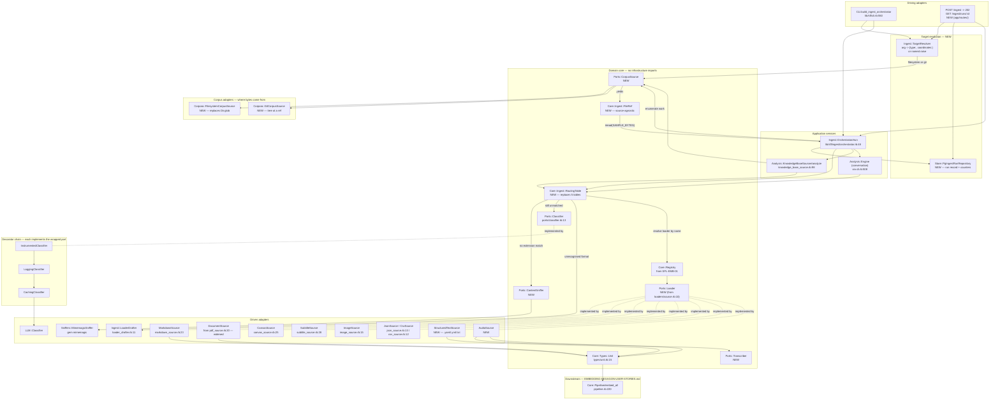

# Ingest & Parser Hexagon — Refactor User Stories

**Project**: `sfl-engine` · **Branch**: `feature/roda_api` · **Date**: 2026-09-12 · **Revised**: 2026-09-13 (rev 3)

**Rev 2 changes**: §0 is new and fixes the source set (open question 1, answered); SFL-ING-19 and
SFL-ING-20 are new; SFL-ING-13, 16 and 17 are re-scoped; R14–R16 are new; `nexo_ai` and
`ruby_llm-mcp` are removed from the Gemfile. Rev 1 content is otherwise unchanged.

**Rev 3 changes**: open question 2 is **answered** — `transcribe.cpp` with
`moss-transcribe-diarize` behind a second NDJSON sidecar. SFL-ING-14 names the adapter and the model;
SFL-ING-21 is new (the sidecar and its Compose service); R6 is rewritten and R17 is new. The
transcription cost figure is restated in **hours of audio** rather than gigabytes, because duration is
what transcription actually costs and bytes are not convertible to it.

**Scope**: absorb large, heterogeneous **sources** through the ingest and parsing subsystem, behind a
Hexagonal (ports/adapters) boundary — with the *origin of bytes* itself a port, runtime-swappable
loader and classifier Strategies resolved through the same Dynamic Registry the embedding refactor
introduces, and cross-cutting concerns applied by Middleware Decorators.

A "source" here is anything that can enumerate files and hand back their bytes. A local filesystem
folder full of all kinds of things is **one** example; a git repository is another, and it is the
example that makes the abstraction necessary rather than decorative, because a git tree has no
working directory to walk, no mtime to compare, and no path to hand `File.read`. The subsystem must
be indifferent to which source produced a file by the time that file reaches a loader.

**Companion document**: [`EMBEDDING-HEXAGON-USER-STORIES.md`](EMBEDDING-HEXAGON-USER-STORIES.md).
The two subsystems are adjacent, not independent: everything this document produces is a
`SFL::Core::Types::Unit` (`lib/sfl/core/types/unit.rb:15-23`) that flows into `Core::Pipeline`, whose
`#embed_all` (`lib/sfl/core/pipeline.rb:220-230`) is the first line of the embedding document's §1.1.
Where a contract is already decided over there — `Core::Registry` (SFL-EMB-01), the decorator chain
(SFL-EMB-06/07), `contextualized_text`/`prompt_version` (SFL-EMB-04/13), the single-instantiation
builder (SFL-EMB-14) — this document **consumes** that decision and says so, rather than re-deriving
it.

**Evidence policy**: every `path:line` below was read from the working tree or resolved through a
codebase-memory graph call (see §7). Anything the architecture needs that is not in the tree is
labelled **does not exist yet**.

**The test source's profile.** `~/Notebook` is the **designated integration-test source** for this
subsystem (§0.6) — chosen because it contains a little of everything, so a single walk exercises
nearly every routing branch at once. It is **not** "the corpus" and **not** a sizing baseline. Its
value is the shape of the variety, not the totals. Measured 2026-09-13 with `find . -type f -not -path '*/.*'`; the
exclusion rule is stated so a reader can reproduce it: **dot-directories excluded**, which removes
Obsidian's own `.obsidian/` configuration tree and any `.git` object store — exactly the noise a
filesystem adapter must learn to exclude (SFL-ING-17).

~3,604 files, of which ~2,100 markdown, ~430 YAML (`.yaml` + `.yml`), 238 PDF, 231 PNG, 197
audio/video files totalling 6.42 GB and — the figure that actually matters — **34.4 hours of audio**
(§4a), 30 `.ass` subtitle files, 29 Obsidian `.canvas`, 25 `.base`,
and a long tail including office formats (4 `.docx`, 3 `.odt`, 1 `.pptx`), `.csv`, `.jsonl`, `.srt`,
`.j2` templates, and extensionless files. Counting *with* dot-directories included roughly doubles
the file count — which is the measurement lesson rather than a fact about the vault: **the same
directory yields two different answers depending on an adapter policy**, so that policy belongs in a
named, testable adapter rather than in an orchestrator's `Dir.glob`.

That vault also carries five distinct ignore-file conventions at or near its root — `.gitignore`,
`.ckignore`, `.graphifyignore`, `.geminiignore`, `.cbmignore` — which is itself evidence that "which
files count" is a source-level policy question with no single universal answer, and therefore adapter
state rather than orchestrator logic.

**No per-run LLM-call count or cost figure is derived from these numbers anywhere in this document.**
With a second source adapter in the picture such arithmetic does not generalise; SFL-ING-10's
instrumentation is the way to learn it per run and per source. No corpus figure of any kind exists in
the repository (see open question 1).

---

## 0. Source Scope — decided

**This section answers open question 1 and supersedes any reading of the document that treats the
source set as undetermined.** Rev 1 named a filesystem vault and a git repository because those were
the two the request named, and listed archives, remote exports and object storage as unknowns. They
are now decided. Four of the five decisions below are subtractive, which is why rev 2 removes two
gems and adds none.

### 0.1 What `sfl-engine ingest <target>` accepts

One argument, resolved to exactly one `Core::Ports::CorpusSource` adapter. Two adapters ship.

| Target form | Yields | Adapter | Status |
|---|---|---|---|
| `~/Notebook` — a directory | many `FileRef`s, lazily | `Corpora::FilesystemCorpusSource` | SFL-ING-17 — build |
| `~/Documents/scratchpad.md` — one file | one `FileRef` | same adapter, root-is-a-file branch | SFL-ING-17 — build |
| `~/Images/screenshot.png` — one image | one `FileRef`, images forced on | same adapter | SFL-ING-17 — build |
| `https://github.com/b08x/dots`, `git@…`, a local `.git` | tree at one ref | `Corpora::GitCorpusSource` | SFL-ING-18 — build |
| `https://docs.example.com/usage` — a web page or site | — | — | **deferred** — port-compatible, unbuilt |
| an MCP server's resources | — | — | **deferred** — port-compatible, unbuilt |

**Single-file ingest is not new work, and the code already proves it.** `Ingest::Orchestrator#run`
is documented as *"a single file, or a directory walked recursively"*
(`lib/sfl/ingest/orchestrator.rb:46-47`) and `#files` returns `[path]` unchanged when
`File.directory?` is false (`:59-63`). `~/Documents/scratchpad.md` works today. What the refactor
owes it is **preservation**, which is an acceptance criterion on SFL-ING-17, not a story of its own.

### 0.2 Resolution is explicit, never guessed

`SFL::Ingest::TargetResolver` (SFL-ING-19) maps the CLI argument or the HTTP request body to
`{type:, coordinates:}` by a stated rule order, and **raises a named error listing the rules tried**
when nothing matches. Both driving adapters call it; neither constructs a `CorpusSource` itself.

A deferred source must fail **by name**. `https://docs.example.com/usage` has to produce *"https
targets other than git remotes are not supported"* — not an `ENOENT` from falling through to
`File.directory?`, which is what would happen if the resolver did not exist. That named failure is
also the seam a web adapter later plugs into.

### 0.3 The deferrals, stated so they stay reviewable

- **Web sources — deferred.** Ingesting a docs site needs an HTTP client, an HTML-to-text loader, and
  a traversal policy (one page, a bounded same-origin crawl, or a sitemap enumeration). None of the
  three exists in `Gemfile` or `lib/`, and choosing among the three traversal semantics is unforced
  until there is a specific site to ingest. Deferring costs nothing structurally: a web adapter is a
  `CorpusSource` like any other, and §0.2's resolver already has the branch that will name it.
- **MCP connectors — deferred, and this is a deferral of work rather than of feasibility.**
  `ruby_llm-mcp` exposes `Resource` and `ResourceTemplate` alongside `Tool` and `Prompt`
  (`ruby_llm-mcp-1.0.1/lib/ruby_llm/mcp/resource.rb`), and MCP's `resources/list` + `resources/read`
  map almost literally onto `#each_ref` + `#read(limit)`. An `MCPCorpusSource` would satisfy the
  shared `"a corpus source"` group unmodified and need **no new port**. What it would need is a
  reason, and there is not one yet. Recorded here as an unbuilt adapter, not as an open question.
- **Agentic classification — rejected for this phase.** The determination the request described —
  *is this an LLM chat log or a knowledge-base article* — already exists and already returns exactly
  that answer: `DeterministicRules.classify` returns `mode: "conversation"` or
  `mode: "knowledge_base"` (`lib/sfl/ingest/deterministic_rules.rb:30-39`), falling through to
  `Ports::Classifier` (`lib/sfl/core/ports/classifier.rb:13`) and then to `LoaderDrafter`. The ladder
  is the determination module. `nexo_ai`'s distinguishing features — durable workflows, sessions,
  tool loops, sandboxes — address **run-level orchestration**, not single-shot labelling, and
  SFL-ING-20's run record covers that need with one database row instead of a framework.

### 0.4 Consequence: the Gemfile shrinks

`gem "nexo_ai", "~> 0.11.0"` (`Gemfile:52`) and `gem "ruby_llm-mcp", "~> 1.0"` (`Gemfile:54`) are
both **removed**. Both are uncommitted additions on this branch with zero call sites, so removal is a
Gemfile edit and a `bundle lock`, not a code change. Against §3's one adopted addition
(`mimemagic`), rev 2 is net **minus one** dependency.

This does not disturb §3: neither gem appears in `injest_parser_refactor_gemlist.json`, so no verdict
in that table changes. Open question 6's separate observation about `jsonl` (`Gemfile:260`) and
`image_processing` (`Gemfile:202`) is unaffected and still open.

### 0.5 What this section changes elsewhere

| Story | Change in rev 2 | Points |
|---|---|---|
| SFL-ING-16 | port gains `#stats`; the per-loader `FileRef` conversion is folded into its definition of done | 5 → **13** |
| SFL-ING-17 | gains `include_images:` and the root-is-a-file branch; reports `stats` | 8 → **10** |
| SFL-ING-13 | `POST /ingest` becomes 202-plus-run-record; body carries a source descriptor, not a path | 5 → **13** |
| SFL-ING-09 | run counters merge the adapter's `stats` | 5 (unchanged) |
| **SFL-ING-19** | **new** — `Ingest::TargetResolver` | **3** |
| **SFL-ING-20** | **new** — ingest run record and background execution | **8** |
| SFL-ING-14 | *(rev 3)* backend named: `transcribe.cpp` + `moss-transcribe-diarize`; ffmpeg precondition; split-above-threshold policy | 8 → **13** |
| **SFL-ING-21** | **new** *(rev 3)* — the transcribe sidecar and its Compose service | **8** |

Open questions 2 (transcription) and 9 (git commit ranges) are untouched; neither is in this phase.

### 0.6 `~/Notebook` is the integration-test source

The vault is **promoted from illustration to fixture**. It is the source an integration run is pointed
at to prove the subsystem end to end, and it earns that role by being heterogeneous rather than by
being large: ~2,100 markdown, ~430 YAML, 238 PDF, 231 PNG, 197 audio/video, 30 `.ass`, 29 `.canvas`,
25 `.base`, plus office formats, `.csv`, `.jsonl`, `.srt`, `.j2` and extensionless files — and five
competing ignore-file conventions at its root. One walk therefore touches the extension tier, the
sniff tier, the classifier tier, the `unsupported_format` path, the image opt-in, the ignore-file
policy and the dot-directory policy **in a single run**.

What this does and does not license:

- **It is a source, not an assertion.** Integration runs against it check *invariants* — that
  `total_seen` plus `#stats` reconciles (R14), that two runs enumerate identically (SFL-ING-16), that
  a second run issues zero classifier calls (SFL-ING-10), that no `File.*` is called on a ref. None of
  those depends on a file count, so none of them breaks when the vault changes underneath.
- **No unit spec may point at it.** Every story's definition of done stays on committed fixtures and
  `Fake::CorpusSource`; a vault outside the repository cannot be a prerequisite for `bundle exec
  rspec`. Integration runs are a separate, opt-in task — skipped, with a message naming the missing
  path, when the vault is absent.
- **Its counts remain evidence about one filesystem on one date**, under the stated
  dot-directories-excluded rule. Promoting it to a test source does not promote its numbers to
  requirements, and §1.2's cost arguments still rest on structure rather than on its totals.
- **It cannot prove the port.** A single filesystem source exercises one adapter. `GitCorpusSource`
  (SFL-ING-18) remains the story that demonstrates the abstraction is real, because it shares none of
  the filesystem's assumptions. The vault proves *coverage*; git proves *generality*.

---

## 1. Context & Problem Statement

### 1.1 What already exists

This subsystem is **already partially hexagonal, and further along than the embedding path was** —
there is a loader duck every source implements, a real classification port with `NotImplementedError`
doubles, an orchestrator with per-file failure isolation, and even an LLM that writes new loaders for
formats nothing recognises. The problem is not absence of structure; it is that the *routing* layer
above the loaders was never given a home, so it grew five copies.

**The loader duck (a port by convention, not by namespace)** — `SFL::Core::Loaders::Source`,
`lib/sfl/core/loaders/source.rb:10-21`. `#each_unit` raises `NotImplementedError` naming the class
(`:13-15`) exactly as the `Core::Ports::*` modules do; `#units` is the free method built on it
(`:18-20`). Its docstring states the contract: *"turn a file into a stream of Types::Unit"* (`:6-9`).

`trace_path(function_name: "each_unit")` returns **13 implementers**, which is the authoritative
enumeration used throughout this document:

| Implementer | File | Shape |
|---|---|---|
| `Core::Loaders::Source` | `lib/sfl/core/loaders/source.rb:10` | the contract itself |
| `Core::Loaders::MarkdownSource` | `lib/sfl/core/loaders/markdown_source.rb:23` | section |
| `Core::Loaders::PdfSource` | `lib/sfl/core/loaders/pdf_source.rb:20` | chunk |
| `Core::Loaders::CanvasSource` | `lib/sfl/core/loaders/canvas_source.rb:25` | node |
| `Core::Loaders::ImageSource` | `lib/sfl/core/loaders/image_source.rb:15` | whole-file description |
| `Core::Loaders::SubtitleSource` | `lib/sfl/core/loaders/subtitle_source.rb:28` | turn |
| `Core::Loaders::ChatgptExportSource` | `lib/sfl/core/loaders/chatgpt_export_source.rb:25` | turn |
| `Core::Loaders::ClaudeExportSource` | `lib/sfl/core/loaders/claude_export_source.rb` | turn |
| `Core::Loaders::MistralExportSource` | `lib/sfl/core/loaders/mistral_export_source.rb` | turn |
| `Core::Loaders::JsonSource` | `lib/sfl/core/loaders/json_source.rb:13` | record |
| `Core::Loaders::CsvSource` | `lib/sfl/core/loaders/csv_source.rb:12` | row |
| `Analysis::ConversationSource` | `lib/sfl/analysis/conversation_source.rb:21`, `include Core::Loaders::Source` at `:22` | turn |
| `Analysis::DocumentationSource` | `lib/sfl/analysis/documentation_source.rb:30`, `include` at `:31` | section |

The last two matter: **the loader duck already has implementers outside `Core::Loaders`**, in the
`Analysis` namespace, and both are themselves *composite* loaders that walk a directory and delegate
to other loaders (`documentation_source.rb:118`). So "a loader" is already a recursive concept in
this codebase; a registry has to accommodate that rather than assume one class per extension.

**The one boundary type** — `SFL::Core::Types::Unit`, `lib/sfl/core/types/unit.rb:15-23`, a
`Dry::Struct`. `document_id` and `text` are required (`:16-17`); `heading`/`speaker`/`is_user`/
`sent_at` are optional and populated only by the source shape that has them (`:18-21`); `metadata` is
a free Hash defaulting to `{}` (`:22`). Its own comment records why it exists: five loaders had
independently reproduced an ad-hoc `{name:, mes:, send_date:}` turn Hash with no shared constructor
(`:8-12`). **This is the seam with the embedding document** — `Unit` is what
`Core::Pipeline#compile` consumes and what eventually reaches `embedder.embed_batch`
(`lib/sfl/core/pipeline.rb:225`). Nothing in this document changes `Unit`'s shape.

**Deterministic classification** — `SFL::Ingest::DeterministicRules`,
`lib/sfl/ingest/deterministic_rules.rb:12-69`. Free/instant, extension-keyed:
`NATIVE_CHAT_EXTENSIONS = %w[.jsonl .srt .vtt .ass]` (`:13`), `KB_EXTENSION_FORMATS` and
`KB_EXTENSION_SOURCE_TYPES` for `.md .canvas .pdf` (`:15-25`), images and `.json` delegated (`:35`,
`:36`). `#classify` returns `nil` for "no deterministic match, fall through to the classifier"
(`:28-29`, `:38`).

**LLM classification (a real port)** — `SFL::Core::Ports::Classifier`,
`lib/sfl/core/ports/classifier.rb:13-22`, `#classify(sample, path)` with a `NotImplementedError` body
(`:19-21`) returning `Core::Types::ClassificationResult`. Its comment states the intended cost
profile precisely: *"this port exists for the ambiguous/new-format tail, not the common case"*
(`:10-12`). `Null::Classifier` and `Fake::Classifier` both exist
(`lib/sfl/core/ports/null/classifier.rb`, `lib/sfl/core/ports/fake/classifier.rb`).

**Orchestration** — `SFL::Ingest::Orchestrator`, `lib/sfl/ingest/orchestrator.rb:18-163`.
`SAMPLE_BYTES = 4096` (`:23`) and `CONFIDENCE_THRESHOLD = 0.6` (`:28`) are both documented as
"start as a constant, tune later" (`:21-22`, `:27-28`). `#run` walks (`:48-53`), `#files` globs a
**local directory tree specifically** (`:58-62`), `#classify` tries deterministic first then the LLM
(`:82-88`) after reading a sample with `File.read(file, SAMPLE_BYTES)` (`:86`), `#dispatch_or_review`
branches three ways (`:94-104`), `#dispatch` fans out to the conversation engine, the documentation
source, or `kb_source.analyze` (`:115-121`). Per-file failure isolation is typed and deliberate:
`rescue Analysis::Error, Core::Loaders::Error, Store::Error, SystemCallError` at `:76`, with a
ten-line rationale at `:64-70` naming F11 and the concurrent-writer case `SystemCallError` exists for.

**Dynamic loader generation** — `SFL::Ingest::LoaderDrafter`, `lib/sfl/ingest/loader_drafter.rb:11`.
When neither deterministic rules nor the classifier recognise a file, a `DSPy::Predict` over
`LLM::Signatures::LoaderDraftSignature` (`:19-21`) **writes a candidate loader class** into
`lib/sfl/core/loaders` (`:17`) and a review doc into `docs/ingest-review`, recorded via
`Store::PgIngestReviewRepository` (`lib/sfl/cli.rb:555`). This is the genuinely dynamic edge of the
system and the reason a *registry* is the right shape: a drafted loader has to be registerable
without editing a `case` statement.

**Knowledge-base dispatch** — `Analysis::KnowledgeBaseSource`,
`lib/sfl/analysis/knowledge_base_source.rb:50-348`. `TEXT_EXTENSIONS = %w[.md .canvas .pdf]` (`:53`),
`IMAGE_EXTENSIONS` aliased from `ImageSource::SUPPORTED_EXTENSIONS` (`:54`). `#collect_files`
pre-filters the directory walk by extension (`:157-167`). `#loader_for` (`:169-176`) and
`#source_type_for` (`:178-186`) are `case` statements. Construction fail-fast is deliberate:
`raise ArgumentError, "chat: is required when analyze_images: true"` (`:79`).

**Composition** — `SFL::CLI.build_ingest_orchestrator`, `lib/sfl/cli.rb:550-560`, assembles the
orchestrator from `build_conversation_engine` (`:552`), `build_kb_source` (`:553`),
`Ingest::LoaderDrafter.new` (`:554`) and `Store::PgIngestReviewRepository.new` (`:555`).

**Gems already declared and actually used on this path** (all verified by `require` line, not by
Gemfile presence): `inkmark` (`Gemfile:77` → `lib/sfl/core/loaders/markdown_source.rb:3`),
`pragmatic_tokenizer` (`Gemfile:78` → `markdown_source.rb:4`), `yajl-ruby` required as `"yajl"`
(`Gemfile:81` → `json_source.rb:3`, `chatgpt_export_source.rb:3`), `json_canvas` (`Gemfile:84` →
`canvas_source.rb:3`), `kreuzberg` (`Gemfile:87` → `pdf_source.rb:3`), `csv` (`Gemfile:74`, with the
inline note *"no longer a default gem as of Ruby 3.4, for CsvSource"* → `csv_source.rb:3`).

### 1.2 What is missing

1. **The orchestrator hardcodes "a local POSIX directory tree" as the only possible origin of
   bytes.** `Ingest::Orchestrator#files` (`lib/sfl/ingest/orchestrator.rb:58-62`) is
   `return [path] unless File.directory?(path)` followed by
   `Dir.glob(File.join(path, "**", "*")).select { |p| File.file?(p) }.sort` (`:61`).
   `Analysis::KnowledgeBaseSource#collect_files` (`:157-167`) independently hardcodes the same
   assumption with its own `Dir.glob` (`:161`). The component that should be the *most*
   source-agnostic thing in the subsystem — the one whose entire job is "classify and dispatch
   whatever arrives" — cannot be pointed at a git repository, a remote export, or an archive without
   editing the orchestrator itself. That is precisely the coupling a hexagon exists to remove, and
   there is **no `Core::Ports::CorpusSource` — it does not exist yet** (`grep -rn "CorpusSource"
   lib/ app/` → zero; `ls lib/sfl/core/ports/` lists 16 files, none of them a corpus source).

   The leak is not confined to traversal. Two further contracts assume a filesystem:

   - **Identity.** `KnowledgeBaseSource#load_all_units` reads `File.mtime(file)`
     (`lib/sfl/analysis/knowledge_base_source.rb:146`) and pairs it with the path. A git blob has a
     SHA and **no meaningful mtime**; a tree at a ref has no working directory to `stat`. Any
     skip-unchanged or incremental story keyed on path+mtime is therefore unimplementable against a
     second adapter.
   - **Reading bytes.** `Ingest::Orchestrator#classify` does `File.read(file, SAMPLE_BYTES)`
     (`lib/sfl/ingest/orchestrator.rb:86`) and `ChatExportExpander#parse_json_with_context` does
     `JSON.parse(File.read(path))` (`lib/sfl/analysis/chat_export_expander.rb:50`). Both bypass any
     source abstraction. **A git-tree adapter has no path to hand `File.read`** — the blob exists
     only inside the object database until something asks for it.

   This finding and the next are co-equal and interlocking: one says the system cannot describe
   *where* bytes come from, the other says it cannot agree on *what to do* with them once they
   arrive. Neither is fixable in isolation — see R12 for the sequencing constraint that falls out.

2. **Five independent extension-routing tables, and they disagree.** Each of the following
   independently answers "which loader/mode handles this file", and
   no two agree on the same set:

   | # | Routing surface | Location | Extensions it knows |
   |---|---|---|---|
   | 1 | `Ingest::DeterministicRules.classify` | `lib/sfl/ingest/deterministic_rules.rb:30-39` | `.jsonl .srt .vtt .ass` · `.md .canvas .pdf` · images · `.json` |
   | 2 | `KnowledgeBaseSource#loader_for`/`#source_type_for` | `lib/sfl/analysis/knowledge_base_source.rb:169-186`, table at `:53` | `.md .canvas .pdf` + images |
   | 3 | `CLI.gather_conversation_files` | `lib/sfl/cli.rb:317`, `:320`, `:328` | `.jsonl .srt .vtt .ass` · `.json` · `.md .txt .rtf .csv .tsv .log` |
   | 4 | `Analysis::DocumentationSource#files` | `lib/sfl/analysis/documentation_source.rb:118`, `:125` | `*.{md,pdf}` |
   | 5 | `Analysis::ConversationSource` | `lib/sfl/analysis/conversation_source.rb:33`, `:71-72` | `.srt .vtt .ass` (modality flag) · `.jsonl` (else raise) |

   Concrete disagreements, each reachable today: `.txt` is ingestible through surface 3
   (`lib/sfl/cli.rb:328`) and invisible to surfaces 1, 2 and 4 — 28 files in the corpus.
   `.csv` likewise (`cli.rb:328`), despite `CsvSource` existing (`lib/sfl/core/loaders/csv_source.rb:12`)
   — 11 files. `.canvas` is known only to surfaces 1 and 2 — 29 files. `.ass`/`.vtt` reach
   `SubtitleSource` only through surfaces 1, 3 and 5, never through the knowledge-base path, so a
   subtitle file in a vault directory is classified `chat_native` and routed to the conversation
   engine regardless of what the surrounding vault is — 30 `.ass` files and 5 `.srt` files here.
   `.rtf .tsv .log` appear at `cli.rb:328` and nowhere else, and there are **zero** of any of them in
   this corpus — routing capacity that exists for no file that exists.

   Surfaces 1 and 2 are not even cleanly independent, which makes it worse rather than better:
   `DeterministicRules` reads `Analysis::KnowledgeBaseSource::TEXT_EXTENSIONS` at
   `lib/sfl/ingest/deterministic_rules.rb:34` and `Core::Loaders::ImageSource::SUPPORTED_EXTENSIONS`
   at `:35`. So `SFL::Ingest` — the classification layer — reaches *into* an `Analysis` adapter and a
   `Core::Loaders` adapter for its own vocabulary. Widening `KnowledgeBaseSource::TEXT_EXTENSIONS`
   silently widens deterministic classification across the whole ingest run, and the dependency
   arrow points the wrong way for a hexagon.

3. **No `Core::Ports::Loader` module.** `grep -rn "Ports::Loader" lib/ app/` returns **zero**;
   `ls lib/sfl/core/ports/` lists 16 `.rb` files and neither `loader.rb` nor `source.rb` is among
   them. `Core::Loaders::Source` fills the port role by convention only, and unlike every other port
   it has **no `Null` or `Fake` double** — `lib/sfl/core/ports/null/` holds 12 files and
   `lib/sfl/core/ports/fake/` holds 5, none of them a loader. A **port module matching the
   `Core::Ports::*` convention does not exist yet**.

4. **`.json` classification reads and fully parses every file to sniff one key.**
   `DeterministicRules.classify_json_export` (`lib/sfl/ingest/deterministic_rules.rb:60-68`) calls
   `Analysis::ChatExportExpander.detect_format`, whose `#parse_json_with_context` is
   `JSON.parse(File.read(path))` (`lib/sfl/analysis/chat_export_expander.rb:49-53`) — the whole file,
   into memory, with no streaming — to answer `first.key?("mapping")` / `first.key?("chat_messages")`
   (`:43-44`). Against this corpus that is 3,692 files, 65.7 MB, including six files over 1 MB and one
   at 7.29 MB, parsed in full to read one key. The malformed-JSON path is handled correctly
   (`rescue Core::Loaders::Error` → `nil` → fall through to the LLM classifier,
   `deterministic_rules.rb:66-67`), so this is a cost defect, not a correctness one.

5. **The walk materialises everything, filters nothing, and cannot report progress.**
   `Ingest::Orchestrator#files` is
   `Dir.glob(File.join(path, "**", "*")).select { |p| File.file?(p) }.sort`
   (`lib/sfl/ingest/orchestrator.rb:61`) with **no extension pre-filter** — contrast
   `KnowledgeBaseSource#collect_files`, which does filter
   (`lib/sfl/analysis/knowledge_base_source.rb:158-163`). Three separable defects sit in that one
   line: every entry is `stat`ed via `File.file?` before any classification happens; the whole array
   is built and sorted before the first file is touched, so nothing can report progress or start
   work early on a large source; and every non-matching file then proceeds to
   `File.read(file, SAMPLE_BYTES)` and a paid classifier call (`:86-87`) even when **no possible
   classifier answer leads to a loader that exists** — audio, video, stylesheets and scripts all
   reach the LLM only to end at `LoaderDrafter` or the review queue.

   The magnitude is deliberately left unquantified here. It depends entirely on which source is
   being walked and under which exclusion policy — the same directory answers differently with and
   without dot-directories, and a git adapter would answer differently again. SFL-ING-10's
   instrumentation is what turns this into a measured per-run fact; SFL-ING-04 and SFL-ING-09 are
   what reduce it.

6. **Classification is 100% extension-based; there is no content sniffing.**
   `grep -rni "mime" lib/ app/ --include=*.rb` returns **zero**. Every routing decision in the table
   above keys on `File.extname`. A file with a wrong or missing extension — 24 extensionless files in
   this corpus — is only recoverable through the LLM classifier's 4 KB sample
   (`lib/sfl/ingest/orchestrator.rb:86`), i.e. at the most expensive tier available.

7. **Two different per-file rescue policies.** `Orchestrator#process` rescues a typed list
   (`lib/sfl/ingest/orchestrator.rb:76`) with a documented rationale (`:64-70`).
   `KnowledgeBaseSource#load_all_units` rescues bare `rescue => e` and `warn`s
   (`lib/sfl/analysis/knowledge_base_source.rb:152-154`). The bare rescue swallows `NoMethodError`,
   `NameError` and `Interrupt`-adjacent programmer errors as "skipping this file", so a genuine bug
   in a loader presents as a per-file warning across a multi-thousand-file run rather than a failure.

8. **A stale citation inside the isolation rationale.** `lib/sfl/ingest/orchestrator.rb:66` cites
   *"lib/sfl/cli.rb:225-233"* as the precedent for its per-file rescue. On the current working tree
   `lib/sfl/cli.rb:225-226` is the `LLM::Error` arm of `CLI.run`'s **top-level** rescue; the per-file
   rescue it means is at `lib/sfl/cli.rb:249-252`, inside `run_conversation`'s `files.each`. The
   principle cited is real and correctly applied — only the line reference drifted.

9. **`build_ingest_orchestrator` constructs the entire pipeline twice.** This is the ingest-side
   instance of the defect SFL-EMB-14 fixes in `API::Context`, and it is worse here.
   `lib/sfl/cli.rb:550-560` calls `build_conversation_engine` (`:552`) and `build_kb_source` (`:553`).
   Each of those independently calls `build_collaborators` (`lib/sfl/cli.rb:503` and `:530`) and
   `build_pipeline` (`:504` and `:531`), and `build_ingest_orchestrator` calls `build_collaborators`
   a **third** time at `:551`. Since `build_pipeline` constructs `Store::PgClauseStore` (`:494`),
   `Store::PgEmbeddingStore` (`:495`), the embedder (`:496`) and the cache (`:497`) inline, a single
   ingest run holds **two `Core::Pipeline` instances, two clause stores, two embedding stores, two
   caches, and three `TimingInstrumenter`s** (`lib/sfl/cli.rb:565`). The irony is recorded in the file's
   own header: `lib/sfl/cli.rb:34` describes `build_pipeline` as *"the one wiring factory that
   replaces what used to be 4x duplicated"*. De-duplicating the **definition** left the
   **invocation** duplicated — which is the same lesson [SFL-EMB-14](EMBEDDING-HEXAGON-USER-STORIES.md)
   draws about hoisting one line instead of fixing the class of defect. Today the visible cost is a
   split timing report. After SFL-EMB-06 lands a **caching** embedder decorator, two pipelines means two
   caches over one corpus — halved hit rate on exactly the run where cache hit rate matters most.

10. **No loader for 432 `.yaml`/`.yml` files.** `grep -rniE "\.yaml" lib/ app/ --include=*.rb`
   returns **zero**; the only `.yml` hits are `lib/sfl/docker_services.rb:4` and `:21`, both
   `docker-compose.yml`. YAML is parsed exactly once in the codebase and only for markdown
   frontmatter: `require "yaml"` inline at `lib/sfl/core/loaders/markdown_source.rb:112` and
   `YAML.safe_load(..., permitted_classes: [Time, Date, Symbol])` at `:113`. A **YAML loader does not
   exist yet**.

11. **No loader for 25 `.base` files.** `grep -rniE "\.base\b" lib/ app/ --include=*.rb` returns
    **zero**. Obsidian Bases is a real format with 25 files in this corpus and **no loader exists
    yet**. It is also the one gap in this document that **no gem in §3 addresses** — saying so
    plainly is better than forcing `parseconfig` or `json_canvas` onto a format neither targets.

12. **No transcription path at all.** `grep -rniE "whisper|AudioSource|\.mp3|\.wav|\.m4a" lib/ app/
    --include=*.rb` returns **zero** for every term. 197 media files — **34.4 hours of audio**
    measured with `ffprobe` across the 191 with readable duration (§4a) — have no ingest route. A
    `Core::Ports::Transcriber` and an `AudioSource` **do not exist yet**. The backend that fills them
    is named in §4 and built by SFL-ING-14 and SFL-ING-21.

13. **`kreuzberg` is used at a fraction of its capability, and the code says so.**
    `PdfSource` calls `Kreuzberg.extract_file_sync(path:, config:)`
    (`lib/sfl/core/loaders/pdf_source.rb:43`) with `Kreuzberg::Config::Extraction.new(chunking:)`
    (`:42`) — **nothing in that call is PDF-specific**. `KnowledgeBaseSource`'s own header records the
    deferral verbatim: legacy routed `.docx/.xlsx/.pptx/.html` through the same loader, and this
    codebase declined *"because extending its use to those four other extensions here would be an
    unverified assumption about kreuzberg's dispatch, not a verified port; a later slice can widen
    TEXT_EXTENSIONS once a spec fixture proves it out"*
    (`lib/sfl/analysis/knowledge_base_source.rb:26-33`). SFL-ING-07 is that later slice.

14. **Four hand-rolled JSONL implementations, and the `jsonl` gem is unused.** `gem "jsonl"` at
    `Gemfile:260` has **zero call sites**: `grep -rn "JSONL\.\|Jsonl\." lib/` returns nothing, and
    every `jsonl` string in `lib/` is either a file extension or a method name. Reading and writing
    are hand-rolled in four places — `lib/sfl/core/loaders/json_source.rb:67-70` (`Yajl::Parser` per
    line), `lib/sfl/analysis/conversation_source.rb:81-87` (`JSON.parse` per line with a
    `JSON::ParserError` filter), `lib/sfl/analysis/dynamic_format_expander.rb:267-271`
    (`io.puts(JSON.dump(...))`), and `lib/sfl/analysis/chat_export_expander.rb:86-88` (same). Note
    this corrects a plausible-looking prior: the gem is declared, so it reads as adopted; it is not.

15. **Two subtitle formats are hand-parsed while gems for both sit in the candidate list.**
    `SubtitleSource#parse` dispatches `.srt`/`.vtt`/`.ass` to three private parsers
    (`lib/sfl/core/loaders/subtitle_source.rb:62-69`), e.g. `#parse_srt` splitting on blank lines and
    matching `SRT_TIMECODE` (`:71`, `:75-80`). §3 rows 10 and 13 evaluate replacing them and decline;
    the reason is in §3, not here.

16. **No ingest spec coverage for the routing layer's disagreements.** `spec/ingest/` holds exactly
    `deterministic_rules_spec.rb` and `orchestrator_spec.rb`; `spec/core/loaders/` holds one spec per
    loader plus `source_spec.rb`. Nothing asserts that surfaces 1–5 agree, because there is no single
    object to assert against.

---

## 2. Target Architecture

**Bounded contexts** (existing module names kept): `SFL::Core` = domain + ports + loaders;
`SFL::Ingest` = ingest application services; `SFL::Analysis` = analysis application services and
composite sources; `SFL::LLM` = inference driven adapters; `SFL::Store` = persistence driven
adapters; `SFL::CLI` + `Sfl` (Roda) = driving adapters.

### 2.1 Ports and adapters

| Port | Responsibility | Driven / driving | Concrete adapters | Backing gem | Status |
|---|---|---|---|---|---|
| `Core::Ports::CorpusSource` | a source → lazy enumerable of `FileRef` | driven | `Ingest::Corpora::FilesystemCorpusSource` (SFL-ING-17); `Ingest::Corpora::GitCorpusSource` (SFL-ING-18); `Null::CorpusSource` (empty); `Fake::CorpusSource` (scripted refs) | none | **does not exist yet** — today hardcoded as `Dir.glob` at `lib/sfl/ingest/orchestrator.rb:61` and `lib/sfl/analysis/knowledge_base_source.rb:161` |
| `Core::Ports::Loader` | file → stream of `Types::Unit` | driven | every class in the 13-implementer table in §1.1; `Null::Loader` (empty stream), `Fake::Loader` (scripted units) | none / per-format | **port module does not exist yet**; `Core::Loaders::Source` (`lib/sfl/core/loaders/source.rb:10`) is promoted into it |
| `Core::Ports::Classifier` | sample + path → `ClassificationResult` | driven | `LLM::Classifier`; `Null::Classifier`; `Fake::Classifier` | `dspy` | exists (`lib/sfl/core/ports/classifier.rb:13`) |
| `Core::Ports::ContentSniffer` | path + magic bytes → MIME type | driven | `Ingest::Sniffers::MimemagicSniffer`; `Null::ContentSniffer` (always `nil`) | `mimemagic` | **does not exist yet** |
| `Core::Ports::Transcriber` | audio path → transcript with speaker turns | driven | `Null::Transcriber`; a real adapter behind an injected client, mirroring `ImageSource`'s injected `chat:` (`lib/sfl/core/loaders/image_source.rb:32`) | none in §3 | **does not exist yet** |
| `Core::Ports::Cache` | memoize by content key | driven (cross-cutting) | `Core::Ports::FileCache` (`lib/sfl/core/ports/file_cache.rb:23`, `DEFAULT_CACHE_DIR` at `:26`) | none | exists — **scoped to Pass 2 annotations today** (`:9-13`); SFL-ING-10 adds a second, separately-keyed use, it does not repurpose the first |
| `Core::Ports::Instrumenter` | named span around a call | driven (cross-cutting) | `Core::Ports::TimingInstrumenter` | `dspy-o11y-langfuse` | exists |
| `Core::Ports::Logger` | structured logging | driven (cross-cutting) | `StderrLogger` (`lib/sfl/cli.rb:564`), `Null::Logger` (`lib/sfl/ingest/orchestrator.rb:35`) | none | exists |
| CLI entry | `sfl-analyze ingest` | **driving** | `SFL::CLI.build_ingest_orchestrator` (`lib/sfl/cli.rb:550`) | `thor` | exists |
| HTTP entry | submit/inspect an ingest run | **driving** | `Sfl` Roda app (`app/sfl.rb:1`), new route under `app/routes/` | `roda` (`Gemfile:139`) | route **does not exist yet** |
| `Core::Ports::CorpusSource` *(deferred adapters)* | same port, sources not built this phase | driven | a web adapter (fetch + HTML→text + a traversal policy); an MCP adapter over `resources/list`/`resources/read` | none adopted | **deferred by decision** — §0.3. Neither needs a port change; both are listed so the port's generality is claimed against named adapters rather than against "anything" |

New domain-core collaborators (zero infrastructure imports):

- `SFL::Core::Ingest::RoutingTable` — `lib/sfl/core/ingest/routing_table.rb` — **does not exist yet**.
  The single answer to "extension (or MIME type) → `{format:, mode:, source_type:, loader:}`", built
  once at boot and consulted by every surface in §1.2 gap 2.
- `SFL::Core::Loaders::Catalog` — `lib/sfl/core/loaders/catalog.rb` — **does not exist yet**.
  `.register_into(registry)`, populating a `Core::Registry` with one factory per loader — the
  registry contract from [SFL-EMB-01](EMBEDDING-HEXAGON-USER-STORIES.md), reused verbatim, **not**
  re-specified here.
- `SFL::Core::Ingest::FileRef` — `lib/sfl/core/ingest/file_ref.rb` — **does not exist yet**.
  The source-agnostic reference a `CorpusSource` yields and everything downstream consumes:
  `{name:, extension:, content_identity:, size_bytes:, mtime: nil, source_id:}` plus `#read(limit = nil)`.
  Deliberately **not** a path — a git blob has no path in a working directory, and `name` is a
  display/identity string rather than something `File.read` can be handed. `content_identity` is
  supplied *by the adapter* (mtime+size for the filesystem, blob SHA for git); `mtime` is optional
  precisely because git has no meaningful one. Precedent for a `Dry::Struct` value in `Core`:
  `lib/sfl/core/types/unit.rb:15`.
- `SFL::Core::Decorators::{Logging,Caching,Instrumented}Classifier` — `lib/sfl/core/decorators/` —
  **does not exist yet**. Each `include`s `Core::Ports::Classifier`. Same chain contract as
  [SFL-EMB-06/07](EMBEDDING-HEXAGON-USER-STORIES.md), same directory.
- `SFL::Ingest::TargetResolver` — `lib/sfl/ingest/target_resolver.rb` — **does not exist yet**.
  One argument in, `{type:, coordinates:}` out, or a named raise (SFL-ING-19). It sits between the
  driving adapters and the corpus adapters so that neither the CLI nor the Roda route decides which
  adapter to construct, and so that a deferred source fails by name rather than by `ENOENT` (§0.2).

### 2.2 The hexagon

Reading order: a `CorpusSource` adapter emits `FileRef`s (SFL-ING-16/17/18); `RoutingTable` answers from the extension
(SFL-ING-03), falling back to `Ports::ContentSniffer` (SFL-ING-04) and then to the decorated
`Ports::Classifier` (SFL-ING-10), and to `LoaderDrafter` only for genuinely unrecognised shapes;
the resolved loader name is turned into an instance by `Core::Registry` (SFL-ING-02); every loader
emits `Core::Types::Unit`, which is where this document ends and
[`EMBEDDING-HEXAGON-USER-STORIES.md`](EMBEDDING-HEXAGON-USER-STORIES.md) begins.

Dependency direction: `Core` (`Types`, `Ports`, `Ingest::RoutingTable`, `Registry`, `Loaders`)
imports nothing from `Analysis`, `Store`, `LLM`, `API`, or `Sfl`. That is a **change**, not a
restatement: today `SFL::Ingest::DeterministicRules` imports `Analysis::KnowledgeBaseSource`'s
constant at `lib/sfl/ingest/deterministic_rules.rb:34`, and SFL-ING-03 reverses that arrow.

### 2.3 Decorator chain contract

Identical to the embedding document's, and deliberately so — one chain idiom, one `Chain.wrap`, one
`lib/sfl/core/decorators/` directory. Outermost first:
`Instrumented → Logging → Caching → concrete strategy`; the span encloses the cache lookup so hit
rate is observable; each decorator's constructor takes `inner:` plus its one collaborator and nothing
else; omitting a collaborator omits that layer. See
[SFL-EMB-06](EMBEDDING-HEXAGON-USER-STORIES.md) §2.3 for the full statement. This document adds
`Classifier` to the set of ports the chain can wrap (SFL-ING-10) and **does not** re-specify
`Chain.wrap`.

The one ingest-specific constraint the embedding chain does not need: a `CachingClassifier`'s key
must include the ref's `content_identity` (SFL-ING-16), because unlike a text
digest, a path is not its own content. Keying on path alone would serve a stale classification for an
edited file — the exact failure mode `Core::Ports::Cache`'s own comment guards against for
annotations (`lib/sfl/core/ports/cache.rb:9-13`).

---

## 3. Gem Disposition Table

Fifteen gems from `injest_parser_refactor_gemlist.json`. "Present" = already declared in `Gemfile` on
this branch (the Gemfile is modified but not committed; line numbers are current working-tree lines).
"Call sites" were established by `grep -rn` for each gem's top-level constant and for
`require "<gem>"` across `lib/`, `app/`, `spec/` and `bin/`.

| # | Gem | Hexagon layer | Present? | Verdict | Rationale (risk fields: invasiveness / coupling / abstraction_leak) | Story |
|---|---|---|---|---|---|---|
| 1 | `base64` | parsing/encoding | no | **reject** | 2 / 1 / low — the risk profile is harmless; the problem is that no story needs it. Nothing in this codebase encodes binary. The one binary path is `ImageSource`, which hands the vision model a **file path**, not bytes: `chat.ask(VISION_PROMPT, with: { image: @path })` (`lib/sfl/core/loaders/image_source.rb:52`). `grep -rn "Base64" lib/ app/` → zero. Adding a dependency for a need that does not exist is how the four zero-call-site gems in the embedding document's §1.2 gap 7 got there. | — (none) |
| 2 | `image_processing` | none — irrelevant | **yes, `Gemfile:202`, zero call sites** | **reject** | 3 / 1 / medium. Already rejected in [`EMBEDDING-HEXAGON-USER-STORIES.md`](EMBEDDING-HEXAGON-USER-STORIES.md) §3 row 6; this document **concurs and does not re-litigate**, but has to address it because ingest is the one place a pixel-manipulation gem could plausibly belong. It does not belong here either: `ImageSource` never touches pixels (`image_source.rb:52`), and its failure path is a text stub plus a `vision_failed: true` flag (`:54-57`), not a re-encode. Its deps `mini_magick`/`ruby-vips` would add an ImageMagick or libvips system requirement for 306 image files that are already handled. Removing it from the Gemfile remains a separate cleanup card. | — (none) |
| 3 | `json_canvas` | driven adapter (loader) | **yes, `Gemfile:84` — in use** | **adopt (already adopted) — no change** | 2 / 1 / low. Not a fresh decision: `require "json_canvas"` at `lib/sfl/core/loaders/canvas_source.rb:3`, and the loader's own comment records *why* the gem beat hand-rolled traversal — node types are classes, so "only TextNode carries prose" is `is_a?(JsonCanvas::TextNode)` rather than a string compare on a raw Hash key (`canvas_source.rb:10-16`). 29 `.canvas` files in the corpus. Nothing in this document changes it. | SFL-ING-03 (routing only) |
| 4 | `jsonl` | parsing/encoding | **yes, `Gemfile:260`, zero call sites** | **defer** | 2 / 1 / low. **Correcting a natural misreading: this gem is declared but has never been called.** `grep -rn "JSONL\.\|Jsonl\." lib/` → zero; every `jsonl` occurrence in `lib/` is a file extension or a method name. JSONL is hand-rolled four times (`json_source.rb:67-70`, `conversation_source.rb:81-87`, `dynamic_format_expander.rb:267-271`, `chat_export_expander.rb:86-88`). The duplication is real, but the four implementations are **not interchangeable** — `conversation_source.rb:82-87` deliberately skips records lacking `:mes` to survive SillyTavern group-chat header records (rationale at `:78-80`), which a generic reader would either surface as garbage turns or reject the file over. Deferred rather than adopted because consolidating onto the gem means re-deciding that filter, and consolidating onto **one internal codec** (SFL-ING-15) achieves the same de-duplication with zero dependency risk and keeps the filter where its rationale lives. Adopt only if a measured parse cost justifies it. | SFL-ING-15 (considered, not adopted) |
| 5 | `kreuzberg` | driven adapter (loader) | **yes, `Gemfile:87` — in use** | **adopt (already adopted) — widen role** | 3 / 1 / medium. Already `require`d at `lib/sfl/core/loaders/pdf_source.rb:3` and driven at `:42-43`. The decision here is not *whether* but *how wide*: the call is `Kreuzberg.extract_file_sync(path: @path, config:)` (`:43`) with `Config::Extraction.new(chunking: DEFAULT_CHUNKING)` (`:42`) — **not one PDF-specific argument**. The gem's own description claims 75+ formats including DOCX/PPTX/XLSX/HTML. The codebase already staged this exact decision and named its gate: *"a later slice can widen TEXT_EXTENSIONS once a spec fixture proves it out"* (`lib/sfl/analysis/knowledge_base_source.rb:26-33`). The medium leak is real — a Rust/Magnus native extension, so format support is a deploy-time fact — and is contained by the routing table declaring supported extensions explicitly rather than probing at runtime. Corpus payoff is modest by count (4 `.docx`, 3 `.odt`, 1 `.pptx`, 17 `.html`) but the `.pptx` alone is 14.75 MB. | SFL-ING-07 |
| 6 | `mimemagic` | driven adapter (`ContentSniffer`) | no, zero call sites | **adopt** | 3 / 1 / medium — the only **new** gem this document adopts, so the justification has to carry weight. The gap is structural, not cosmetic: `grep -rni "mime" lib/ app/` → **zero**, i.e. every routing decision in §1.2 gap 2 keys on `File.extname` alone, and 24 extensionless files in this corpus have no extension to key on. The alternative already in the tree is the LLM classifier (`lib/sfl/core/ports/classifier.rb:13`), which does cover the case — at a 4 KB read plus an inference call per file (`lib/sfl/ingest/orchestrator.rb:86-87`), against 1,575 fall-through files. A libmagic lookup is microseconds. Coupling 1 is what makes it safe: MIME string in, nothing else. The medium leak is the freedesktop XML database being a deploy-time artifact, contained by putting it behind `Core::Ports::ContentSniffer` with a `Null` adapter that returns `nil` — a deployment without the database degrades to today's extension-only behaviour, it does not fail. Its `nokogiri` dependency adds **no new transitive surface**: `nokogiri (1.19.4)` is already resolved in `Gemfile.lock:316`. | SFL-ING-04 |
| 7 | `parseconfig` | parsing/encoding | no, zero call sites | **reject** | 2 / 1 / low risk, and rejected on **fit**, not risk. The tempting target is the 432 `.yaml`/`.yml` files (§1.2 gap 9), but this gem does not parse YAML: its own role description says *"'param = value'"* with *"nested [group] sections"* — INI. Adopting it for YAML would be a category error. The corpus contains zero `.ini`/`.cfg` files. YAML is already available and already used, with a safety posture worth preserving: `YAML.safe_load(match[1], permitted_classes: [Time, Date, Symbol])` at `lib/sfl/core/loaders/markdown_source.rb:113`. SFL-ING-06 reuses that call, not this gem. | — (rejected in SFL-ING-06) |
| 8 | `rubyzip` | storage | no, zero call sites | **reject** | 4 / 1 / **high** leak — the risk fields alone demand an explicit justification to adopt, and there is none to give. The sample vault holds **5 `.zip` files** in ~3,604 (0.1%). Invasiveness 4 plus a high abstraction leak — archive entries are streams, not paths, so every loader downstream would need a path-or-IO contract it does not have today (`Core::Loaders::Source`'s implementers all take a path string, e.g. `pdf_source.rb:32-33`) — for five files is a plainly bad trade. Note also that `kreuzberg`'s description claims archive support, so if archives ever matter, the already-adopted gem is the first thing to test. | — (none) |
| 9 | `shared_tools` | driving adapter (agent tools) | no, zero call sites | **reject** | 3 / **3** / medium, but the dependency list is the disqualifier: `dentaku, nokogiri, openweathermap, ruby_llm, ruby_llm-mcp, sequel, zeitwerk`. It pulls `ruby_llm` as a **direct** dependency, and this codebase made the opposite decision deliberately and wrote it down: the Ollama embedder *"Replaces the RubyLLM embedder... to eliminate gem bloat and dependency issues"* (`lib/sfl/llm/embedder.rb:9-11`). A weather API client has no place in an ingest dependency graph. Same verdict as [`EMBEDDING-HEXAGON-USER-STORIES.md`](EMBEDDING-HEXAGON-USER-STORIES.md) §3 row 12, for the same reason. | — (none) |
| 10 | `srt` | parsing/encoding | no, zero call sites | **reject** | 2 / 1 / low risk — rejected because the job is already done, better. `SubtitleSource` parses SRT at `lib/sfl/core/loaders/subtitle_source.rb:75-80` (`SRT_TIMECODE` at `:71`), and the parse is the easy half. The valuable half is the **domain rule layered on top**: consecutive cues from one speaker merge into a single turn because a turn boundary is a speaker change and nothing else, with an explicit fallback to one synthetic speaker (`SYNTHETIC_SPEAKER` at `:33`) for formats carrying no speaker data — rationale at `:15-24`. A generic SRT gem returns cues; it cannot return SFL turns. Swapping it in would replace ~6 lines of stable parsing while leaving 100% of the merge logic, and add a dependency whose upgrades could change cue text normalisation underneath a documented invariant. 5 `.srt` files in the corpus. | — (rejected in SFL-ING-08) |
| 11 | `tty-command` | CLI/terminal | no, zero call sites | **reject** | 1 / 1 / low — the lowest-risk gem in the list, and still out of domain: it executes shell commands with pretty logging. Ingest and parsing run no subprocesses. The codebase does spawn one — the spaCy sidecar at `lib/sfl/cli.rb:483-484` — but that is Pass 1, not ingest, and already has a working parser class. A gem is rejected for having no consumer, not for being risky. | — (none) |
| 12 | `tty-file` | CLI/terminal | no, zero call sites | **reject** | 1 / 2 / low — same out-of-domain verdict, with one extra reason: its dependency list (`diff-lcs`, `pastel`, `tty-prompt`) is interactive-CLI tooling, and the file operations ingest performs are `Dir.glob` + `File.read` (`lib/sfl/ingest/orchestrator.rb:61`, `:86`). `LoaderDrafter` writes files (`lib/sfl/ingest/loader_drafter.rb:3` requires `fileutils`) and needs nothing more. | — (none) |
| 13 | `webvtt` | parsing/encoding | no, zero call sites | **reject** | 2 / 1 / low — identical reasoning to row 10, same class: `.vtt` is parsed at `lib/sfl/core/loaders/subtitle_source.rb:65` via the same `#parse` dispatch (`:62-69`), and the same speaker-merge invariant (`:15-24`) is what the gem cannot supply. Zero `.vtt` files in this corpus, which makes the case for churn weaker still. | — (rejected in SFL-ING-08) |
| 14 | `inkmark` | driven adapter (loader) | **yes, `Gemfile:77` — in use** | **adopt (already adopted) — no change** | 2 / 1 / low. Not a fresh decision: `require "inkmark"` at `lib/sfl/core/loaders/markdown_source.rb:3`, driving the documented five-step chunk/render/strip/normalise/emit pipeline at `markdown_source.rb:11-22`. It carries the single highest-volume format in the corpus by file count that actually has a loader (2,126 `.md`, 21.4 MB). Nothing in this document changes it; SFL-ING-03 only changes how files reach it. | SFL-ING-03 (routing only) |
| 15 | `refile` | storage | no, zero call sites | **reject** | 4 / 2 / **high** leak, and a direct stack conflict on top. Its dependencies are `mime-types`, `rest-client`, **`sinatra`** — a second web framework beside this project's actual `falcon` (`Gemfile:135`), `rack` (`Gemfile:136`), `roda` (`Gemfile:139`) stack. Beyond that it solves a problem this system does not have: Refile handles *uploads* into an application; ingest reads files that already exist on disk by path (`lib/sfl/ingest/orchestrator.rb:48`). Even the HTTP ingest route in SFL-ING-13 accepts a **path**, not a multipart body, precisely so no upload machinery is needed. | — (none) |

**Summary**: adopt 4 (`json_canvas`, `kreuzberg`, `inkmark` — all three already adopted and in use;
`mimemagic` — the single new dependency) · defer 1 (`jsonl`) · reject 10 (`base64`,
`image_processing`, `parseconfig`, `rubyzip`, `shared_tools`, `srt`, `tty-command`, `tty-file`,
`webvtt`, `refile`).

**A note on what this table does not solve.** Three of the largest gaps in §1.2 have **no candidate
gem at all**: `.base` / Obsidian Bases (25 files, gap 11), audio transcription (197 files, 34.4 h,
gap 12), and the 432 `.yaml`/`.yml` files (gap 10, which needs stdlib YAML, not a gem). Saying so is
the point of the table.

**Two of those three are now answered from outside the gem list, which is the lesson restated.** YAML
is served by stdlib (SFL-ING-06) and transcription by a **container image** rather than a dependency
(§4, SFL-ING-21) — neither is a row anyone could have picked from `injest_parser_refactor_gemlist.json`,
and forcing one (`parseconfig` to YAML) would have been the category error §3 row 7 rejects. The rule
that no story may add a gem this section does not mark **adopt** is therefore unchanged and
unstrained by rev 3: `transcribe.cpp` adds no gem. `.base` remains genuinely uncovered. A gem list is a menu, not a specification, and matching a gap to the
nearest-looking row — `parseconfig` to YAML, `rubyzip` to five zip files — produces worse
architecture than admitting the menu does not cover the need.

**The corpus-source port changes no verdict in this table.** SFL-ING-16/17/18 are a *structural*
change — where bytes come from — not a parsing one, and they add **no gem**. The git adapter shells
out to `git ls-tree`/`git cat-file` through Ruby's built-in `IO.popen` rather than taking a libgit2
binding, which is not in the candidate list and therefore not addable under this section's own rule.
Note also that `tty-command` (row 11) is **not** resurrected by that subprocess need: it is rejected
for being CLI-presentation tooling, and a two-call `IO.popen` wrapper inside one adapter is not the
shell-orchestration problem that gem solves.

**No story below may add a gem this section does not mark adopt.** This rule is self-contained to
this document, mirroring the same rule in
[`EMBEDDING-HEXAGON-USER-STORIES.md`](EMBEDDING-HEXAGON-USER-STORIES.md) §3.

---

## 4. Transcription Backend — decided

**This section answers open question 2.** Rev 1 defined `Core::Ports::Transcriber` and a Null adapter
but named no backend, because nothing in the repository indicated a transcription service, model or
budget. A backend is now named, verified, and measured against this vault.

### 4a. The cost figure was in the wrong unit

Rev 1 and rev 2 quoted **6.42 GB** as the transcription cost. That number is real but it is not a
cost: transcription scales with **duration**, and the bytes-to-duration ratio spans two orders of
magnitude between a 64 kbps voice memo and a screen recording. Measured 2026-09-13 with `ffprobe`
over the test vault (§0.6), across the 191 of 197 media files that report a readable duration:

| | |
|---|---|
| Total duration | **34.4 h** (123,800 s) |
| Mean per file | 10.8 min |
| Longest single file | 51 min (0.86 h) |

The command is recorded so the figure is reproducible rather than asserted:
`find . -type f -not -path '*/.*' \( -iname '*.mp3' -o … \) | xargs -P8 ffprobe -v error
-show_entries format=duration -of csv=p=0`. Six files reported no duration and are excluded; that is
stated rather than rounded away.

### 4b. `transcribe.cpp` — the adapter

[`handy-computer/transcribe.cpp`](https://github.com/handy-computer/transcribe.cpp) — MIT, C++17 over
`ggml`/GGUF, with Metal, Vulkan, CUDA, HIP/ROCm and a tinyBLAS CPU path. Adopted for one specific
reason rather than for transcribing in general:

**`moss-transcribe-diarize` emits this codebase's turn shape natively.** The model (Apache-2.0, 0.9B,
Q5_K_M ≈ 700 MB) generates the diarized format `[start][Sxx]text[end]` and the runtime parses it into
`full_text`, segment rows, speaker IDs and **speaker-turn rows**, gated by `--diarize` with
`--timestamps segment` keeping the parsed turn timing. SFL-ING-14 requires
`{speaker:, text:, start_offset:}` — which *is* `SubtitleSource`'s
`Cue = Struct.new(:speaker, :start_offset, :text)` (`lib/sfl/core/loaders/subtitle_source.rb:31`).
**A speaker-turn row is a cue.** Rev 1's claim that "a transcript is a subtitle file that has not been
written to disk" turns out to be literally true for this model, so `AudioSource` reuses the existing
cue-merge rule (`:15-24`) instead of re-deriving turn boundaries. Most ASR returns a text blob with no
speaker attribution and would have left that requirement unmet.

Length behaviour is documented and non-silent: whisper and parakeet are unbounded (windowed and
stitched internally), hard-cap families reject over-length input **before** decoding with
`TRANSCRIBE_ERR_INPUT_TOO_LONG`, and a mid-decode overrun returns `TRANSCRIBE_ERR_OUTPUT_TRUNCATED`
with the partial transcript still readable. That last case maps onto SFL-ING-14's existing
truthful-partial stance rather than needing a new one.

### 4c. A second sidecar, not a new pattern

There is no Ruby binding, so the integration is a subprocess — and the codebase already has one.
`SpacySidecarParser`'s own comment states that the transport is *"a subprocess with stdin/stdout
pipes," not specifically Python*, and names `["docker", "run", "-i", "--rm", "sfl-spacy-sidecar"]` as
an acceptable `command:` (`lib/sfl/core/pass_one/spacy_sidecar_parser.rb:11-18`). `sidecar/` already
holds a `Dockerfile`, a `README.md` and `spacy_sidecar.py`. SFL-ING-21 adds a neighbour, not a
mechanism.

**It must be a resident daemon.** `transcribe-cli` is one-shot — model load, transcribe, exit — and
reloading 700 MB for each of 191 files is the entire cost paid again. The sidecar uses the project's
Python binding, keeps the model loaded, and speaks the **same NDJSON protocol** as `spacy_sidecar.py`,
so `Core::Ports::Transcriber` gains no knowledge of how the process was launched.

### 4d. Measured on this platform class

The project publishes benchmarks for **AMD Ryzen 7 PRO 4750U / Fedora Linux 43 / Vulkan RADV RENOIR**
— the same platform family this work is being done on, which is why these are quoted rather than the
Apple M4 Max column.

| Backend | Throughput | 34.4 h of vault audio |
|---|---|---|
| Vulkan | 3.1× realtime | **~11.1 h** |
| CPU (tinyBLAS) | 1.7× realtime | ~20.2 h |

One-time, local, **no API and no per-minute billing**. The GPU path is roughly twice the CPU path and
neither is a blocker; both are opt-in by wiring (SFL-ING-14's Null adapter remains the default).

### 4e. Two constraints, both bounded and both measured

- **16 kHz mono WAV only.** The vault is `.mp3`/`.m4a`/`.mp4`/video, so an
  `ffmpeg -ar 16000 -ac 1` decode is a **precondition**, not an optimisation. It lives in the sidecar
  so that `Core::Ports::Transcriber` stays "audio in, turns out" and never learns about containers or
  codecs. `ffmpeg` and `ffprobe` are already present on this host and are a documented image
  dependency, not a new Ruby gem — §3's no-new-gems rule is untouched.
- **Peak RAM scales with clip length**, at roughly 85 MB per minute of audio. The vault's longest file
  is 51 min → **~4.4 GB peak**, against the model card's own "~5 GB for an hour". That is inside the
  envelope but not comfortably, so SFL-ING-14 splits above a duration threshold and stitches. 4.4 GB
  is a measured number for this vault, not a hypothetical ceiling — see R17.

### 4f. What this does *not* resolve

R6 said transcription and per-chunk enrichment compound multiplicatively and that neither had a
figure. **The transcription half is now local, one-time and effectively free.** The enrichment half is
not, and it is now the larger of the two: 34.4 h of speech is on the order of 270,000 words, and every
chunk derived from it still meets [SFL-EMB-13](EMBEDDING-HEXAGON-USER-STORIES.md)'s per-chunk LLM
enrichment call — which *is* a metered API cost and remains unquantified in that document (its R11).
Transcription stopped being the expensive half; it did not stop the compounding. R6 is rewritten
accordingly rather than closed.

---

## 5. Epics

| Epic | Goal (one line) |
|---|---|
| **I0 — Source substrate** | Make the origin of bytes a port with its own adapters, so the orchestrator stops hardcoding a local POSIX directory tree and a git repository becomes a wiring choice. |
| **I1 — Port & registry substrate** | Promote the loader duck to a real `Core::Ports::Loader` with `Null`/`Fake` doubles, and register every loader in the `Core::Registry` introduced by SFL-EMB-01. |
| **I2 — One routing table** | Collapse the five independent extension-dispatch surfaces onto a single `Core::Ingest::RoutingTable`, and reverse the `Ingest → Analysis` constant dependency. |
| **I3 — Cheaper classification** | Stop full-parsing JSON to sniff a key, stop LLM-classifying files no loader could serve, and add MIME sniffing between extension matching and the LLM. |
| **I4 — Vault format coverage** | Add the loaders the corpus actually needs — YAML/plain text, office documents, and audio behind a transcription port served by a local sidecar (§4) — and say plainly which gaps remain uncovered. |
| **I5 — Cross-cutting correctness** | Apply the embedding document's decorator chain to the classifier, unify the two per-file rescue policies, and make ingest collaborator construction single-instance by construction. |
| **I6 — Driving adapters** | Expose an ingest run and its format inventory over Roda and the CLI, so a large-source walk is observable while it runs — asynchronously, against a polled run record (SFL-ING-20), rather than by holding a request open. |

---

## 6. User Stories

Conventions every story inherits (verified against the tree): Zeitwerk-compatible file layout under
`lib/sfl/` with inflections registered in `lib/sfl.rb:12-30` when a name is not camel-derivable;
`Dry::Monads` `Result` returns for anything that can fail at request time (pattern at
`lib/sfl/core/pipeline.rb:90-94`); every loader emits `Core::Types::Unit`
(`lib/sfl/core/types/unit.rb:15-23`) and nothing else; RSpec specs mirroring the source path under
`spec/` (e.g. `spec/core/loaders/markdown_source_spec.rb`); no new gem added to the Gemfile by a
story that is not marked **adopt** in §3; rubocop clean under the project's existing
`rubocop-sequel`/`rubocop-rspec`/`rubocop-thread_safety` config.

---

### SFL-ING-01 — `Core::Ports::Loader` port with Null and Fake doubles

**Points**: 3 · **Depends on**: none · **Epic**: I1

> **As a** domain developer
> **I want** the loader contract to live in `Core::Ports` like every other contract
> **so that** a loader can be doubled in a spec without a fixture file on disk, and the port
> convention has no exception.

**Acceptance criteria**

- **Given** `SFL::Core::Ports::Loader`, **when** a class includes it without defining `#each_unit`,
  **then** it raises `NotImplementedError` naming the class — identical to the existing body at
  `lib/sfl/core/loaders/source.rb:13-15` and to the convention at
  `lib/sfl/core/ports/classifier.rb:19-21`.
- **Given** the port, **then** `#units` is still the free method built on `#each_unit`
  (`lib/sfl/core/loaders/source.rb:18-20`), and `#each_unit` still returns an `Enumerator` when
  called without a block — the idiom every implementer uses, e.g.
  `lib/sfl/core/loaders/pdf_source.rb:40` and `lib/sfl/core/loaders/chatgpt_export_source.rb:33`.
- **Given** `SFL::Core::Loaders::Source`, **then** it remains as an alias of the new port so that
  **all 13 existing implementers** (§1.1 table) compile unchanged — including the two outside
  `Core::Loaders`: `lib/sfl/analysis/conversation_source.rb:22` and
  `lib/sfl/analysis/documentation_source.rb:31`.
- **Given** `Core::Ports::Null::Loader`, **when** `#each_unit` is called, **then** it yields nothing
  and `#units` returns `[]` — mirroring the Null convention in `lib/sfl/core/ports/null/`
  (12 files, none of them a loader today).
- **Given** `Core::Ports::Fake::Loader.new(units)`, **then** `#each_unit` yields exactly those
  `Types::Unit`s and records that it was called — mirroring `lib/sfl/core/ports/fake/classifier.rb`.
- **Given** a shared RSpec example group `"a loader"`, **then** every one of the 13 implementers
  satisfies it: `#each_unit` without a block returns an `Enumerator`; every yielded object is a
  `Core::Types::Unit`; `document_id` and `text` are non-empty on every unit
  (`lib/sfl/core/types/unit.rb:16-17`).

**Integration points**

- New: `lib/sfl/core/ports/loader.rb`, `lib/sfl/core/ports/null/loader.rb`,
  `lib/sfl/core/ports/fake/loader.rb`.
- Modify: `lib/sfl/core/loaders/source.rb:10-21` becomes the alias; its docstring (`:6-9`) moves to
  the port.
- No change to any of the 13 implementers. No Gemfile change.

**Definition of done**: `spec/core/ports/loader_spec.rb`; a shared `"a loader"` group in
`spec/support/` (directory exists); the existing `spec/core/loaders/source_spec.rb` and all 10
per-loader specs in `spec/core/loaders/` pass **unmodified**; `spec/zeitwerk_spec.rb` passes.

---

### SFL-ING-02 — Loader catalog over `Core::Registry`

**Points**: 5 · **Depends on**: SFL-ING-01, **SFL-EMB-01** · **Epic**: I1

> **As a** platform engineer
> **I want** loaders resolved by name from the same registry the embedders use
> **so that** a drafted loader can be registered at runtime instead of requiring a new branch in a
> `case` statement.

This story **consumes** `SFL::Core::Registry` exactly as
[SFL-EMB-01](EMBEDDING-HEXAGON-USER-STORIES.md) specifies it — `#register(name, &factory)`,
`#resolve!(name, **kwargs)` raising `UnknownStrategyError`, `#resolve` returning a
`Dry::Monads::Result`, `#names`, duplicate registration raising, mutation under a `Mutex`. It
specifies **no registry behaviour of its own**. If SFL-EMB-01 has not landed, this story is blocked,
not forked — a second registry class would be the exact duplication both documents exist to remove.

**Acceptance criteria**

- **Given** `SFL::Core::Loaders::Catalog.register_into(registry)`, **then** `registry.names` includes
  one entry per concrete loader in the §1.1 table: `:markdown`, `:pdf`, `:canvas`, `:image`,
  `:subtitle`, `:chatgpt_export`, `:claude_export`, `:mistral_export`, `:json`, `:csv`.
- **Given** `registry.resolve!(:markdown, path: "a.md")`, **then** it returns a
  `Core::Loaders::MarkdownSource` constructed with the same keywords the class takes today
  (`lib/sfl/core/loaders/markdown_source.rb:23` and its `#initialize`).
- **Given** `registry.resolve!(:image, path: "a.png")` with **no** `chat:`, **then** it raises rather
  than constructing a loader that will fail later — preserving the fail-fast stance already taken at
  `lib/sfl/analysis/knowledge_base_source.rb:79`.
- **Given** the two composite loaders (`Analysis::ConversationSource`,
  `Analysis::DocumentationSource`), **then** they are **not** registered in this catalog. They accept
  a directory and delegate to other loaders (`lib/sfl/analysis/documentation_source.rb:118`), so they
  are application services that consume the registry, not entries in it. A spec asserts their absence
  from `registry.names`, because silently including them would make "resolve a loader for this file"
  ambiguous.
- **Given** `registry.resolve(:nope)`, **then** it returns `Failure` per SFL-EMB-01, so SFL-ING-13's
  Roda route can answer 400 rather than 500.
- **Given** `lib/sfl/core/loaders/catalog.rb`, **when** grepped, **then** it contains no `require` of
  `sequel`, `net/http`, `dspy`, `roda`, and no `ENV` read.

**Integration points**

- New: `lib/sfl/core/loaders/catalog.rb`.
- Depends on `lib/sfl/core/registry.rb` from SFL-EMB-01 (**does not exist yet**).
- Registration site is a composition root, not the catalog: `SFL::Boot` per
  [SFL-EMB-08](EMBEDDING-HEXAGON-USER-STORIES.md).
- No Gemfile change.

**Definition of done**: `spec/core/loaders/catalog_spec.rb` covering every registered name, the
missing-`chat:` raise, and the composite-absence assertion; `spec/zeitwerk_spec.rb` passes.

---

### SFL-ING-03 — One routing table replacing five

**Points**: 8 · **Depends on**: SFL-ING-02, **SFL-ING-17** · **Epic**: I2 · **Sequence**: must land **after** the filesystem corpus adapter — see R12

> **As a** maintainer
> **I want** exactly one object that answers "which loader and which mode for this file"
> **so that** `.txt` cannot be ingestible from the CLI and invisible to the vault walker at the same
> time.

**The five surfaces this story collapses** are enumerated with citations in §1.2 gap 2:
`lib/sfl/ingest/deterministic_rules.rb:30-39`, `lib/sfl/analysis/knowledge_base_source.rb:169-186`,
`lib/sfl/cli.rb:317`/`:320`/`:328`, `lib/sfl/analysis/documentation_source.rb:118`/`:125`, and
`lib/sfl/analysis/conversation_source.rb:33`/`:71-72`.

**Acceptance criteria**

- **Given** `SFL::Core::Ingest::RoutingTable`, **then** `#route(descriptor)` returns
  `{format:, mode:, source_type:, loader:}` or `nil`, where `nil` means "no deterministic match, fall
  through" — the same contract and the same `nil` semantics as
  `lib/sfl/ingest/deterministic_rules.rb:28-29`, so the orchestrator's existing branch logic
  (`lib/sfl/ingest/orchestrator.rb:82-88`) needs no restructuring.
- **Given** the table, **then** it is the **only** place in `lib/` and `app/` where a loader is chosen
  from an extension. A spec greps `lib/` for `File.extname` and asserts every remaining occurrence is
  either inside `RoutingTable`, inside a loader deciding **among its own formats**
  (`lib/sfl/core/loaders/subtitle_source.rb:62-69`, `lib/sfl/core/loaders/json_source.rb:63-65`), or
  inside a loader deriving a `file_id` (`lib/sfl/core/loaders/pdf_source.rb:34`). Within-loader
  format dispatch is legitimate and is **not** collapsed: a loader owning its own grammar is the
  Strategy, not a duplicate of the router.
- **Given** the table, **then** every extension any of the five surfaces knows today is present with
  its current behaviour, and the disagreements in §1.2 gap 2 are resolved **explicitly**: `.txt` and
  `.csv` become reachable from the vault path as well as the conversation path; `.canvas` is reachable
  from every path; `.rtf`, `.tsv` and `.log` (`lib/sfl/cli.rb:328`) are **retained**, because removing
  routing capacity is a separate decision from consolidating it, and zero corpus files is evidence
  about this corpus, not about the format.
- **Given** a subtitle file inside a vault directory, **then** the table's answer is recorded as a
  deliberate decision with a comment, not an accident of which surface saw it first. Today
  `lib/sfl/ingest/deterministic_rules.rb:13` makes every `.srt`/`.vtt`/`.ass` `chat_native`
  unconditionally, and `KnowledgeBaseSource` never sees one; that behaviour is **preserved** by this
  story and flagged in §8 open question 3 rather than silently changed.
- **Given** `lib/sfl/ingest/deterministic_rules.rb:34-35`, **then** the reads of
  `Analysis::KnowledgeBaseSource::TEXT_EXTENSIONS` and
  `Core::Loaders::ImageSource::SUPPORTED_EXTENSIONS` are **removed**; the vocabulary lives in
  `RoutingTable` and `KnowledgeBaseSource` reads it *from* the core instead. A spec asserts that
  `lib/sfl/core/ingest/routing_table.rb` references no constant under `SFL::Analysis` — this reverses
  the dependency arrow described in §2.1.
- **Given** `KnowledgeBaseSource#loader_for` (`lib/sfl/analysis/knowledge_base_source.rb:169-176`) and
  `#source_type_for` (`:178-186`), **then** both delegate to the table and the two `case` statements
  are deleted. `TEXT_EXTENSIONS` (`:53`) becomes a table query so that
  `#collect_files`'s pre-filter (`:158`) stays correct by construction.
- **Given** `DeterministicRules.classify` (`lib/sfl/ingest/deterministic_rules.rb:30-39`), **then**
  it becomes a thin delegation to the table, keeping its public signature and `nil` contract so
  `spec/ingest/deterministic_rules_spec.rb` passes with assertions unchanged.
- **Given** the table, **when** two entries claim the same extension, **then** registration raises at
  boot naming both — the same fail-fast-over-silent-replacement stance as SFL-EMB-01's
  `DuplicateStrategyError`.
- **Given** `lib/sfl/core/ingest/routing_table.rb`, **when** grepped, **then** it contains no `ENV`
  read, no `Dir.glob`, and no `File.read` — it maps values to names; walking and loading are other
  objects' jobs.

**Integration points**

- New: `lib/sfl/core/ingest/routing_table.rb`, `lib/sfl/core/ingest/file_descriptor.rb`.
- Modify: `lib/sfl/ingest/deterministic_rules.rb:13-68` (becomes delegation),
  `lib/sfl/analysis/knowledge_base_source.rb:53`, `:158`, `:169-186`,
  `lib/sfl/cli.rb:317`, `:320`, `:328`, `lib/sfl/analysis/documentation_source.rb:118`, `:125`,
  `lib/sfl/analysis/conversation_source.rb:33`, `:71-72`.
- `dry-struct` for `FileRef`, already declared `Gemfile:29`; precedent
  `lib/sfl/core/types/unit.rb:15`.
- No Gemfile change.

**Definition of done**: `spec/core/ingest/routing_table_spec.rb` with a **table-driven case per
extension the corpus contains**, asserting one answer per extension across every caller;
`spec/ingest/deterministic_rules_spec.rb` and `spec/ingest/orchestrator_spec.rb` pass with
assertions unmodified; the `File.extname` grep assertion; rubocop clean.

---

### SFL-ING-04 — `Core::Ports::ContentSniffer` and the mimemagic adapter

**Points**: 5 · **Depends on**: SFL-ING-03 · **Epic**: I3

> **As an** operator
> **I want** a file with a missing or misleading extension identified by its content before an LLM is
> asked about it
> **so that** 24 extensionless files do not each cost an inference call.

**Acceptance criteria**

- **Given** `SFL::Core::Ports::ContentSniffer#sniff(path)`, **then** it returns a MIME type `String`
  or `nil`, and a class including it without defining `#sniff` raises `NotImplementedError` naming
  the class — the convention at `lib/sfl/core/ports/classifier.rb:19-21`.
- **Given** `Ingest::Sniffers::MimemagicSniffer`, **when** `#sniff` is called on a `.md` file renamed
  to have no extension, **then** it returns `text/...` and `RoutingTable` resolves the markdown
  loader; **when** called on a `.png`, **then** `image/png`.
- **Given** the sniffer reads a file, **then** it reads **at most** `SAMPLE_BYTES` — reusing the
  constant already established at `lib/sfl/ingest/orchestrator.rb:23` rather than introducing a
  second sampling size, so "how much of a file do we touch to classify it" has one answer.
- **Given** `Core::Ports::Null::ContentSniffer`, **then** `#sniff` returns `nil` always, and the
  orchestrator falls through to today's LLM path unchanged. **A deployment without the freedesktop
  MIME database degrades to current behaviour; it does not fail** — this is what contains the gem's
  medium abstraction leak (§3 row 6).
- **Given** the ordering, **then** sniffing runs **after** an extension match fails and **before**
  `Ports::Classifier` (`lib/sfl/ingest/orchestrator.rb:86-87`). Extension-first is kept because it is
  free and correct for the large majority of files that match; sniffing is the cheap middle tier, the LLM the
  expensive tail — the tiering the classifier port's own comment already asks for
  (`lib/sfl/core/ports/classifier.rb:10-12`).
- **Given** a sniffed MIME type with **no** routing entry (`video/mp4`, `audio/mpeg`, `text/css`,
  `application/javascript`), **then** the file is recorded as `unsupported_format` in the review repo
  and **no** LLM call is made. Every audio, video, stylesheet and script file in a source is
  eliminated from the paid tier this way — today all of them reach `classify_via_llm`
  (`lib/sfl/ingest/orchestrator.rb:90-92`) and can only end in `LoaderDrafter` or the review queue.
  The saving is **reported per run** by SFL-ING-10's `tier` attribute rather than predicted here,
  because it depends entirely on which source is being ingested.
- **Given** a sniff raises (unreadable file, missing database), **then** it is caught and treated as
  `nil`; the sniffer never becomes a new way for a run to die, consistent with the isolation stance
  at `lib/sfl/ingest/orchestrator.rb:64-70`.

**Integration points**

- New: `lib/sfl/core/ports/content_sniffer.rb`, `lib/sfl/core/ports/null/content_sniffer.rb`,
  `lib/sfl/ingest/sniffers/mimemagic_sniffer.rb`.
- Modify: `lib/sfl/ingest/orchestrator.rb:33-43` (one new injected collaborator, defaulting to
  `Null::ContentSniffer` exactly as `logger:` defaults to `Null::Logger` at `:35`), `:82-88`.
- `mimemagic` is **adopt** in §3 row 6 — this is the one Gemfile addition this document authorises.
  `nokogiri` is already resolved (`Gemfile.lock:316`).

**Definition of done**: `spec/ingest/sniffers/mimemagic_sniffer_spec.rb` with extensionless fixtures
for text, image and binary; `spec/core/ports/content_sniffer_spec.rb`;
`spec/ingest/orchestrator_spec.rb` extended for the unsupported-MIME no-LLM path; a spec asserting
the Null adapter reproduces today's behaviour exactly.

---

### SFL-ING-05 — Streaming sniff for chat-export JSON

**Points**: 5 · **Depends on**: SFL-ING-03 · **Epic**: I3

> **As an** operator
> **I want** a `.json` file's export format detected without parsing the whole file
> **so that** classifying 3,692 JSON files does not read 65.7 MB into memory, one 7.29 MB document at
> a time.

**Acceptance criteria**

- **Given** `Analysis::ChatExportExpander.detect_format` (`lib/sfl/analysis/chat_export_expander.rb:37-47`),
  **then** its **public contract is unchanged**: `:chatgpt`, `:claude`, or `nil`, raising
  `Core::Loaders::Error` with path context on invalid JSON (the documented behaviour at `:34-36`,
  which exists because a bare `JSON::ParserError` gave no indication which file in a batch failed —
  live-verified 2026-08-02).
- **Given** the implementation, **then** `#parse_json_with_context`'s
  `JSON.parse(File.read(path))` (`lib/sfl/analysis/chat_export_expander.rb:49-53`) is replaced by a
  streaming parse that stops once the first array element's keys are known. `yajl-ruby` is already
  declared and in use (`Gemfile:81`, `lib/sfl/core/loaders/chatgpt_export_source.rb:3`) — **no
  Gemfile change**, and no gem outside §3.
- **Given** the `{"conversations": [...]}` wrapper form handled at
  `lib/sfl/analysis/chat_export_expander.rb:39`, **then** it still resolves correctly under streaming.
- **Given** the two key checks — `first.key?("mapping")` for ChatGPT and `first.key?("chat_messages")`
  for Claude (`lib/sfl/analysis/chat_export_expander.rb:43-44`) — **then** both are decided from the
  first element alone, which is already all the current code inspects (`:40-41`).
- **Given** a 7.29 MB JSON file (the corpus maximum), **then** peak memory for detection is bounded
  by the streaming buffer, not by file size; a spec asserts the sniff of a large generated fixture
  reads strictly fewer bytes than the file's length.
- **Given** a malformed JSON file, **then** `Core::Loaders::Error` is still raised and
  `DeterministicRules.classify_json_export` still rescues it into `nil`
  (`lib/sfl/ingest/deterministic_rules.rb:66-67`) — the fall-through-not-crash behaviour is a
  regression test, not an implementation detail.
- **Given** a `.json` file that is neither export shape — the common case in this corpus — **then**
  detection returns `nil` after reading a bounded prefix, and `RoutingTable` routes it to
  `Core::Loaders::JsonSource` (`lib/sfl/core/loaders/json_source.rb:13`) **if** a `text_key:` is
  configured, or to the review queue otherwise. `JsonSource` requires `text_key:` (`:31`) and a
  generic JSON file carries no schema to infer it from (`:8-12`) — so this story does **not** invent
  a heuristic for it; see open question 4.

**Integration points**

- Modify: `lib/sfl/analysis/chat_export_expander.rb:37-53`.
- Callers unchanged: `lib/sfl/ingest/deterministic_rules.rb:61`, `lib/sfl/cli.rb:320-326`.
- No Gemfile change.

**Definition of done**: `spec/analysis/chat_export_expander_spec.rb` extended with a large-fixture
bounded-read assertion, both wrapper forms, the malformed-JSON raise, and the neither-shape `nil`;
all existing assertions in that spec pass unmodified.

---

### SFL-ING-06 — `StructuredTextSource` for YAML and plain text

**Points**: 5 · **Depends on**: SFL-ING-02, SFL-ING-03 · **Epic**: I4

> **As a** vault owner
> **I want** my 432 YAML files and 28 text files ingested as prose
> **so that** the largest un-loadable text population in the vault stops being routed to an LLM that
> has no loader to route it to.

**Acceptance criteria**

- **Given** `SFL::Core::Loaders::StructuredTextSource`, **then** it `include`s
  `Core::Ports::Loader` (SFL-ING-01) and emits `Core::Types::Unit`s with `document_id` and `text`
  populated (`lib/sfl/core/types/unit.rb:16-17`).
- **Given** a `.yaml`/`.yml` file, **then** it is parsed with
  `YAML.safe_load(..., permitted_classes: [Time, Date, Symbol])` — **the exact call already used** at
  `lib/sfl/core/loaders/markdown_source.rb:113`, reused rather than re-chosen, so the codebase has
  one YAML safety posture and not two. §3 row 7 rejects `parseconfig` for this job; **no Gemfile
  change**.
- **Given** a YAML document, **then** scalar string leaves are emitted as units and structure is
  preserved in `metadata` (the free Hash at `lib/sfl/core/types/unit.rb:22`), with the key path as
  `heading`. Non-string leaves (numbers, booleans, timestamps) are **not** emitted as prose — a unit
  whose `text` is `"true"` is noise in a retrieval corpus.
- **Given** a YAML file that is pure configuration — no string leaf longer than a configurable
  `min_length` — **then** it emits **zero** units rather than a stream of fragments. `PdfSource`
  already establishes both the parameter and the default: `min_length: 40` at
  `lib/sfl/core/loaders/pdf_source.rb:32`, applied at `:48`. Many of the 432 YAML files are Obsidian
  plugin configuration and should legitimately yield nothing.
- **Given** a `.txt` file, **then** it is split on blank lines into paragraph units, with the same
  `skip_empty`/`min_length` guards (`lib/sfl/core/loaders/pdf_source.rb:30-32`). `.txt` is routed
  today only through the conversation path (`lib/sfl/cli.rb:328`) and reaches the LLM-driven
  `Analysis::DynamicFormatExpander`, which exists to recover **speaker turns** from transcripts
  (`lib/sfl/analysis/dynamic_format_expander.rb:12-13`) — the wrong and far more expensive tool for
  a plain note.
- **Given** malformed YAML, **then** it raises `Core::Loaders::Error`
  (`lib/sfl/core/loaders/error.rb`) with the path, matching `ChatExportExpander`'s reasoning about
  path context (`lib/sfl/analysis/chat_export_expander.rb:34-36`) — and is therefore inside the
  orchestrator's existing typed rescue (`lib/sfl/ingest/orchestrator.rb:76`).
- **Given** `RoutingTable`, **then** `.yaml`, `.yml`, `.txt` route to this loader with mode
  `knowledge_base`, and it is registered in the catalog as `:structured_text` (SFL-ING-02).
- **Explicitly out of scope**: `.base` (25 files), `.j2` (34), `.css` (108), `.js` (93), `.html`
  (17). Obsidian Bases has **no loader and no candidate gem** (§1.2 gap 11, §3 closing note); `.j2`
  is a Jinja template whose prose is interleaved with control flow; `.css`/`.js` are not prose.
  These route to `unsupported_format` via SFL-ING-04, not to an LLM.

**Integration points**

- New: `lib/sfl/core/loaders/structured_text_source.rb`.
- Modify: `lib/sfl/core/ingest/routing_table.rb` (three entries),
  `lib/sfl/core/loaders/catalog.rb` (one registration).
- `yaml` is stdlib and already required inline at `lib/sfl/core/loaders/markdown_source.rb:112`;
  this story requires it at the top of its own file rather than inside a method.
- No Gemfile change.

**Definition of done**: `spec/core/loaders/structured_text_source_spec.rb` satisfying the shared
`"a loader"` group (SFL-ING-01) plus the config-only-yields-nothing case, the non-string-leaf case,
and the malformed-YAML raise; `spec/core/ingest/routing_table_spec.rb` extended.

---

### SFL-ING-07 — Widen `PdfSource` into `DocumentSource` for office formats

**Points**: 5 · **Depends on**: SFL-ING-03 · **Epic**: I4

> **As a** vault owner
> **I want** `.docx`, `.pptx`, `.odt` and `.html` extracted by the document engine already in the
> Gemfile
> **so that** eight office files and seventeen HTML files stop being unreachable behind an assumption
> nobody has tested.

**This story is the slice the codebase already asked for.**
`lib/sfl/analysis/knowledge_base_source.rb:26-33` records that legacy routed
`.docx/.xlsx/.pptx/.html` through the same loader, that this codebase declined because it would be
*"an unverified assumption about kreuzberg's dispatch, not a verified port"*, and that *"a later
slice can widen TEXT_EXTENSIONS once a spec fixture proves it out."* The gate is a fixture. This
story's deliverable is the fixture first, the widening second.

**Acceptance criteria**

- **Given** `lib/sfl/core/loaders/pdf_source.rb:42-43`, **then** the extraction call
  `Kreuzberg.extract_file_sync(path: @path, config:)` is **unchanged** — the widening is a routing
  and naming change, not a new integration, because that call carries no PDF-specific argument.
- **Given** a **committed fixture** for each of `.docx`, `.pptx`, `.odt`, `.html`, **then** a spec
  asserts non-empty extracted content for each. **A format with no passing fixture is not added to
  the routing table.** This is the gate `knowledge_base_source.rb:32-33` names, applied literally.
- **Given** the class, **then** it is renamed `Core::Loaders::DocumentSource` with
  `SFL::Core::Loaders::PdfSource` kept as a constant alias so
  `lib/sfl/analysis/documentation_source.rb` and `lib/sfl/analysis/knowledge_base_source.rb:173`
  keep working; a deprecation comment names the replacement.
- **Given** `DEFAULT_CHUNKING = Kreuzberg::Config::Chunking.new(max_chars: 1000, max_overlap: 0)`
  (`lib/sfl/core/loaders/pdf_source.rb:26`), **then** it stays the default **and** the rationale at
  `:10-19` is updated rather than deleted: sentence-aware chunking exists because *PDF* extraction
  loses paragraph breaks. `.docx` and `.html` may retain structure, so a per-format chunking override
  is supported — with `nil` (engine default) permitted — and the existing rationale stays attached to
  the format it was written about.
- **Given** the fallback at `lib/sfl/core/loaders/pdf_source.rb:54-58` — when the engine returns no
  chunks, wrap the whole content as one `Kreuzberg::Result::Chunk` — **then** it applies to every
  widened format, so a single-paragraph `.docx` still emits one unit.
- **Given** unit metadata built from page anchors (`chunk.first_page` at
  `lib/sfl/core/loaders/pdf_source.rb:62`), **then** formats with no page concept fall back to the
  existing `"chunk#{index + 1}"` branch on the same line — already handled, asserted for the new
  formats.
- **Given** `.xlsx`, **then** it is **not** added: zero `.xlsx` files in the corpus, and a spreadsheet
  flattened to prose is a different modelling question (`CsvSource` exists for tabular data and
  requires an injected `text_column:` for exactly that reason,
  `lib/sfl/core/loaders/csv_source.rb:8-11`).
- **Given** `KnowledgeBaseSource::TEXT_EXTENSIONS` (`lib/sfl/analysis/knowledge_base_source.rb:53`),
  **then** it is already a `RoutingTable` query after SFL-ING-03, so the widening reaches the vault
  walker's pre-filter (`:158`) with no second edit.

**Integration points**

- Modify: `lib/sfl/core/loaders/pdf_source.rb:1-112` (rename + alias + per-format chunking),
  `lib/sfl/core/ingest/routing_table.rb`, `lib/sfl/core/loaders/catalog.rb`,
  `lib/sfl/analysis/knowledge_base_source.rb:26-33` (the deferral comment records that the gate was
  met, with the fixture paths).
- `kreuzberg` already declared `Gemfile:87` and required at `lib/sfl/core/loaders/pdf_source.rb:3`
  — **no Gemfile change**; §3 row 5 marks it adopt-and-widen.

**Definition of done**: `spec/core/loaders/document_source_spec.rb` (renamed from
`spec/core/loaders/pdf_source_spec.rb`, existing PDF assertions unmodified) with one fixture and one
extraction assertion per newly-routed format; the alias asserted; `spec/analysis/` KB specs green.

---

### SFL-ING-08 — Golden-master specs for the hand-rolled subtitle parsers

**Points**: 3 · **Depends on**: none · **Epic**: I4

> **As a** maintainer
> **I want** the three subtitle grammars pinned by fixtures
> **so that** the decision to keep hand-rolled parsers instead of the `srt` and `webvtt` gems is
> backed by tests rather than by inertia.

**Acceptance criteria**

- **Given** `SubtitleSource#parse` (`lib/sfl/core/loaders/subtitle_source.rb:62-69`), **then** a
  committed fixture exists for each of `.srt`, `.vtt` and `.ass`, and a golden-master spec asserts the
  exact `Core::Types::Unit` stream for each.
- **Given** the cue-merge rule — consecutive cues from the same speaker merge into one turn because a
  turn boundary is a speaker change and nothing else (`lib/sfl/core/loaders/subtitle_source.rb:15-24`)
  — **then** a spec asserts it directly on a multi-speaker `.ass` fixture, since this is the behaviour
  §3 rows 10 and 13 cite as the reason no gem can substitute.
- **Given** a file with no speaker information, **then** every cue merges into one unit under
  `SYNTHETIC_SPEAKER` (`lib/sfl/core/loaders/subtitle_source.rb:33`) — the documented consequence at
  `:19-24`, asserted rather than assumed.
- **Given** an unsupported extension, **then** `#parse` raises `Loaders::Error` naming the extension
  (`lib/sfl/core/loaders/subtitle_source.rb:67`).
- **Given** `Gemfile`, **then** neither `srt` nor `webvtt` is added — §3 rows 10 and 13 mark both
  **reject**, and this story is the evidence that made rejecting them safe.
- **Given** `SubtitleSource`, **then** it satisfies the shared `"a loader"` group from SFL-ING-01.

**Integration points**

- New: fixtures under `spec/fixtures/` for all three formats.
- Modify: `spec/core/loaders/subtitle_source_spec.rb` (existing) only.
- No source change. No Gemfile change.

**Definition of done**: golden-master assertions for all three grammars, the multi-speaker merge, the
no-speaker collapse, and the unsupported-extension raise; rubocop-rspec clean.

---

### SFL-ING-09 — Orchestrator consumes `Ports::CorpusSource`

**Points**: 5 · **Depends on**: SFL-ING-16, SFL-ING-17, SFL-ING-03 · **Epic**: I3

> **As an** operator
> **I want** the orchestrator to enumerate work through the corpus port instead of globbing a
> directory itself
> **so that** pointing ingest at a git repository is a wiring change rather than an orchestrator
> change.

**Acceptance criteria**

- **Given** `Ingest::Orchestrator#files` (`lib/sfl/ingest/orchestrator.rb:58-62`), **then** it is
  **deleted** and the orchestrator receives an injected `corpus:` implementing
  `Core::Ports::CorpusSource` (SFL-ING-16), defaulting to `Null::CorpusSource` exactly as `logger:`
  defaults to `Null::Logger` at `:35`. A spec asserts `lib/sfl/ingest/orchestrator.rb` contains **no**
  `Dir.glob`, no `File.file?`, no `File.mtime` and no `File.read`.
- **Given** `#classify` (`lib/sfl/ingest/orchestrator.rb:82-88`), **then** its
  `File.read(file, SAMPLE_BYTES)` (`:86`) becomes `ref.read(SAMPLE_BYTES)` on the `FileRef` the port
  yielded. `SAMPLE_BYTES = 4096` (`:23`) stays where it is — *how much* to sample is an ingest policy;
  *how to get those bytes* is the adapter's problem.
- **Given** `#draft_or_record_failure`'s fallback re-read (`lib/sfl/ingest/orchestrator.rb:146`),
  **then** it likewise goes through the ref. Its existing optimisation — reuse the sample
  `#classify` already read rather than re-reading the same bytes (`:144-145`) — is preserved.
- **Given** a routing table with no entry for an extension and sniffing disabled, **then** the file is
  never classified — the pre-filter `KnowledgeBaseSource#collect_files` already performs
  (`lib/sfl/analysis/knowledge_base_source.rb:158-163`) and the orchestrator does not. **The filter
  now lives in the orchestrator's routing consult, not in the adapter**: an adapter that dropped
  unroutable files would make `skipped_unsupported:` unreportable and would silently differ per
  source.
- **Given** `#run` (`lib/sfl/ingest/orchestrator.rb:48-53`), **then** its return shape
  `{dispatched:, review_entries:, drafted:}` (`:49`) gains `skipped_unsupported:` and `total_seen:`
  and **keeps every existing key**, so existing callers and `spec/ingest/orchestrator_spec.rb`
  assertions still hold.
- **Given** a file already resolved in the review repo (`review_repo.resolved?(file)` at
  `lib/sfl/ingest/orchestrator.rb:72`), **then** resume still works, but the lookup key becomes the
  ref's `content_identity` (SFL-ING-16) rather than the path — so a file that moved but did not
  change is not re-ingested, and a file that changed in place is.
- **Given** `KnowledgeBaseSource#load_all_units` (`lib/sfl/analysis/knowledge_base_source.rb:143-156`),
  **then** its `File.mtime(file)` (`:146`) is replaced by the ref's `content_identity`, and
  `#collect_files` (`:157-167`) stops walking — it consumes refs. The `mtime` is used downstream for
  staleness (`STALENESS_MONTHS = 18` at `:55`), so the port must expose an **optional** `mtime` that
  the filesystem adapter populates and the git adapter may leave `nil`; staleness assessment degrades
  to "unknown" rather than to a wrong answer. This is stated as a limitation, not hidden.
- **Given** the orchestrator, **then** it never materialises the full file list: it consumes the
  port's lazy enumerable, so the first classification starts before enumeration finishes and progress
  is reportable on a long-running source (SFL-ING-13).
- **Given** two runs over the same unchanged source, **then** dispatch order is identical — the
  ordering guarantee moves to the port's contract (SFL-ING-16) where `.sort`
  (`lib/sfl/ingest/orchestrator.rb:61`) used to provide it implicitly.

**Integration points**

- Modify: `lib/sfl/ingest/orchestrator.rb:33-43` (new `corpus:` collaborator), `:48-53`,
  **delete `:58-62`**, `:71-80`, `:82-88`, `:143-146`;
  `lib/sfl/analysis/knowledge_base_source.rb:143-167`.
- Depends on the port and the filesystem adapter landing first (SFL-ING-16, SFL-ING-17) — see R12.
- No Gemfile change.

**Definition of done**: `spec/ingest/orchestrator_spec.rb` driven by `Fake::CorpusSource` with **no
filesystem fixtures at all** — the direct demonstration that the coupling is gone; the no-`Dir.glob`
grep assertion; the two new counters asserted with existing assertions unmodified; KB specs green.

---

### SFL-ING-10 — Middleware decorators on `Ports::Classifier`

**Points**: 8 · **Depends on**: SFL-ING-04, **SFL-EMB-06**, **SFL-EMB-07** · **Epic**: I5

> **As an** operator
> **I want** classification logged, cached and instrumented by wrapping the port
> **so that** re-running ingest over an unchanged vault costs nothing and the expensive tier is
> visible in telemetry.

This story **reuses** the chain contract and `Core::Decorators::Chain.wrap` defined in
[SFL-EMB-06](EMBEDDING-HEXAGON-USER-STORIES.md) §2.3 and adds `Classifier` to the set of wrappable
ports. It specifies no new chain semantics.

**Acceptance criteria**

- **Given** `Core::Decorators::LoggingClassifier.new(inner:, logger:)`, **then** it `include`s
  `Core::Ports::Classifier`, forwards `#classify(sample, path)` (`lib/sfl/core/ports/classifier.rb:19`),
  and emits one line per call with path, resulting format, confidence and `latency_ms`.
- **Given** `Core::Decorators::CachingClassifier.new(inner:, cache:)`, **then** the cache key is
  derived from the ref's `source_id` and `content_identity` (SFL-ING-16) plus a
  digest of the sample. **Path alone is not a content key** — an edited file must miss. This is the
  ingest-specific constraint noted in §2.3, and it is the same structural-invalidation principle
  SFL-EMB-06 applies to `strategy`/`model`/`dimensions`.
- **Given** `Core::Ports::FileCache` (`lib/sfl/core/ports/file_cache.rb:23`) as the cache, **then**
  ingest classifications are stored under a **separate key namespace** from Pass 2 annotations. The
  port's comment scopes it to `Pipeline#annotate_with_cache` via `--resume` (`:9-13`) and this story
  does **not** repurpose that scope — two different things cached in one store with colliding keys
  would be a worse defect than no cache.
- **Given** a second ingest run over an unchanged vault, **then** `inner.classify` is called **zero**
  times and the run completes without an LLM call — the whole fall-through population, minus
  whatever SFL-ING-04 already removed.
- **Given** `Core::Decorators::InstrumentedClassifier.new(inner:, instrumenter:)`, **then** each call
  is wrapped in `instrumenter.instrument("ingest.classify", {path:, tier:, cache:}) { ... }` matching
  the signature at `lib/sfl/core/ports/instrumenter.rb:14`, where `tier` is
  `:extension`/`:mime`/`:llm` — so the §1.2 gap 5 cost distribution becomes a measured fact rather
  than the estimate in this document's header.
- **Given** the chain, **then** the span **encloses** the cache lookup, so a hit is a fast span
  carrying `cache: :hit` rather than no span at all (SFL-EMB-07's stated ordering).
- **Given** `inner.classify` raises, **then** nothing is cached and the error propagates unchanged —
  it is then caught by the orchestrator's existing typed rescue
  (`lib/sfl/ingest/orchestrator.rb:76`). Decorators never swallow.
- **Given** `Chain.wrap(inner, logger: nil, cache: nil, instrumenter: nil)`, **then** it returns
  `inner` untouched, so a Null-wired run costs nothing.
- **Given** `lib/sfl/core/decorators/`, **when** grepped, **then** no file requires `sequel`,
  `net/http`, `dspy`, `mimemagic`, or `roda`.

**Integration points**

- New: `lib/sfl/core/decorators/logging_classifier.rb`, `caching_classifier.rb`,
  `instrumented_classifier.rb` — in the directory SFL-EMB-06 creates.
- Modify: `lib/sfl/ingest/orchestrator.rb:39` (receives a wrapped classifier; the constructor is
  unchanged — it already takes `classifier:` at `:34`), `lib/sfl/cli.rb:558` (wrapping at the
  composition root, per SFL-ING-11).
- Reuses `Core::Ports::FileCache` (`lib/sfl/core/ports/file_cache.rb:23`, `DEFAULT_CACHE_DIR` at
  `:26`), `Null::Cache`, `Null::Instrumenter`, `Core::Ports::TimingInstrumenter`.
- No Gemfile change.

**Definition of done**: `spec/core/decorators/caching_classifier_spec.rb` asserting the mtime-miss
case, the namespace-separation case and the raise-does-not-cache case;
`spec/core/decorators/instrumented_classifier_spec.rb` asserting span name, `tier`, and span-on-raise;
an end-to-end spec asserting a second run issues zero classifier calls.

---

### SFL-ING-11 — Single-instantiation builder for the ingest orchestrator

**Points**: 5 · **Depends on**: **SFL-EMB-14** · **Epic**: I5 · **Sequence**: schedule **early** — SFL-ING-10 wires through this same method

> **As a** maintainer
> **I want** one `Core::Pipeline` per ingest run, constructed once
> **so that** the caching embedder decorator does not end up with two half-populated caches over one
> corpus.

**The defect, with citations.** `CLI.build_ingest_orchestrator` (`lib/sfl/cli.rb:550-560`) calls
`build_conversation_engine` (`:552`) and `build_kb_source` (`:553`). Each of those calls
`build_collaborators` and `build_pipeline` independently — `lib/sfl/cli.rb:503-504` and
`lib/sfl/cli.rb:530-531` — and `build_ingest_orchestrator` calls `build_collaborators` a third time
at `:551`. Because `build_pipeline` constructs its collaborators inline
(`Store::PgClauseStore` at `:494`, `Store::PgEmbeddingStore` at `:495`, the embedder at `:496`, the
cache at `:497`), one ingest run holds **two pipelines, two clause stores, two embedding stores, two
caches, and three `TimingInstrumenter`s** (`lib/sfl/cli.rb:565`).

**Why this is the same defect as SFL-EMB-14, and why hoisting is not the fix.**
[SFL-EMB-14](EMBEDDING-HEXAGON-USER-STORIES.md) diagnoses `API::Context` as inconsistent about
*where* it constructs things — some collaborators hoisted to locals and shared, others constructed
inline inside a `new(...)` literal — and fixes the class of defect with a memoized builder rather
than fixing the one visible instance. `build_ingest_orchestrator` has the identical shape one level
up: the duplication is not in the method, it is in two factories each doing their own full wiring.
Passing a pre-built pipeline into both would fix today's instance and leave the next factory free to
duplicate again.

**What is deliberately *not* claimed.** Unlike SFL-EMB-14, this duplication has **not** been
confirmed with the author as unintentional. It is arguably defensible: `build_conversation_engine`
and `build_kb_source` are independently callable from `run_conversation` (`lib/sfl/cli.rb:241`) and
the KB path, where each legitimately owns its wiring. What is **not** defensible is a caller that
invokes both and silently gets two of everything. See open question 5.

**Acceptance criteria**

- **Given** `SFL::CLI::IngestBuilder#build`, **then** a spy asserts `Core::Pipeline.new` is called
  **exactly once** per ingest run. The same assertion covers `Store::PgClauseStore`,
  `Store::PgEmbeddingStore`, `Core::Ports::TimingInstrumenter` and the cache — the invariant is "one
  construction per type", asserted for every type, not just the one that regressed.
- **Given** the built orchestrator, **then**
  `conversation_engine.pipeline.equal?(kb_source.pipeline)` is `true` — object identity, not `==`.
- **Given** `build_conversation_engine` (`lib/sfl/cli.rb:502`) and `build_kb_source` (`:529`),
  **then** both accept an **optional** pre-built `pipeline:`/collaborators, defaulting to today's
  self-wiring. Their existing standalone callers — `run_conversation` at `lib/sfl/cli.rb:241` and the
  KB path — are unchanged and their specs pass unmodified.
- **Given** every collaborator, **then** it is constructed **during** `build`, not on first access.
  SFL-EMB-14 records the reason from this codebase's own scar: `lib/sfl/api/context.rb:43-55`
  documents a period when *"The HTTP API had never actually booted"* because construction was
  deferred behind an autoload. Same stance, same rationale.
- **Given** a constructor that raises, **then** `build` raises immediately and returns no
  partially-wired orchestrator.
- **Given** SFL-ING-10, **then** the classifier decorator chain is applied **here**, once —
  `Ingest::Orchestrator`'s constructor (`lib/sfl/ingest/orchestrator.rb:33-43`) is unchanged and
  still receives a plain `classifier:`.
- **Given** the builder, **when** grepped, **then** it contains no `ENV` read and no `Sequel`
  connection logic; it receives `boot_result` and composes, matching the rule stated at
  `lib/sfl/llm/embedder.rb:19-20`.

**Why this matters more once the decorators land.** Today two pipelines over one corpus is wasteful
but survivable. After [SFL-EMB-06](EMBEDDING-HEXAGON-USER-STORIES.md) wraps the embedder in a
**caching** decorator, two pipelines means two caches: halved hit rate on exactly the workload —
a large-source walk — where the cache is worth the most. Three `TimingInstrumenter`s already
split one span stream three ways, so the instrumentation added by SFL-ING-10 would be wrong on
arrival without this story.

**Integration points**

- New: `lib/sfl/cli/ingest_builder.rb`.
- Modify: `lib/sfl/cli.rb:550-560` (body becomes delegation), `:502-513` and `:529-541` (optional
  injected collaborators, defaults unchanged).
- Not restructured: `build_pipeline` (`lib/sfl/cli.rb:482-501`) itself — SFL-EMB-08 rewrites that
  method, and two stories editing one method body is how merge conflicts become behaviour changes.
- No Gemfile change.

**Definition of done**: `spec/cli/ingest_builder_spec.rb` covering the one-construction-per-type spy,
pipeline identity, eager materialization, and constructor-failure propagation; existing
`spec/cli/run_conversation_spec.rb` and `spec/ingest/orchestrator_spec.rb` green **unmodified**.

---

### SFL-ING-12 — One per-file failure policy

**Points**: 3 · **Depends on**: none · **Epic**: I5

> **As a** maintainer
> **I want** the vault walker to isolate failures the same way the orchestrator does
> **so that** a `NoMethodError` in a loader is a bug report, not thousands of warnings.

**Acceptance criteria**

- **Given** `KnowledgeBaseSource#load_all_units`'s bare `rescue => e`
  (`lib/sfl/analysis/knowledge_base_source.rb:152-154`), **then** it is narrowed to the same typed
  list the orchestrator uses: `Analysis::Error, Core::Loaders::Error, Store::Error, SystemCallError`
  (`lib/sfl/ingest/orchestrator.rb:76`), whose ten-line rationale at `:64-70` — including why
  `SystemCallError` is in the list for a live filesystem ingested concurrently with other writers —
  applies verbatim to a vault walk.
- **Given** a loader raising `NoMethodError`, **then** the run **fails** with that error rather than
  logging `"skipping"` and continuing. A programmer error surfacing as a per-file warning across
  thousands of files is indistinguishable from a corpus with thousands of bad files.
- **Given** a genuinely unreadable file — permissions, corrupt binary, the cases the comment at
  `lib/sfl/analysis/knowledge_base_source.rb:141-142` names — **then** behaviour is unchanged: warn
  and skip.
- **Given** the warn path, **then** it routes through the injected logger rather than `Kernel#warn`
  (`lib/sfl/analysis/knowledge_base_source.rb:153`), matching the orchestrator's
  `logger.error { ... }` (`lib/sfl/ingest/orchestrator.rb:77`), so vault-walk failures appear in the
  same stream as ingest failures.
- **Given** `lib/sfl/ingest/orchestrator.rb:66`, **then** the stale citation *"lib/sfl/cli.rb:225-233"*
  is corrected to `lib/sfl/cli.rb:249-252` — the per-file rescue inside `run_conversation`'s
  `files.each`, whose own rationale at `lib/sfl/cli.rb:259-266` is the F11 precedent actually meant.
  `lib/sfl/cli.rb:225-226` is the `LLM::Error` arm of `CLI.run`'s top-level rescue.
- **Given** a skipped file, **then** it is counted and reported in the run summary rather than only
  warned about — `#run`'s counts Hash (`lib/sfl/ingest/orchestrator.rb:49`) already establishes the
  shape.

**Integration points**

- Modify: `lib/sfl/analysis/knowledge_base_source.rb:143-156`, `lib/sfl/ingest/orchestrator.rb:66`
  (comment only).
- `KnowledgeBaseSource#initialize` (`lib/sfl/analysis/knowledge_base_source.rb:70-90`) gains a
  `logger:` keyword defaulting to `Core::Ports::Null::Logger.new`, matching
  `lib/sfl/ingest/orchestrator.rb:35`.
- No Gemfile change.

**Definition of done**: KB specs asserting that a loader raising `NoMethodError` propagates, that
`Errno::EACCES` is isolated and counted, and that the counts appear in the report; existing KB specs
green.

---

### SFL-ING-13 — Roda and CLI driving adapters for ingest

**Points**: 13 · **Depends on**: SFL-ING-09, SFL-ING-11, SFL-ING-19, SFL-ING-20 · **Epic**: I6

> **As an** API consumer
> **I want** to start an ingest run and ask what formats are supported
> **so that** a multi-thousand-file walk is observable while it runs instead of only when it ends.

**Rev 2 resolves a contradiction inside rev 1 of this story.** Its user-story line asks that a
multi-thousand-file walk be *"observable while it runs instead of only when it ends"*, but its
acceptance criterion had `POST /ingest` **return** the final counters — which is only possible by
blocking until the run ends. A Roda request held open for a 3,604-file walk is also a timeout in
every proxy in front of it. The route is now asynchronous, and the counters it reports come from the
run record SFL-ING-20 introduces. The body shape changes too: `{"path": ...}` is filesystem-only, and
a git source is a repo **plus a ref** — two coordinates — so the body carries the descriptor
SFL-ING-19 produces.

**Acceptance criteria**

- **Given** `GET /ingest/formats`, **then** it returns the routing table's inventory —
  `[{extension:, format:, mode:, loader:}, ...]` from `Core::Ingest::RoutingTable` (SFL-ING-03) — as a
  new hash branch under `app/routes/` picked up by `autoload_hash_branch_dir("./app/routes")`
  (`app/sfl.rb:4`). This is the endpoint that makes §1.2 gap 2 impossible to reintroduce: if two
  tables existed, this route could not answer. It stays **synchronous**: it is a table read.
- **Given** `POST /ingest` with `{"source": {"type": "filesystem", "root": "~/Notebook"}}` or
  `{"source": {"type": "git", "repo": "...", "ref": "HEAD"}}`, **then** it validates the descriptor
  through `Ingest::TargetResolver` (SFL-ING-19), persists a run row (SFL-ING-20), starts the run on a
  background thread, and returns **HTTP 202** with `{run_id:, status: "running"}`. *(rev 2)* The body
  carries a **descriptor**, never a file upload — §3 row 15 rejects `refile`, and this is why no
  upload machinery is needed. A bare `{"path": "..."}` is accepted as a filesystem descriptor for
  compatibility and a spec pins that.
- **Given** `GET /ingest/runs/:id`, **then** it returns the live counters —
  `{status:, total_seen:, dispatched:, review_entries:, drafted:, skipped_unsupported:, adapter_stats:}`
  — reading the run row while the walk is still going, which is what makes the story's own
  "observable while it runs" true. **Given** an unknown id, **then** **404**. **Given**
  `GET /ingest/runs`, **then** recent runs, newest first. *(rev 2)*
- **Given** a target that cannot be resolved — an `https://` URL that is not a git remote, a path that
  does not exist — **then** the response is **HTTP 400** with the resolver's message. *(rev 2)* No
  per-route rescue is written: `TargetResolver::UnresolvableTarget` subclasses `ArgumentError`, and
  `handle_error` already maps `ArgumentError` to 400 with its message (`app/sfl.rb:88-91`) — the same
  mechanism that turns `POST /retrieve`'s `raise ArgumentError, "query is required"`
  (`app/routes/retrieve.rb:7`) into a 400. This satisfies rev 1's requirement of *"an explicit check
  rather than rescuing `SystemCallError`"* while leaving the route body about five lines long.
- **Given** a second `POST /ingest` while a run is active, **then** **HTTP 409** with
  `{error:, run_id:}` naming the active run. *(rev 2)* One run at a time, and the reason is
  structural rather than conservative: `def ctx = Providers::Engine.get` (`app/sfl.rb:42`) is a
  memoized singleton, so two concurrent requests would share one orchestrator, one pipeline and one
  clause store — **exactly the object graph SFL-ING-11 makes single by design**. Per-request
  construction would undo that story; serialising preserves it. A queue is the obvious later change
  and needs no contract change to add.
- **Given** the route, **then** it reaches the orchestrator through `def ctx = Providers::Engine.get`
  (`app/sfl.rb:42`) — the delegation shape `app/routes/retrieve.rb:12` already uses — which means
  `SFL::API::Context` gains an `ingest_orchestrator` field, built by the `ContextBuilder` that
  [SFL-EMB-14](EMBEDDING-HEXAGON-USER-STORIES.md) introduces, so the single-instantiation invariant
  covers it from the start.
- **Given** CORS and the existing plugins (`app/sfl.rb:36-39`, `:44-53`), **then** the new branches
  honour them without modification; `Core::Wire.dump` remains the serialization convention
  (`app/routes/retrieve.rb:13`).
- **Given** the CLI ingest path, **then** it prints a progress line per N files using the counters
  from SFL-ING-09. The existing progress idiom is `ArtifactProgressBar` (`lib/sfl/cli.rb:534`) and
  `TurnProgressBar` (`lib/sfl/cli.rb:506`); a third of the same family is added rather than a new
  mechanism. **The CLI and the HTTP route read the same counter object** (SFL-ING-20) — the CLI
  renders it, the route persists it — so "how far along is this run" has one answer and not two.
- **Given** `parse_ingest_options` (`lib/sfl/cli.rb:173-181`), **then** it gains `--images`, its third
  option alongside `--output-dir` and the tracing flag, forwarded to `FilesystemCorpusSource`'s
  `include_images:` (SFL-ING-17). *(rev 2)*
- **Given** `Ctrl+C` during a run, **then** the existing clean-quit stance applies — the stop flag
  documented at `lib/sfl/cli.rb:577-580`, already threaded into `KnowledgeBaseSource` via
  `stop_requested:` (`lib/sfl/analysis/knowledge_base_source.rb:62-63`) — so a long-running walk is
  interruptible with a partial report.

**Integration points**

- New: `app/routes/ingest.rb` (four branches: `formats`, `POST /`, `runs/:id`, `runs`).
- Modify: `lib/sfl/api/context.rb` struct (`:26-30`) gains `ingest_run_service`, built in
  `Context.build` (`:60+`) through the same `CLI.build_*` factories every other field uses, so the
  API and the CLI keep one wiring path rather than growing a second;
  `lib/sfl/cli.rb:550-560` (progress wiring, via SFL-ING-11's builder), `lib/sfl/cli.rb:173-181`
  (`--images`).
- `roda` already declared `Gemfile:139` and in use at `app/sfl.rb:1` — **no Gemfile change**.
- CSRF: the app loads `plugin :route_csrf` (`app/sfl.rb:34`) but `POST /retrieve` works today without
  an explicit `check_csrf!`, so the new POST inherits that posture unchanged — noted so it is a
  decision rather than an oversight.

**Definition of done**: `spec/api/` request specs using `rack-test` (`Gemfile:224`) for the formats
inventory; a 202-then-poll-to-completion run driven by `Fake::CorpusSource`; the 400 on an `https://`
non-git target; the **409** on a second concurrent POST; the **404** on an unknown run id; the
background thread **joined** in specs rather than slept on; existing `POST /retrieve` specs pass
unmodified.

---

### SFL-ING-14 — `Core::Ports::Transcriber` and `AudioSource`

**Points**: 13 · **Depends on**: SFL-ING-01, SFL-ING-02, SFL-ING-21 · **Epic**: I4

> **As a** vault owner
> **I want** audio files ingested as speaker-attributed transcripts behind an injected transcription
> port
> **so that** **34.4 hours** of recordings stop being invisible to the system.

**This capability does not exist yet, in any form.**
`grep -rniE "whisper|AudioSource|transcribe|\.mp3|\.wav|\.m4a" lib/ app/ --include=*.rb` returns zero
matches for every term. There is no transcription client, no audio loader, and no routing entry.

**Rev 3 names the backend.** Rev 1 built the seam and left the adapter unnamed because open question 2
had no answer. §4 answers it: `transcribe.cpp` running `moss-transcribe-diarize` behind the NDJSON
sidecar SFL-ING-21 builds. The port's shape is **unchanged** — which is the point, and the evidence
that rev 1 shaped it around the domain rather than around an imagined client.

**Acceptance criteria**

- **Given** `SFL::Core::Ports::Transcriber#transcribe(path)`, **then** it returns an ordered
  collection of `{speaker:, text:, start_offset:}` and a class including it without defining
  `#transcribe` raises `NotImplementedError` naming the class — the convention at
  `lib/sfl/core/ports/classifier.rb:19-21`.
- **Given** the return shape, **then** it is deliberately **the same shape `SubtitleSource` already
  produces internally**: `Cue = Struct.new(:speaker, :start_offset, :text)`
  (`lib/sfl/core/loaders/subtitle_source.rb:31`). A transcript is a subtitle file that has not been
  written to disk, so `AudioSource` reuses the existing cue-merge logic
  (`lib/sfl/core/loaders/subtitle_source.rb:15-24`) rather than re-deriving turn boundaries.
- **Given** `Core::Loaders::AudioSource.new(ref:, transcriber:)`, **then** the transcriber is
  **injected**, exactly as `ImageSource` takes an injected `chat:`
  (`lib/sfl/core/loaders/image_source.rb:32`) rather than resolving a client itself — the correction
  that class's comment documents at `:6-11`. The first argument is a `FileRef`, not a path
  (SFL-ING-16).
- **Given** `Ingest::Transcribers::TranscribeCppSidecar`, **then** it implements
  `Core::Ports::Transcriber` and talks NDJSON over stdin/stdout to the process SFL-ING-21 builds,
  taking an injected `command:` that defaults to the Compose service and accepts any process speaking
  the protocol — **the same seam and the same rationale** as
  `SpacySidecarParser#initialize(model:, command: nil, env:, logger:)`
  (`lib/sfl/core/pass_one/spacy_sidecar_parser.rb:31`), whose comment at `:11-18` already states that
  the transport is a subprocess rather than a language. *(rev 3)*
- **Given** the returned turns, **then** they come from `moss-transcribe-diarize`'s **speaker-turn
  rows** (`--diarize --timestamps segment`), which carry `speaker_id` and parsed segment timing. *(rev
  3)* A spec asserts a two-speaker fixture yields distinct speakers, and that the rows feed
  `SubtitleSource`'s existing cue-merge (`lib/sfl/core/loaders/subtitle_source.rb:15-24`) unmodified —
  §4b's claim that a speaker-turn row *is* a `Cue` is asserted, not assumed.
- **Given** audio that is not 16 kHz mono WAV, **then** the **sidecar** decodes it with
  `ffmpeg -ar 16000 -ac 1` before inference, and `Core::Ports::Transcriber` never learns that
  containers or codecs exist. *(rev 3)* A spec asserts the port's contract is identical for a `.wav`
  and an `.mp3` fixture. `ffmpeg` is an image dependency, **not a gem** — §3's rule is untouched.
- **Given** a clip longer than a configurable `max_clip_minutes` (default 30), **then** the adapter
  splits it at silence, transcribes the parts, and stitches the turns with offsets rebased. *(rev 3)*
  The reason is measured rather than defensive: MOSS holds the recording in memory at ~85 MB/min, the
  vault's longest file is 51 min → **~4.4 GB peak**, and the model card's own guidance is ~5 GB for an
  hour. A spec asserts stitched `start_offset`s are monotonic across a split boundary. See R17.
- **Given** `TRANSCRIBE_ERR_OUTPUT_TRUNCATED`, **then** the partial transcript is emitted with
  `transcription_truncated: true` rather than discarded — the library keeps partial output readable,
  and this is the same truthful-partial stance the `transcription_failed` flag below already takes.
  *(rev 3)*
- **Given** `AudioSource` constructed with a nil transcriber, **then** it raises `ArgumentError` at
  construction, mirroring the fail-fast at `lib/sfl/analysis/knowledge_base_source.rb:79`.
- **Given** a transcription failure, **then** the unit is still emitted with a truthful metadata flag
  — `transcription_failed: true` — mirroring `ImageSource`'s `vision_failed` stub-plus-flag path
  (`lib/sfl/core/loaders/image_source.rb:51-57`, fallback at `:59-62`), so a failed file is visible
  in the corpus rather than silently absent.
- **Given** `Core::Ports::Null::Transcriber`, **then** `#transcribe` returns `[]` and `AudioSource`
  emits nothing — so audio ingestion is a **wiring** decision, not a branch, and a deployment with no
  transcription backend behaves exactly as today.
- **Given** `RoutingTable`, **then** `.mp3`, `.wav`, `.m4a`, `.mp4` route to `:audio` **only when a
  real transcriber is wired**; with the Null adapter they route to `unsupported_format` per
  SFL-ING-04. A routing entry that produces zero units is worse than no entry — it hides the gap.
- **Given** §3, **then** **no gem is added by this story**. No candidate in
  `injest_parser_refactor_gemlist.json` performs transcription, and none is needed: the adapter is a
  subprocess client behind the port, and `transcribe.cpp` is a container image rather than a Ruby
  dependency. §3's no-new-gems rule holds without an exception. *(rev 3)*
- **Given** cost, **then** the port's documentation states the **measured** figure and its unit:
  34.4 h of audio, ~11.1 h of one-time local Vulkan compute, no API billing (§4a, §4d) — and that
  transcription output lands on the ingest path **upstream** of
  [SFL-EMB-13](EMBEDDING-HEXAGON-USER-STORIES.md)'s per-chunk enrichment LLM call, which is now the
  expensive half and is still unquantified. *(rev 3)* See R6 as rewritten.

**Integration points**

- New: `lib/sfl/core/ports/transcriber.rb`, `lib/sfl/core/ports/null/transcriber.rb`,
  `lib/sfl/core/ports/fake/transcriber.rb`, `lib/sfl/core/loaders/audio_source.rb`,
  `lib/sfl/ingest/transcribers/transcribe_cpp_sidecar.rb` *(rev 3)*.
- Modify: `lib/sfl/core/loaders/subtitle_source.rb` (extract the cue-merge step so both sources share
  it — the parsers at `:62-69` are untouched), `lib/sfl/core/ingest/routing_table.rb`,
  `lib/sfl/core/loaders/catalog.rb`, `lib/sfl/boot.rb:95-101` (a `transcribe_command`/`transcribe_env`
  pair mirroring `pass1_command`/`pass1_env` and its `resolve_pass1_command` at `:250-256`) *(rev 3)*.
- Depends on SFL-ING-21 for the process on the other end of the pipe.
- No Gemfile change.

**Definition of done**: `spec/core/loaders/audio_source_spec.rb` with a `Fake::Transcriber`, covering
the shared-cue-merge case, the failure-flag case, and the nil-transcriber raise; `AudioSource`
satisfies the shared `"a loader"` group from SFL-ING-01; a routing spec asserting `.mp3` routes to
`unsupported_format` under the Null adapter; **`spec/ingest/transcribers/transcribe_cpp_sidecar_spec.rb`
driving a scripted fake process over the NDJSON protocol — no model, no GPU and no audio decode in the
unit suite — plus the two-speaker turn case, the split-and-stitch offset case, and the truncated-output
case** *(rev 3)*.

---

### SFL-ING-15 — One JSONL codec

**Points**: 3 · **Depends on**: none · **Epic**: I5

> **As a** maintainer
> **I want** one place that reads and writes JSON Lines
> **so that** four independent implementations stop being four places a format bug can live.

**Acceptance criteria**

- **Given** `SFL::Core::Codecs::Jsonl`, **then** `.each_record(path)` and `.write(path, records)` are
  the only JSONL I/O in `lib/`. The four current implementations —
  `lib/sfl/core/loaders/json_source.rb:67-70`, `lib/sfl/analysis/conversation_source.rb:81-87`,
  `lib/sfl/analysis/dynamic_format_expander.rb:267-271`,
  `lib/sfl/analysis/chat_export_expander.rb:86-88` — delegate to it.
- **Given** the reader, **then** it takes a **record filter block**, and
  `ConversationSource` passes its existing `turn if turn.is_a?(Hash) && turn[:mes]` predicate
  (`lib/sfl/analysis/conversation_source.rb:84`). **The filter's rationale stays with the caller**:
  it exists because SillyTavern group-chat exports prepend a `{chat_metadata:, ...}` header record
  that is syntactically valid JSON (`:78-80`). A shared codec that silently applied that filter
  everywhere would corrupt `JsonSource`, whose records have no `:mes` key at all.
- **Given** the reader, **then** per-line `JSON::ParserError` handling is a caller-supplied policy:
  `ConversationSource` skips the line (`:85-86`) while `JsonSource` does not. Both behaviours are
  preserved and asserted.
- **Given** `ConversationSource`'s empty-file guard — `raise Core::Loaders::Error, "No turns found"`
  (`lib/sfl/analysis/conversation_source.rb:88`) — **then** it stays in `ConversationSource`. It is a
  domain rule about conversations, not a property of the file format.
- **Given** parser choice, **then** the codec uses `Yajl::Parser` (`Gemfile:81`, already required at
  `lib/sfl/core/loaders/json_source.rb:3`), which is what the highest-volume reader already uses
  (`:69`); the two `JSON.parse` call sites converge onto it.
- **Given** `Gemfile:260`, **then** the `jsonl` gem is **not** wired in — §3 row 4 marks it **defer**,
  and this story is the reason deferring is safe: the duplication is removed without it. Whether the
  now-unused declaration should be removed from the Gemfile is a separate cleanup card, matching how
  [`EMBEDDING-HEXAGON-USER-STORIES.md`](EMBEDDING-HEXAGON-USER-STORIES.md) §3 row 6 treats
  `image_processing`.
- **Given** the writer, **then** output is byte-identical to today's `io.puts(JSON.dump(...))`
  (`lib/sfl/analysis/dynamic_format_expander.rb:269`,
  `lib/sfl/analysis/chat_export_expander.rb:86-88`) — asserted by a golden-master spec, because the
  files it writes are read back by `ConversationSource` and consumed by the CLI
  (`lib/sfl/cli.rb:322`, `:335`).

**Integration points**

- New: `lib/sfl/core/codecs/jsonl.rb`.
- Modify: the four call sites above.
- Zeitwerk: `Codecs` is camel-derivable; no inflection needed at `lib/sfl.rb:12-30`.
- No Gemfile change.

**Definition of done**: `spec/core/codecs/jsonl_spec.rb` covering the filter-block contract, both
parse-error policies, and writer byte-identity; `spec/analysis/conversation_source_spec.rb`,
`spec/analysis/chat_export_expander_spec.rb`, `spec/analysis/dynamic_format_expander_spec.rb` and
`spec/core/loaders/json_source_spec.rb` all green **unmodified**.

### SFL-ING-16 — `Core::Ports::CorpusSource` and the `FileRef` contract

**Points**: 13 · **Depends on**: none · **Epic**: I0 · **Sequence**: schedule **first** — SFL-ING-03 and SFL-ING-09 both depend on it, and R12 explains why the order is not negotiable

**Rev 2 raises this story from 5 points to 13.** Two additions, both below: the port gains `#stats`,
and the per-loader conversion from a path to a `FileRef` is folded into this story's definition of
done rather than left implied. The second is the larger of the two and was the phase's biggest
unpriced cost — every loader that stores `@path = path.to_s` has to change, and the criterion
forbidding `File.*` on a ref is unenforceable until they all have.

> **As a** platform engineer
> **I want** the origin of bytes to be a port
> **so that** ingesting a git repository, an archive, or a remote export is an adapter, not an edit
> to the orchestrator.

**Acceptance criteria**

- **Given** `SFL::Core::Ports::CorpusSource`, **then** `#each_ref` yields `Core::Ingest::FileRef`s and
  a class including the port without defining it raises `NotImplementedError` naming the class — the
  body shape at `lib/sfl/core/ports/classifier.rb:19-21`. `#refs` is the free method built on it,
  mirroring `#units`/`#each_unit` at `lib/sfl/core/loaders/source.rb:17-20`. **This port does not
  exist yet**; `grep -rn "CorpusSource" lib/ app/` returns zero.
- **Given** `#each_ref` called without a block, **then** it returns an `Enumerator` — the idiom every
  existing source uses (`lib/sfl/core/loaders/pdf_source.rb:40`). Enumeration is **lazy**: a spec
  asserts the first ref is yielded before the adapter has finished enumerating, so a long-running
  source reports progress instead of blocking on a materialised array the way
  `Dir.glob(...).select { ... }.sort` does today (`lib/sfl/ingest/orchestrator.rb:61`).
- **Given** `Core::Ingest::FileRef`, **then** it carries `name`, `extension`, `content_identity`,
  `size_bytes`, optional `mtime`, `source_id`, and responds to `#read(limit = nil)`.
  **It is deliberately not a path.** A spec asserts no consumer of a ref calls `File.read`,
  `File.mtime` or `File.stat` on it — that is the whole point, and it is what makes a git-tree
  adapter expressible at all.
- **Given** `content_identity`, **then** it is an opaque `String` **supplied by the adapter**, never
  computed by a consumer. The filesystem adapter derives it from mtime+size; the git adapter uses the
  blob SHA. Every skip-unchanged, resume and cache decision keys on it — replacing today's
  path-and-mtime assumptions at `lib/sfl/ingest/orchestrator.rb:72` and
  `lib/sfl/analysis/knowledge_base_source.rb:146`. A spec asserts that two refs with the same
  `content_identity` and different `name`s are treated as the same content.
- **Given** `mtime`, **then** it is **optional and may be `nil`**, because a git blob has no
  meaningful one. `KnowledgeBaseSource`'s staleness assessment (`STALENESS_MONTHS = 18` at
  `lib/sfl/analysis/knowledge_base_source.rb:55`) must therefore degrade to "unknown" rather than to a
  wrong answer when it is absent — asserted, not assumed.
- **Given** `#read(limit)`, **then** it returns at most `limit` bytes without the caller knowing where
  they came from. This is the method that replaces `File.read(file, SAMPLE_BYTES)`
  (`lib/sfl/ingest/orchestrator.rb:86`) and, via SFL-ING-05, the whole-file read at
  `lib/sfl/analysis/chat_export_expander.rb:50`.
- **Given** ordering, **then** the port's contract requires a **stable enumeration order for an
  unchanged source**, so two runs dispatch identically. Today `.sort`
  (`lib/sfl/ingest/orchestrator.rb:61`) provides that implicitly; making it contractual is what keeps
  it true once a second adapter exists.
- **Given** `Null::CorpusSource`, **then** `#each_ref` yields nothing. **Given** `Fake::CorpusSource.new(refs)`,
  **then** it yields exactly those refs and records that it was called — the `lib/sfl/core/ports/null/`
  (12 files) and `fake/` (5 files) convention, neither of which holds a corpus source today.
- **On history, explicitly.** This port describes **one snapshot** of a source: a filesystem as it is
  now, or a git tree at one ref. It does **not** model a commit range, and SFL-ING-18 does not add
  one. The contract is kept history-*compatible* rather than history-*aware* by two decisions: a
  source is constructed with its own coordinates (a directory, or a repo **plus a ref**) rather than
  being asked for them per call, and `source_id` is carried on every ref. A future range-ingest is
  therefore "enumerate several sources and merge", which needs no change to this contract — whereas
  had `#each_ref` taken a `ref:` argument, every non-git adapter would have had to ignore a parameter
  that means nothing to it. Chosen deliberately; stated so the choice is reviewable.
- **Given** `lib/sfl/core/ports/corpus_source.rb` and `lib/sfl/core/ingest/file_ref.rb`, **when**
  grepped, **then** neither contains `Dir`, `File`, `git`, `Sequel`, `net/http`, or `ENV` — the core
  declares the contract; adapters know about filesystems.
- **Given** the port, **then** it also defines `#stats`, returning a Hash of **adapter-level
  exclusion counts** and defaulting to `{}` so `Null`, `Fake` and `GitCorpusSource` need not
  implement it. *(rev 2)* This exists because SFL-ING-17 lets an adapter drop refs by policy — images
  without `--images`, dot-directories, ignore-file matches. An adapter that drops silently makes
  SFL-ING-09's `total_seen:` a **lie**: the count would be post-filter and no reader could tell an
  excluded file from a nonexistent one. The orchestrator merges `stats` into the run counters, so
  every file a source declined to yield is still accounted for by name
  (`{skipped_images: 231, skipped_dotdirs: 1_842}`). A spec asserts `Null::CorpusSource#stats == {}`
  and that a filtering adapter's `total_seen` plus its `stats` values reconcile against the
  unfiltered tree.
- **Given** the "not a path" criterion above, **then** every loader is converted to take a `FileRef`
  in this story, not in a later one. *(rev 2)* The conversion is mechanical but wide: `ImageSource`
  stores `@path = path.to_s` and derives `@file_id` from `File.basename`
  (`lib/sfl/core/loaders/image_source.rb:33-35`), and the other implementers in §1.1's table share
  that shape. Bytes come from `ref.read`; `document_id`/`file_id` derive from `ref.name`. Folding it
  in is deliberate: the criterion asserting that no consumer of a ref calls `File.read`/`File.mtime`/
  `File.stat` **cannot pass** while any loader still takes a path, so splitting it out would ship a
  story whose central spec is red.
- **Given** `ImageSource` specifically, **then** its injected `chat:` collaborator is unchanged
  (`lib/sfl/core/loaders/image_source.rb:32`) — only the path argument becomes a ref. Its vision call
  passes a file path today (`:52`), so the ref must be able to supply one; `FileRef` therefore permits
  an adapter-supplied **materialisation** (the filesystem adapter returns its real path; the git
  adapter writes the blob to a temp file and removes it after). This is the one place the "not a path"
  rule meets an API that demands a path, and it is resolved in the adapter rather than by weakening
  the rule.

**Integration points**

- New: `lib/sfl/core/ports/corpus_source.rb`, `lib/sfl/core/ports/null/corpus_source.rb`,
  `lib/sfl/core/ports/fake/corpus_source.rb`, `lib/sfl/core/ingest/file_ref.rb`.
- `dry-struct` for `FileRef`, already declared `Gemfile:29`; precedent `lib/sfl/core/types/unit.rb:15`.
- Zeitwerk: `CorpusSource`, `Corpora` and `FileRef` are camel-derivable; no inflection at
  `lib/sfl.rb:12-30`.
- No Gemfile change.

**Definition of done**: `spec/core/ports/corpus_source_spec.rb`; a shared `"a corpus source"` example
group in `spec/support/` covering laziness, ordering stability, `content_identity` opacity, the
`nil`-`mtime` case, `#read(limit)` and the `#stats` default; both doubles satisfy it;
**every loader in §1.1's table converted to `FileRef` with its existing spec assertions passing
against a `Fake::CorpusSource` ref instead of a fixture path**; the no-`File.*`-on-a-ref grep
assertion green across `lib/`; `spec/zeitwerk_spec.rb` passes.

---

### SFL-ING-17 — `FilesystemCorpusSource` adapter

**Points**: 10 · **Depends on**: SFL-ING-16 · **Epic**: I0 · **Sequence**: immediately after SFL-ING-16, **before** SFL-ING-03 (R12)

> **As an** operator
> **I want** all the filesystem-specific policy in one adapter
> **so that** "which files count" is a testable decision with a name rather than an implicit
> consequence of a glob pattern.

**This story moves concerns, it does not invent them.** Every policy below is something the current
code either does implicitly, does inconsistently, or fails to do at all. They are **adapter**
concerns — that is the point of the story.

**Acceptance criteria**

- **Given** `Ingest::Corpora::FilesystemCorpusSource.new(root:, ...)`, **then** it implements
  `Core::Ports::CorpusSource` and satisfies the shared `"a corpus source"` group from SFL-ING-16.
- **Given** a ref it yields, **then** `content_identity` is derived from **mtime and size** — the two
  facts a filesystem cheaply provides — and `mtime` is populated. It `stat`s each entry **once**;
  today `File.file?` runs over every entry (`lib/sfl/ingest/orchestrator.rb:61`) and `File.mtime` is
  read again per file in the KB path (`lib/sfl/analysis/knowledge_base_source.rb:146`).
- **Given** dot-directories, **then** they are excluded **by default** and the default is
  configurable. This is the policy the header's sample profile makes concrete: the same directory
  yields roughly double the file count with them included, because Obsidian's `.obsidian/` tree and
  any `.git` object store are counted as content. A spec asserts both settings on one fixture tree.
- **Given** ignore files, **then** the adapter honours a **configurable list** of them, defaulting to
  `.gitignore`. A real vault carries five different conventions at or near its root — `.gitignore`,
  `.ckignore`, `.graphifyignore`, `.geminiignore`, `.cbmignore` — so "which files count" has no
  single universal answer and the list is injected rather than hardcoded. Nested ignore files apply
  to their own subtree.
- **Given** symlinks, **then** the policy is explicit and defaults to **not following** them, and
  cycles are impossible by construction. Today `Dir.glob` with `**` does not follow symlinked
  directories, so the default **preserves current behaviour**; the story makes it a stated choice
  rather than an accident of glob semantics.
- **Given** enumeration, **then** it is lazy and depth-first with per-directory ordering, never
  building a full array — the laziness the port requires and `lib/sfl/ingest/orchestrator.rb:61`
  cannot provide.
- **Given** a file that vanishes or loses permissions mid-walk, **then** the adapter skips it and
  records it rather than raising. This is the concurrent-writer case
  `lib/sfl/ingest/orchestrator.rb:64-70` documents `SystemCallError` for; the orchestrator's typed
  rescue at `:76` remains as the outer guard.
- **Given** `#read(limit)` on a ref, **then** it opens and reads at most `limit` bytes; a spec asserts
  a large fixture is not fully read when a limit is given.
- **Given** the adapter, **then** it is the **only** place in `lib/` outside a loader that calls
  `Dir.glob` or `File.file?`. A spec greps `lib/sfl/ingest/` and `lib/sfl/analysis/` for both and
  asserts zero occurrences.
- **Given** `root:` naming a **file** rather than a directory, **then** the adapter yields exactly one
  ref and enumeration terminates. *(rev 2)* This is how `sfl-engine ingest ~/Documents/scratchpad.md`
  is served — no second adapter, no special case in the orchestrator. It preserves the behaviour
  `Ingest::Orchestrator#files` already has (`lib/sfl/ingest/orchestrator.rb:59-63`), which is why
  §0.1 calls this preservation rather than a feature.
- **Given** `include_images:`, **then** it defaults to **false** and a directory walk yields no image
  refs unless `--images` is passed; **given** `root:` that is itself an image file, **then** images
  are included regardless, because naming the file **is** the opt-in. *(rev 2)* The cost is the
  reason: `DeterministicRules` already routes `.png/.jpg/.jpeg/.webp` to `ImageSource`
  (`lib/sfl/ingest/deterministic_rules.rb:35`), and `ImageSource` makes one vision-model call per
  image (`lib/sfl/core/loaders/image_source.rb:20-26`). The sample vault holds 231 PNGs, so a naive
  walk is 231 VLM calls before a single embedding is computed — R6's compounding problem, but for
  images, and unlike audio there is **no Null adapter gating it**: the loader is wired in already.
  This is the same opt-in-by-wiring stance SFL-ING-14 takes, applied to a capability that shipped
  before anyone priced it. The policy lives here, beside the dot-directory and ignore-file rules,
  because R12's lesson is that "which files count" is adapter state.
- **Given** any ref the adapter declines to yield, **then** it is counted under a named key in
  `#stats` (SFL-ING-16) — `skipped_images`, `skipped_dotdirs`, `skipped_ignored`. *(rev 2)* A spec
  asserts that for one fixture tree, `total_seen` plus every `stats` value equals the count of an
  unfiltered walk. Silent filtering is what this criterion exists to prevent.

**Integration points**

- New: `lib/sfl/ingest/corpora/filesystem_corpus_source.rb`.
- Consumed by SFL-ING-09, which deletes `lib/sfl/ingest/orchestrator.rb:58-62` and
  `lib/sfl/analysis/knowledge_base_source.rb:157-167`.
- No Gemfile change — ignore-file matching is `File::FNM_PATHNAME` globbing, and §3 row 12 rejects
  `tty-file`.

**Definition of done**: `spec/ingest/corpora/filesystem_corpus_source_spec.rb` satisfying the shared
group plus a fixture tree exercising dot-directory exclusion both ways, nested ignore files, a
symlink cycle, a mid-walk `Errno::ENOENT`, and the bounded `#read`; the no-`Dir.glob` grep assertion;
**the root-is-a-file single-ref case, the root-is-an-image forced-include case, the
`include_images: false` default, and the `total_seen` + `stats` reconciliation** *(rev 2)*.

---

### SFL-ING-18 — `GitCorpusSource` adapter

**Points**: 5 · **Depends on**: SFL-ING-16, SFL-ING-09 · **Epic**: I0

> **As a** developer
> **I want** to ingest a git repository at a ref
> **so that** the corpus port is proven by a second adapter that shares none of the filesystem's
> assumptions — rather than by one adapter and a claim.

**Why this story is not optional.** A port with one adapter is a refactor, not an abstraction. Git is
the right second adapter precisely because it breaks every filesystem assumption independently:
entries come from a **tree object at a ref**, not a working directory; `.gitignore` semantics are
**native** rather than a convention to re-implement; blobs can be read **without a checkout**;
identity is a **blob SHA**; and there is no meaningful mtime. If the port survives this adapter, the
`File.read`/`File.mtime`/`Dir.glob` coupling is genuinely gone.

**Acceptance criteria**

- **Given** `Ingest::Corpora::GitCorpusSource.new(repo:, ref: "HEAD")`, **then** it implements
  `Core::Ports::CorpusSource` and satisfies the shared `"a corpus source"` group from SFL-ING-16
  **unmodified** — the group is the proof obligation, and any change to it to accommodate git is a
  failure of the port, not of the adapter.
- **Given** enumeration, **then** refs come from the tree at `ref` via `git ls-tree -r -l`, **not**
  from the working directory. A spec asserts that a file present on disk but not committed is **not**
  yielded, and that a file deleted from disk but present at the ref **is**.
- **Given** a ref, **then** `content_identity` is the **blob SHA** and `mtime` is `nil`. A spec
  asserts the ref's `content_identity` is stable across two enumerations and that consumers tolerate
  the `nil` mtime — the degradation SFL-ING-16 requires of `STALENESS_MONTHS`
  (`lib/sfl/analysis/knowledge_base_source.rb:55`).
- **Given** `#read(limit)`, **then** it reads the blob via `git cat-file blob <sha>` **without a
  checkout**, truncating to `limit`. This is the criterion that could not be met at all today:
  `lib/sfl/ingest/orchestrator.rb:86` and `lib/sfl/analysis/chat_export_expander.rb:50` both require a
  path on disk.
- **Given** `.gitignore`, **then** the adapter does **not** re-implement it — ignored files are simply
  not in the tree. A spec contrasts this with `FilesystemCorpusSource`, which must honour ignore
  files explicitly (SFL-ING-17): same vault, same ignore rules, two different mechanisms, one port.
- **Given** history, **then** this story ingests **one ref** and no range. `source_id` records the
  repo and ref so refs from two snapshots are distinguishable, which is what keeps a future
  range-ingest a composition of sources rather than a contract change (SFL-ING-16's history criterion).
  A range is **out of scope** and listed as open question 9.
- **Given** subprocess invocation, **then** it uses Ruby's built-in `IO.popen` with an argument array
  (never a shell string), and a non-zero exit raises `Core::Loaders::Error` with the repo, the ref and
  the command — the path-context reasoning at `lib/sfl/analysis/chat_export_expander.rb:34-36`, which
  puts it inside the orchestrator's existing typed rescue (`lib/sfl/ingest/orchestrator.rb:76`).
- **Given** §3, **then** **no gem is added**. No libgit2 binding appears in
  `injest_parser_refactor_gemlist.json`, so none is addable under §3's own rule; `tty-command` is
  rejected (row 11) and is not resurrected for two `IO.popen` calls inside one adapter.
- **Given** a repository with no commits, or an unknown ref, **then** construction fails fast with a
  message naming the ref — not at the first `#each_ref`.

**Integration points**

- New: `lib/sfl/ingest/corpora/git_corpus_source.rb`.
- Wired at the composition root by SFL-ING-11's builder; selectable from the CLI and from
  `POST /ingest` (SFL-ING-13), which gains a source-type parameter alongside its path.
- No Gemfile change.

**Definition of done**: `spec/ingest/corpora/git_corpus_source_spec.rb` against a fixture repository
created in a temp dir, satisfying the shared `"a corpus source"` group **unmodified**, plus the
committed-vs-working-tree case, the blob-SHA identity case, the no-checkout read, the unknown-ref
fail-fast, and the `.gitignore`-contrast case.

---

### SFL-ING-19 — `Ingest::TargetResolver`

**Points**: 3 · **Depends on**: SFL-ING-16 · **Epic**: I0 · **Added in rev 2**

> **As an** operator
> **I want** one object that turns `sfl-engine ingest <anything>` into a named source descriptor
> **so that** a source this phase deliberately does not support fails by name instead of by
> `ENOENT`.

**Acceptance criteria**

- **Given** `SFL::Ingest::TargetResolver.call(arg)`, **then** it returns
  `{type: :filesystem, root:}` or `{type: :git, repo:, ref:}`, and both driving adapters —
  `CLI.run_ingest` (`lib/sfl/cli.rb:408`) and `POST /ingest` (SFL-ING-13) — call it. **Neither
  constructs a `CorpusSource` directly**; a spec asserts `Corpora::` is referenced in exactly one
  place outside the resolver's own dispatch.
- **Given** the rule order, **then** it is stated and tested in this sequence: a `git@…` SCP-style
  remote; an `https://` URL ending `.git` or on a known forge host; a `file://` URL; a `.git`
  directory at or above the path; `File.directory?`; `File.file?`. First match wins, and a spec
  covers one case per rule.
- **Given** `https://docs.example.com/usage`, **then** it raises
  `TargetResolver::UnresolvableTarget` whose message **names the rules tried** and states that web
  sources are not supported in this phase (§0.3). A spec asserts the message mentions neither
  `ENOENT` nor a filesystem path — misreporting a deferred source as a missing file is the specific
  failure this story exists to prevent.
- **Given** `UnresolvableTarget`, **then** it subclasses `ArgumentError`, so `app/sfl.rb:88-91` maps
  it to **HTTP 400** with its message and SFL-ING-13's route needs no rescue of its own.
- **Given** a path with `~`, **then** it is expanded once, here, rather than in each adapter.
- **Given** `lib/sfl/ingest/target_resolver.rb`, **when** grepped, **then** it contains no `Dir.glob`,
  no `File.read`, no `net/http` and no `ENV` — it may call `File.directory?`/`File.file?`/`File.exist?`
  as classification predicates and nothing else. Walking and reading belong to the adapters.
- **Given** a future web or MCP adapter (§0.3), **then** adding it is a new branch **here** plus a new
  adapter — no change to `Core::Ports::CorpusSource`, to `RoutingTable`, or to either driving adapter.
  A comment names that seam.

**Integration points**

- New: `lib/sfl/ingest/target_resolver.rb`.
- Modify: `lib/sfl/cli.rb:408-420` (`run_ingest` resolves before building), `app/routes/ingest.rb`
  (SFL-ING-13).
- Zeitwerk: `TargetResolver` is camel-derivable; no inflection at `lib/sfl.rb:12-30`.
- No Gemfile change.

**Definition of done**: `spec/ingest/target_resolver_spec.rb` with one example per rule in order, the
`~` expansion, the deferred-https named raise, the `ArgumentError` ancestry, and the no-`Dir.glob`
grep; `spec/zeitwerk_spec.rb` passes.

---

### SFL-ING-20 — Ingest run record and background execution

**Points**: 8 · **Depends on**: SFL-ING-09, SFL-ING-11 · **Epic**: I6 · **Added in rev 2**

> **As an** API consumer
> **I want** an ingest run to be a row I can poll
> **so that** a walk of thousands of files reports progress instead of holding an HTTP request open
> until it finishes.

**Acceptance criteria**

- **Given** `db/migrations/012_create_ingest_runs.rb`, **then** it creates `ingest_runs` modelled on
  `009_create_ingest_review_entries.rb` — String UUID primary key, `status` with a default, an index
  on `status` — so the same read/query idiom applies and no new persistence pattern is introduced:
  `id`, `source_type`, `source_coordinates` (JSON), `status`, `total_seen`, `dispatched`,
  `review_entries`, `drafted`, `adapter_stats` (JSON, from SFL-ING-16's `#stats`), `error`,
  `created_at`, `finished_at`.
- **Given** `status`, **then** its values are `running`, `completed`, `failed`, `interrupted`,
  `orphaned`. **`orphaned` is not decoration**: a background thread does not survive a process
  restart, so boot marks every `running` row it did not start as `orphaned`. Without that transition
  the status endpoint reports "running" forever after any deploy, which is worse than reporting
  nothing. A spec asserts the boot-time sweep.
- **Given** `Ingest::RunSupervisor`, **then** the counters `Orchestrator#run` keeps as a local Hash
  (`lib/sfl/ingest/orchestrator.rb:49`) become an **injected mutable counter object**. The CLI renders
  it through a progress bar and the HTTP route persists it every N files — one object, two readers.
  This is also what lets `Ctrl+C` produce a partial report: the stop flag
  (`lib/sfl/cli.rb:577-580`, threaded into `KnowledgeBaseSource` at
  `lib/sfl/analysis/knowledge_base_source.rb:62-63`) sets `interrupted` and the counters already hold
  the partial totals.
- **Given** a run started over HTTP, **then** it executes on a background thread that checks out its
  **own** Sequel connection from the pool and never captures the request's. A spec asserts the request
  thread returns before the walk completes.
- **Given** a run that raises, **then** `status` becomes `failed`, `error` carries the message, and
  `finished_at` is set — the run record is closed on every path, never left `running`.
- **Given** persistence frequency, **then** counters are written every N refs rather than per ref, so
  a 3,604-file walk is not 3,604 `UPDATE`s. N is a named constant with the same "start as a constant,
  tune later" stance as `SAMPLE_BYTES` (`lib/sfl/ingest/orchestrator.rb:21-23`), and the final write
  on completion is unconditional.
- **Given** `Store::PgIngestRunRepository`, **then** it mirrors `Store::PgIngestReviewRepository`
  (`lib/sfl/cli.rb:555`) in shape and namespace, so the two ingest-side repositories are recognisably
  one family.
- **Given** concurrency, **then** the repository exposes the active-run query SFL-ING-13's **409**
  depends on, and a spec asserts two overlapping starts leave exactly one `running` row.
- **Given** §3, **then** **no gem is added**. A `Thread`, a Sequel table and a counter object are all
  this needs; `nexo_ai`'s durable-workflow machinery is the alternative §0.3 rejects, and removing it
  from `Gemfile:52` is part of this story.

**Integration points**

- New: `db/migrations/012_create_ingest_runs.rb`, `lib/sfl/store/pg_ingest_run_repository.rb`,
  `lib/sfl/ingest/run_supervisor.rb`, `lib/sfl/ingest/run_counters.rb`.
- Modify: `lib/sfl/ingest/orchestrator.rb:48-53` (counters injected rather than local),
  `lib/sfl/cli.rb:408-420` (`run_ingest` renders the shared counters), `Gemfile:52` and `:54`
  (**remove** `nexo_ai` and `ruby_llm-mcp` per §0.4), `Gemfile.lock` (`bundle lock`).
- `sequel` already declared and in use across `lib/sfl/store/` — **no gem added**.

**Definition of done**: `spec/store/pg_ingest_run_repository_spec.rb`; `spec/ingest/run_supervisor_spec.rb`
covering the shared-counter contract, the every-N-refs write, the failure path closing the row, the
interrupt path, and the boot-time `orphaned` sweep; a spec asserting exactly one `running` row under
two overlapping starts; `bundle exec rubocop` clean including `rubocop-thread_safety` over the new
thread code.

---

---

### SFL-ING-21 — The transcribe sidecar and its Compose service

**Points**: 8 · **Depends on**: none · **Epic**: I4 · **Added in rev 3**

> **As an** operator
> **I want** transcription to run as an opt-in container beside the database and the spaCy sidecar
> **so that** a 34-hour corpus can be transcribed locally without adding a Ruby dependency, an API
> key, or a per-minute bill.

**This is a second instance of an existing pattern.** `sidecar/` already holds `Dockerfile`,
`README.md` and `spacy_sidecar.py`; `docker-compose.yml` already gates optional services behind
Compose profiles (`profiles: ["app"]` on `api` and `migrate`). Nothing structural is invented here.

**Acceptance criteria**

- **Given** `sidecar/transcribe_sidecar.py`, **then** it speaks the **same NDJSON request/response
  protocol over stdin/stdout** as `sidecar/spacy_sidecar.py`, including the ready-line handshake
  `SpacySidecarParser#await_ready` blocks on (`lib/sfl/core/pass_one/spacy_sidecar_parser.rb:68-70`)
  and its `STARTUP_TIMEOUT_SECONDS = 30` (`:23`). A model load of ~700 MB may exceed 30 s on a cold
  page cache, so the timeout is a constructor parameter on the new adapter rather than a shared
  constant — stated, because silently raising the spaCy timeout would change Pass 1's behaviour.
- **Given** the process, **then** the model is loaded **once at startup and stays resident**. A spec
  asserts N transcription requests produce exactly one load. `transcribe-cli` is one-shot, and
  reloading per file would pay the whole model-load cost 191 times (§4c).
- **Given** a request naming a media file, **then** the sidecar decodes it to 16 kHz mono WAV with
  `ffmpeg -ar 16000 -ac 1` before inference and removes the temporary WAV afterwards, **including on
  failure**. Codec knowledge lives here and nowhere in `lib/` (§4e).
- **Given** `sidecar/Dockerfile.transcribe`, **then** it builds `transcribe.cpp`
  (`cmake -B build -DTRANSCRIBE_VULKAN=ON`), installs `ffmpeg` and the project's Python binding, and
  its `ENTRYPOINT`/`CMD` mirror the existing sidecar's shape
  (`sidecar/Dockerfile:15-16`). The GGUF is **not** baked into the image: it is a read-only mount, so
  a 700 MB model is not a 700 MB layer and swapping quants needs no rebuild.
- **Given** `docker-compose.yml`, **then** a `transcribe` service is added under
  `profiles: ["transcribe"]`, so `docker compose up` is unchanged for everyone who is not
  transcribing — the same opt-in stance `profiles: ["app"]` already takes for `api`
  (`docker-compose.yml:52`). A spec-free assertion is acceptable here: the check is that the default
  `docker compose config --services` output does not list it.
- **Given** no GPU, **then** the image falls back to the tinyBLAS CPU path automatically and the
  service still works — 20.2 h rather than 11.1 h for this vault (§4d). GPU passthrough is a
  documented Compose override, never a requirement. **A missing GPU must never be a failure**, only a
  slower run.
- **Given** `SFL::DockerServices.ensure_running!` (`lib/sfl/docker_services.rb:28-47`), **then** it is
  **not** extended to auto-start this service. Its contract is explicit opt-in under
  `SFL_AUTO_START_DOCKER=1` for Postgres and Redis (`:11-19`), and silently starting a GPU workload
  that may take 11 hours is not a "best-effort no-op if Docker is missing" operation. The transcribe
  profile is started deliberately by an operator.
- **Given** the model file is absent, **then** the sidecar exits at startup with a message naming the
  expected path and the download URL, and `Null::Transcriber` remains the default wiring — so a
  checkout with no model behaves exactly as it does today rather than failing mid-run.
- **Given** `sidecar/README.md`, **then** it documents both sidecars: the model download, the quant
  recommendation (**Q5_K_M or higher** — the model card records Q4_K_M's 2.59% WER as a handful of
  4-bit tail failures rather than broad degradation, but recommends against it), the Vulkan and CPU
  build flags, and the measured throughput from §4d.
- **Given** licensing, **then** it is recorded: `transcribe.cpp` is **MIT**, vendored `ggml` and
  `miniz` are MIT, and `moss-transcribe-diarize` is **Apache-2.0**. All three are compatible with
  local use and redistribution, which is why this backend is nameable where a gated or
  non-commercial model would not be.

**Integration points**

- New: `sidecar/transcribe_sidecar.py`, `sidecar/Dockerfile.transcribe`, `models/.gitignore`
  (the GGUF is mounted, never committed).
- Modify: `docker-compose.yml` (one profiled service), `sidecar/README.md`,
  `.env.example` (`TRANSCRIBE_MODEL_PATH`, `TRANSCRIBE_BACKEND`).
- Not modified: `lib/sfl/docker_services.rb` — deliberately, per the criterion above.
- No Gemfile change. `ffmpeg` is an image dependency, not a Ruby dependency.

**Definition of done**: the sidecar starts, loads once, and answers the NDJSON protocol against
`samples/jfk.wav`; a two-speaker fixture returns distinct `speaker_id`s; a `.mp3` fixture is decoded
and transcribed with the temp WAV removed on both the success and failure paths; the default
`docker compose config --services` does not list `transcribe`; the CPU-only path succeeds with no GPU
mapped. **No unit spec in `spec/` requires the image, a GPU, or the model** — SFL-ING-14's adapter spec
drives a scripted fake process instead.

---

---

## 7. Integration Point Ledger

`check_index_coverage` was called once for all 25 paths below (project
`home-b08x-WorkspaceV3-sfl-engine`, index generation `2026-09-13T03:44:03Z`, `index_mode: full`,
`recording_status: complete`, `coverage_version: 3`, `generation_matches: true`).

**Graph tooling note — read this before trusting the "how it was found" column.** On this index,
`search_graph(query: "loader source each_unit classify extension")` returned an empty object `{}`,
matching the behaviour the embedding document records for its own sweeps. `trace_path` **did**
resolve: `trace_path(function_name: "each_unit")` returned `status: "ambiguous"` with **13 qualified
names**, which is the authoritative implementer enumeration in §1.1 and the evidence that
`Analysis::ConversationSource` and `Analysis::DocumentationSource` implement the loader duck from
outside `Core::Loaders`. Every claim the graph could not confirm was verified by reading source
directly, and the column says so rather than implying a query that did not work.

| File / class | Touched by | How it was found | Coverage status |
|---|---|---|---|
| `lib/sfl/core/loaders/source.rb` — `Core::Loaders::Source` | SFL-ING-01 | `trace_path("each_unit")` → 13-name ambiguity list; full body read | `no_recorded_issue` / `metadata_match` |
| `lib/sfl/core/types/unit.rb` — `Core::Types::Unit` | all (boundary type) | directory listing + full body read | `no_recorded_issue` / `metadata_match` |
| `lib/sfl/core/ports/corpus_source.rb`, `.../null/`, `.../fake/`, `lib/sfl/core/ingest/file_ref.rb` | SFL-ING-16 | `grep -rn "CorpusSource" lib/ app/` → **zero**; `ls lib/sfl/core/ports/` (16 files, none a corpus source) | **does not exist yet** |
| `lib/sfl/ingest/corpora/` | SFL-ING-17, 18 | directory absent | **does not exist yet** |
| `lib/sfl/core/ports/classifier.rb` — `Core::Ports::Classifier` | SFL-ING-04, 10 | `ls lib/sfl/core/ports/`; full body read | `no_recorded_issue` / `metadata_match` |
| `lib/sfl/core/ports/file_cache.rb` — `Core::Ports::FileCache` | SFL-ING-10 | direct read `:1-30` | `no_recorded_issue` / `metadata_match` |
| `lib/sfl/ingest/deterministic_rules.rb` — `Ingest::DeterministicRules` | SFL-ING-03, 05 | `ls lib/sfl/ingest/`; full body read | `no_recorded_issue` / `metadata_match` |
| `lib/sfl/ingest/orchestrator.rb` — `Ingest::Orchestrator` | SFL-ING-04, 09, 10, 12 | `ls lib/sfl/ingest/`; full body read | `no_recorded_issue` / `metadata_match` |
| `lib/sfl/ingest/loader_drafter.rb` — `Ingest::LoaderDrafter` | SFL-ING-02 (context) | direct read `:1-40` | `no_recorded_issue` / `metadata_match` |
| `lib/sfl/core/loaders/markdown_source.rb` | SFL-ING-03, 06 | `trace_path("each_unit")` ambiguity list; read `:1-35`, `:105-120` | `no_recorded_issue` / `metadata_match` |
| `lib/sfl/core/loaders/pdf_source.rb` | SFL-ING-07 | same ambiguity list; read `:1-35`, `:40-70` | `no_recorded_issue` / `metadata_match` |
| `lib/sfl/core/loaders/subtitle_source.rb` | SFL-ING-08, 14 | same ambiguity list; read `:1-35`, `:55-80` | `no_recorded_issue` / `metadata_match` |
| `lib/sfl/core/loaders/image_source.rb` | SFL-ING-02, 14 (pattern) | same ambiguity list; read `:1-35`, `:45-62` | `no_recorded_issue` / `metadata_match` |
| `lib/sfl/core/loaders/json_source.rb` | SFL-ING-05, 15 | same ambiguity list; read `:1-35`, `:56-70` | `no_recorded_issue` / `metadata_match` |
| `lib/sfl/core/loaders/csv_source.rb` | SFL-ING-03, 07 | same ambiguity list; read `:1-35` | `no_recorded_issue` / `metadata_match` |
| `lib/sfl/core/loaders/canvas_source.rb` | §3 row 3 | same ambiguity list; read `:1-35` | `no_recorded_issue` / `metadata_match` |
| `lib/sfl/core/loaders/chatgpt_export_source.rb` | SFL-ING-02 | same ambiguity list; read `:1-35` | `no_recorded_issue` / `metadata_match` |
| `lib/sfl/core/loaders/{claude,mistral}_export_source.rb` | SFL-ING-02 | same ambiguity list; directory listing + `wc -l` | not individually read (enumerated by graph) |
| `lib/sfl/analysis/knowledge_base_source.rb` — `Analysis::KnowledgeBaseSource` | SFL-ING-03, 07, 09, 12 | `grep -n` + `awk` reads of `:15-40`, `:40-110`, `:140-200` | `no_recorded_issue` / `metadata_match` |
| `lib/sfl/analysis/conversation_source.rb` — `Analysis::ConversationSource` | SFL-ING-03, 15 | `trace_path("each_unit")` ambiguity list; read `:1-30`, `:78-90`; `grep -n "extname"` | `no_recorded_issue` / `metadata_match` |
| `lib/sfl/analysis/documentation_source.rb` — `Analysis::DocumentationSource` | SFL-ING-03 | same ambiguity list; read `:1-40`; `grep -n "glob\|extname"` → `:118`, `:125` | `no_recorded_issue` / `metadata_match` |
| `lib/sfl/analysis/chat_export_expander.rb` | SFL-ING-05, 15 | `grep` from `deterministic_rules.rb:61`; read `:1-60`, `:78-95` | `no_recorded_issue` / `metadata_match` |
| `lib/sfl/analysis/dynamic_format_expander.rb` | SFL-ING-06 (context), 15 | `grep` from `cli.rb:335`; read `:1-60`, `:264-275` | `no_recorded_issue` / `metadata_match` |
| `lib/sfl/cli.rb` — `SFL::CLI` | SFL-ING-03, 11, 13 | `awk` reads of `:215-240`, `:310-350`, `:478-580`; `grep -n "def build_conversation_engine"` | `no_recorded_issue` / `metadata_match` |
| `lib/sfl/core/pipeline.rb` — `Core::Pipeline` | boundary to the embedding doc | `awk` read `:214-236` | `no_recorded_issue` / `metadata_match` |
| `lib/sfl/llm/embedder.rb` — `SFL::LLM::Embedder` | §3 row 9 (ruby_llm rejection) | `awk` read `:8-22` | `no_recorded_issue` / `metadata_match` |
| `lib/sfl/core/ports/null/`, `lib/sfl/core/ports/fake/` | SFL-ING-01, 04, 14 | `ls` (12 and 5 files) — **no loader/sniffer/transcriber double present** | directory listed, not individually queried |
| `spec/ingest/`, `spec/core/loaders/` | all DoD sections | `ls` (2 and 11 files) | not queried (spec tree) |
| `app/sfl.rb`, `app/routes/retrieve.rb` | SFL-ING-13 | **read in full this pass** (rev 2): `handle_error`'s `ArgumentError` → 400 branch at `:88-91`, `def ctx` at `:42`, `plugin :route_csrf` at `:34`, `autoload_hash_branch_dir` at `:4`; `app/routes/` listed (7 branches, no ingest) | `no_recorded_issue` |
| `lib/sfl/api/context.rb` — `API::Context` | SFL-ING-13 | direct read `:1-60`; the 9-field Struct at `:26-30` | `no_recorded_issue` |
| `Gemfile` | §3 (all rows), §0.4 | `grep -n 'gem "…"'`; `nexo_ai` at `:52`, `ruby_llm-mcp` at `:54`, both zero call sites | **`not_tracked`** — non-code file; read directly |
| `ruby_llm-mcp-1.0.1/lib/ruby_llm/mcp/{resource,resource_template,tool,prompt}.rb` | §0.3 | `gem contents ruby_llm-mcp` | **outside the repository** — installed gem, listed not read |
| `nexo_ai-0.11.0/docs/{workflows,durable-workflows,mcp,sessions,sandboxes}.md` | §0.3 | `gem contents nexo_ai` | **outside the repository** — installed gem, listed not read |
| `db/migrations/` (11 files, `001`–`011`) | SFL-ING-20 | `ls db/migrations`; `009_create_ingest_review_entries.rb` read in full as the shape precedent | `no_recorded_issue` |
| `lib/sfl/ingest/target_resolver.rb`, `lib/sfl/ingest/run_supervisor.rb`, `lib/sfl/store/pg_ingest_run_repository.rb` | SFL-ING-19, 20 | files absent | **does not exist yet** |
| `lib/sfl/core/pass_one/spacy_sidecar_parser.rb` — `SpacySidecarParser` | SFL-ING-14, 21 (pattern) | direct read `:1-70`; the injected-`command:` seam at `:31` and its "subprocess, not Python" comment at `:11-18` | `no_recorded_issue` |
| `sidecar/` — `Dockerfile`, `README.md`, `spacy_sidecar.py` | SFL-ING-21 | `ls -la sidecar/`; `Dockerfile` read in full (16 lines) | not indexed (non-Ruby) |
| `docker-compose.yml`, `lib/sfl/docker_services.rb` | SFL-ING-21 | service/profile grep; `docker_services.rb` read in full — the `profiles: ["app"]` precedent at `docker-compose.yml:52` and the explicit-opt-in contract at `docker_services.rb:11-19` | `not_tracked` (YAML) / `no_recorded_issue` (Ruby) |
| `lib/sfl/boot.rb:95-101`, `:250-256` | SFL-ING-14 | `grep -n "pass1_command\|pass1_env\|spacy_model"` — the wiring pair the transcribe sidecar mirrors | `no_recorded_issue` |
| `handy-computer/transcribe.cpp` — `README.md`, `docs/input-limits.md`, `docs/models/moss-transcribe-diarize.md` | §4 | GitHub contents API, 2026-09-13 | **outside the repository** — upstream project, read directly |
| `~/Notebook` media duration — 34.4 h / 191 files | §4a, §1.2 gap 12 | `find … \| xargs -P8 ffprobe -show_entries format=duration` on the live filesystem | **outside the repository** — command recorded in §4a so the figure is reproducible |
| `Gemfile.lock` | §3 row 6 (`nokogiri` already resolved) | `grep -n "    nokogiri ("` → `:316` | not queried (non-code) |
| `config.ru`, `bin/roda` | SFL-ING-13 (context) | not touched by this document | **`not_tracked`** — confirmed by `check_index_coverage` |
| `injest_parser_refactor_gemlist.json` | §3 | direct read (all 15 entries) | `no_recorded_issue` / `metadata_match` |
| `~/Notebook` — **integration-test source** | header, §1.2, §0.6 | `find` / `du` on the live filesystem | **outside the repository** — a fixture the suite may use opt-in and must skip when absent (§0.6); its counts are evidence about one filesystem on one date, never a requirement |

---

## 8. Risks & Open Questions

### Risks

| # | Risk | Impact | Mitigation / story |
|---|---|---|---|
| R1 | **Collapsing five routing tables changes behaviour somewhere.** The five surfaces in §1.2 gap 2 disagree today, so any single table is a behaviour change for at least four of them. `.txt` becoming vault-ingestible (`lib/sfl/cli.rb:328` vs `lib/sfl/analysis/knowledge_base_source.rb:53`) is the clearest case. | A vault walk that previously skipped files now ingests them, changing corpus size and compile cost without anyone asking for it. | SFL-ING-03 requires a table-driven spec with **one case per extension the corpus contains**, asserting the resolved answer per caller, so every change is enumerated in a diff rather than discovered in a run. The `.rtf`/`.tsv`/`.log` entries are retained rather than pruned for the same reason. |
| R2 | **MIME sniffing misroutes a file the extension had right.** `mimemagic` reports `text/plain` for many structured text formats, so a sniff could shadow a correct extension match. | A `.canvas` file sniffed as `application/json` would route to `JsonSource` instead of `CanvasSource` and emit garbage. | SFL-ING-04 fixes the order: extension first, sniff **only** when the extension has no entry. The sniffer can never override a matched extension. The Null adapter (`#sniff` → `nil`) is the default, so the feature is opt-in. |
| R3 | **Stale classification cache serves a wrong answer.** Caching on path alone would serve yesterday's verdict for an edited file. | Silent misrouting that no log line reveals. | SFL-ING-10 puts `size_bytes` and `mtime` in the key alongside a sample digest — structural invalidation, the same stance [SFL-EMB-06](EMBEDDING-HEXAGON-USER-STORIES.md) takes with `strategy`/`model`/`dimensions`. |
| R4 | **The ingest cache collides with the Pass 2 annotation cache.** Both would use `Core::Ports::FileCache`, whose comment scopes it to `Pipeline#annotate_with_cache` via `--resume` (`lib/sfl/core/ports/file_cache.rb:9-13`). | Cross-contaminated cache reads — the worst possible failure because both sides look like a hit. | SFL-ING-10 mandates a separate key namespace and a spec asserting no key from one domain resolves in the other. The port is reused; its existing scope is not repurposed. |
| R5 | **Two pipelines over one corpus.** Already real, not hypothetical: `lib/sfl/cli.rb:550-560` → `:504` and `:531`. | Two clause stores, two embedding stores, two caches, three instrumenters per ingest run — and after [SFL-EMB-06](EMBEDDING-HEXAGON-USER-STORIES.md), two embedding caches with roughly half the hit rate each. | SFL-ING-11 makes single construction structural with a one-construction-per-type spy, following the pattern [SFL-EMB-14](EMBEDDING-HEXAGON-USER-STORIES.md) establishes. Scheduled early for the same reason that story is. |
| R6 | **Enrichment, not transcription, is the expensive half — and it is the half still unquantified.** *(rewritten in rev 3.)* Rev 1 treated both as unknown. §4 measures transcription: 34.4 h of audio, ~11.1 h of one-time **local** Vulkan compute, no API billing. What that produces is ~270,000 words of text, and every chunk derived from it meets [SFL-EMB-13](EMBEDDING-HEXAGON-USER-STORIES.md)'s per-chunk LLM enrichment call — a metered API cost that document still flags as unquantified (its R11). | The compounding is real but its shape inverted: the free half got a number, the billed half did not. Turning on transcription silently enlarges an unmeasured API cost downstream, which is worse than an expensive step you can see. | Both remain opt-in by wiring: `Null::Transcriber` emits nothing (SFL-ING-14), `Null::Contextualizer` returns `""` (SFL-EMB-13); neither is on by default. **SFL-ING-10's `tier` instrumentation reports the chunk count a transcription run produces**, so the enrichment bill is a measured per-run fact before anyone enables the second half rather than a surprise after. Transcription is answered (open question 2); enrichment cost belongs to the embedding document. |
| R7 | **The bare-rescue narrowing turns warnings into failures.** `lib/sfl/analysis/knowledge_base_source.rb:152` currently swallows everything. If a loader has a latent `NoMethodError` on some file shape, SFL-ING-12 converts a silent skip into a hard stop. | A walk that "worked" starts failing partway through. | That is the intended outcome — a programmer error presenting as thousands of skip warnings is the defect. SFL-ING-12 pairs the narrowing with counted, reported skips so the legitimate cases stay visible, and SFL-ING-08's golden-master fixtures reduce the chance of an unpinned parser being the one that raises. |
| R8 | **`kreuzberg` widening rests on a claim, not a test.** `lib/sfl/analysis/knowledge_base_source.rb:26-33` declined the widening precisely because format dispatch was *"an unverified assumption."* Nothing has changed about that. | A `.docx` route that extracts nothing, or raises inside a native extension. | SFL-ING-07 inverts the order: fixture first, routing entry only for formats with a passing fixture. A format that fails its fixture is simply not added — the gate the codebase itself specified. |
| R9 | **`Analysis::ConversationSource`/`DocumentationSource` are loaders *and* application services.** The graph enumeration proves they implement the duck (`conversation_source.rb:22`, `documentation_source.rb:31`) while also walking directories (`documentation_source.rb:118`). | A registry that treats them as ordinary loaders makes "resolve a loader for this file" ambiguous; one that ignores them leaves two implementers outside the port's guarantees. | SFL-ING-02 excludes them from the catalog with an explicit spec, and SFL-ING-01 still holds them to the shared `"a loader"` group. The distinction is stated, not left implicit. |
| R10 | **Zeitwerk eager-load over new nested namespaces.** `Core::Ingest`, `Core::Codecs`, `Core::Decorators`, `Ingest::Sniffers`, plus a `Loaders::Catalog`, all under the `lib/` loader (`lib/sfl.rb:38-44`) with a second loader for `app/`. | Boot-time `NameError`. | All names are camel-derivable, so no inflection is needed at `lib/sfl.rb:12-30`; `spec/zeitwerk_spec.rb` already exists and is in every story's DoD. |
| R11 | **A drafted loader is written into the source tree at runtime.** `LoaderDrafter` writes `.rb` files into `lib/sfl/core/loaders` (`lib/sfl/ingest/loader_drafter.rb:17`) — the directory Zeitwerk autoloads. | An LLM-authored file landing in an autoloaded namespace mid-run. | Out of scope for this document, and deliberately so: the current design already gates drafts behind `Store::PgIngestReviewRepository` (`lib/sfl/cli.rb:555`) rather than loading them. SFL-ING-02's registry makes eventual promotion a `register` call rather than a `case` edit, which is strictly safer than today. Flagged, not fixed. |
| R12 | **Removing the routing tables before the corpus port makes traversal strictly worse.** `KnowledgeBaseSource#collect_files` is accidentally protected from tooling-directory noise **only** because it pre-filters by `TEXT_EXTENSIONS` (`lib/sfl/analysis/knowledge_base_source.rb:158`, applied at `:162`) — the very coupling SFL-ING-03 removes. A `.obsidian/` tree, a `.git` object store and a `node_modules/` are currently invisible to it by accident, not by policy. | Do SFL-ING-03 first and the extension filter that was incidentally acting as a noise gate disappears with nothing replacing it: the walk widens to every file in the tree at exactly the moment the routing table stops narrowing it. | **Sequencing is the mitigation and it is not negotiable**: SFL-ING-16 then SFL-ING-17 (which makes dot-directory and ignore-file exclusion an explicit, tested adapter policy) **before** SFL-ING-03. The story headers state this; SFL-ING-09's dependency list enforces it. This is also why SFL-ING-17 carries 8 points for what looks like a move — it is where the accidental protection becomes deliberate. |
| R14 | **Silent adapter filtering makes the run counters lie.** *(rev 2)* SFL-ING-17 lets the filesystem adapter drop refs by policy — images without `--images`, dot-directories, ignore-file matches. If it drops them silently, SFL-ING-09's `total_seen:` reports the post-filter count and no reader can distinguish an excluded file from one that was never there. | An operator sees "812 files seen" on a vault of 3,604 and has no way to learn why, so the image opt-in reads as data loss rather than as policy. | SFL-ING-16 adds `#stats` to the port (default `{}`), SFL-ING-17 populates it with named keys, and both stories carry a spec asserting `total_seen` plus every `stats` value reconciles against an unfiltered walk of the same fixture tree. |
| R15 | **A deferred source failing as `ENOENT` reads as a bug.** *(rev 2)* Without a resolver, `sfl-engine ingest https://docs.example.com/usage` falls through to `File.directory?` and then `File.file?`, and reports a missing file — for a URL that is not a file and was never meant to be one. | Time spent debugging a filesystem error for an unsupported-source decision that §0.3 made deliberately. | SFL-ING-19 raises `UnresolvableTarget` naming the rules tried and stating that web sources are out of scope this phase, with a spec asserting the message mentions neither `ENOENT` nor a path. |
| R16 | **Concurrent HTTP ingest runs would share one pipeline.** *(rev 2)* `def ctx = Providers::Engine.get` (`app/sfl.rb:42`) is memoized, so two simultaneous `POST /ingest` requests reach one orchestrator, one clause store, one embedding cache — the exact object graph SFL-ING-11 makes single on purpose. | Interleaved writes from two runs through collaborators built for one, and an embedding cache keyed as though one corpus were being walked. | SFL-ING-13 returns **409** while a run is active rather than constructing per request — per-request construction would undo SFL-ING-11. SFL-ING-20's repository exposes the active-run query and a spec asserts two overlapping starts leave exactly one `running` row. A queue is an additive later change. |
| R17 | **A long recording exhausts memory mid-run.** *(rev 3)* `moss-transcribe-diarize` holds the whole clip in memory at ~85 MB per minute. The test vault's longest file is 51 min → **~4.4 GB peak**, against the model card's own "~5 GB for an hour" guidance. A vault with a two-hour recording would be past it. | A transcription run that has already spent hours dies on one long file, and with per-file isolation it looks like a skip rather than a capacity problem. | SFL-ING-14 splits above `max_clip_minutes` (default 30) at silence and stitches turns with rebased offsets, with a spec asserting monotonic `start_offset` across a boundary. The threshold is a constant with the "start as a constant, tune later" stance `SAMPLE_BYTES` already sets (`lib/sfl/ingest/orchestrator.rb:21-23`). The 4.4 GB figure is measured for this vault (§4e), so the default is chosen against a real distribution rather than guessed. |
| R18 | **The transcription backend is a container, so format support is a deploy-time fact.** *(rev 3)* The same shape as `kreuzberg`'s medium abstraction leak (§3 row 5): whether a given file transcribes depends on the image's `ffmpeg` codecs and the built GGML backends, not on anything visible in `lib/`. | A `.mkv` that works on the operator's laptop and fails in CI, diagnosed as a Ruby bug. | The decode step is pinned in `sidecar/Dockerfile.transcribe` rather than relying on a host `ffmpeg`, `Null::Transcriber` is the default so a deployment without the image behaves exactly as today, and the sidecar exits at startup with a named message when the model is missing — the same degrade-don't-fail containment SFL-ING-04 applies to `mimemagic`'s MIME database. |
| R13 | **A second corpus adapter could deform the port to fit git.** The temptation is to add a `ref:` parameter to `#each_ref`, or to let `content_identity` mean "SHA" everywhere. | A port shaped around its second adapter is as coupled as one shaped around its first — just less obviously. | SFL-ING-16 fixes source coordinates at **construction** and keeps `content_identity` opaque; SFL-ING-18 must satisfy the shared `"a corpus source"` group **unmodified**, and a change to that group to accommodate git is defined as a failure of the port rather than of the adapter. |

### Open questions — not verifiable from the repository

1. ~~**Which sources are actually in scope?**~~ — **ANSWERED in rev 2; see §0.** The set is
   filesystem (directory or single file, images opt-in), git at one ref, and nothing else this phase.
   Web sources and MCP connectors are **deferred by decision** and recorded in §0.3 as unbuilt
   adapters rather than unknowns; agentic classification via `nexo_ai` is **rejected** because the
   existing `DeterministicRules → Ports::Classifier → LoaderDrafter` ladder already produces the
   conversation-vs-knowledge-base determination it would duplicate. Archives, object storage and mail
   spools were never requested and are not in scope.
   **The second half is answered too**: `~/Notebook` is the designated **integration-test source**
   (§0.6), selected for containing a little of everything rather than for being representative of a
   production corpus — the distinction matters, because it means the vault validates *branch
   coverage*, not sizing. The tree still records no corpus size, no ingest benchmark and no sizing
   note, the same gap [`EMBEDDING-HEXAGON-USER-STORIES.md`](EMBEDDING-HEXAGON-USER-STORIES.md) open
   question 2 reports — and that gap is now **out of scope rather than unresolved**, since no story's
   justification rests on a corpus figure and §0.6 forbids any unit spec from depending on the vault.
2. ~~**Is there a transcription backend available, and at what cost?**~~ — **ANSWERED in rev 3; see
   §4.** [`handy-computer/transcribe.cpp`](https://github.com/handy-computer/transcribe.cpp) (MIT)
   running `moss-transcribe-diarize` (Apache-2.0, ~700 MB at Q5_K_M) behind a second NDJSON sidecar,
   as a profiled Compose service. The model emits speaker-turn rows natively, which is what satisfies
   the port's `{speaker:, text:, start_offset:}` shape without inventing diarization.
   **The cost, measured rather than estimated**: 34.4 h of audio across 191 files (`ffprobe`,
   2026-09-13) → ~11.1 h of one-time local compute on Vulkan or ~20.2 h on CPU, using the project's
   own published benchmarks for this exact platform family (Ryzen 7 PRO 4750U / Fedora 43 / RADV).
   No API, no per-minute billing. Peak RAM is ~4.4 GB on the vault's longest file (R17).
   **The document was also measuring the wrong thing**: "6.42 GB" was quoted as the cost in rev 1 and
   rev 2, but transcription scales with duration and bytes are not convertible to it — the figure was
   one `ffprobe` sweep away throughout. What remains unquantified is the **downstream enrichment**
   cost, which is [SFL-EMB-13](EMBEDDING-HEXAGON-USER-STORIES.md)'s to answer, not this document's —
   see R6 as rewritten.
3. **Should a subtitle file inside a vault directory be a conversation or a document?** Today it is
   always `chat_native` (`lib/sfl/ingest/deterministic_rules.rb:13`) and never reaches
   `KnowledgeBaseSource` (`:53` omits it). SFL-ING-03 preserves that behaviour because changing it
   would change ingest output, but nothing in the tree states whether the current answer is a decision
   or an artifact of which routing surface was written first.
4. **What should a generic, non-export `.json` file become?** 3,692 `.json` files exist and almost
   none are chat exports. `JsonSource` requires an injected `text_key:`
   (`lib/sfl/core/loaders/json_source.rb:31`) *because* a JSON file carries no schema to infer it
   from (`:8-12`). Whether these files should be ingested at all, ingested with a per-directory
   `text_key:` convention, or skipped, is a corpus-owner decision the code cannot answer. SFL-ING-05
   deliberately stops at `nil` rather than guessing.
5. **Was the double pipeline construction at `lib/sfl/cli.rb:552-553` intentional?**
   [SFL-EMB-14](EMBEDDING-HEXAGON-USER-STORIES.md) could state that its duplication was
   author-confirmed unintentional; no equivalent confirmation exists here. `build_conversation_engine`
   and `build_kb_source` each self-wiring is defensible when called alone; it is only the caller
   invoking both that duplicates. SFL-ING-11 assumes the duplication is unwanted, which is the
   assumption worth checking before the story is scheduled.
6. **Why is `jsonl` declared at `Gemfile:260` with zero call sites?** Along with `image_processing`
   (`Gemfile:202`), it may be a speculative addition on this uncommitted Gemfile or a remnant of a
   removed implementation. The tree records no intent. §3 row 4 treats it on its merits and SFL-ING-15
   removes the need for it, but whether it should be deleted from the Gemfile is not this document's
   call.
7. **Do the 24 extensionless files share a shape?** They are the clearest justification for
   `mimemagic` (§3 row 6) and the case the LLM classifier is most expensive for, but nothing in the
   repository describes them, and this document did not inspect their contents. If they turn out to be
   a single known format, a routing rule would be cheaper than a sniffer.
9. **Should git ingestion ever cover a commit range rather than a single ref?** SFL-ING-18
   deliberately ingests one ref and SFL-ING-16 is built so a range would be "several sources merged"
   rather than a contract change. Whether anyone wants history ingested at all — and if so whether
   the unit of work is a commit, a diff, or a snapshot per tag — is not answerable from the
   repository; nothing in the tree references git as a data source.
10. **Graph index gaps.** `search_graph` returned `{}` on this index for the ingest sweep, while
   `trace_path` resolved correctly; `Gemfile`, `config.ru` and `bin/roda` are `not_tracked`. Every
   citation from those sources was read directly, but a reindex would be worth running before
   implementation starts so that later impact analysis is not similarly degraded — the same
   recommendation [`EMBEDDING-HEXAGON-USER-STORIES.md`](EMBEDDING-HEXAGON-USER-STORIES.md) open
   question 6 makes.
