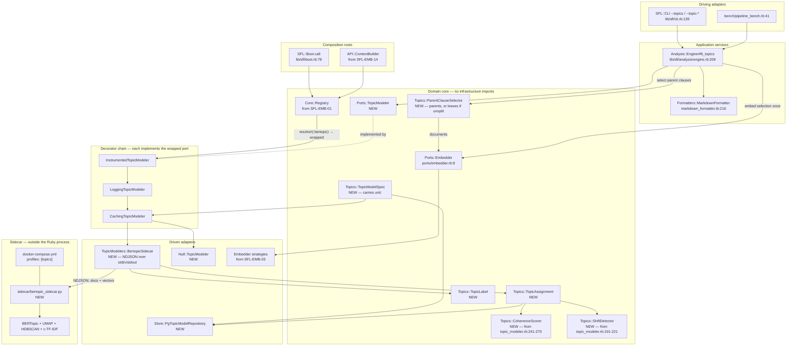

# Topic Modeling Hexagon — Refactor User Stories

**Project**: `sfl-engine` · **Branch**: `feature/roda_api` · **Date**: 2026-09-13 · **Revised**: 2026-09-13 (rev 3)

**Rev 2 changes**: all five of rev 1's open questions are answered, and one is answered by adding a
story rather than by deciding inside an existing one.
(1) **The modelled unit is the parent clause**, not the conversation turn — §4g is new, SFL-TOP-06 is
rewritten around it, SFL-TOP-09's schema follows it, and the hard sequencing dependency on
[SFL-EMB-10](EMBEDDING-HEXAGON-USER-STORIES.md) is **R13**, new.
(2) **`reduce_outliers` runs by default** — §4f is new and records why the rev 1 reasoning reversed,
with both outlier counts and the pre-reduction assignment persisted so the change is not concealment.
(3) **Migration numbers are never reserved in a planning document** — **SFL-TOP-02 is new** (move
`db/migrations/` to timestamped filenames), every story now describes schema by table and column, and
rev 1's defensive `014` is gone.
(4) **R8 is rewritten**: the literal `012_*` filenames in
[SFL-EMB-04](EMBEDDING-HEXAGON-USER-STORIES.md) and
[SFL-ING-20](INGEST-PARSER-HEXAGON-USER-STORIES.md) are stale rather than colliding; neither document
is edited here.
(5) `DEFAULT_DOMINANT_THRESHOLD = 0.35` still moves unchanged, and SFL-TOP-01's characterization is
named as the mechanism that would expose it drifting.
**Stories are renumbered**: rev 1's SFL-TOP-02..13 are now SFL-TOP-03..14, because SFL-TOP-02 must
precede every story that writes a migration. Rev 1 content is otherwise unchanged.

**Rev 3 changes** (2026-09-13): four open questions resolved and one redirected. The fit payload moves
to a **shared temp volume** (Q4) — §4b is rewritten, the NDJSON control line stays small, and the
flush-per-line protocol is untouched. The **graph reindex is done and verified, and did not fix the
symptom** (Q6): the index is healthy and `trace_path` works, while `search_graph` and
`get_architecture` still return `{}`, so the recommendation becomes "treat those two as unavailable"
rather than "reindex". A **minimum hardware baseline** is recorded (Q7: i7-11800H, NVIDIA T1200,
4 GB VRAM, compute 7.5), which also surfaces a platform conflict with the ingest document's
transcription benchmark. `DEFAULT_DOMINANT_THRESHOLD` is **redirected** (Q3) to be re-derived against
BERTopic's published defaults rather than carried across. Q5 stays open with a named research task.

**Scope**: replace the in-process `tomoto` gem (LDA fixed-k / HDP auto-k) with
[BERTopic](https://github.com/maartengr/bertopic) running in an NDJSON sidecar, behind a Hexagonal
(ports/adapters) boundary — with the topic model a runtime-swappable Strategy resolved through the
same Dynamic Registry the embedding refactor introduces, wrapped by the same Middleware Decorators,
and consuming the embedding hexagon's `Ports::Embedder` rather than carrying an embedder of its own.
The unit the model is fitted on is the **parent clause** from
[SFL-EMB-10](EMBEDDING-HEXAGON-USER-STORIES.md)'s chunk-splitting pass (§4g), which makes that story
a hard prerequisite (R13).

**Companion documents**: [`EMBEDDING-HEXAGON-USER-STORIES.md`](EMBEDDING-HEXAGON-USER-STORIES.md)
and [`INGEST-PARSER-HEXAGON-USER-STORIES.md`](INGEST-PARSER-HEXAGON-USER-STORIES.md). This document
is downstream of both and re-derives nothing they have decided. Where a contract is already fixed
over there — `Core::Registry` (SFL-EMB-01), the decorator chain and its cache-key rule
(SFL-EMB-06/07), embedder strategies and `Core::Embedding::ModelSpec` (SFL-EMB-03/04), the
single-instantiation collaborator builder (SFL-EMB-14), the `Core::Ports::*` + `Null`/`Fake` double
convention (SFL-ING-01), the sidecar-plus-profiled-Compose-service pattern (SFL-ING-21), and the one
per-file failure policy (SFL-ING-12) — this document **consumes** it and says so.

**The seam with the two companion documents.** The ingest hexagon produces
`SFL::Core::Types::Unit`; `Analysis::Engine#analyze` turns those units into stub turns and hands
their text to a topic modeler (`lib/sfl/analysis/engine.rb:209-216`); the embedding hexagon turns
clause text into vectors through `Core::Ports::Embedder` (`lib/sfl/core/ports/embedder.rb:8`).
BERTopic needs exactly the second of those as an input. That is the single most important structural
fact in this document: **BERTopic is a clustering-and-labelling algorithm over document embeddings,
not an embedder**, so the correct integration reuses the embedding hexagon's embedder rather than
shipping a second one inside a Python container.

**Evidence policy**: every `path:line` below was read from the working tree on 2026-09-13, or, for
BERTopic itself, from the upstream source file named in §7. Anything the architecture needs that is
not in the tree is labelled **does not exist yet**.

---

## 1. Context & Problem Statement

### 1.1 What already exists

Topic modeling is **the least hexagonal subsystem in this codebase**, and it is the only analysis
capability with no port at all. It is also, by the same measure, the easiest to move, because it has
exactly one implementation, one construction site, and one already-injected seam.

| Element | File | What it is |
|---|---|---|
| `Analysis::TopicModeler` | `lib/sfl/analysis/topic_modeler.rb:29` | the tomoto adapter — a concrete class, not a port implementation |
| `require "tomoto"` | `lib/sfl/analysis/topic_modeler.rb:3` | in-process native gem, loaded at file load |
| `require "pragmatic_tokenizer"` | `lib/sfl/analysis/topic_modeler.rb:4` | the adapter's own tokenizer |
| Fixed-k LDA / auto-k HDP switch | `lib/sfl/analysis/topic_modeler.rb:295-304` | `Tomoto::LDA.new(k:, min_cf:, rm_top:, seed:)` (`:297`) when `@k`, else `Tomoto::HDP.new(...)` (`:299`) |
| Training knobs | `lib/sfl/analysis/topic_modeler.rb:109-111` | `k:`, `min_cf: 3`, `rm_top: 2`, `iterations: 100`, `seed: 42`, `burn_in: nil`, `dominant_threshold:` |
| Model persistence | `lib/sfl/analysis/topic_modeler.rb:223-236` | `#save(path)` → `@model.save(path)` (`:226`); `#load_model(path)` → `Tomoto::LDA.load(path)` (`:232`) |
| Injected factory seam | `lib/sfl/analysis/engine.rb:58` | `topic_modeler_factory: -> (k:) { TopicModeler.new(k:) }`, stored at `:68` |
| The only call site | `lib/sfl/analysis/engine.rb:213` | `@topic_modeler_factory.call(k: topic_k(topics, units.size))`, then `modeler.fit(stub_turns)` at `:214` |
| CLI surface | `lib/sfl/cli.rb:68`, `:139` | `--topics N` help text ("0 = HDP (auto-discover)"), parsed as `Integer` at `:139`, defaulted to `nil` at `:129` |
| Bench surface | `bench/pipeline_bench.rb:36`, `:41` | `options = { topics: 3, ... }` and `--topics N` |
| Formatter surface | `lib/sfl/formatters/markdown_formatter.rb:216-238` | `#topic_modeling_section`, called at `:46` |
| Gem declaration | `Gemfile:98` | `gem "tomoto", "~> 0.6"`, under the section comment at `:89-96` |
| Unit spec | `spec/analysis/topic_modeler_spec.rb:14` | exercises the real gem, seed-pinned (`:21-23`), rationale at `:6-13` |
| Engine injection specs | `spec/analysis/engine_spec.rb:319`, `:331`, `:343`, `:360` | four factory-injection cases, including `topics: 0 → k: nil` at `:360` |

**The public surface `Analysis::Engine` actually consumes is small and already enumerated.**
`#fit_topics` (`lib/sfl/analysis/engine.rb:209-216`) uses exactly four members of the modeler:
`#fit(turns)` (`:214`), `#turns` (`:215`), `#topic_labels` (`:215`), and `#detect_topic_shifts`
(`:215`). The spec's stand-in double confirms this is the whole surface —
`double("topic_modeler", fit: nil, turns: [], topic_labels: { 0 => %w[a] }, detect_topic_shifts: [])`
(`spec/analysis/engine_spec.rb:344-345`). **That four-method surface is the port, and it already
exists as a duck.** It is the same situation the ingest document describes for
`Core::Loaders::Source` (its §1.1): a port by convention, missing its namespace and its doubles.

**Everything downstream of the modeler is already typed and already stable.**
`Core::Types::ConversationTurn` carries `topic_distribution` (`lib/sfl/core/types/conversation_turn.rb:20`),
`dominant_topic` (`:21`) and `semantic_coherence_score` (`:22`).
`Core::Types::AnalysisResult` carries `topic_labels` (`lib/sfl/core/types/analysis_result.rb:17`) and
`topic_evolution` (`:18`). `Analysis::Engine` reads those fields at `:285-286`, `:425-436`,
`:462-469` and `:471-478`, and the Markdown formatter reads `topic_labels` and `topic_evolution` at
`lib/sfl/formatters/markdown_formatter.rb:217-235`. **No consumer of topic modeling touches tomoto.**

**The sidecar pattern this story reuses is fully built and running.**
`Core::PassOne::SpacySidecarParser` (`lib/sfl/core/pass_one/spacy_sidecar_parser.rb:18`)
`include Ports::SyntacticParser` (`:19`) and talks NDJSON over stdin/stdout. Its own header states
the transport is *"a subprocess with stdin/stdout pipes," not specifically Python* and names
`["docker", "run", "-i", "--rm", "sfl-spacy-sidecar"]` as an acceptable `command:` (`:11-18`). The
mechanics that a second sidecar copies rather than reinvents:

- injected `command:` with a local-`python3` default — `initialize(model:, command: nil, env: {}, logger:)` (`:28`), default at `:30`;
- `Open3.popen2(@env, *@command, pgroup: true)` with the process-group rationale at `:57-61` (`:62`);
- a ready-line handshake under `STARTUP_TIMEOUT_SECONDS = 30` (`:22`), blocked on at `:67-77`;
- one-line-per-request with a `SecureRandom.uuid` id (`:85`), response read at `:105-110`, error field raised as `SidecarError` at `:87`;
- a single crash-and-retry with its rationale at `:79-83`, implemented at `:90-92` and `:94-103`;
- `Mutex`-serialised requests (`:33`, `:41`);
- `SFL::Core::PassOne::SidecarError < Error` (`lib/sfl/core/pass_one/sidecar_error.rb:8`).

The Python half is equally explicit. `sidecar/spacy_sidecar.py:9-13` documents the protocol —
`{"type": "ready", "model": ...}` on startup (emitted at `:89`), `{"id":…, "text":…, "document_id":…}`
in, `{"id":…, "clauses":[…]}` or `{"id":…, "error":…}` out — with `emit()` flushing every line
(`:76-78`) and a per-request `except` that emits an error rather than crashing the server (`:103-104`).
`sidecar/Dockerfile` is 16 lines: `FROM python:3.12-slim` (`:6`), `pip install` (`:10-11`), `COPY`
(`:13`), `ENTRYPOINT`/`CMD` (`:15-16`), with the "doesn't need to know which transport launched it"
rationale at `:1-5`.

**Compose already gates optional services behind profiles.** `docker-compose.yml` runs `postgres`
(`:2`) and `redis` (`:26`) unprofiled, and puts `api` (`:48`) and `migrate` (`:86`) behind
`profiles: ["app"]` (`:52`, `:90`) with the rationale at `:42-47`.
`SFL::DockerServices.ensure_running!` (`lib/sfl/docker_services.rb:28-33`) is explicit opt-in under
`SFL_AUTO_START_DOCKER=1` (`:34`), documented at `:11-19`.

**Ports, doubles and shared role specs are an established convention.**
`lib/sfl/core/ports/` holds 17 `.rb` files plus `null/` (12 files) and `fake/` (5 files);
`Core::Ports::SyntacticParser` (`lib/sfl/core/ports/syntactic_parser.rb:10`) raises
`NotImplementedError` naming the class (`:15`); `Null::SyntacticParser`
(`lib/sfl/core/ports/null/syntactic_parser.rb:9`) returns `[]` (`:13`);
`spec/support/shared_examples/ports.rb` holds twelve role groups (`:9`, `:15`, `:47`, `:59`, `:65`,
`:96`, `:103`, `:109`, `:122`, `:128`, `:134`, `:143`) whose header states the rule: *"a new adapter
can't quietly drift from the interface"* (`:3-7`).

**A golden-master precedent exists for exactly this class of change.**
`spec/analysis/engine_conversation_golden_master_spec.rb:6-28` diffs an `AnalysisResult` against a
committed fixture at the structural level, explicitly including `dominant_topic` and
`semantic_coherence_score` (`:19`).

### 1.2 What is missing

1. **No `Core::Ports::TopicModeler` — it does not exist yet.** `grep -rn "Ports::TopicModeler" lib/
   app/` returns zero; `ls lib/sfl/core/ports/` lists 17 files and none is a topic modeler. The
   contract exists only as the four methods `Analysis::Engine#fit_topics` happens to call
   (`lib/sfl/analysis/engine.rb:214-215`) and as the shape of a double in a spec
   (`spec/analysis/engine_spec.rb:344-345`). There is no `Null::TopicModeler` and no
   `Fake::TopicModeler`, so every test that wants to avoid training cost hand-rolls an unverified
   `double` — which `spec/analysis/engine_spec.rb:344` has to silence RuboCop for.

2. **The algorithm, the tokenizer, the coherence metric and the shift detector are one class.**
   `lib/sfl/analysis/topic_modeler.rb` is 375 lines carrying four separable responsibilities, and its
   own header disables `Metrics/ClassLength` while naming them: *"one topic-modeling adapter around
   tomoto, each responsibility (fit/tokenize/coherence/shifts) its own method"* (`:27-28`). Three of
   those four are **domain logic with no tomoto in them at all**:
   - `#cosine_distance` (`:354-365`) — pure arithmetic over two Hashes;
   - `#calculate_coherence` (`:241-249`) and `#conversation_baseline` (`:253-270`) — pure arithmetic over turn distributions;
   - `#detect_topic_shifts` (`:191-199`) and `#topic_shift_for` (`:202-221`) — a threshold rule over `dominant_topic` and `topic_distribution`;
   - `#dominant_topic_id` (`:148-156`) — the normalised-excess-over-uniform rule whose calibration constant is `DEFAULT_DOMINANT_THRESHOLD = 0.35` (`:102`).

   Only `#build_model` (`:295-304`), `#train_model` (`:306-308`), `#build_topic_labels` (`:310-318`),
   `#assign_topic`'s `make_doc`/`infer` pair (`:328-329`), `#save` (`:226`) and `#load_model` (`:232`)
   actually touch the gem. **Replacing the backend today means rewriting the domain rules too**,
   because they live inside the adapter.

3. **The tokenizer is an adapter-private decision with a documented, expensive history — and BERTopic
   does not want it.** `TOKENIZER_OPTIONS` (`lib/sfl/analysis/topic_modeler.rb:86-98`) sets
   `stem: :porter`, `remove_stop_words: true`, `min_length: 3`; `UNICODE_PUNCTUATION_MAP` (`:49-69`)
   exists because U+2019 defeated the stoplist in a real run (`:30-48`); the decision *not* to add a
   domain stoplist is argued for thirteen lines (`:73-85`). All of this is correct for a bag-of-words
   LDA. BERTopic's input is **document embeddings**, and its topic *labels* come from c-TF-IDF over a
   `CountVectorizer` that lives inside the model (`bertopic/_bertopic.py:160`). Porter-stemmed,
   stopword-stripped token arrays are the wrong input for the first and a lossy input for the second.
   The tokenizer is not portable to the new backend and its rationale must not be silently discarded.

4. **`--topics N` encodes tomoto's parameter space in the user interface.**
   `lib/sfl/cli.rb:68` says *"Number of topics for LDA; 0 = HDP (auto-discover)"*; `Engine#topic_k`
   (`lib/sfl/analysis/engine.rb:503-511`) returns `nil` for `0` (`:504`) so `#build_model` falls to
   HDP (`lib/sfl/analysis/topic_modeler.rb:299`). The clamp at `:506` and its warning at `:513-522`
   cite Tang et al., ICML 2014 on LDA posterior contraction (`:480-499`) and hard-code
   `MIN_DOCS_PER_TOPIC = 3` / `MIN_TOPIC_K = 2` (`:500-501`). **Every one of those is an LDA fact.**
   BERTopic's equivalents are `min_topic_size` (default 10) and `nr_topics` (`None`, an integer, or
   `"auto"`) — `bertopic/_bertopic.py:150-151` — and its clustering step is HDBSCAN, which has its own
   small-corpus failure mode (everything becomes the `-1` outlier topic) rather than LDA's. The
   existing clamp is not translatable; it must be re-derived against the new backend or removed with
   its reason recorded.

5. **The doc-count guard is the only thing standing between a small corpus and a meaningless model,
   and it is in the wrong layer.** `Engine#fit_topics` returns early `unless topics && units.size >= 3`
   (`lib/sfl/analysis/engine.rb:210`). That `3` is unexplained at its own site and is not the same `3`
   as `MIN_DOCS_PER_TOPIC` (`:500`). Whether it is still the right threshold for HDBSCAN is not
   knowable from the tree.

6. **Fitted models are never persisted in practice.** `#save` (`lib/sfl/analysis/topic_modeler.rb:223`)
   and `#load_model` (`:231`) exist, but `grep -rn "load_model\|\.save(" lib/sfl/analysis/engine.rb
   lib/sfl/cli.rb` finds no caller: `Engine#fit_topics` constructs a fresh modeler per `#analyze`
   call (`:213`) and drops it (`_modeler` at `:89` is discarded). The class comment states this is
   deliberate and provisional — *"one TopicModeler per call… faithfully porting the CURRENT per-call
   duplication, not yet the more ambitious 'topic modeling as an engine-owned pipeline stage'"*
   (`lib/sfl/analysis/engine.rb:16-20`). So **every run re-fits from scratch**, topic ids are not
   comparable between two runs over the same corpus, and there is no table anywhere recording which
   model produced a given `dominant_topic`. There is no `topic_models` table: `ls db/migrations/`
   lists eleven files, `001`–`011`, none topic-related.

7. **No strategy registry entry, no decorator, no instrumentation.** Topic modeling is constructed by
   a bare lambda (`lib/sfl/analysis/engine.rb:58`), not resolved from `Core::Registry` — which
   **does not exist yet** and is SFL-EMB-01's to build. Nothing wraps the fit in
   `Ports::Instrumenter#instrument`, so the single most expensive non-LLM step in an analysis run
   (`@iterations.times { @model.train(1) }`, `lib/sfl/analysis/topic_modeler.rb:307`, default 100
   iterations from `:109`) emits no span and appears in no timing report.

8. **A second embedding model would be introduced by the naive port.** BERTopic's default backend is
   `sentence-transformers` `all-MiniLM-L6-v2` (`bertopic/_bertopic.py:147`, documented at `:168-169`),
   which is a 384-dimension model. This codebase already has an embedder — `Core::Ports::Embedder`
   (`lib/sfl/core/ports/embedder.rb:8`) over Ollama, with `VECTOR_DIMENSIONS = 768` at
   `lib/sfl/store/pg_embedding_store.rb:49` and the 2026-08-02 dimension-mismatch scar documented at
   `:39-48`. Letting the sidecar embed its own documents would put **two unrelated embedding models
   in one pipeline**, one of them invisible to `Core::Embedding::ModelSpec` (SFL-EMB-03). That is the
   single largest design risk in this refactor and §4 exists to close it.

9. **`tomoto` is in-process; BERTopic is not.** This is stated here as a cost, not buried in §8.
   Today topic modeling is a native extension inside the Ruby process: no container, no network hop,
   no second runtime, and `spec/analysis/topic_modeler_spec.rb` can exercise the real gem for real
   (`:6-13`). After this refactor it is a Python process behind a pipe. The gain is capability and
   isolation; the cost is an operational dependency where there was none. See R1 and R2.

10. **No characterization fixture for topic output.** `spec/analysis/topic_modeler_spec.rb` pins
    exact topic ids and labels against a fixed corpus and seed (`:6-13`), which is a **unit** pin on
    tomoto's own behaviour and becomes meaningless the moment the backend changes. The
    `AnalysisResult`-level golden master (`spec/analysis/engine_conversation_golden_master_spec.rb`)
    does cover `dominant_topic` (`:19`) but runs the conversation path only. Nothing today would make
    a change in *report* output visible as a diff.

---

## 2. Target Architecture

**Bounded contexts** (existing module names kept): `SFL::Core` = domain + ports + topic domain rules;
`SFL::Analysis` = analysis application services and topic-model driven adapters; `SFL::Store` =
persistence driven adapters; `SFL::CLI` + `Sfl` (Roda) = driving adapters.

### 2.1 Ports and adapters

| Port | Responsibility | Driven / driving | Concrete adapters | Backing runtime | Status |
|---|---|---|---|---|---|
| `Core::Ports::TopicModeler` | documents (+ optional precomputed vectors) → topic assignments and topic labels | driven | `Analysis::TopicModelers::BertopicSidecar` (SFL-TOP-05); `Null::TopicModeler` (no topics); `Fake::TopicModeler` (scripted assignments) | BERTopic in a container | **does not exist yet** — today the concrete class `lib/sfl/analysis/topic_modeler.rb:29` with no port |
| `Core::Ports::Embedder` | text → vector(s) | driven | per [SFL-EMB-03](EMBEDDING-HEXAGON-USER-STORIES.md) | Ollama / Informers | exists (`lib/sfl/core/ports/embedder.rb:8`) — **reused, never duplicated** |
| `Core::Ports::Instrumenter` | named span around a call | driven (cross-cutting) | `Core::Ports::TimingInstrumenter` (`lib/sfl/core/ports/timing_instrumenter.rb:10`) | `dspy-o11y-langfuse` | exists |
| `Core::Ports::Cache` | memoize by content key | driven (cross-cutting) | `Core::Ports::FileCache` (`lib/sfl/core/ports/file_cache.rb:23`) | none | exists — a **third** separately-keyed namespace beside Pass 2 (`file_cache.rb:9-13`) and ingest ([SFL-ING-10](INGEST-PARSER-HEXAGON-USER-STORIES.md)); see R7 |
| `Core::Ports::Logger` | structured logging | driven (cross-cutting) | `StderrLogger` (the Engine's non-Null default, `lib/sfl/analysis/engine.rb:62`, rationale `:46-52`) | none | exists |
| CLI entry | `--topics` and its successors | **driving** | `SFL::CLI` (`lib/sfl/cli.rb:139`), `bench/pipeline_bench.rb:41` | `thor` / `optparse` | exists, semantics change (SFL-TOP-11) |

New domain-core collaborators (zero infrastructure imports):

- `SFL::Core::Topics::ParentClauseSelector` — `lib/sfl/core/topics/parent_clause_selector.rb` —
  **does not exist yet**. Given a document's annotated clauses, returns the **parent** clauses — the
  exact complement of `Pipeline#leaf_clauses` (`lib/sfl/core/pipeline.rb:232-235`), computed from the
  same `parent_clause_id` set (`:233`). Returns the leaves when no clause has a parent, which is the
  state of the whole corpus today (`lib/sfl/core/pipeline.rb:218-219`); see §4g and R13.
- `SFL::Core::Topics::TopicAssignment` — `lib/sfl/core/topics/topic_assignment.rb` — **does not
  exist yet**. A `Dry::Struct` of `{document_index:, topic_id:, probability:, distribution:}`. The
  boundary value a `TopicModeler` returns, one per input document, in input order. Precedent for a
  `Dry::Struct` value in `Core`: `lib/sfl/core/types/unit.rb:15`.
- `SFL::Core::Topics::TopicLabel` — `lib/sfl/core/topics/topic_label.rb` — **does not exist yet**.
  `{topic_id:, words:, count:, name:}`. `words` is what
  `lib/sfl/formatters/markdown_formatter.rb:223` already renders with `.first(5)`.
- `SFL::Core::Topics::TopicModelSpec` — `lib/sfl/core/topics/topic_model_spec.rb` — **does not exist
  yet**. `{strategy:, embedding_spec:, min_topic_size:, nr_topics:, representation:, seed:}`. The
  value that makes a topic assignment's provenance explicit and is the basis of its cache key —
  exactly the role `Core::Embedding::ModelSpec` plays for a vector in
  [SFL-EMB-03/04](EMBEDDING-HEXAGON-USER-STORIES.md), and it **embeds** that spec rather than
  restating its fields.
- `SFL::Core::Topics::CoherenceScorer` — `lib/sfl/core/topics/coherence_scorer.rb` — **does not
  exist yet**. The extraction of `#cosine_distance` (`lib/sfl/analysis/topic_modeler.rb:354-365`),
  `#calculate_coherence` (`:241-249`) and `#conversation_baseline` (`:253-270`).
- `SFL::Core::Topics::ShiftDetector` — `lib/sfl/core/topics/shift_detector.rb` — **does not exist
  yet**. The extraction of `#detect_topic_shifts` (`:191-199`) and `#topic_shift_for` (`:202-221`).
- `SFL::Core::Decorators::{Logging,Caching,Instrumented}TopicModeler` — `lib/sfl/core/decorators/` —
  **does not exist yet**. Each `include`s `Core::Ports::TopicModeler`. Same chain contract and same
  directory as [SFL-EMB-06/07](EMBEDDING-HEXAGON-USER-STORIES.md); **not re-specified here**.

### 2.2 The hexagon



Reading order: `Analysis::Engine#fit_topics` embeds its stub-turn texts **once** through the
embedding hexagon's `Ports::Embedder` (SFL-TOP-06), hands documents plus vectors to
`Ports::TopicModeler` (SFL-TOP-01), which resolves to a decorated `BertopicSidecar` (SFL-TOP-05,
SFL-TOP-08) via `Core::Registry` (SFL-TOP-07); the adapter returns `TopicAssignment`s and
`TopicLabel`s; `CoherenceScorer` and `ShiftDetector` (SFL-TOP-10) turn those into the
`semantic_coherence_score` and shift events `AnalysisResult` already carries; the fitted model and
its assignments are persisted by `Store::PgTopicModelRepository` (SFL-TOP-09).

Dependency direction: `Core` (`Ports`, `Topics::*`, `Registry`, `Decorators`) imports nothing from
`Analysis`, `Store`, `LLM`, `API`, or `Sfl`. That is a **change**, not a restatement: today the
coherence and shift rules live inside a class whose first line is `require "tomoto"`
(`lib/sfl/analysis/topic_modeler.rb:3`), so the domain currently depends on a native gem.

### 2.3 Decorator chain contract

Identical to the embedding and ingest documents', and deliberately so — one chain idiom, one
`Chain.wrap`, one `lib/sfl/core/decorators/` directory. Outermost first:
`Instrumented → Logging → Caching → concrete strategy`; the span encloses the cache lookup so hit
rate is observable; each decorator's constructor takes `inner:` plus its one collaborator and nothing
else; omitting a collaborator omits that layer. **Specified in
[SFL-EMB-06/07](EMBEDDING-HEXAGON-USER-STORIES.md) and consumed here unchanged.** The only
topic-specific addition is what goes in the cache key, which is SFL-TOP-08's single new decision.

---

## 3. Gem Disposition Table

This document has **no candidate gem list**, because there is no Ruby BERTopic. The table therefore
records dispositions for the gems the current implementation uses and for the one candidate a reader
would reasonably reach for.

| # | Gem | Hexagon layer | Present? | Verdict | Rationale (risk fields: invasiveness / coupling / abstraction_leak) | Story |
|---|---|---|---|---|---|---|
| 1 | `tomoto` | driven adapter (topic model) | **yes, `Gemfile:98` — in use** | **remove** | 3 / 3 / **high**. The leak is not hypothetical: `Tomoto::LDA`/`Tomoto::HDP` appear inside the class that also owns the coherence metric and the shift rule (`lib/sfl/analysis/topic_modeler.rb:297`, `:299`, `:232`), and the gem's parameter space is spelled into the CLI's own help text (`lib/sfl/cli.rb:68`). It is a native extension, and the Gemfile comment at `:93-96` records that the version in use (0.6.2) is not the version legacy pinned (`~> 0.3`) and that the API was re-verified by reading the installed gem's source. That is a maintenance posture, not a stable dependency. Removed terminally by SFL-TOP-14, **after** every consumer has moved, never before. | SFL-TOP-14 |
| 2 | `pragmatic_tokenizer` | driven adapter (tokenizer) | **yes, `Gemfile:78` — in use** | **keep, narrow role** | 2 / 1 / low. It is declared for `MarkdownSource` (`Gemfile:78`'s own inline comment) and required by the topic modeler at `lib/sfl/analysis/topic_modeler.rb:4`. This refactor **removes the topic-modeling use** — BERTopic takes raw document text, not Porter-stemmed token arrays (§1.2 gap 3) — and leaves the markdown use untouched. The gem stays in the Gemfile; only `TOKENIZER_OPTIONS` (`topic_modeler.rb:86-98`) and `UNICODE_PUNCTUATION_MAP` (`:49-69`) go, and SFL-TOP-05 requires their rationale to be carried into the sidecar's `CountVectorizer` configuration rather than deleted. | SFL-TOP-05 |
| 3 | `informers` | driven adapter (local ONNX embedding) | yes, `Gemfile:154`, zero call sites | **out of scope here** | 3 / 1 / medium. [`EMBEDDING-HEXAGON-USER-STORIES.md`](EMBEDDING-HEXAGON-USER-STORIES.md) §3 row 7 adopts it as an `Ports::Embedder` strategy. This document **consumes whatever that document decides** and adds nothing: topic modeling asks `Ports::Embedder` for vectors and does not care which strategy answers. Naming it here is to state explicitly that SFL-TOP-06 introduces no second embedder. | — (consumed via SFL-EMB-03) |
| 4 | a Ruby BERTopic binding | driven adapter | **no such gem exists** | **n/a — stated rather than searched around** | The honest row. BERTopic is Python (`bertopic`, `umap-learn`, `hdbscan`, `scikit-learn`, `sentence-transformers`); there is no Ruby binding and no FFI wrapper. The integration is therefore a **container image**, exactly as [SFL-ING-21](INGEST-PARSER-HEXAGON-USER-STORIES.md) resolves transcription with a container rather than a dependency. Forcing a nearest-looking Ruby gem here — an LDA gem, a clustering gem — would be the category error that document's §3 row 7 rejects. | SFL-TOP-04 |
| 5 | `lingua` | analysis | yes, `Gemfile:101` | **untouched** | 1 / 1 / low. Adjacent in the Gemfile (immediately below `tomoto` at `:98`) and unrelated. Named only so that SFL-TOP-14's Gemfile edit is unambiguous about which lines it removes: `:98` and the topic-modeling section comment at `:89-96` that describes it, not `:101`. | SFL-TOP-14 |

**Summary**: remove 1 (`tomoto`) · keep with a narrowed role 1 (`pragmatic_tokenizer`) · add **zero**
gems. The net Gemfile change of this document is **minus one dependency**.

**No story below may add a gem.** BERTopic and its Python dependency tree live in the sidecar image
and never in `Gemfile`. This rule mirrors the same rule in both companion documents' §3.

---

## 4. The BERTopic Sidecar — decided

**Every API fact in this section was read from BERTopic's own source on 2026-09-13**, not recalled:
`bertopic/_bertopic.py` from `MaartenGr/BERTopic` at `master`. Line numbers are that file's.

### 4a. The API surface this integration uses

| Call | Signature (source) | Used for |
|---|---|---|
| `BERTopic(...)` | `_bertopic.py:145-163` | construction: `min_topic_size` (`:150`), `nr_topics` (`:151`), `calculate_probabilities` (`:153`), `seed_topic_list` (`:154`), `zeroshot_topic_list` (`:155`), `embedding_model` (`:157`), `umap_model` (`:158`), `hdbscan_model` (`:159`), `vectorizer_model` (`:160`), `representation_model` (`:162`), `top_n_words` (`:148`), `n_gram_range` (`:149`) |
| `#fit_transform(documents, embeddings=None, images=None, y=None)` | `_bertopic.py:395-401` | the fit; returns `(topics, probabilities)` — one topic id per document, in input order (`:414-421`) |
| `#transform(documents, embeddings=None, images=None)` | `_bertopic.py:545-549` | assigning **new** documents to an already-fitted model |
| `#get_topic_info(topic=None)` | `_bertopic.py:1650` | the label table: columns `Topic`, `Count` (`:1666`), `Name` (`:1667`), `Representation` (`:1677`), `Representative_Docs` (`:1693`) |
| `#approximate_distribution(documents, window=4, stride=1, ...)` | `_bertopic.py:1204-1214` | a per-document **distribution** over topics, which `calculate_probabilities` alone does not give for HDBSCAN |
| `#reduce_outliers(documents, topics, strategy="distributions", ...)` | `_bertopic.py:2380-2389` | post-hoc reassignment of the `-1` topic — **on by default** (§4f); `strategy` default at `:2385`, `threshold` default at `:2387` |
| `#reduce_topics(...)` / `#update_topics(...)` | `_bertopic.py:2313` / `:1488` | post-fit topic-count reduction and representation refresh |
| `#partial_fit(documents, embeddings=None, y=None)` | `_bertopic.py:649-653` | online/incremental fitting — **not used this phase**, see §4e |
| `#save(path, serialization=..., save_embedding_model=True, save_ctfidf=False)` | `_bertopic.py:3416-3421` | persistence; `serialization` is `"safetensors" \| "pickle" \| "pytorch"` (`:3419`), and with `safetensors` `path` is a **directory** (`:3431-3432`) |
| `BERTopic.load(path, embedding_model=None)` | `_bertopic.py:3534` | reload; `embedding_model` is passed separately when it was not saved (`:3540-3541`) |

Two facts from that table drive the whole design:

- **`fit_transform` and `transform` both accept precomputed `embeddings`** (`:397`, `:547`), described
  in the docstrings as *"Pre-trained document embeddings. These can be used instead of the
  sentence-transformer model"* (`:407-408`, `:555-556`). This is the hook that lets §1.2 gap 8 be
  closed rather than accepted.
- **`save` with `serialization="safetensors"` writes without the embedding, dimensionality-reduction
  and clustering algorithms** (`:3433-3435`). That is the safe format, and it is also a constraint:
  a safetensors-saved model reloads its topic representations, not its UMAP/HDBSCAN state.

### 4b. The protocol — the spaCy sidecar's, extended

One JSON object per line on stdin/stdout, flushed immediately, exactly as
`sidecar/spacy_sidecar.py:9-13` documents and `:76-78` implements.

```
startup  (stdout) -> {"type":"ready","backend":"bertopic","bertopic_version":"<str>","embedding_model":null}
fit      (stdin)  -> {"id":"<uuid>","op":"fit","payload_path":"<path in the shared volume>",
                      "params":{"min_topic_size":<int>,"nr_topics":<int|"auto"|null>,
                                "top_n_words":<int>,"n_gram_range":[<int>,<int>],
                                "seed":<int>,"stop_words":"english","min_df":<int>,
                                "calculate_probabilities":<bool>,
                                "seed_topic_list":[[...]]|null,
                                "zeroshot_topic_list":[...]|null},
                      "model_id":"<uuid>"}
         (stdout) -> {"id":"<uuid>","model_id":"<uuid>",
                      "assignments":[{"document_index":<int>,"topic_id":<int>,
                                      "probability":<float|null>,
                                      "distribution":{"<topic_id>":<float>,...}},...],
                      "labels":[{"topic_id":<int>,"words":["<str>",...],
                                 "count":<int>,"name":"<str>"},...],
                      "outlier_count":<int>}
transform(stdin)  -> {"id":"<uuid>","op":"transform","model_id":"<uuid>",
                      "payload_path":"<path in the shared volume>"}
         (stdout) -> same "assignments" shape, no "labels"
save     (stdin)  -> {"id":"<uuid>","op":"save","model_id":"<uuid>","path":"<dir>"}
load     (stdin)  -> {"id":"<uuid>","op":"load","model_id":"<uuid>","path":"<dir>"}
any error(stdout) -> {"id":"<uuid>|null","error":"<message>","error_code":"<str>"}
```

**Documents and embeddings travel through a shared volume, not through the pipe** (open question 4,
answered 2026-09-13). `payload_path` names a file in a volume mounted into both the Ruby process and
the sidecar container; the file holds one JSON object per line, `{"text":…,"embedding":[…]}`, in
document order. The control line stays small and the NDJSON protocol stays exactly what
`sidecar/spacy_sidecar.py:76-78` implements — which matters, because that flush-per-line loop was
written for one sentence at a time and a fit at 768 dimensions across a few thousand documents is
tens of megabytes on one line. Three consequences, each an acceptance criterion on SFL-TOP-04/05:
the writer deletes the payload after the response is read **and on the error path**; the sidecar
streams the file rather than reading it whole, so peak memory is a buffer rather than the payload;
and the volume is declared in `docker-compose.yml` beside the profiled `transcribe` service, so an
unmounted volume fails at startup with a named error rather than at first fit. The reuse of JSONL
here is deliberate — it is the same line-delimited shape the ingest document's SFL-ING-15 codec
already owns.

`assignments` is **parallel to the payload's line order** and carries `document_index` anyway, so a
reordering bug is detectable rather than silent — this is the one place the protocol is deliberately
redundant. `topic_id: -1` is BERTopic's outlier topic and is passed through as `-1`, never as `null`
and never dropped; `Core::Topics::TopicAssignment` maps it to `dominant_topic: nil` at the domain
boundary so `AnalysisResult` semantics (`lib/sfl/core/types/conversation_turn.rb:21`) are unchanged.

`distribution` is populated from `#approximate_distribution` (`_bertopic.py:1204`) because
`ConversationTurn#topic_distribution` is a `Hash` the coherence metric consumes
(`lib/sfl/analysis/topic_modeler.rb:241-249`, keys used at `:355`) and HDBSCAN's
`calculate_probabilities` gives a single scalar per document, not a distribution.

The error line, the `id` echo, and the ready handshake are copied verbatim in shape from
`sidecar/spacy_sidecar.py:89`, `:102`, `:104` so that
`Core::PassOne::SpacySidecarParser`'s transport code (`lib/sfl/core/pass_one/spacy_sidecar_parser.rb:67-116`)
is the template for the new adapter rather than a thing to be redesigned.

### 4c. Embeddings come from Ruby, always

The sidecar is constructed with `BERTopic(embedding_model=None, ...)` and **every** `fit`/`transform`
request carries `embeddings` (`_bertopic.py:397`, `:547`). Consequences, stated so they are
reviewable:

- There is **one** embedding model in the system, the one `Core::Ports::Embedder` names
  (`lib/sfl/core/ports/embedder.rb:8`), and its identity is already a first-class value —
  `Core::Embedding::ModelSpec` from [SFL-EMB-03](EMBEDDING-HEXAGON-USER-STORIES.md).
- `sentence-transformers` is **not installed in the image**, which is what makes the previous point
  enforceable rather than merely intended, and removes ~2 GB of PyTorch from the layer.
- A topic assignment's provenance includes the embedding model that produced its input vectors, which
  is why `Core::Topics::TopicModelSpec` embeds `Core::Embedding::ModelSpec` rather than restating it.
- The vectors are already being computed for storage on any `--store` run
  (`lib/sfl/core/pipeline.rb:225`), so on that path the marginal cost of topic modeling's embeddings
  is a cache hit, not a second inference pass — provided the cache key matches, which is
  [SFL-EMB-06](EMBEDDING-HEXAGON-USER-STORIES.md)'s contract and SFL-TOP-06's obligation to honour.

The one thing this costs: `#save(save_embedding_model=...)` (`_bertopic.py:3420`) cannot point at a
model the image does not have, so saved models are written with `save_embedding_model=False` and the
embedding model's identity is recorded on **the Ruby side**, in `TopicModelSpec` and in the
`topic_models` row (SFL-TOP-09). That is strictly better provenance than a string inside a
safetensors directory, but it is a divergence from BERTopic's own documented reload idiom and is
recorded as such.

### 4d. What replaces fixed-k LDA and HDP

| Today | Mechanism | Tomorrow | Mechanism |
|---|---|---|---|
| `--topics N`, N > 0 | `Tomoto::LDA.new(k: N)` (`topic_modeler.rb:297`) | `--topics N` | `nr_topics: N` (`_bertopic.py:151`) applied as a **post-fit reduction**, not a target |
| `--topics 0` | `Tomoto::HDP.new(...)` (`topic_modeler.rb:299`) | `--topics 0` | `nr_topics: "auto"` (`_bertopic.py:151`, whose `"auto"` value is documented at `:190`) |
| *(no equivalent)* | — | `--min-topic-size N` | `min_topic_size` (`_bertopic.py:150`, default 10) — **the parameter BERTopic's own docstring says to adjust first** (`:191-192`) |
| `seed: 42` (`topic_modeler.rb:109`) | tomoto RNG | `--topic-seed N` | UMAP `random_state`, set in the sidecar's `umap_model` (`_bertopic.py:158`) |
| `rm_top: 2`, `min_cf: 3` (`:109`) | tomoto corpus pruning | *(none)* | c-TF-IDF's `CountVectorizer` `min_df` / `stop_words` (`_bertopic.py:160`) |
| `iterations: 100`, `burn_in:` (`:109`, `:302`) | Gibbs sampling | *(none — removed)* | BERTopic has no sampling loop |

`nr_topics` being a **reduction** rather than a target is the semantic change that matters most:
`--topics 10` on a corpus BERTopic clusters into 4 topics yields 4, not 10. The clamp-and-warn
machinery at `lib/sfl/analysis/engine.rb:503-522`, built for LDA's finite-corpus failure
(`:480-499`), therefore has nothing left to clamp. SFL-TOP-11 replaces it with the failure BERTopic
actually has — everything landing in the `-1` outlier topic on a small corpus — and reports *that*
through the same non-Null `StderrLogger` the Engine deliberately defaults to (`engine.rb:46-52`).

### 4e. Deliberately not used this phase

- **`partial_fit`** (`_bertopic.py:649`). Online topic modeling requires `MiniBatchKMeans`/`IncrementalPCA`
  and `OnlineCountVectorizer` in place of HDBSCAN/UMAP (`:658-666`), which is a different clustering
  model with different output characteristics. Nothing in the repository asks for incremental
  fitting, and §1.2 gap 6 shows the codebase does not even reuse a fitted model yet. Recorded as an
  unbuilt capability the protocol accommodates (`op` is an open string), not an open question.
- **Guided modeling** (`seed_topic_list`, `_bertopic.py:154`) and **zero-shot modeling**
  (`zeroshot_topic_list`, `:155`). Both are present in the protocol's `params` (§4b) and both are
  **null by default**. They are the natural home for a future SFL-specific topic vocabulary — the
  codebase already has a static vocabulary registry in `Core::ClassificationRegistry`
  (`lib/sfl/core/classification_registry.rb:11`) — but nothing in the tree states what those seed
  topics would be, so wiring them now would be inventing a taxonomy. The seam exists; the content
  does not.
- **Representation models** (`representation_model`, `_bertopic.py:162`). BERTopic can refine topic
  labels with KeyBERT, MMR or an LLM. The LLM variants would put a metered API call inside topic
  modeling, compounding with [SFL-EMB-13](EMBEDDING-HEXAGON-USER-STORIES.md)'s already-unquantified
  per-chunk enrichment cost (its R11). Default c-TF-IDF only this phase; the `params` key exists.
### 4f. Outlier reduction runs by default — and why that reversed

**`#reduce_outliers` (`_bertopic.py:2380-2389`) is ON.** Rev 1 defaulted it **off**, on the reasoning
that reassigning every `-1` document to a nearest topic would conceal the small-corpus failure mode.
That reasoning was **conditional on the modelled unit, and the unit has changed.** It was written when
the input was a turn (`lib/sfl/analysis/engine.rb:220-230` builds one stub turn per `Unit`), where
most documents would legitimately be outliers and reduction would paper over a design problem. With
the **parent clause** as the unit (§4g, SFL-TOP-06), outliers are the ordinary residue of density
clustering rather than a symptom, and reducing them is cleanup. Recorded here rather than only in a
story so it is not re-litigated from the rev 1 reasoning.

The parameters stay explicit and inspectable rather than defaulted invisibly:

| Setting | Value | Where it is visible |
|---|---|---|
| `strategy` | `"distributions"` (the `_bertopic.py:2385` default) | `params` in the §4b protocol; `reduce_outliers_strategy` column (SFL-TOP-09) |
| `threshold` | `0` (the `_bertopic.py:2387` default) | `params`; `reduce_outliers_threshold` column |
| pre-reduction assignment | retained per document | `topic_id_before_reduction` column |
| pre-reduction total | retained per model | `outlier_count_raw` beside `outlier_count_after_reduction` |

**Both counts are stored, which is what keeps this from being concealment.** `outlier_count_raw` is
the number that says whether the parent-clause unit is working; SFL-TOP-11's warning fires on it, not
on the post-reduction figure, so a corpus that clustered badly still reports badly even though its
report renders cleanly. `reduce_outliers` remains switchable, and turning it off changes nothing that
was recorded.

### 4g. The modelled unit is the parent clause

BERTopic is fitted on **parent clauses** — the output of
[SFL-EMB-10](EMBEDDING-HEXAGON-USER-STORIES.md)'s chunk-splitting pass — not on conversation turns
and not on leaf chunks. Parent clauses are long enough to carry a topic and short enough to carry
one; a child's topic is its parent's, by join on `parent_clause_id`
(`db/migrations/011_add_parent_clause_id_to_clauses.rb:21`), with no denormalised copy.

**The column exists and is empty.** `db/migrations/011_add_parent_clause_id_to_clauses.rb:21` adds
it, `:27` indexes it, `:28-29` gives it an FK to `clauses.external_id` and `:31-33` a
self-reference CHECK — but `Core::Pipeline`'s own comment states the current reality: *"Until a
future chunk-splitting pass populates `parent_clause_id`, every clause is a leaf, so this is a no-op
today"* (`lib/sfl/core/pipeline.rb:218-219`), which is why `#leaf_clauses`
(`lib/sfl/core/pipeline.rb:232-235`) returns everything — its `parent_ids` set (`:233`) is empty.
**SFL-TOP-06 and SFL-TOP-09 are therefore blocked on SFL-EMB-10 actually populating the column**, not
merely on its migration having run. R13 carries this, and SFL-TOP-06 defines the degenerate
behaviour for a corpus with no parents rather than leaving it to raise.

---

## 5. Epics

| Epic | Goal (one line) |
|---|---|
| **T0 — Make the change visible, and make schema work collidable-free** | Pin today's topic-modeling output at the report level before touching the backend, so the swap produces a reviewable diff rather than a surprise; and move `db/migrations/` to timestamped filenames so two documents planning schema work in parallel stop needing to reserve numbers. |
| **T1 — Port substrate** | Give topic modeling the `Core::Ports::TopicModeler` contract, `Null`/`Fake` doubles and a shared role spec that every other port in this codebase already has. |
| **T2 — The BERTopic sidecar** | Build the container and the NDJSON process, as a profiled Compose service beside the spaCy sidecar, and the Ruby adapter that speaks to it. |
| **T3 — The right unit, one embedder** | Fit BERTopic on parent clauses from [SFL-EMB-10](EMBEDDING-HEXAGON-USER-STORIES.md)'s chunking pass, embedded by the embedding hexagon's `Ports::Embedder`, so the model clusters units that can carry a topic and the system never grows a second, invisible embedding model. |
| **T4 — Composition and cross-cutting** | Register the strategy in `Core::Registry`, wrap it in the existing decorator chain, and wire it from one composition root. |
| **T5 — Provenance** | Persist fitted models and topic assignments so two runs over one corpus are comparable and any `dominant_topic` can be traced to the model and embedding spec that produced it. |
| **T6 — Interface and cleanup** | Migrate `--topics` semantics onto BERTopic's parameter space, keep report output continuous, extract the domain rules out of the old adapter, and remove `tomoto`. |

---

## 6. User Stories

Conventions every story inherits (verified against the tree): Zeitwerk-compatible file layout under
`lib/sfl/` with inflections registered in `lib/sfl.rb:12-30` when a name is not camel-derivable —
`Topics`, `TopicModelers` and `Decorators` are all camel-derivable, so **none** is needed;
`Dry::Monads` `Result` returns for anything that can fail at request time (pattern at
`lib/sfl/core/pipeline.rb:90-94`); `Dry::Struct` for boundary values (`Gemfile:29`, precedent
`lib/sfl/core/types/unit.rb:15`); RSpec specs mirroring the source path under `spec/`; **no new gem
in any story** (§3); rubocop clean under the project's existing
`rubocop-sequel`/`rubocop-rspec`/`rubocop-thread_safety` config.

---

### SFL-TOP-01 — Characterization and golden-master specs for today's topic output

**Points**: 5 · **Depends on**: none · **Epic**: T0 · **Sequence**: schedule **first** — every later
story changes what this pins

> **As a** reviewer
> **I want** today's topic-modeling report output committed as a fixture before the backend changes
> **so that** the BERTopic swap shows up as a diff I can read rather than as a run that looks
> different and nobody can say how.

**Why this is not covered by the specs that exist.** `spec/analysis/topic_modeler_spec.rb` pins exact
topic ids and labels against a fixed corpus and seed, and its header says so (`:6-13`) — that is a
**unit** pin on tomoto's own arithmetic and is worthless the moment tomoto is gone.
`spec/analysis/engine_conversation_golden_master_spec.rb` does diff `dominant_topic` and
`semantic_coherence_score` (`:19`) but runs the conversation path with a stubbed Pass 1 (`:23-28`)
and no documentation path. Nothing anywhere pins the **rendered report**.

**Acceptance criteria**

- **Given** `spec/analysis/topic_report_characterization_spec.rb`, **then** it runs
  `Analysis::Engine#analyze` (`lib/sfl/analysis/engine.rb:85`) with `topics: 3` and with `topics: 0`
  over a committed fixture corpus, renders through
  `Formatters::MarkdownFormatter#topic_modeling_section`
  (`lib/sfl/formatters/markdown_formatter.rb:216`), and diffs against a committed
  `spec/fixtures/topic_report/` artefact.
- **Given** the characterization, **then** it asserts **structure, not vocabulary**: the section
  heading (`markdown_formatter.rb:219`), the `"N topics identified"` line (`:220`), one
  `- **Topic <id>**: <5 words>` bullet per label (`:222-224`), and the `Topic Evolution` block when
  `topic_evolution` is non-empty (`:227-235`). Exact topic words are **not** pinned, because they are
  the one thing that legitimately changes when the backend changes.
- **Given** the same spec, **then** it separately pins the invariants that must **not** change across
  the backend swap: `metadata[:topics_enabled]` is `true` exactly when `topic_labels` is non-nil
  (`lib/sfl/analysis/engine.rb:202`); `dominant_topic` is `nil` or an `Integer`
  (`lib/sfl/core/types/conversation_turn.rb:21`); `semantic_coherence_score` is `nil` or in `0.0..1.0`
  (`:22`); `topic_evolution` carries one entry per turn with a non-nil `dominant_topic`
  (`lib/sfl/analysis/engine.rb:425-436`); insights include the two topic strings
  (`lib/sfl/analysis/engine.rb:462-469`, `:471-478`).
- **Given** `topics: nil`, **then** the section renders as the empty string and no fixture is required
  — the guard at `lib/sfl/formatters/markdown_formatter.rb:217` and the early return at
  `lib/sfl/analysis/engine.rb:210`.
- **Given** the existing `spec/analysis/topic_modeler_spec.rb`, **then** it is **left untouched by
  this story** and deleted by SFL-TOP-14 — so the tomoto pin remains green until the gem is actually
  removed.
- **Given** the fixture corpus, **then** it is committed under `spec/fixtures/` and is large enough to
  clear the `units.size >= 3` guard (`lib/sfl/analysis/engine.rb:210`) with room to spare; no spec
  points at any path outside the repository.

**Integration points**

- New: `spec/analysis/topic_report_characterization_spec.rb`, `spec/fixtures/topic_report/`.
- Reads only: `lib/sfl/analysis/engine.rb:85`, `:202`, `:209-216`, `:425-436`, `:462-478`;
  `lib/sfl/formatters/markdown_formatter.rb:216-238`.
- Precedent for the fixture-diff idiom: `spec/analysis/engine_conversation_golden_master_spec.rb:6-28`.

**Definition of done**: both new spec files green against the **current** tomoto implementation, with
no source file modified by this story; rubocop-rspec clean.

---

### SFL-TOP-02 — Timestamped migration filenames

**Points**: 3 · **Depends on**: none · **Epic**: T0 · **Added in rev 2** · **Sequence**: before any
story in any document writes a new migration

> **As a** maintainer
> **I want** migration filenames to carry a timestamp instead of a sequence number
> **so that** two documents planning schema work in parallel cannot collide on the same number, and
> nobody has to reserve a number in a planning document to avoid it.

**This document surfaced the collision, so this document carries the fix.** `ls db/migrations/`
lists eleven files, `001`–`011`, highest `011_add_parent_clause_id_to_clauses.rb`. Two companion
stories each plan a `012`: [SFL-EMB-04](EMBEDDING-HEXAGON-USER-STORIES.md) at that document's
`:493` and `:537`, and [SFL-ING-20](INGEST-PARSER-HEXAGON-USER-STORIES.md) at that document's
`:2094` and `:2132`. Sequence numbers make the *order in which two people write a migration* a
merge conflict; timestamps do not.

**Acceptance criteria**

- **Given** `db/migrations/`, **then** every **new** migration from this story onward is named
  `YYYYMMDDHHMMSS_<description>.rb`, and **no migration below may cite a literal filename** — see
  the policy criterion below.
- **Given** the existing `001`–`011`, **then** they are **not renamed**. This is the load-bearing
  criterion and the reason the story exists rather than being a rename commit. `Sequel::Migrator.run`
  dispatches to `TimestampMigrator` automatically once any migration version exceeds `20000100`, and
  the dispatch is decided by **the filenames present, not by configuration**. Sequel converts the
  tracking table itself on that transition — `IntegerMigrator`'s single-integer `schema_info` becomes
  `TimestampMigrator`'s per-file `schema_migrations` — behaviour stated in Sequel's 3.12.0 release
  notes. `TimestampMigrator` tolerates missing and out-of-order migrations by design, which is what
  makes a mixed directory correct rather than merely tolerated. **Renaming `001`–`011` is the unsafe
  path**: under `IntegerMigrator` the recorded integer version would match no file, and all eleven
  would re-run against a populated database. A comment in `db/migrations/` states this so nobody
  tidies the old filenames later.
- **Given** the first timestamped migration lands, **then** a spec or a documented manual check
  confirms the `schema_info` → `schema_migrations` conversion happened once and that re-running
  `rake db:migrate` is a no-op.
- **Given** `Rakefile:36` — `Sequel::Migrator.run(db, "db/migrations")` — **then** it needs **no
  change**. It passes no `target:` and no migrator class, so Sequel's own dispatch rule applies
  unchanged. Stated explicitly because "the rake task must be updated" is the obvious wrong guess.
- **Given** `bin/roda:15` — `Sequel::Migrator.run(db, "db/migrations", target: options[:target].to_i)`
  — **then** it also needs no code change: `option :target, type: :numeric` (`bin/roda:7`) followed by
  `.to_i` (`:15`) accepts a 14-digit `YYYYMMDDHHMMSS`, which is a valid Ruby `Integer`, so
  `roda db:migrate --target 20260913120000` already works today.
- **Given** `bin/roda:6`, **then** its `desc` string — *"Optional: provide target version, e.g.,
  'roda db:migrate 1'"* — **is updated**, because it now documents a form that no longer names any
  new migration. It is the **only** stale thing in the migration tooling, and a one-line change.
- **Given** any story in this document, **then** its acceptance criteria describe schema by **table
  and column**, never by migration filename. `db/migrations/004_create_embeddings.rb` and
  `db/migrations/011_add_parent_clause_id_to_clauses.rb` may still be cited as **evidence of what
  exists**; only *planned* filenames are forbidden.
- **Given** §3, **then** **no gem is added**. `sequel` is already declared (`Gemfile:126`) and
  `Sequel.extension :migration` is already loaded at both call sites (`Rakefile:31`, `bin/roda:12`).

**Integration points**

- Modify: `bin/roda:6` (the `desc` string only). Add: a `db/migrations/README.md` or a header comment
  recording the no-rename rule and its reason.
- Not modified: `Rakefile:28-38`, `bin/roda:7`, `:15`, `:17`, and every existing migration file.
- Evidence read this pass: `bin/roda:1-25`, `Rakefile:28-60`, `ls db/migrations/`.

**Definition of done**: `bin/roda db:migrate` and `rake db:migrate` both run clean against a fresh
database and against a database already at version `011`; the second run is a no-op; the no-rename
rule is committed somewhere a future maintainer will read it; rubocop clean.

---

### SFL-TOP-03 — `Core::Ports::TopicModeler` port with Null and Fake doubles

**Points**: 3 · **Depends on**: none · **Epic**: T1

> **As a** domain developer
> **I want** a topic-modeling contract in `Core::Ports`
> **so that** the algorithm stops being a concrete class the Engine names by lambda, and can be
> swapped or nulled without a training run.

**Acceptance criteria**

- **Given** `SFL::Core::Ports::TopicModeler`, **when** a class includes it without defining
  `#fit(documents, embeddings: nil, spec:)`, **then** calling it raises `NotImplementedError` naming
  the class — identical in shape to `lib/sfl/core/ports/syntactic_parser.rb:14-16`.
- **Given** the contract, **then** `#fit` accepts an `Array<String>` of document texts, an optional
  `Array<Array<Float>>` of precomputed vectors parallel to it, and a
  `Core::Topics::TopicModelSpec` (SFL-TOP-07), and returns a
  `Core::Topics::TopicModelResult(assignments:, labels:, model_id:, outlier_count:)` whose
  `assignments` has **exactly one entry per input document, in input order**.
- **Given** the contract, **then** it also declares `#transform(documents, embeddings: nil, model_id:)`
  returning assignments only — the seam BERTopic's own `#transform` (`bertopic/_bertopic.py:545`)
  provides and tomoto's `#load_model` (`lib/sfl/analysis/topic_modeler.rb:231`) gestured at without
  a caller (§1.2 gap 6).
- **Given** `Null::TopicModeler`, **when** `#fit` is called, **then** it returns a result with
  `assignments` of `topic_id: nil` for every document and `labels: []` — so
  `Analysis::Engine#fit_topics` produces `topic_labels: nil`, `metadata[:topics_enabled]` is `false`
  (`lib/sfl/analysis/engine.rb:202`) and the report section is empty
  (`lib/sfl/formatters/markdown_formatter.rb:217`). **Topic modeling becomes a wiring decision, not a
  branch**, mirroring `Null::SyntacticParser`'s `[]` (`lib/sfl/core/ports/null/syntactic_parser.rb:13`).
- **Given** `Fake::TopicModeler`, **when** `#fit` is called, **then** it returns scripted assignments,
  records the call, and asserts nothing about the content — mirroring the `Fake` convention in
  `lib/sfl/core/ports/fake/` (5 files).
- **Given** **any** topic-modeler adapter and an **empty** document array, **then** it returns an
  empty result without spawning a process, loading a model, or calling an embedder. Asserted for every
  adapter via a shared RSpec example group.
- **Given** a document array and an `embeddings` array of a **different length**, **then** the port
  raises `ArgumentError` naming both lengths — a misaligned vector array is the failure mode §4b's
  redundant `document_index` exists to catch, and catching it at the port is cheaper than catching it
  in Python.
- **Given** `lib/sfl/core/ports/topic_modeler.rb`, **when** grepped, **then** it contains no
  `tomoto`, `open3`, `json`, `sequel` or `ENV` reference.

**Integration points**

- New: `lib/sfl/core/ports/topic_modeler.rb`, `lib/sfl/core/ports/null/topic_modeler.rb`,
  `lib/sfl/core/ports/fake/topic_modeler.rb`, `lib/sfl/core/topics/topic_assignment.rb`,
  `lib/sfl/core/topics/topic_label.rb`, `lib/sfl/core/topics/topic_model_result.rb`.
- Contract style copied verbatim from `lib/sfl/core/ports/syntactic_parser.rb:10-17`; the same
  port-plus-doubles shape [SFL-ING-01](INGEST-PARSER-HEXAGON-USER-STORIES.md) applies to
  `Core::Ports::Loader`.
- Shared examples belong in `spec/support/shared_examples/ports.rb`, which already holds twelve
  groups (`:9`, `:15`, `:47`, `:59`, `:65`, `:96`, `:103`, `:109`, `:122`, `:128`, `:134`, `:143`).
- `dry-struct` already declared, `Gemfile:29`.

**Definition of done**: `spec/core/ports/topic_modeler_spec.rb` plus a shared example group
`"a topic modeler port"` added to `spec/support/shared_examples/ports.rb`; both doubles pass it;
`spec/zeitwerk_spec.rb` still eager-loads; rubocop clean; no Gemfile change.

---

### SFL-TOP-04 — The BERTopic sidecar and its Compose service

**Points**: 8 · **Depends on**: none · **Epic**: T2

> **As an** operator
> **I want** BERTopic to run as an opt-in container beside the database and the spaCy sidecar
> **so that** topic modeling gains a modern backend without adding a Ruby dependency or a native
> extension to the application process.

**This is a second instance of an existing pattern, and a third instance of a stated one.**
`sidecar/` already holds `Dockerfile`, `README.md` and `spacy_sidecar.py`; `docker-compose.yml`
already gates optional services behind profiles (`profiles: ["app"]` at `:52` and `:90`, rationale at
`:42-47`); and [SFL-ING-21](INGEST-PARSER-HEXAGON-USER-STORIES.md) establishes that a second sidecar
is a neighbour rather than a mechanism. Nothing structural is invented here.

**Acceptance criteria**

- **Given** `sidecar/bertopic_sidecar.py`, **then** it speaks the **same NDJSON request/response
  protocol over stdin/stdout** as `sidecar/spacy_sidecar.py` (`:9-13`), including the ready-line
  handshake the Ruby side blocks on (`lib/sfl/core/pass_one/spacy_sidecar_parser.rb:67-77`) and the
  `emit()`-flushes-every-line rule (`spacy_sidecar.py:76-78`), extended with the `op` field and the
  `fit`/`transform`/`save`/`load` payloads specified in §4b.
- **Given** a malformed or unhandleable request, **then** the sidecar emits
  `{"id": …, "error": …, "error_code": …}` and **keeps serving**, exactly as
  `sidecar/spacy_sidecar.py:103-104` does — one bad request must never kill the process.
- **Given** `STARTUP_TIMEOUT_SECONDS = 30` on the spaCy adapter
  (`lib/sfl/core/pass_one/spacy_sidecar_parser.rb:22`), **then** the new adapter's startup timeout is
  a **constructor parameter**, not that shared constant. Importing `bertopic` pulls `umap-learn`,
  `hdbscan` and `scikit-learn` and can exceed 30 s on a cold page cache; silently raising the spaCy
  constant would change Pass 1's behaviour, which is why this is stated rather than assumed.
- **Given** the process, **then** `import bertopic` happens **once at startup**, before the ready
  line, and fitted models are held in a `model_id`-keyed dictionary for the process's life. A spec
  asserts N `fit` requests produce exactly one import.
- **Given** `BERTopic(...)` construction, **then** `embedding_model` is `None`
  (`bertopic/_bertopic.py:157`) and **`sentence-transformers` is not installed in the image** — §4c's
  one-embedder rule made structural rather than merely intended. A request arriving with no
  `embeddings` array is answered with `error_code: "embeddings_required"`, never by embedding in
  Python.
- **Given** `sidecar/Dockerfile.bertopic`, **then** it is `FROM python:3.12-slim` and
  `pip install`s `bertopic` with its UMAP/HDBSCAN/scikit-learn dependencies and **no** torch or
  sentence-transformers; its `ENTRYPOINT`/`CMD` mirror the existing sidecar's shape
  (`sidecar/Dockerfile:15-16`), and its header comment states the same
  transport-is-not-the-language point the existing one does (`sidecar/Dockerfile:1-5`).
- **Given** `docker-compose.yml`, **then** a `bertopic` service is added under
  `profiles: ["topics"]`, so plain `docker compose up` is unchanged for everyone who is not topic
  modeling — the same opt-in stance `profiles: ["app"]` already takes (`docker-compose.yml:52`). The
  check is that the default `docker compose config --services` output does not list it.
- **Given** `SFL::DockerServices.ensure_running!` (`lib/sfl/docker_services.rb:28-33`), **then** it is
  **not** extended to auto-start this service. Its contract is explicit opt-in under
  `SFL_AUTO_START_DOCKER=1` (`:34`, documented `:11-19`) for Postgres and Redis; the topics profile is
  started deliberately by an operator, exactly as
  [SFL-ING-21](INGEST-PARSER-HEXAGON-USER-STORIES.md) decides for `transcribe`.
- **Given** determinism, **then** the sidecar sets UMAP's `random_state` from the request's `seed`
  and reports in its `fit` response whether it could — UMAP's parallelism makes exact reproducibility
  conditional, and a seed that is accepted but not honoured is worse than one that is refused.
- **Given** `sidecar/README.md`, **then** it is extended to document **both** sidecars: the image
  build, the `topics` profile, the protocol, the no-sentence-transformers rule and its reason, and the
  fact that `embeddings` are supplied by the Ruby process.
- **Given** §3, **then** **no gem is added**. BERTopic and its dependency tree live in the image.

**Integration points**

- New: `sidecar/bertopic_sidecar.py`, `sidecar/Dockerfile.bertopic`.
- Modify: `docker-compose.yml` (one profiled service), `sidecar/README.md`, `.env.example`
  (`BERTOPIC_COMMAND`, `BERTOPIC_STARTUP_TIMEOUT`).
- Not modified: `lib/sfl/docker_services.rb` — deliberately, per the criterion above.
- No Gemfile change.

**Definition of done**: the sidecar starts, imports once, and answers a `fit` request carrying
documents plus vectors; a malformed request returns an error line and the process survives; a request
with no `embeddings` returns `embeddings_required`; the default `docker compose config --services`
does not list `bertopic`. **No unit spec in `spec/` requires the image** — SFL-TOP-05's adapter spec
drives a scripted fake process instead.

---

### SFL-TOP-05 — `BertopicSidecar` adapter and `TopicModelError`

**Points**: 8 · **Depends on**: SFL-TOP-03, SFL-TOP-04 · **Epic**: T2

> **As a** maintainer
> **I want** a Ruby adapter that implements `Core::Ports::TopicModeler` over the NDJSON pipe
> **so that** the Engine never learns that a Python process, a container, or a pipe exists.

**Acceptance criteria**

- **Given** `SFL::Analysis::TopicModelers::BertopicSidecar`, **then** it
  `include Core::Ports::TopicModeler` and takes an **injected** `command:` defaulting to a local
  `python3` invocation of `sidecar/bertopic_sidecar.py`, accepting any process that speaks the
  protocol — **the same seam and the same rationale** as
  `SpacySidecarParser#initialize(model:, command: nil, env:, logger:)`
  (`lib/sfl/core/pass_one/spacy_sidecar_parser.rb:28`, default at `:30`), whose comment at `:11-18`
  already states that the transport is a subprocess rather than a language.
- **Given** process management, **then** it reuses `SpacySidecarParser`'s shape verbatim:
  `Open3.popen2(@env, *@command, pgroup: true)` with the Ctrl+C isolation rationale
  (`spacy_sidecar_parser.rb:57-62`); a `Mutex` serialising requests (`:33`, `:41`); a
  `SecureRandom.uuid` per request (`:85`); an error field raised rather than returned (`:87`);
  `#close` closing both pipes and reaping (`:45-50`, `:123-129`).
- **Given** a transport failure, **then** it performs **one** crash-and-retry and then raises, exactly
  as `spacy_sidecar_parser.rb:90-92` and `:94-103` do, for the reason stated at `:79-83`. **With one
  stated difference**: a `fit` is not idempotent in cost, so a retry re-sends the whole document and
  vector payload. A spec asserts the retry happens at most once and logs at `warn` naming the payload
  size, so an expensive replay is visible.
- **Given** `SFL::Analysis::TopicModelError < SFL::Analysis::Error`, **then** it is the single error
  type this adapter raises, mirroring
  `SFL::Core::PassOne::SidecarError < Error` (`lib/sfl/core/pass_one/sidecar_error.rb:8`) and
  inheriting from the namespace's existing base (`lib/sfl/analysis/error.rb:9`). It carries the
  sidecar's `error_code` so `embeddings_required` is distinguishable from a crash.
- **Given** a `fit` response, **then** the adapter maps it to `Core::Topics::TopicAssignment`s and
  `TopicLabel`s, asserting that `assignments.length == documents.length` and that each
  `document_index` equals its position — the redundancy §4b builds in is **checked**, not decorative.
  A mismatch raises `TopicModelError`, never returns partial data.
- **Given** `topic_id: -1` (BERTopic's outlier topic), **then** the adapter passes it through as `-1`
  on `TopicAssignment` and the **domain** maps it to `dominant_topic: nil` (SFL-TOP-10) — the adapter
  does not silently erase the distinction between "outlier" and "not computed".
- **Given** the tokenizer knowledge in `TOKENIZER_OPTIONS`
  (`lib/sfl/analysis/topic_modeler.rb:86-98`) and `UNICODE_PUNCTUATION_MAP` (`:49-69`), **then** the
  parts that still apply — stopword removal and a minimum token length for the **label** vocabulary —
  are carried into the request's `params` (`stop_words`, `min_df`, `n_gram_range`) and the U+2019
  finding (`:30-48`) is restated in the sidecar's `CountVectorizer` configuration comment. **Porter
  stemming is dropped**, with the reason recorded: c-TF-IDF labels are read by humans
  (`lib/sfl/formatters/markdown_formatter.rb:223`) and stemmed labels are worse for that, whereas
  LDA's bag-of-words did not care. The thirteen-line argument against a domain stoplist
  (`topic_modeler.rb:73-85`) is carried over unchanged and still applies.
- **Given** `documents == []`, **then** the adapter returns an empty result **without spawning the
  process** — the shared example group from SFL-TOP-03 asserts it.
- **Given** `lib/sfl/analysis/topic_modelers/`, **when** grepped, **then** no file references
  `tomoto`, `Tomoto`, `PragmaticTokenizer`, `sequel` or `ENV`.

**Integration points**

- New: `lib/sfl/analysis/topic_modelers/bertopic_sidecar.rb`,
  `lib/sfl/analysis/topic_model_error.rb`.
- Template, read in full and copied in shape: `lib/sfl/core/pass_one/spacy_sidecar_parser.rb:1-158`.
- Depends on SFL-TOP-04 for the process on the other end of the pipe.
- `lib/sfl/analysis/topic_modeler.rb` is **not deleted by this story** — it stays until SFL-TOP-14, so
  the characterization fixture from SFL-TOP-01 has something to compare against.
- No Gemfile change.

**Definition of done**: `spec/analysis/topic_modelers/bertopic_sidecar_spec.rb` driving a **scripted
fake process** over the NDJSON protocol — no container, no Python, no model in the unit suite —
covering the happy path, the length-mismatch raise, the `-1` passthrough, the error-line raise, the
single-retry path, and the empty-documents short circuit; the adapter satisfies the
`"a topic modeler port"` group from SFL-TOP-03; rubocop clean including `rubocop-thread_safety`.

---

### SFL-TOP-06 — The modelled document is the parent clause, embedded by `Ports::Embedder`

**Points**: 8 · **Depends on**: SFL-TOP-03, **SFL-EMB-10** (hard — see below), **SFL-EMB-03**,
**SFL-EMB-06** · **Epic**: T3 · **Revised in rev 2**

> **As a** retrieval developer
> **I want** BERTopic fitted on **parent clauses**, with vectors from the same embedder the rest of
> the system uses
> **so that** the topic model clusters units long enough to carry a topic, and the pipeline never
> grows a second, invisible embedding model.

**The unit is decided: a parent clause, not a turn.** Rev 1 fed BERTopic the stub turns
`Analysis::Engine` builds per `Unit` (`lib/sfl/analysis/engine.rb:220-230`) and flagged the risk that
turn-length text is too short for HDBSCAN to cluster. The unit is now the **parent clause** produced
by [SFL-EMB-10](EMBEDDING-HEXAGON-USER-STORIES.md)'s parent/child chunking pass. That is the level at
which a chunk is long enough to have a topic and short enough to have only one.

**This creates a hard cross-document sequencing dependency, and it is not negotiable.**
`parent_clause_id` exists in the schema — added as a nullable `String` column at
`db/migrations/011_add_parent_clause_id_to_clauses.rb:21`, indexed at `:27`, with its FK at `:28-29`
and a self-reference CHECK at `:31-33`. **It is unpopulated today.** `Core::Pipeline`'s own comment
states it: *"Until a future chunk-splitting pass populates `parent_clause_id`, every clause is a leaf,
so this is a no-op today"* (`lib/sfl/core/pipeline.rb:218-219`), and `#leaf_clauses`
(`lib/sfl/core/pipeline.rb:232-235`) accordingly returns every clause, because `parent_ids` (`:233`)
is empty. **No story that consumes parent clauses may be scheduled before
[SFL-EMB-10](EMBEDDING-HEXAGON-USER-STORIES.md) lands and actually populates the column** — not
merely before its migration runs, which already did. See R13.

**This story consumes, and does not re-derive, the embedding hexagon.** `Core::Ports::Embedder`
(`lib/sfl/core/ports/embedder.rb:8`), its `#embed_batch` contract (`:17`), the strategy family and
`Core::Embedding::ModelSpec` ([SFL-EMB-03](EMBEDDING-HEXAGON-USER-STORIES.md)), the caching decorator
and its key rule ([SFL-EMB-06](EMBEDDING-HEXAGON-USER-STORIES.md)), and the splitter itself
([SFL-EMB-10](EMBEDDING-HEXAGON-USER-STORIES.md)) are all decided over there.

**Acceptance criteria**

- **Given** a compiled document, **then** the documents handed to `Ports::TopicModeler#fit` are its
  **parent clauses** — the clauses some other clause's `syntactic.parent_clause_id` points at, i.e.
  exactly the complement of `Pipeline#leaf_clauses` (`lib/sfl/core/pipeline.rb:232-235`). A named
  `Core::Topics::ParentClauseSelector` computes it from the same `parent_ids` set (`:233`), so the
  two selections can never disagree.
- **Given** a corpus with **no** parents — every clause a leaf, which is the state of every document
  compiled before [SFL-EMB-10](EMBEDDING-HEXAGON-USER-STORIES.md) runs — **then** the modeller
  **falls back to modelling the leaves** and records `unit: :leaf` on the `TopicModelSpec`, with a
  `warn` through the Engine's non-Null `StderrLogger` (`lib/sfl/analysis/engine.rb:62`, rationale at
  `:46-52`) naming the document and the fallback. **The degenerate case is defined behaviour, not an
  exception**: a corpus that has not been split must still produce a report, and the `unit` field is
  what makes a leaf-fitted model non-comparable with a parent-fitted one rather than silently mixed
  with it.
- **Given** the selected documents, **then** vectors are obtained by **one**
  `embedder.embed_batch(texts)` call before `#fit` and passed as `embeddings:` — one batched call,
  never one per document, the contract `Core::Ports::Embedder#embed_batch` already states
  (`lib/sfl/core/ports/embedder.rb:17`).
- **Given** the embedder is a `Null::Embedder` (`lib/sfl/core/ports/null/embedder.rb`), **then**
  topic modeling is skipped and the existing no-topics tuple is returned
  (`lib/sfl/analysis/engine.rb:210`) with a `warn` naming the reason. **BERTopic without vectors is
  not a degraded mode, it is an error** (§4c), and reporting it as "no topics" without saying why
  would reproduce exactly the class of silent degradation that logger default exists to prevent.
- **Given** an embedder wrapped in the caching decorator from
  [SFL-EMB-06](EMBEDDING-HEXAGON-USER-STORIES.md), **then** topic modeling's vectors are a cache
  **hit** rather than a second inference pass wherever the same text was already embedded. Note the
  limit honestly: `Pipeline#embed_all` embeds **leaves only** (`lib/sfl/core/pipeline.rb:223`,
  `:225`), so once parents exist, **parent text is not in that cache** and topic modeling pays for
  its own embeddings. The hit applies only in the leaf-fallback case above. A spec asserts the key
  scheme is the shared one, not a parallel one.
- **Given** the vectors, **then** their `Core::Embedding::ModelSpec` is carried into
  `Core::Topics::TopicModelSpec` (SFL-TOP-07) so a topic assignment records which embedding model it
  is downstream of. A model fitted on 768-dim Ollama vectors and one fitted on another strategy are
  **different models** and must not share a `model_id`.
- **Given** an embedder failure (`SFL::LLM::Error`, raised per `lib/sfl/llm/embedder.rb:16-17`),
  **then** it propagates — topic modeling does not rescue it into an empty topic set.
- **Given** `lib/sfl/analysis/engine.rb`, **then** the embedder is **injected** as a constructor
  keyword alongside `topic_modeler_factory` (`:58`), defaulting to `Core::Ports::Null::Embedder.new`,
  and is never resolved from a global or from `ENV` — the rule at `lib/sfl/llm/embedder.rb:19-20`.
- **Given** `Null::TopicModeler` is wired, **then** neither the selection nor the embedding runs —
  the short-circuit is checked first, so a nulled topic modeler costs nothing.
- **Given** a parent clause's text, **then** it is used **verbatim**; this story does not concatenate
  children, re-join chunks, or reach for `contextualized_text`
  ([SFL-EMB-04](EMBEDDING-HEXAGON-USER-STORIES.md)'s enrichment column). Composing a different text
  for the modeller than the one that was embedded would break the one-embedder guarantee §4c exists
  to make.

**Integration points**

- New: `lib/sfl/core/topics/parent_clause_selector.rb`.
- Modify: `lib/sfl/analysis/engine.rb:55-63` (one new injected keyword), `:68` (assignment),
  `:209-216` (`#fit_topics` selects parents, embeds, then fits).
- Consumes: `lib/sfl/core/ports/embedder.rb:8`, `:17`; `lib/sfl/core/ports/null/embedder.rb`;
  `Core::Embedding::ModelSpec` and the caching decorator from
  [SFL-EMB-03/06](EMBEDDING-HEXAGON-USER-STORIES.md); the populated `parent_clause_id` from
  [SFL-EMB-10](EMBEDDING-HEXAGON-USER-STORIES.md).
- Reads, not modified: `lib/sfl/core/pipeline.rb:216-219` (the no-op comment this story's premise
  depends on), `:223`, `:225`, `:232-235`;
  `db/migrations/011_add_parent_clause_id_to_clauses.rb:21`, `:27`, `:28-29`, `:31-33`.
- `spec/analysis/engine_spec.rb:319`, `:331`, `:343`, `:360` must be extended, not replaced — the
  four existing factory-injection assertions remain meaningful.

**Definition of done**: `spec/core/topics/parent_clause_selector_spec.rb` asserting the selection is
the exact complement of `#leaf_clauses` over the same fixture, **including the all-leaves case**;
`spec/analysis/engine_spec.rb` extended with a `Fake::Embedder` covering the one-batched-call case,
the leaf-fallback warn case, the Null-embedder skip case and the error-propagation case; a spec
asserting `unit:` reaches `TopicModelSpec` and differs between a split and an unsplit corpus;
rubocop clean.

---

### SFL-TOP-07 — `TopicModelSpec` and strategy registration in `Core::Registry`

**Points**: 5 · **Depends on**: SFL-TOP-03, **SFL-EMB-01** · **Epic**: T4

> **As a** platform engineer
> **I want** topic-model strategies registered by name in the same registry the embedders and
> re-rankers use
> **so that** the backend is a wiring choice rather than a lambda in an application service's
> constructor.

**`Core::Registry` is [SFL-EMB-01](EMBEDDING-HEXAGON-USER-STORIES.md)'s to build.** Its
`#register`/`#resolve!`/`#resolve`/`#names` surface, its `UnknownStrategyError` and
`DuplicateStrategyError`, its `Failure([:unknown_strategy, …])` result and its `Mutex`-guarded
registration are all specified there. This story **uses it** and specifies none of it again.

**Acceptance criteria**

- **Given** `SFL::Core::Topics::TopicModelSpec`, **then** it is a `Dry::Struct` of
  `{strategy:, unit:, embedding_spec:, min_topic_size:, nr_topics:, representation:, seed:,
  reduce_outliers:}` where `embedding_spec` is a `Core::Embedding::ModelSpec` (SFL-EMB-03) —
  **embedded, not restated**, so there is exactly one definition of "which embedding model" in the
  codebase. `unit` is `:parent_clause` or `:leaf` (SFL-TOP-06's fallback) and `reduce_outliers`
  carries the strategy and threshold from §4f; both are part of the spec because both change what the
  model means.
- **Given** `Analysis::TopicModelers::Catalog.register_into(registry)`, **when** called, **then**
  `registry.names` includes `:bertopic` and `:null`, and **does not** include `:lda` or `:hdp` — the
  tomoto names are not re-registered under a new roof, because SFL-TOP-14 removes them entirely and a
  registered-but-dead name is worse than an absent one.
- **Given** `registry.resolve!(:bertopic, spec:)`, **then** the factory returns a
  `BertopicSidecar` **already wrapped** in the decorator chain (SFL-TOP-08) — the same
  register-then-wrap shape [SFL-EMB-03/08](EMBEDDING-HEXAGON-USER-STORIES.md) establish for embedders.
- **Given** an unknown strategy name at boot, **then** `#resolve!` raises with the list of valid names
  **before** any analysis run starts — fail fast, the stance
  [SFL-EMB-08](EMBEDDING-HEXAGON-USER-STORIES.md) takes and R4 there records.
- **Given** two `TopicModelSpec`s differing in **any** field, **then** they produce different
  `#cache_key` values and different `model_id`s. A spec asserts this for each field individually,
  including `embedding_spec` — changing the embedder must change the topic model's identity (§4c).
- **Given** `lib/sfl/core/topics/`, **when** grepped, **then** no file requires `tomoto`, `open3`,
  `sequel`, `net/http` or `bertopic`-anything. The spec is a value; the adapter is elsewhere.
- **Given** `Core::ClassificationRegistry` (`lib/sfl/core/classification_registry.rb:11`), **then**
  it is **not** merged with `Core::Registry` — it registers SFL mood/theme *values*, not behaviours, a
  distinction [SFL-EMB-01](EMBEDDING-HEXAGON-USER-STORIES.md) already draws.

**Integration points**

- New: `lib/sfl/core/topics/topic_model_spec.rb`,
  `lib/sfl/analysis/topic_modelers/catalog.rb`.
- Consumes: `Core::Registry` (SFL-EMB-01), `Core::Embedding::ModelSpec` (SFL-EMB-03).
- Zeitwerk: `Topics`, `TopicModelers` and `Catalog` are camel-derivable; **no** inflection needed at
  `lib/sfl.rb:12-30`.
- `dry-struct` already declared, `Gemfile:29`.

**Definition of done**: `spec/core/topics/topic_model_spec_spec.rb` covering per-field key
divergence; `spec/analysis/topic_modelers/catalog_spec.rb` asserting registered names and the absence
of `:lda`/`:hdp`; `spec/zeitwerk_spec.rb` passes; rubocop clean.

---

### SFL-TOP-08 — Decorator chain on `Ports::TopicModeler`

**Points**: 5 · **Depends on**: SFL-TOP-03, SFL-TOP-07, **SFL-EMB-06**, **SFL-EMB-07** · **Epic**: T4

> **As an** operator
> **I want** every topic-model fit logged, cached and wrapped in a span
> **so that** the most expensive non-LLM step in an analysis run stops being invisible, and a
> re-analysis of an unchanged corpus stops re-fitting.

**The chain contract is [SFL-EMB-06/07](EMBEDDING-HEXAGON-USER-STORIES.md)'s.** Outermost first,
`Instrumented → Logging → Caching → concrete`; the span encloses the cache lookup; each constructor
takes `inner:` plus one collaborator; `Chain.wrap` with a nil collaborator omits that layer. This
story adds three classes to that existing directory and makes exactly **one** new decision: what goes
in the key.

**Acceptance criteria**

- **Given** `Core::Decorators::LoggingTopicModeler.new(inner:, logger:)`, **then** it `include`s
  `Core::Ports::TopicModeler`, forwards `#fit`/`#transform`, and emits one `debug` line before and one
  `info` line after carrying document count, `strategy`, `min_topic_size`, `nr_topics`,
  resulting topic count and `outlier_count`. **`outlier_count` is in the log line deliberately**: it
  is the number that tells an operator whether a fit was meaningful, and it is the small-corpus
  failure mode §4d names.
- **Given** `Core::Decorators::CachingTopicModeler.new(inner:, cache:, spec:)`, **then** the key is
  derived from `spec.cache_key` (SFL-TOP-07 — which already includes the embedding spec) **and** a
  digest of the ordered document texts. Changing the strategy, any BERTopic parameter, the embedding
  model, or **one character of one document** invalidates by construction, with no flush step — the
  same structural-invalidation stance [SFL-EMB-06](EMBEDDING-HEXAGON-USER-STORIES.md) takes for
  vectors. Precedent for content-hash keys: `lib/sfl/llm/derivation_hash.rb`.
- **Given** the cache, **then** it uses a **separate key namespace** from the Pass 2 annotation cache
  (`lib/sfl/core/ports/file_cache.rb:9-13` scopes that one to `Pipeline#annotate_with_cache`) and from
  the ingest classification cache ([SFL-ING-10](INGEST-PARSER-HEXAGON-USER-STORIES.md)). A spec
  asserts no key from one domain resolves in another. This is the third tenant of one port; see R7.
- **Given** a fit that raises `TopicModelError` (SFL-TOP-05), **then** nothing is written to the cache
  and the error propagates unchanged — decorators never swallow, the rule
  [SFL-EMB-06](EMBEDDING-HEXAGON-USER-STORIES.md) states and its R8 records.
- **Given** `Core::Decorators::InstrumentedTopicModeler.new(inner:, instrumenter:)`, **then** it wraps
  each call in `instrumenter.instrument("topics.fit", {strategy:, documents:, min_topic_size:,
  nr_topics:, cache:})`, matching the signature at `lib/sfl/core/ports/instrumenter.rb:14`, and the
  span is recorded even when the inner call raises — guaranteed by the `ensure`-based timing at
  `lib/sfl/core/ports/timing_instrumenter.rb:26-29`.
- **Given** `Chain.wrap(inner, logger: nil, cache: nil, instrumenter: nil)`, **then** it returns
  `inner` untouched, so a Null-wired CLI run costs nothing.
- **Given** `lib/sfl/core/decorators/`, **when** grepped, **then** no file requires `open3`, `json`,
  `sequel`, `tomoto` or `dspy`.

**Integration points**

- New: `lib/sfl/core/decorators/logging_topic_modeler.rb`, `caching_topic_modeler.rb`,
  `instrumented_topic_modeler.rb` — in the directory
  [SFL-EMB-06](EMBEDDING-HEXAGON-USER-STORIES.md) creates.
- Reuses: `Core::Ports::FileCache` (`lib/sfl/core/ports/file_cache.rb:23`), `Null::Cache`,
  `Fake::Cache`, `Core::Ports::TimingInstrumenter` (`lib/sfl/core/ports/timing_instrumenter.rb:10`),
  `Null::Instrumenter`.
- No Gemfile change.

**Definition of done**: `spec/core/decorators/*_topic_modeler_spec.rb` covering the
document-change invalidation case, the embedding-spec-change invalidation case, the
raise-does-not-cache case, the span-on-raise case and the cross-namespace isolation case; the
`"a topic modeler port"` group from SFL-TOP-03 passes against a fully wrapped chain; rubocop clean.

---

### SFL-TOP-09 — Persist fitted models and topic assignments

**Points**: 8 · **Depends on**: SFL-TOP-02, SFL-TOP-06, SFL-TOP-07, **SFL-EMB-10** (hard — see
SFL-TOP-06 and R13) · **Epic**: T5 · **Revised in rev 2**

> **As an** analyst
> **I want** a fitted topic model and its per-parent-clause assignments to be rows I can query
> **so that** two runs over one corpus are comparable and any `dominant_topic` in a report can be
> traced to the model, the unit, and the embedding spec that produced it.

**No migration filename appears in this story.** Per SFL-TOP-02, migration numbers are assigned when
the migration is written, never reserved in a planning document, and new migrations are timestamped.
The schema below is therefore described by **table and column**. This supersedes rev 1's defensive
`014` and the "leave `013` free" reasoning, both of which were symptoms of the numbering policy
SFL-TOP-02 removes.

**Acceptance criteria**

- **Given** a new timestamped migration, **then** it creates a `topic_models` table modelled on the
  shape `db/migrations/009_create_ingest_review_entries.rb` already establishes — String UUID primary
  key, an indexed status-like column, a `created_at` — so no new persistence pattern is introduced:
  `id` (the `model_id` §4b carries), `strategy`, `unit` (`"parent_clause"` or `"leaf"`, from
  SFL-TOP-06's fallback), `embedding_model`, `embedding_dimensions`, `bertopic_version`,
  `min_topic_size`, `nr_topics`, `seed`, `reduce_outliers_strategy`, `reduce_outliers_threshold`,
  `document_count`, `topic_count`, `outlier_count_raw`, `outlier_count_after_reduction`,
  `labels` (JSON), `artifact_path`, `corpus_digest`, `created_at`.
- **Given** `unit`, **then** it is **not** nullable and **not** defaulted. A model fitted on leaves
  because the corpus was unsplit (SFL-TOP-06) and one fitted on parent clauses are not comparable,
  and a column that can be absent would let them be compared by accident.
- **Given** `outlier_count_raw` **and** `outlier_count_after_reduction`, **then** both are stored.
  Outlier reduction is on by default (§4e), so storing only the post-reduction figure would erase the
  evidence of how much reduction did — which is the number that says whether the parent-clause unit
  is working. `reduce_outliers_strategy` and `reduce_outliers_threshold` are stored beside them so a
  row is self-describing.
- **Given** the same migration, **then** it creates a `topic_assignments` table: `topic_model_id` (FK
  to `topic_models.id`, `on_delete: :cascade` — the same lifecycle rule
  `db/migrations/004_create_embeddings.rb:22-23` already establishes), `clause_id` (the parent
  clause's `external_id`, the key `db/migrations/011_add_parent_clause_id_to_clauses.rb:28-29`
  already uses for the parent reference), `document_index`, `topic_id` (nullable `INTEGER`; `-1` is
  stored as `-1`, never as `NULL`), `topic_id_before_reduction`, `probability`,
  `distribution` (JSON), with a unique index on `[:topic_model_id, :document_index]`.
- **Given** `topic_id_before_reduction`, **then** it records what the model assigned before
  `#reduce_outliers` ran, so a reassignment is auditable per document rather than only in aggregate.
- **Given** `clause_id`, **then** it makes a topic assignment joinable to the clause it describes and
  therefore to that clause's children via `parent_clause_id`
  (`db/migrations/011_add_parent_clause_id_to_clauses.rb:21`) — a child chunk's topic is its parent's,
  by join, with no denormalised copy.
- **Given** `embedding_model` and `embedding_dimensions` on `topic_models`, **then** they are
  **columns, not a foreign key** into the embedding schema — a topic model records the embedding spec
  it was fitted under as a fact about itself, and must survive that spec being reconfigured. This is
  the same provenance-by-value stance `Core::Embedding::ModelSpec` takes for a vector
  ([SFL-EMB-04](EMBEDDING-HEXAGON-USER-STORIES.md)).
- **Given** `Store::PgTopicModelRepository`, **then** it mirrors `Store::PgIngestReviewRepository`
  (constructed at `lib/sfl/cli.rb:555`) in shape and namespace, so the persistence-side repositories
  stay one recognisable family, and it writes model plus assignments in **one transaction** — the
  delete-then-insert-in-one-transaction discipline `lib/sfl/store/pg_embedding_store.rb:77-83`
  establishes.
- **Given** `artifact_path`, **then** it points at a directory written by the sidecar's `save` op
  using `serialization="safetensors"` (`bertopic/_bertopic.py:3419`, directory semantics at `:3431-3432`)
  with `save_embedding_model=False` (§4c). The database row is authoritative for provenance; the
  directory is a reload optimisation. A row whose `artifact_path` directory is missing is **still a
  valid row** — a spec asserts reading assignments does not touch the filesystem.
- **Given** `corpus_digest`, **then** it is the same ordered-document digest the caching decorator
  keys on (SFL-TOP-08), so "have we already fitted this corpus under this spec?" is answerable by a
  query, not only by a cache probe.
- **Given** persistence is **off** (no repository injected), **then** everything still works and
  nothing is written — the same wiring-not-branching stance `Null::EmbeddingStore` gives the embedding
  path (`lib/sfl/cli.rb:495`). Topic modeling must not require a database.
- **Given** the migration, **then** it has a working `down` that drops both tables, and its filename
  is timestamped per SFL-TOP-02.

**Integration points**

- New: one timestamped migration under `db/migrations/` (filename assigned when written, per
  SFL-TOP-02), `lib/sfl/store/pg_topic_model_repository.rb`.
- Modify: `lib/sfl/analysis/engine.rb:209-216` (persist after fit, when a repository is injected).
- Migrations run via `bin/roda:17` and `Rakefile:36`, both
  `Sequel::Migrator.run(db, "db/migrations")` — unchanged by SFL-TOP-02.
- `sequel` already declared (`Gemfile:126`) and in use across `lib/sfl/store/` — **no gem added**.

**Definition of done**: `spec/store/pg_topic_model_repository_spec.rb` covering the one-transaction
write, the `-1`-is-stored case, the cascade delete, the missing-artifact-directory read, and the
no-repository-injected path, the `unit` column being non-nullable, and both outlier counts being stored; migration `down` exercised; rubocop-sequel clean.

---

### SFL-TOP-10 — Extract the topic domain rules out of the adapter

**Points**: 5 · **Depends on**: SFL-TOP-03 · **Epic**: T6

> **As a** domain developer
> **I want** the coherence metric, the shift rule and the dominant-topic rule to live in `Core`
> **so that** they survive a backend change instead of being rewritten with it.

**These rules have no tomoto in them.** `#cosine_distance`
(`lib/sfl/analysis/topic_modeler.rb:354-365`) is arithmetic over two Hashes; `#calculate_coherence`
(`:241-249`) and `#conversation_baseline` (`:253-270`) are arithmetic over turn distributions;
`#detect_topic_shifts` (`:191-199`) and `#topic_shift_for` (`:202-221`) are a threshold rule over
`dominant_topic`; `#dominant_topic_id` (`:148-156`) is the normalised-excess-over-uniform rule whose
constant is `DEFAULT_DOMINANT_THRESHOLD = 0.35` (`:102`). All six are currently inside a class whose
first line is `require "tomoto"` (`:3`).

**Acceptance criteria**

- **Given** `SFL::Core::Topics::CoherenceScorer`, **then** it carries `#cosine_distance`
  (from `topic_modeler.rb:354-365`, `round(4)` behaviour included), `#calculate_coherence`
  (from `:241-249`, including the `clamp(0.0, 1.0).round(4)` at `:248`) and
  `#conversation_baseline` (from `:253-270`), **byte-equivalent in output**. A spec ports the existing
  assertions from `spec/analysis/topic_modeler_spec.rb` for these methods unchanged.
- **Given** `SFL::Core::Topics::ShiftDetector`, **then** it carries `#detect_topic_shifts`
  (`topic_modeler.rb:191-199`) and the per-pair rule (`:202-221`) including the
  `threshold: 0.3` default (`:191`), the two `nil`/equal-topic short circuits (`:205-206`), the
  `magnitude: distance.round(4)` (`:216`) and the description string (`:217-218`) — whose
  `#topic_name` helper (`:368-371`, `first(3).join("/")`) moves with it.
- **Given** `SFL::Core::Topics::TopicAssignment#dominant_topic`, **then** BERTopic's `-1` outlier maps
  to `nil` here and nowhere else, so `ConversationTurn#dominant_topic`
  (`lib/sfl/core/types/conversation_turn.rb:21`) keeps its current meaning and
  `Engine#topic_evolution`'s `next unless turn.dominant_topic` (`lib/sfl/analysis/engine.rb:427`)
  behaves identically.
- **Given** `#dominant_topic_id`'s excess-over-uniform rule (`topic_modeler.rb:148-156`) and its
  `DEFAULT_DOMINANT_THRESHOLD = 0.35` (`:102`), **then** the rule and the constant move to
  `Core::Topics`, and their applicability to a BERTopic distribution is **stated in the story's
  output**: the rule was calibrated against LDA distributions, and
  `#approximate_distribution` (`bertopic/_bertopic.py:1204`) produces a differently-shaped one.
  SFL-TOP-10 moves it unchanged and flags the recalibration as open question 3 rather than silently
  retuning it.
- **Given** the `0.01` probability floor at `topic_modeler.rb:332`, **then** it moves with the rule
  and is a named constant rather than a literal.
- **Given** `lib/sfl/core/topics/`, **when** grepped, **then** no file references `tomoto`,
  `Tomoto`, `PragmaticTokenizer`, `open3` or `sequel`.
- **Given** `lib/sfl/analysis/topic_modeler.rb`, **then** this story does **not** delete it — it
  delegates to the extracted rules so the existing spec (`spec/analysis/topic_modeler_spec.rb`) and
  the SFL-TOP-01 characterization stay green through the extraction. Deletion is SFL-TOP-14's.

**Integration points**

- New: `lib/sfl/core/topics/coherence_scorer.rb`, `lib/sfl/core/topics/shift_detector.rb`; extends
  `lib/sfl/core/topics/topic_assignment.rb` (SFL-TOP-03).
- Modify: `lib/sfl/analysis/topic_modeler.rb:148-156`, `:191-221`, `:241-270`, `:354-371` (bodies
  become delegations); `lib/sfl/analysis/engine.rb:130-131` (`#topic_shift_moments` now consumes the
  detector's output shape, which is unchanged).
- The shift Hash shape must stay exactly what `Core::Types::KeyMoment` consumes via
  `s.slice(:turn_id, :type, :magnitude, :description)` (`lib/sfl/analysis/engine.rb:131`).

**Definition of done**: `spec/core/topics/coherence_scorer_spec.rb` and
`spec/core/topics/shift_detector_spec.rb` carrying the ported assertions;
`spec/analysis/topic_modeler_spec.rb` green **unmodified**; SFL-TOP-01's characterization green
unmodified; rubocop clean.

---

### SFL-TOP-11 — `--topics` semantics migrated onto BERTopic's parameter space

**Points**: 5 · **Depends on**: SFL-TOP-05, SFL-TOP-07 · **Epic**: T6

> **As an** operator
> **I want** the CLI flags to describe the model that actually runs
> **so that** `--topics 0` does not keep promising HDP and a small corpus does not fail silently in a
> new way.

**Acceptance criteria**

- **Given** `--topics N` with `N > 0`, **then** it maps to `nr_topics: N` (`bertopic/_bertopic.py:151`)
  and the help text at `lib/sfl/cli.rb:68` is rewritten to say what that means: a **post-fit
  reduction ceiling**, not a target. `--topics 10` on a corpus BERTopic clusters into 4 yields 4.
- **Given** `--topics 0`, **then** it maps to `nr_topics: "auto"` — BERTopic's own documented automatic
  reduction (`bertopic/_bertopic.py:151`, documented at `:190`) — preserving the user-facing meaning of "let the model
  decide" that HDP served (`lib/sfl/analysis/topic_modeler.rb:299`). Backwards compatibility of the
  *flag*, not of the algorithm.
- **Given** `--topics nil` (the default at `lib/sfl/cli.rb:129`), **then** topic modeling is off,
  unchanged — the `unless topics` guard at `lib/sfl/analysis/engine.rb:210` and the four existing
  specs at `spec/analysis/engine_spec.rb:319`, `:331`, `:343`, `:360` keep their meaning.
- **Given** a new `--min-topic-size N`, **then** it maps to `min_topic_size`
  (`bertopic/_bertopic.py:150`, default 10) and its help text states BERTopic's own guidance that this
  is the parameter to adjust **before** `nr_topics` (`:191-192`). Default: the library default.
- **Given** a new `--topic-seed N`, **then** it maps to the sidecar's UMAP `random_state`, replacing
  `seed: 42` (`lib/sfl/analysis/topic_modeler.rb:109`), and its help text states that reproducibility
  is best-effort (SFL-TOP-04's seed-honoured reporting).
- **Given** `Engine#topic_k` (`lib/sfl/analysis/engine.rb:503-511`), `MIN_DOCS_PER_TOPIC = 3` and
  `MIN_TOPIC_K = 2` (`:500-501`), and `#warn_topic_k_clamped` (`:513-522`), **then** they are
  **deleted**, and the twenty-line rationale at `:480-499` — Tang et al. on LDA posterior contraction
  — is **rewritten, not deleted**, to record that the clamp existed for LDA's finite-corpus failure
  and that BERTopic's failure mode is different. Deleting the reasoning along with the code would
  destroy the only account in the tree of why small corpora were a problem.
- **Given** BERTopic's actual small-corpus failure — most or all documents landing in the `-1` outlier
  topic — **then** `Analysis::Engine` warns through the same `StderrLogger` default
  (`lib/sfl/analysis/engine.rb:62`, rationale at `:46-52`) when `outlier_count` exceeds half the
  document count, naming the count, the corpus size and `--min-topic-size` as the lever. **The
  non-Null logger default exists precisely so a degraded run is never indistinguishable from a good
  one** (`:47-52`); this warning is the replacement for the clamp warning it was written for.
- **Given** the `units.size >= 3` guard (`lib/sfl/analysis/engine.rb:210`), **then** it is replaced by
  a named constant with a stated reason tied to `min_topic_size`, not to LDA — a corpus smaller than
  `min_topic_size` cannot produce a single non-outlier cluster, so the guard becomes
  `units.size >= min_topic_size` with a `warn` naming both numbers.
- **Given** `bench/pipeline_bench.rb:36` and `:41`, **then** the bench's `--topics` default of `3` and
  its flag are updated in step, so a benchmark run does not silently exercise a different
  configuration from a CLI run.
- **Given** `lib/sfl/cli.rb:278-281` and `:354-357`, **then** the two `engine.analyze(...)` call sites
  pass the new options through unchanged in shape.

**Integration points**

- Modify: `lib/sfl/cli.rb:68` (help), `:129` (defaults), `:139` (parsing), `:281`, `:357` (pass-through);
  `lib/sfl/analysis/engine.rb:79` (param doc), `:85` (signature), `:209-216`, `:480-522` (delete the
  clamp, rewrite the rationale); `bench/pipeline_bench.rb:36`, `:41`.
- Delete: `Engine#topic_k`, `#warn_topic_k_clamped`, `MIN_DOCS_PER_TOPIC`, `MIN_TOPIC_K`.
- `spec/analysis/engine_spec.rb:382`, `:390`, `:392` and `:422` exercise the clamp and its HDP-mode
  exemption; they are **replaced** by outlier-warning specs, and the replacement is called out in the
  story's diff rather than quietly dropped.

**Definition of done**: `spec/analysis/engine_spec.rb` updated — the four factory-injection cases
(`:319`, `:331`, `:343`, `:360`) still green with `topics: 0` now asserting `nr_topics: "auto"`, the
clamp cases replaced by outlier-warning cases; a CLI spec asserting each flag reaches
`TopicModelSpec`; SFL-TOP-01's characterization green with its **structural** assertions and a
reviewed diff on its topic-word content; rubocop clean.

---

### SFL-TOP-12 — Report output continuity

**Points**: 3 · **Depends on**: SFL-TOP-05, SFL-TOP-10, SFL-TOP-11 · **Epic**: T6

> **As a** report consumer
> **I want** the Topic Modeling section to keep rendering the same shape
> **so that** the backend change shows up as different topics, not as a different document.

**Acceptance criteria**

- **Given** `Formatters::MarkdownFormatter#topic_modeling_section`
  (`lib/sfl/formatters/markdown_formatter.rb:216-238`), **then** it is **not modified** by this story.
  Continuity is achieved by the adapter producing the shapes the formatter already reads, not by
  editing the formatter. A spec asserts the file is unchanged in the story's diff.
- **Given** `result.topic_labels`, **then** it remains a `Hash{Integer => Array<String>}` — the shape
  `markdown_formatter.rb:222-224` iterates and `.first(5)` slices, and the shape
  `Core::Types::AnalysisResult` declares (`lib/sfl/core/types/analysis_result.rb:17`). BERTopic's
  `Representation` column (`bertopic/_bertopic.py:1677`) supplies the words; `Topic` supplies the id.
- **Given** BERTopic's `-1` outlier topic, **then** it is **excluded** from `topic_labels`, so
  `"N topics identified"` (`markdown_formatter.rb:220`) counts real topics and no
  `- **Topic -1**: ...` bullet is ever rendered. The outlier count is surfaced through the SFL-TOP-11
  warning and the SFL-TOP-09 row instead.
- **Given** `result.topic_evolution`, **then** it remains an `Array<Hash>` with `:turn_id` and
  `:dominant_topic` keys (`lib/sfl/core/types/analysis_result.rb:18`, produced at
  `lib/sfl/analysis/engine.rb:425-436`, consumed at `markdown_formatter.rb:230-233`).
- **Given** `metadata[:topics_enabled]` (`lib/sfl/analysis/engine.rb:202`), **then** it stays `true`
  exactly when `topic_labels` is non-nil, including when BERTopic finds only outliers — a run that
  produced no usable topics reports `topics_enabled: true` with zero labels, which is truthful, rather
  than `false`, which would be indistinguishable from not asking for topics.
- **Given** `#topic_insights` (`lib/sfl/analysis/engine.rb:462-469`) and `#dominant_topic_insight`
  (`:471-478`), **then** both keep working unmodified against the new label shape, including the
  `topic_labels[top_topic]&.first(3)&.join(", ")` fallback at `:476`.
- **Given** `BERTopic#get_topic_info`'s `Name` column (`bertopic/_bertopic.py:1667`) — a
  human-readable label tomoto had no equivalent for — **then** it is carried on
  `Core::Topics::TopicLabel#name` and persisted (SFL-TOP-09) but **not rendered this phase**, so the
  report diff stays attributable to the model rather than to a new field.

**Integration points**

- Reads: `lib/sfl/formatters/markdown_formatter.rb:21`, `:46`, `:216-238`;
  `lib/sfl/core/types/analysis_result.rb:17-18`.
- Modify: only the mapping inside `lib/sfl/analysis/engine.rb:209-216` and
  `lib/sfl/analysis/topic_modelers/bertopic_sidecar.rb` (SFL-TOP-05).
- Other formatters in `lib/sfl/formatters/` are checked for topic references and none is modified
  without being named in the story's diff.

**Definition of done**: SFL-TOP-01's characterization spec green with the backend switched — all
structural assertions pass, the topic-word diff is reviewed and accepted; a formatter spec asserting
no `Topic -1` bullet; `spec/analysis/engine_conversation_golden_master_spec.rb` green or its
`dominant_topic` diff explicitly accepted in the story's review; rubocop clean.

---

### SFL-TOP-13 — Composition-root wiring

**Points**: 5 · **Depends on**: SFL-TOP-06, SFL-TOP-07, SFL-TOP-08, SFL-TOP-09, **SFL-EMB-08**,
**SFL-EMB-14** · **Epic**: T4

> **As a** maintainer
> **I want** one place that registers topic strategies and builds the wrapped modeler
> **so that** the CLI, the Roda app and the specs share exactly one wiring path.

**Acceptance criteria**

- **Given** `SFL::Boot.call` (`lib/sfl/boot.rb:78`), **then** `Boot::Result` carries
  `topic_registry` and `topic_model_spec` alongside its existing fields (`:101-102`), and a
  `bertopic_command`/`bertopic_env` pair is resolved the same way `pass1_command`/`pass1_env` are
  (`:95-97`, resolver at `:250-256`). **This is the wiring pattern the spaCy sidecar already
  establishes**, and copying it is why the topic sidecar needs no new boot concept.
- **Given** `require_llm: false` (`lib/sfl/boot.rb:82`), **then** boot still succeeds and the topic
  registry is empty — no strategy is constructed eagerly and no subprocess is spawned.
- **Given** `Analysis::Engine#initialize` (`lib/sfl/analysis/engine.rb:55-63`), **then**
  `topic_modeler_factory:` (`:58`) is replaced by an injected `topic_modeler:` — an already-resolved,
  already-wrapped port implementation — plus the `embedder:` from SFL-TOP-06. The factory-lambda seam
  was the right shape when the modeler was per-call and cheap to build; a sidecar-backed modeler holds
  a subprocess, and building one per `#analyze` call would spawn a Python process per analysis.
  **This is the story where `lib/sfl/analysis/engine.rb:16-20`'s "not yet the more ambitious
  topic-modeling-as-an-engine-owned-stage" note is resolved.**
- **Given** the resolved modeler, **then** it is built **once** by the composition root and shared —
  the single-instantiation discipline [SFL-EMB-14](EMBEDDING-HEXAGON-USER-STORIES.md) makes structural
  for `API::Context` and [SFL-ING-11](INGEST-PARSER-HEXAGON-USER-STORIES.md) for the ingest
  orchestrator. A spec spies on `BertopicSidecar.new` and asserts exactly one call per boot. Two
  instances would mean **two sidecar processes and two caches**, which is the concrete form R5 in the
  ingest document warns about.
- **Given** `CLI.build_pipeline` (`lib/sfl/cli.rb:482`) and the engine builders it feeds
  (`:490-500`), **then** topic wiring follows the same real-vs-Null-by-flag shape the embedding store,
  embedder and cache already use (`:495-497`): no `--topics` flag means `Null::TopicModeler`, and **no
  subprocess is spawned at all**.
- **Given** an unknown strategy name in configuration, **then** `Registry#resolve!` raises with the
  list of valid names **before** the first analysis run — fail fast, per
  [SFL-EMB-08](EMBEDDING-HEXAGON-USER-STORIES.md).
- **Given** process lifetime, **then** the resolved modeler's `#close` is called on CLI shutdown
  alongside the existing sidecar teardown path, so an interrupted run does not leave an orphan Python
  process. The interrupt trap already isolates the spaCy child by process group
  (`lib/sfl/core/pass_one/spacy_sidecar_parser.rb:57-62`); the same `pgroup: true` applies here
  (SFL-TOP-05).
- **Given** `lib/sfl/analysis/engine.rb`, **when** grepped after this story, **then** it contains no
  `TopicModeler.new` and no `tomoto` reference.

**Integration points**

- Modify: `lib/sfl/boot.rb:78-102`, `:250-256`; `lib/sfl/cli.rb:482-500`, `:129`, `:281`, `:357`;
  `lib/sfl/analysis/engine.rb:38-52` (param docs), `:55-63`, `:68`, `:209-216`.
- Consumes: `Core::Registry` (SFL-EMB-01), `Boot::Result` field additions (SFL-EMB-08), the
  `ContextBuilder` memoization pattern (SFL-EMB-14).
- Precedent, read in full: the `pass1_command`/`pass1_env` resolution at `lib/sfl/boot.rb:95-97` and
  `:250-256`, and its consumption at `lib/sfl/cli.rb:483-484`.

**Definition of done**: `spec/analysis/engine_spec.rb` updated for the injected-modeler surface (the
four cases at `:319`, `:331`, `:343`, `:360` rewritten against a `Fake::TopicModeler` rather than a
bare `double`, which also removes the two `RSpec/VerifiedDoubles` disables at `:320` and `:344`);
a boot spec asserting one construction per boot and an empty registry under `require_llm: false`;
`spec/zeitwerk_spec.rb` passes; no behaviour change for a run with no `--topics`.

---

### SFL-TOP-14 — Remove `tomoto`

**Points**: 3 · **Depends on**: SFL-TOP-01, SFL-TOP-05, SFL-TOP-10, SFL-TOP-11, SFL-TOP-12,
SFL-TOP-13 · **Epic**: T6 · **Sequence**: **terminal** — nothing else may depend on it

> **As a** maintainer
> **I want** the tomoto gem and its adapter deleted once nothing uses them
> **so that** the codebase carries one topic-modeling backend rather than two.

**This story is last on purpose.** Until it runs, `lib/sfl/analysis/topic_modeler.rb` and
`spec/analysis/topic_modeler_spec.rb` stay green, so every preceding story can be reverted
independently and the SFL-TOP-01 characterization always has a working baseline to compare against.

**Acceptance criteria**

- **Given** `grep -rn "tomoto\|Tomoto" lib/ app/ spec/ bench/ bin/`, **then** it returns **zero**
  matches before the Gemfile line is removed. The grep is the gate, not the intention.
- **Given** `Gemfile:98`, **then** `gem "tomoto", "~> 0.6"` is removed together with the section
  comment that describes it (`:89-96`), which is entirely about tomoto's version history and API
  verification and becomes false the moment the gem is gone. `gem "lingua"` (`:101`) is **not**
  touched.
- **Given** `Gemfile.lock`, **then** it is regenerated with `bundle lock` and the diff is reviewed for
  transitively-orphaned native dependencies.
- **Given** `lib/sfl/analysis/topic_modeler.rb`, **then** it is **deleted**. The knowledge in it that
  is still true has already moved: the coherence, shift and dominant-topic rules to
  `Core::Topics` (SFL-TOP-10); the stopword and Unicode-punctuation findings (`:30-48`, `:73-85`) to
  the sidecar's `CountVectorizer` configuration (SFL-TOP-05). A reviewer checks both landings before
  the delete, because `:30-48` and `:73-85` are the two comment blocks in this file that record real
  production findings rather than implementation detail.
- **Given** `spec/analysis/topic_modeler_spec.rb`, **then** it is deleted with the class it pins. Its
  replacement coverage is `spec/analysis/topic_modelers/bertopic_sidecar_spec.rb` (SFL-TOP-05),
  `spec/core/topics/*_spec.rb` (SFL-TOP-10) and the characterization spec (SFL-TOP-01), and the story
  names which of its assertions landed where.
- **Given** `require "pragmatic_tokenizer"` (`lib/sfl/analysis/topic_modeler.rb:4`), **then** it goes
  with the file, and `gem "pragmatic_tokenizer"` (`Gemfile:78`) **stays** — it is required by
  `lib/sfl/core/loaders/markdown_source.rb:4`, which this document does not touch (§3 row 2).
- **Given** `spec/zeitwerk_spec.rb`, **then** it passes with the constant gone.
- **Given** CI, **then** the full suite passes with no native tomoto extension present — a clean
  `bundle install` on a machine that has never built it is the real assertion.

**Integration points**

- Delete: `lib/sfl/analysis/topic_modeler.rb`, `spec/analysis/topic_modeler_spec.rb`.
- Modify: `Gemfile:89-98` (remove the section comment and the gem line), `Gemfile.lock`.
- Not modified: `Gemfile:78` (`pragmatic_tokenizer`), `Gemfile:101` (`lingua`).

**Definition of done**: the grep gate returns zero; `bundle install` on a clean checkout does not
build a native tomoto extension; the full suite green; SFL-TOP-01's characterization green;
rubocop clean.

---

## 7. Integration Point Ledger

Every path below was **read from the working tree on 2026-09-13** at the lines cited, using `cat -n`,
`awk` line-ranged reads and `grep -n`. `search_graph` was not relied on: both companion documents
record that it returned `{}` on this index for their sweeps (their §6 and §7 respectively), so this
document used direct source reads throughout and says so rather than implying a query that did not
work. **That recommendation is now discharged** (open question 6): the reindex has been run and
verified — 3,248 nodes / 5,564 edges, `index_mode: "full"`, `recording_status: "complete"` — and
`search_graph` and `get_architecture` *still* return `{}` while `trace_path` works. Direct reads were
therefore the right method for this document, not a workaround for a stale index.

| File / class | Touched by | How it was found | Status |
|---|---|---|---|
| `lib/sfl/analysis/topic_modeler.rb` — `Analysis::TopicModeler` | SFL-TOP-05, 09, 13 | `cat -n`, full 375-line body read | exists |
| `lib/sfl/analysis/engine.rb` — `Analysis::Engine` | SFL-TOP-06, 10, 11, 12 | `grep -n "topic\|Topic"` (34 hits) + `awk` reads of `:14-22`, `:38-96`, `:195-230`, `:470-528` | exists |
| `lib/sfl/formatters/markdown_formatter.rb` | SFL-TOP-01, 11 | `grep -n "topic"` + `awk` read `:208-245` | exists |
| `lib/sfl/cli.rb` — `SFL::CLI` | SFL-TOP-11, 12 | `grep -n "topics\|topic"` → `:68`, `:129`, `:139`, `:281`, `:357`; `awk` reads `:60-72`, `:278-283`, `:354-359`, `:478-500` | exists |
| `bench/pipeline_bench.rb` | SFL-TOP-11 | `awk` read `:30-55` | exists |
| `spec/analysis/engine_spec.rb` | SFL-TOP-06, 10, 12 | `grep -n "topic_modeler_factory\|topics:\|TopicModeler"` + `awk` read `:310-345` | exists |
| `spec/analysis/topic_modeler_spec.rb` | SFL-TOP-01, 09, 13 | `awk` read `:1-25` | exists |
| `spec/analysis/engine_conversation_golden_master_spec.rb` | SFL-TOP-01, 11 | `awk` read `:1-30` | exists |
| `Gemfile` | §3, SFL-TOP-14 | `awk` read `:88-102`; `grep -n` for `pragmatic_tokenizer` (`:78`), `dry-struct` (`:29`), `sequel` (`:126`), `informers` (`:154`) | non-code file, read directly |
| `lib/sfl/core/pass_one/spacy_sidecar_parser.rb` — `SpacySidecarParser` | SFL-TOP-04, 04 (pattern) | `cat -n`, full 161-line body read | exists — the template |
| `lib/sfl/core/ports/syntactic_parser.rb` | SFL-TOP-03 (pattern) | `cat -n`, full body read | exists |
| `lib/sfl/core/ports/null/syntactic_parser.rb` | SFL-TOP-03 (pattern) | `cat -n`, full body read | exists |
| `lib/sfl/core/pass_one/sidecar_error.rb` | SFL-TOP-05 (pattern) | `cat -n`, full body read | exists |
| `lib/sfl/analysis/error.rb` — `Analysis::Error` | SFL-TOP-05 | `cat -n`, full body read | exists |
| `sidecar/spacy_sidecar.py` | SFL-TOP-04 | `cat -n`, full 113-line body read | exists — the protocol source |
| `sidecar/Dockerfile` | SFL-TOP-04 | `cat -n`, full 16-line body read | exists |
| `sidecar/README.md` | SFL-TOP-04 | `ls -la sidecar/` (3 files, 2.4 KB README) | exists, not read in full |
| `docker-compose.yml` | SFL-TOP-04 | `cat -n`, full 103-line body read — `profiles: ["app"]` at `:52`, `:90` | non-code file, read directly |
| `lib/sfl/docker_services.rb` — `DockerServices` | SFL-TOP-04 | `awk` read `:1-50` | exists |
| `lib/sfl/boot.rb` — `SFL::Boot` | SFL-TOP-13 | `grep -n "pass1_command\|pass1_env\|spacy_model\|require_llm"` → `:78`, `:82`, `:89`, `:95-97`, `:101-102`, `:250-256`; `awk` read `:100-120` | exists |
| `lib/sfl.rb` — Zeitwerk loader | all stories | `awk` read `:1-50` — `INFLECTIONS` at `:12-30`, loader at `:37-44`, `setup` at `:48` | exists |
| `lib/sfl/core/types/conversation_turn.rb` | SFL-TOP-10, 11 | `grep -n "topic_distribution\|dominant_topic\|semantic_coherence"` → `:20-22` | exists |
| `lib/sfl/core/types/analysis_result.rb` | SFL-TOP-12 | `grep -n "topic"` → `:17-18` | exists |
| `spec/support/shared_examples/ports.rb` | SFL-TOP-03 | `grep -n "shared_examples"` → 12 groups at `:9`, `:15`, `:47`, `:59`, `:65`, `:96`, `:103`, `:109`, `:122`, `:128`, `:134`, `:143`; `cat -n` head read `:1-60` | exists |
| `lib/sfl/core/ports/` + `null/` + `fake/` | SFL-TOP-03 | `ls` — 17 port files, 12 Null, 5 Fake; **no topic modeler among them** | port **does not exist yet** |
| `lib/sfl/core/topics/`, `lib/sfl/analysis/topic_modelers/` | SFL-TOP-03, 04, 06, 09 | directories absent (`ls lib/sfl/analysis/` — 21 files, no `topic_modelers/`) | **does not exist yet** |
| `db/migrations/` | SFL-TOP-02, 09 | `ls` — 11 files, `001`–`011`, highest `011_add_parent_clause_id_to_clauses.rb` | exists; **no number is reserved by this document** — SFL-TOP-02 moves new migrations to timestamped filenames |
| `db/migrations/011_add_parent_clause_id_to_clauses.rb` | SFL-TOP-06, 09 | `awk` read `:15-35` — column at `:21`, index `:27`, FK `:28-29`, CHECK `:31-33` | exists; column present, **unpopulated** |
| `lib/sfl/core/pipeline.rb` — `#embed_all` / `#leaf_clauses` | SFL-TOP-06 | `awk` read `:214-240` — the no-op comment at `:218-219`, `#leaf_clauses` at `:232-235` | exists |
| `bin/roda` | SFL-TOP-02, 09 | `awk` read `:1-25` — stale `desc` at `:6`, `option :target` at `:7`, `.to_i` at `:15`, plain run at `:17` | **`not_tracked`** — read directly |
| `Rakefile` | SFL-TOP-02, 09 | `awk` read `:28-60` — `Sequel::Migrator.run` at `:36`, `Sequel.extension :migration` at `:31` | **`not_tracked`** — read directly |
| `EMBEDDING-HEXAGON-USER-STORIES.md` SFL-EMB-04, `INGEST-PARSER-HEXAGON-USER-STORIES.md` SFL-ING-20 | R8 | `grep -n "012"` → EMB `:483`, `:493`, `:537`; ING `:2094`, `:2132` | sibling planning documents, read directly; **not modified** |
| `lib/sfl/store/pg_topic_model_repository.rb` | SFL-TOP-09 | file absent | **does not exist yet** |
| `.env.example` | SFL-TOP-04 | `ls -a` — present at repository root | exists, not read |
| `models/` | — | `ls -d models` → no such directory | **does not exist yet** — unlike the transcribe sidecar, BERTopic needs no mounted model file (§4c) |
| `bertopic/_bertopic.py` — `MaartenGr/BERTopic` at `master` | §4, SFL-TOP-04, 04, 08, 10, 11 | fetched 2026-09-13 and read at `:145-163`, `:395-421`, `:545-567`, `:649-666`, `:1204-1214`, `:1650-1702`, `:2313`, `:2380-2389`, `:3416-3470`, `:3534-3560` | **outside the repository** — upstream project, read directly |
| Graph index — `home-b08x-WorkspaceV3-sfl-engine` | §8 Q6, and both companion documents | `index_status` (ready, 3,248 nodes / 5,564 edges, 0 parse_partial, 0 skipped); `check_index_coverage` (generation `2026-09-13T07:06:06Z`, `full`, `complete`, `generation_matches: true`); `search_graph` ×2 and `get_architecture` → `{}`; `trace_path("each_unit")` → 13 names | **verified this session** — index healthy, two query tools non-functional |
| Hardware baseline — i7-11800H / NVIDIA T1200 | §8 Q7, and the ingest document's §4d correction | `lscpu`, `lspci -nn`, `nvidia-smi --query-gpu=name,memory.total,driver_version,compute_cap` → `NVIDIA T1200 Laptop GPU, 4096 MiB, 595.91.07, 7.5` | **outside the repository** — a live machine measurement, supplied by the owner and confirmed by execution |
| `bertopic` package | §8 Q3 | `python3 -c "import bertopic"` → fails on missing `dateutil`; upstream docs unreachable (the sandboxed fetch tool failed to load) | **not verifiable this session** — BERTopic's default `min_similarity` / `window` / `stride` values are deliberately **not asserted** in this document |

---

## 8. Risks & Open Questions

### Risks

| # | Risk | Impact | Mitigation / story |
|---|---|---|---|
| R1 | **In-process becomes out-of-process. This is the headline cost of the refactor and it is not recoverable.** Today `require "tomoto"` (`lib/sfl/analysis/topic_modeler.rb:3`) makes topic modeling a native extension inside the Ruby process: no container, no pipe, no second runtime, and `spec/analysis/topic_modeler_spec.rb` exercises the real gem for real (`:6-13`). After this refactor it is a Python process behind a subprocess boundary, with a startup cost, a serialization cost for every document and every vector, and a failure mode (a dead pipe) that did not previously exist. | A capability that worked on any machine with a compiler now needs a container image or a Python environment. Vectors are sent over a pipe as JSON, so a 1,000-document fit at 768 dimensions moves roughly 10 MB of text-encoded floats per request. | Not eliminated — **paid deliberately and bounded**. `Null::TopicModeler` (SFL-TOP-03) is the default wiring, so a deployment without the image behaves exactly as a run with no `--topics` does today. The adapter reuses the transport the codebase already runs in production for Pass 1 (`lib/sfl/core/pass_one/spacy_sidecar_parser.rb:1-158`), including its one-retry policy (`:79-103`), so the failure mode is a known one. The JSON float cost is measurable and unmeasured; see open question 4. |
| R2 | **The unit suite can no longer exercise the real model.** `spec/analysis/topic_modeler_spec.rb:6-13` states the codebase's convention — exercise local, non-network gems for real — and pins exact topic ids against a fixed seed. A sidecar cannot be exercised that way without the image in CI. | A whole class of regression (the model silently producing different clusters) stops being caught by `bundle exec rspec`. | SFL-TOP-05 drives a **scripted fake process** over the protocol, which tests the adapter and the protocol but not BERTopic. SFL-TOP-01's characterization spec moves the meaningful assertion up a level, to report structure, where it survives the backend change. The gap that remains — nobody's unit suite checks that BERTopic clusters sensibly — is real and is stated rather than papered over. |
| R3 | **Two embedding models in one pipeline.** BERTopic's default `embedding_model` is a 384-dimension sentence-transformer (`bertopic/_bertopic.py:147`, `:168-169`); this codebase's embedder is 768-dimension (`lib/sfl/store/pg_embedding_store.rb:49`, with the 2026-08-02 dimension scar at `:39-48`). A naive port would run both, one of them invisible to `Core::Embedding::ModelSpec`. | Topic assignments computed in a vector space unrelated to the one retrieval uses, with no record anywhere of which model produced them. | Structurally prevented: SFL-TOP-06 makes `embeddings` a required input, SFL-TOP-04 constructs `BERTopic(embedding_model=None)` and **does not install sentence-transformers in the image**, so the fallback path cannot be taken even by accident, and SFL-TOP-07 embeds the `ModelSpec` in the `TopicModelSpec` so provenance is carried. |
| R4 | **`nr_topics` is a reduction ceiling, not a target.** `--topics 10` currently means "fit 10 LDA topics" (`lib/sfl/analysis/topic_modeler.rb:297`). After the swap it means "reduce to at most 10" (`bertopic/_bertopic.py:151`), and a corpus BERTopic clusters into 4 yields 4. | An operator's flag silently means something different, and a report showing 4 topics for `--topics 10` reads as a bug. | SFL-TOP-11 rewrites the help text at `lib/sfl/cli.rb:68` to say so, adds `--min-topic-size` as the parameter BERTopic's own docstring says to adjust first (`:191-192`), and keeps `--topics 0` meaning "let the model decide" via `nr_topics: "auto"`. |
| R5 | **Small corpora fail differently and more quietly.** LDA over-fragments; the clamp at `lib/sfl/analysis/engine.rb:503-511` and its Tang et al. rationale (`:480-499`) exist for that. HDBSCAN under-clusters: on a small or homogeneous corpus everything lands in the `-1` outlier topic and the report shows zero topics with no error. | A run that produced nothing looks identical to a run that was not asked to produce anything. **This is precisely the class of bug the Engine's non-Null `StderrLogger` default was chosen to prevent** (`lib/sfl/analysis/engine.rb:46-52`). | SFL-TOP-11 replaces the clamp warning with an outlier warning through the same logger, firing when **`outlier_count_raw`** — the pre-reduction figure, per §4f — exceeds half the document count, and naming `--min-topic-size` as the lever; SFL-TOP-08 puts both counts in the log line and the span; SFL-TOP-09 persists both; SFL-TOP-12 keeps `topics_enabled: true` with zero labels rather than reporting `false`. |
| R6 | **UMAP is stochastic and `seed` may not fully determinize it.** `seed: 42` (`lib/sfl/analysis/topic_modeler.rb:109`) makes tomoto reproducible, and `spec/analysis/topic_modeler_spec.rb:6-13` relies on it. UMAP's `random_state` disables some parallelism and still does not guarantee bit-identical output across builds. | A spec that pins topic content becomes flaky; two runs over one corpus produce different topic ids. | SFL-TOP-01 pins **structure, not vocabulary**, so no spec depends on reproducibility. SFL-TOP-04 requires the sidecar to report whether the seed was honoured rather than silently accepting it. SFL-TOP-09's persisted assignments are what make two runs comparable — by storing the mapping, not by hoping it repeats. |
| R7 | **A third tenant on `Core::Ports::FileCache`.** Its comment scopes it to Pass 2 annotations (`lib/sfl/core/ports/file_cache.rb:9-13`); [SFL-ING-10](INGEST-PARSER-HEXAGON-USER-STORIES.md) adds ingest classification as a second, separately-keyed use; SFL-TOP-08 adds a third. | Cross-contaminated reads, the worst possible failure because both sides look like a hit. | SFL-TOP-08 mandates a separate key namespace and a spec asserting no key from one domain resolves in another — the same mitigation [SFL-ING-10](INGEST-PARSER-HEXAGON-USER-STORIES.md)'s R4 specifies. The port is reused; its existing scope is not repurposed. |
| R8 | **Two companion stories cite literal migration filenames that will never be used.** *(rewritten in rev 2.)* [SFL-EMB-04](EMBEDDING-HEXAGON-USER-STORIES.md) writes `db/migrations/012_*.rb` in its acceptance criteria and integration points (that document's `:493` and `:537`, with `012` also in its story title at `:483`); [SFL-ING-20](INGEST-PARSER-HEXAGON-USER-STORIES.md) writes `db/migrations/012_create_ingest_runs.rb` (that document's `:2094` and `:2132`). Under SFL-TOP-02 both are stale: migration numbers are assigned when the migration is written, and new migrations are timestamped. | **This is no longer a collision** — neither number ever gets used, so nothing fails at deploy. The residual risk is documentary: an implementer following either story literally would create a sequence-numbered file and re-open the problem the policy closes. | Not this document's to edit, and it does not edit them. Each should drop its literal filename when next revised and describe its schema by table and column, as SFL-TOP-09 now does. Recorded here with the story IDs and the line numbers read this pass so the revision is mechanical rather than a search. |
| R9 | **The modeler's lifetime changes from per-call to per-process.** `Engine#fit_topics` builds a modeler per `#analyze` (`lib/sfl/analysis/engine.rb:213`) and discards it (`:89`), which the class comment records as a faithful port of current behaviour (`:16-20`). A sidecar-backed modeler holds a subprocess; building one per call spawns a Python process per analysis. | A multi-file CLI run (`lib/sfl/cli.rb:278-281` loops over files) would spawn one process per file, each paying the `import bertopic` cost. | SFL-TOP-13 replaces the factory with an injected, already-resolved instance built once by the composition root, with a one-construction-per-boot spy — the same single-instantiation discipline [SFL-EMB-14](EMBEDDING-HEXAGON-USER-STORIES.md) and [SFL-ING-11](INGEST-PARSER-HEXAGON-USER-STORIES.md) establish. SFL-TOP-05 carries `pgroup: true` (`spacy_sidecar_parser.rb:62`) and SFL-TOP-13 requires `#close` on shutdown, so an interrupt does not orphan the child. |
| R10 | **Real production findings live in comments on a file that gets deleted.** `lib/sfl/analysis/topic_modeler.rb:30-48` records that U+2019 defeated the stoplist in an observed run; `:73-85` records the thirteen-line argument against a domain stoplist, naming the exact terms and why deleting them would destroy signal in a linguistics corpus. Both are findings, not implementation detail. | Deleting the file deletes the only account of two decisions that a future maintainer will otherwise re-litigate from scratch. | SFL-TOP-05 requires both to be carried into the sidecar's `CountVectorizer` configuration comments, and SFL-TOP-14 makes a reviewer check both landings **before** the delete. |
| R11 | **BERTopic's dependency tree is large and its versions are coupled.** `bertopic` pulls `umap-learn`, `hdbscan`, `scikit-learn` and `numpy`, and `_bertopic.py:3427-3428` warns that models saved in one version should not be loaded in another. | A rebuilt image can fail to load a persisted model directory (SFL-TOP-09's `artifact_path`), turning a reload optimisation into a hard failure. | SFL-TOP-09 makes the database row authoritative and the artifact directory an optimisation, with an explicit criterion that a missing or unloadable directory is still a valid row. SFL-TOP-04 pins the image's `bertopic` version; SFL-TOP-09's `topic_models` row should carry it (recorded here as a refinement to that story's column list). |
| R12 | **Zeitwerk eager-load over new nested namespaces.** `Core::Topics`, `Core::Decorators`, `Analysis::TopicModelers`, all under the `lib/` loader (`lib/sfl.rb:37-44`, `setup` at `:48`), with a second loader for `app/`. | Boot-time `NameError`. | All names are camel-derivable, so no inflection is needed at `lib/sfl.rb:12-30`; `spec/zeitwerk_spec.rb` already exists and is in every story's definition of done — the same mitigation both companion documents record (their R9 and R10). |
| R13 | **The modelled unit does not exist yet.** *(new in rev 2.)* Decision 1 makes the parent clause the unit BERTopic is fitted on. The column is real — `db/migrations/011_add_parent_clause_id_to_clauses.rb:21` adds `parent_clause_id`, indexed at `:27`, FK at `:28-29`, self-reference CHECK at `:31-33` — but **nothing populates it**. `Core::Pipeline`'s own comment states so: *"Until a future chunk-splitting pass populates `parent_clause_id`, every clause is a leaf, so this is a no-op today"* (`lib/sfl/core/pipeline.rb:218-219`), and `#leaf_clauses` (`:232-235`) therefore returns every clause because its `parent_ids` set (`:233`) is empty. The producer is [SFL-EMB-10](EMBEDDING-HEXAGON-USER-STORIES.md), in another document. | **SFL-TOP-06 and SFL-TOP-09 cannot be scheduled before SFL-EMB-10 lands and actually populates the column.** Not before its migration runs — that already happened — but before the splitter writes values. Scheduling them earlier yields a topic model fitted on leaves in every case, which is the degenerate path, not the design. | Stated in three places so it cannot be missed: the dependency line of SFL-TOP-06 and SFL-TOP-09, SFL-TOP-06's own premise paragraph, and here. The degenerate case is given **defined behaviour** rather than an exception — SFL-TOP-06 falls back to leaves, records `unit: :leaf` on the spec, warns through the Engine's non-Null `StderrLogger` (`lib/sfl/analysis/engine.rb:62`, rationale `:46-52`), and SFL-TOP-09 stores `unit` as a non-nullable column so a leaf-fitted model can never be silently compared with a parent-fitted one. |

### Open questions — not answerable from the repository

Numbered as a stable ledger: a question's number is its permanent ID (other documents cross-reference
it as "open question N"), so resolution moves an item between the two lists below rather than
renumbering it.

#### Resolved

Q1. ~~**Is BERTopic the right shape for SFL clause- and turn-level documents?**~~ — **ANSWERED in
   rev 2; see §4g.** The modelled unit is the **parent clause** from
   [SFL-EMB-10](EMBEDDING-HEXAGON-USER-STORIES.md), not the conversation turn
   (`lib/sfl/analysis/engine.rb:220-230`) that rev 1 assumed. The question was about unit length, and
   the unit is now chosen rather than inherited. SFL-TOP-09 stores `outlier_count_raw` per model, so
   whether parent clauses cluster is a queryable per-run fact. What remains is a scheduling
   constraint, not a design problem: the column is unpopulated today
   (`lib/sfl/core/pipeline.rb:218-219`). That constraint is R13.

Q2. ~~**Should the `-1` outlier topic ever be reduced away?**~~ — **ANSWERED in rev 2; see §4f.**
   `#reduce_outliers` (`bertopic/_bertopic.py:2380-2389`) runs **by default**, with
   `strategy: "distributions"` (`:2385`) and `threshold: 0` (`:2387`). Rev 1 objected that reduction
   hides the failure mode. That objection applied to turn-length input, where most documents would
   legitimately be outliers; it does not apply to parent clauses. Both counts are stored:
   `outlier_count_raw` and `outlier_count_after_reduction` per model, `topic_id_before_reduction` per
   document (SFL-TOP-09). SFL-TOP-11's warning reads the **raw** count.

Q4. ~~**How much data does one fit send to the sidecar?**~~ — **ANSWERED by the corpus owner,
   2026-09-13: a shared temp volume.** Not binary framing, not a bigger line. Documents and embeddings
   are written to a JSONL file in a volume mounted into both processes and the control line carries a
   `payload_path`; §4b is rewritten around it. This keeps the NDJSON protocol byte-for-byte what
   `sidecar/spacy_sidecar.py:76-78` already implements — the flush-per-line loop was written for one
   sentence at a time, and it never has to carry tens of megabytes on one line. The size question
   becomes a disk question, which is the cheap one. SFL-TOP-08's instrumentation still reports the
   per-run figure, now as bytes written rather than bytes piped. Original text follows.

   ~~How much data does one fit send to the sidecar?~~ A fit sends every document's text and every
   document's vector as JSON. At 768 dimensions and a few thousand documents that is tens of megabytes
   per request, and `sidecar/spacy_sidecar.py:76-78`'s flush-per-line protocol was written for one
   sentence at a time. Whether this requires binary framing, a shared temporary file, or no change is
   **unmeasured**. No corpus-size figure exists anywhere in the repository; both companion documents
   report the same absence (their open question 2 and open question 1). SFL-TOP-08's instrumentation
   is how the figure is obtained per run.

Q6. ~~**Graph index gaps.**~~ — **THE REINDEX IS DONE (2026-09-13), AND IT DID NOT FIX THE SYMPTOM.**
   Reported complete by the owner and verified here rather than taken on trust, which is what turned a
   closed question into a more useful one.

   **What the fresh index reports.** `index_status` → `status: "ready"`, **3,248 nodes / 5,564 edges**,
   `parse_partial: 0`, `skipped: 0`. `check_index_coverage` → generation `2026-09-13T07:06:06Z`,
   `index_mode: "full"`, `recording_status: "complete"`, `generation_matches: true`. The index is
   healthy and current; staleness is ruled out.

   **What still returns nothing.** `search_graph(query: "loader source each_unit classify extension")`
   → `{}`. `search_graph(name_pattern: ".*each_unit.*")` → `{}`. `get_architecture(aspects:
   ["overview"])` → `{}`. Meanwhile `trace_path(function_name: "each_unit")` → `status: "ambiguous"`
   with **13 qualified names**, re-confirming on the fresh index the exact implementer enumeration the
   ingest document's §1.1 table is built from.

   **So the diagnosis changes.** This was never an index-freshness problem and a reindex was never
   going to fix it: `index_status`, `check_index_coverage` and `trace_path` work against this index
   while `search_graph` and `get_architecture` return empty on the same index. That is a **query-surface
   defect**, and the recommendation the three documents carried — "reindex before implementation" —
   is now discharged and **replaced** by: treat `search_graph`/`get_architecture` as unavailable on
   this project and use `trace_path` plus direct reads, which is what all three documents did anyway.

   **One thing the reindex correctly did not change.** `Gemfile`, `config.ru` and `bin/roda` are still
   `freshness: "not_tracked"` — they are not Ruby source the indexer tracks, which is by design rather
   than a gap. Every citation from them stays a direct read.

Q7. ~~**Which quantisation, which image base, which GPU configuration?**~~ — **ANSWERED: a minimum
   hardware baseline is now on record (2026-09-13).** Supplied by the owner and confirmed against this
   machine:

   | | Baseline |
   |---|---|
   | CPU | Intel Core i7-11800H (Tiger Lake-H, 8C/16T) |
   | iGPU | Intel TigerLake-H GT1 UHD Graphics, `i915`, Xe |
   | dGPU | **NVIDIA T1200 Laptop GPU** (TU117GLM, Turing, compute capability **7.5**) |
   | VRAM | **4,096 MiB** |
   | Driver | `nvidia` 595.91.07 |

   **For this document the answer is still "not needed this phase", but now for a stated reason rather
   than an absent one.** §4c's no-sentence-transformers rule means BERTopic runs with
   `embedding_model=None`, loads no model file, and is CPU-only — so the image base is a plain Python
   image, there is no quantisation to choose, and no device needs mapping. The baseline matters the
   moment §4e's representation models are adopted: the image would then carry a model file and a
   device configuration, and **4 GB of VRAM on a Turing card is the binding constraint** — it sets an
   upper bound on model size and rules out anything that assumes Ampere-or-later features. Recording
   the baseline now means that decision starts from a number instead of a survey.

   **This also exposes a conflict in a companion document, flagged rather than silently corrected.**
   [`INGEST-PARSER-HEXAGON-USER-STORIES.md`](INGEST-PARSER-HEXAGON-USER-STORIES.md) §4d quotes the
   transcription benchmark as measured on *"this platform family (Ryzen 7 PRO 4750U / Fedora 43 /
   RADV)"* and reports ~11.1 h on Vulkan. That is an **AMD APU with the RADV driver** — not this
   baseline. On the hardware above the relevant accelerated path is **CUDA on a 4 GB Turing card**,
   and R17's ~4.4 GB peak RAM figure sits uncomfortably close to 4,096 MiB of VRAM if any of it were
   to land there. The ingest document's open question 2 is marked answered on the strength of that
   Vulkan figure; the figure is upstream-published and real, but it is **not a measurement of this
   machine**. See the note added to that document's §4d.

   Original text follows. ~~Unlike the transcribe sidecar~~
   ([SFL-ING-21](INGEST-PARSER-HEXAGON-USER-STORIES.md)), BERTopic with `embedding_model=None` runs
   CPU-only and loads no model file, so §4c's no-sentence-transformers rule removes these questions for
   this phase. Adopting a representation model (§4e) reintroduces them: the image would then carry a
   model file and need a device configuration it does not have today.

#### Still open

Q3. **Is `DEFAULT_DOMINANT_THRESHOLD = 0.35` still correct?** — **DEFERRED by the corpus owner,
   2026-09-13: "cross this bridge once the sidecar is up and connected."** Re-derivation against
   BERTopic's real defaults needs the pinned version running (SFL-TOP-04) to read them off, so there
   is nothing to re-derive against yet — the owner declined to guess ahead of that. Stays open until
   the sidecar exists. Pending that, the direction remains: reevaluate the constant
   against BERTopic's own recommended defaults rather than carrying it across. The rev-2 decision
   (move the constant unchanged, because no measurement exists to set a different value against) is
   **superseded**: the comparison to make is not against a measurement that does not exist, it is
   against the defaults the library itself publishes.

   **What to check, named exactly, so this is a task and not a sentiment.** BERTopic's
   `#approximate_distribution` takes a `min_similarity` argument and a `window`/`stride` pair; the
   scalar path (`calculate_probabilities`) and the distribution path are separate and default
   differently. **This session could not verify those default values** — `bertopic` is not importable
   on this machine (`python3 -c "import bertopic"` fails on a missing `dateutil`), and the sandboxed
   fetch tool that would read the upstream documentation failed to load. The values are therefore
   **not asserted here**; SFL-TOP-04 must read them off the pinned version in the image it builds and
   record them in this document at that point.

   **What does not change.** The 0.35 rule is normalised-excess-over-uniform
   (`lib/sfl/analysis/topic_modeler.rb:148-156`, constant at `:102`), derived against LDA in a legacy
   codebase this repository references but does not contain (`:100-101`). Whatever BERTopic's
   defaults turn out to be, they are expressed over a differently shaped distribution, so the
   reevaluation is a **re-derivation against the new distribution**, not a substitution of one number
   for another. SFL-TOP-01's characterization specs remain the detector either way: if the threshold
   is wrong for BERTopic's distributions, the `topic_evolution` entry count drops between the
   `tomoto` baseline and the BERTopic run and the committed fixture diff shows it. Original text
   follows.

   ~~Is `DEFAULT_DOMINANT_THRESHOLD = 0.35` still correct?~~ The normalised-excess-over-uniform rule
   (`lib/sfl/analysis/topic_modeler.rb:148-156`, constant at `:102`) was derived against LDA's topic
   distributions. Its derivation is recorded only in a legacy codebase this repository references but
   does not contain (`:100-101`). BERTopic's distributions come from `#approximate_distribution`
   (`bertopic/_bertopic.py:1204`) and have a different shape. **Decided in rev 2: the constant moves
   unchanged**, because no measurement exists to set a different value against. It stays open for the
   same reason. SFL-TOP-01's characterization specs are what detect a wrong value: they pin that
   `dominant_topic` is `nil` or an `Integer` (`lib/sfl/core/types/conversation_turn.rb:21`), that
   `topic_evolution` carries one entry per turn with a non-nil `dominant_topic`
   (`lib/sfl/analysis/engine.rb:425-436`), and that `semantic_coherence_score` stays in `0.0..1.0`
   (`conversation_turn.rb:22`). If the threshold is wrong for BERTopic's distributions, the
   `topic_evolution` entry count drops between the tomoto baseline and the BERTopic run, and the
   committed fixture diff shows it.

Q5. **Should topic modeling stay a per-`#analyze` pre-pass?** — **STILL OPEN, and now with a
   direction: research the corpus-level shape before deciding.** The owner's note (2026-09-13) is that
   *topic modeling a collection of documents* is the thing worth investigating, and that the right
   shape for this project has to be established rather than assumed. So this question is not answered
   and is deliberately not being closed by default.

   **What makes it researchable rather than open-ended** (owner confirmed, 2026-09-13: "agreed"). The
   alternative is concrete: fit one model across the corpus and call `#transform` on individual
   documents (`bertopic/_bertopic.py:545`)
   instead of refitting per `#analyze`. Three things in the tree already bear on it —
   `lib/sfl/analysis/engine.rb:16-20` records that the current per-call fit is a faithful port of
   legacy behaviour and *"not yet the more ambitious 'topic modeling as an engine-owned pipeline
   stage'"*; SFL-TOP-09's persistence is the **precondition**, because a corpus model that cannot be
   saved and reloaded has to be refitted anyway; and §4g's decision that the modelled unit is the
   parent clause changes what "a collection of documents" even means here, since the collection is
   clauses across documents rather than documents. SFL-TOP-13 sets the modeler's lifetime to one per
   process and **does not** answer this; that remains true. Original text follows.

   ~~Should topic modeling stay a per-`#analyze` pre-pass?~~ `lib/sfl/analysis/engine.rb:16-20`
   records that the current per-call fit is a faithful port of legacy behaviour and *"not yet the more
   ambitious 'topic modeling as an engine-owned pipeline stage' the card's later bullet describes."*
   SFL-TOP-13 sets the modeler's lifetime to one per process. It does not answer the architectural
   question. Fitting one model across a whole corpus and calling `#transform` on individual documents
   (`bertopic/_bertopic.py:545`) is a different design. SFL-TOP-09's persistence is required before
   that design is possible. Nothing in the tree states whether it is wanted.
